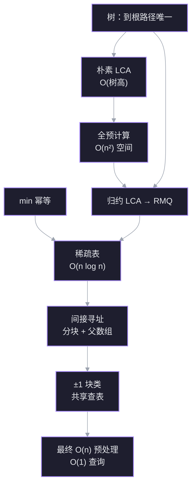

从「树上两点的最低公共祖先」出发，沿一条归约链把问题一路换形：LCA → RMQ → 稀疏表 → 分块 + $\pm1$ 查表。目标不是记住流程，而是每一步都能自己重新推出来：为什么必须换形、为什么换完更好、为什么还差一个 $\log$、最后那半个 $\log$ 又是怎么被消掉的。

材料：视频 [[LCA How to Solve an Impossible Problem (with Data Structures)]]（`Ref/`），以及 Harel–Tarjan、Bender–Farach-Colton 的原始结果。

> [!note] 问题的来历
> Aho–Hopcroft–Ullman 1973 年提出该问题；1984 年 Harel–Tarjan 首次做到 $O(n)$ 预处理、$O(1)$ 查询。视频说「十余年才有解」略过了一批更早的次优解（AHU 的 $O(n\log n)$、Tarjan 的离线并查集），准确说法是：**问题 1973 年提出，最优在线界 11 年后才拿到**。另外 $O(1)$ 依赖单位代价字 RAM 模型。

## 依赖图



读图顺序就是学习顺序。两条根（U1、U2）是你按字面就能接受的事实；每往下一层，只问「上一块已经成立，为什么自然会走到这一步」。

## 探针：先找边缘

> [!question] 1. 一棵 100 万节点的链状树，用「两点各自往上走直到相遇」找 LCA，单次查询最坏多少步？

> [!success]- ✓ 答对
> $O(n)$。链上深度可达 $n-1$，两个叶子分别在最底端时，要一路走到根才相遇。

> [!question] 2. 设「$A$ 归约到 $B$」表示任何解 $B$ 的算法都能拿来解 $A$。如果 $B$ 已有 $O(n)$ 算法，关于 $A$ 能推出什么？

> [!question] 不知道
> 这正是视频的核心工具，后面单独讲。先记住方向：箭头是「$A \le B$」，信息流从 $B$ 的算法流向 $A$。

> [!question] 3. 数组 `[3,1,4,1,5,9,2,6]`，只预计算了所有长度 4 的区间最小值，能否用两个已算结果拼出下标 1..6 的最小值？

> [!question] 不知道
> 能，而且两块允许重叠：`[1..4]` 与 `[3..6]` 覆盖了整个 1..6。重叠元素在两边都取 min 不影响结果——这条后面会变成稀疏表的全部依据。

> [!question] 4. 树里找第 $k$ 个祖先，除了沿父指针一步步走，有没有更快的预处理做法？

> [!failure]- ✗ 当时的想法：把所有祖先存进哈希表，查询 $O(1)$
> 查询确实是 $O(1)$，但空间 $O(n^2)$：链状树上每个节点都有 $\Theta(n)$ 个祖先。你在追问空间时自己修正成了 $O(n^2)$，说明你已经握住了真正的约束——**查询快必须连预处理和空间一起算**。标准答案是倍增表：存 $2^j$ 级祖先，$O(n\log n)$ 空间、$O(\log n)$ 查询。

> [!question] 5. $n$ 个节点的树，从根出发走遍每条边再回到根，每「到达或经过」一个节点记录一次，序列多长？

> [!question] 不知道
> $2n-1$：每条边向下、向上各经过一次，共 $2(n-1)$ 次，根在起点额外记一次。后面欧拉游走归约的复杂度全靠这个数。

## 无条件真理 1：树中每个节点到根有唯一路径

**为什么现在需要它？** 「公共祖先」和「最低」这两个词，只有在祖先集合是良定义的时候才有意义。这条真理负责把定义钉死；没有它，后面「往上走」这个动作都不合法。

- 树是连通、无环的无向图；指定一个根后，每个非根节点恰好有一个父节点。
- 从任意节点反复取父节点，必然到达根，且这条链唯一——如果存在两条不同的链，它们会围出一个环，与「无环」矛盾。
- **深度** $d(v)$ = $v$ 到根的边数；根的深度为 $0$。
- **祖先** = 这条链上的节点（通常包含节点自身）。**公共祖先** = 同时出现在 $u$、$v$ 两条链上的节点。

关键推论：两条链在根处汇合后完全重合，所以「公共祖先」集合是一条从某个节点一直连到根的全序链。既然全序，「最低」（深度最大）就没有歧义。

## 1. 朴素解法：两条祖先链，从根往下比

**为什么现在需要这个节点？** 它是基准线。后面每一层优化，衡量的都是「比朴素快了多少、付了什么代价」。

**建立。** 由真理 1，每个节点的祖先链是现成的：沿父指针一路向上即可。

- 从 $u$ 出发写出祖先链（自底向上）：$u \to p(u) \to p(p(u)) \to \dots \to \text{root}$。
- 对 $v$ 做同样的事。
- 两条链都反转为从根向下的顺序，从头逐个比较，**最后一个相同的节点**就是 LCA。
- 这等价于：两链的公共前缀的最后一个元素。

**数值例子。** 树：

```
        A(0)
       /    \
     B(1)   C(1)
     / \      \
   D(2) E(2)  F(2)
         |
        G(3)
```

| 查询 | $u$ 的链 | $v$ 的链 | 公共前缀 | LCA |
|---|---|---|---|---|
| LCA(D, G) | D–B–A | G–E–B–A | A, B | **B** |
| LCA(D, F) | D–B–A | F–C–A | A | **A** |
| LCA(E, G) | E–B–A | G–E–B–A | A, B, E | **E** |

第三行说明：**一个节点本身是另一个的祖先时，答案就是它自己**，不需要特判。原因是「祖先」按定义包含自身，两条链在 $E$ 处开始重合，而最后一次共同出现正是 $E$。

**成本。** 写链与比较的总步数是 $d(u)+d(v)$ 的量级，其上界是 $2(n-1)$，所以单次查询最坏 $O(n)$。链状树上取两个最深节点，就是 $\Theta(n)$；平衡树上树高 $\Theta(\log n)$，单次才便宜。**慢的根源是树高可以到 $\Theta(n)$，不是「比较」本身慢。**

> [!question] 检查点：两个节点的所有公共祖先，能否出现「两个公共祖先互不为对方的祖先」的情况？

> [!success]- ✓ 正确
> 不能。两条到根的链在第一个公共点之后完全重合，所以公共祖先集合是一条链；「最低」因此唯一。这条全序性正是朴素法「找最后一个相同节点」合法的原因。

**连接。** 这一节点只用了 U1。它同时暴露了下一条路的动机：查询次数多时，每次重走祖先链是纯浪费——树没变，为什么每次都要重算？预计算的想法自然出现。

## 2. 全预计算：查表 $O(1)$，但表格本身太大

**为什么现在需要这个节点？** 它是「预计算」最直接的想法，也是第一个被否定的想法。它的失败方式很重要：**查询已经最优了，输在预处理和空间上**。后面所有方案都在和这两个量做交易。

**建立。** 既然树是静态的，最朴素的做法是：把所有点对的答案提前算好，存成 $n\times n$ 的表 $M$，查询时直接取 $M[u][v]$。

先去掉冗余：

- **对称性**：$\mathrm{LCA}(u,v)=\mathrm{LCA}(v,u)$，所以上三角和下三角重复，只留一半，约 $n(n-1)/2$ 条。
- **对角线**：$\mathrm{LCA}(u,u)=u$，不用查表。
- 剩下的仍然是 $\Theta(n^2)$ 条。

再算代价：

| 项目 | 量级 | 以 $n=1000$ 为例 |
|---|---|---|
| 要填的条目 | $\Theta(n^2/2)$ | $\approx 5\times 10^5$ |
| 用朴素法逐条填 | 每条 $O(n)$ → 共 $O(n^3)$ | $\approx 10^9$ 步 |
| 即使每条补到 $O(1)$ | 写表本身 $\Theta(n^2)$ | $\approx 5\times 10^5$ 步 + 同样多空间 |

最后一行是致命的：**哪怕有魔法让每条答案瞬间算出，把 $\Theta(n^2)$ 条结果写下来的时间已经超过线性的目标了。** $n=10^6$ 时，$n^2/2=5\times10^{11}$ 条，任何计算机都存不下。

**连接。** 这一节点否定的不是「预计算」，而是「预计算所有点对」。它给出的约束是：预处理必须 $O(n)$ 或 $O(n\log n)$，空间同样；查询要达到 $O(1)$。三个约束同时压住，说明需要换一个**对象**去预计算——不是点对，而是某种更小的结构。这正是归约要做的事。

> [!question] 检查点：用朴素 LCA 逐对填满整张 $n\times n$ 答案表，总时间复杂度？

> [!success]- ✓ 正确
> $\Theta(n^3)$：表里有 $\Theta(n^2)$ 条，每条用 $O(n)$ 的朴素法算。

## 3. 归约：把难问题换成易问题

**为什么现在需要这个节点？** 全预计算说明「直接存答案」空间不够。要突破，只能把问题变成另一个更小的对象上的问题。归约是「换形」的合法手续；没有它，后面就算找到 RMQ 也用不上。

**建立。** 设两个问题 $A$、$B$。

- 若能把 $A$ 的每个实例 $x$ 变换成 $B$ 的一个实例 $f(x)$，并且 $B$ 的答案能还原成 $A$ 的答案，则称 **$A$ 归约到 $B$**，记 $A \le B$。
- 语义：**任何解 $B$ 的算法，都能拿来解 $A$**——先变换，再调用 $B$，再还原。所以 $B$ 容易 $\Rightarrow$ $A$ 也容易。
- 方向口诀：箭头从**难**指向**易**；$A \le B$ 读作「$A$ 不比 $B$ 难」。
- 变换本身的代价要计入总账。若变换是线性的，预处理总量仍保持线性。

视频里先给了一个**反向**例子（$RMQ \le LCA$）：把数组的最小值当根，左右两半的最小值当子树根，递归建树。这样任意区间的端点取 LCA，正好得到区间最小值——因为树根比后代浅，深度顺序天然对应数值顺序。

但它对解题方向没有帮助：它说的是「LCA 的算法能解 RMQ」。我们需要的是相反的那句——**LCA 的算法能不能由 RMQ 的算法得到**。所以真正要造的是 $LCA \le RMQ$：把树变成数组。

> [!question] 已知 RMQ 已经有 $O(n)$ 预处理、$O(1)$ 查询的解法。要解 LCA，应该建立哪个方向的归约？

**连接。** 现在目标改写成：怎样把一棵树**无损地**写成一个数组，使得「两个节点的 LCA」等于「数组某区间的最小值」。下一节的欧拉游走就是在造这个写法。
