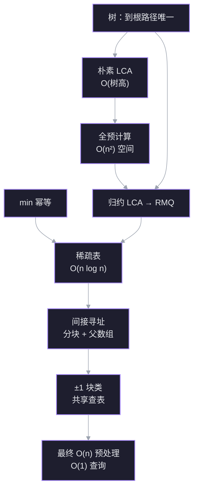
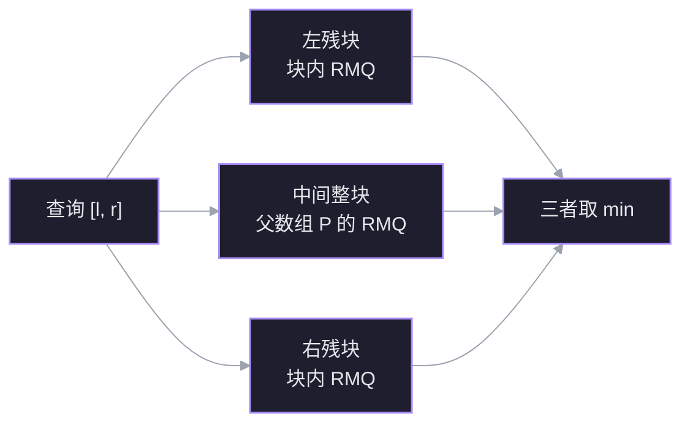
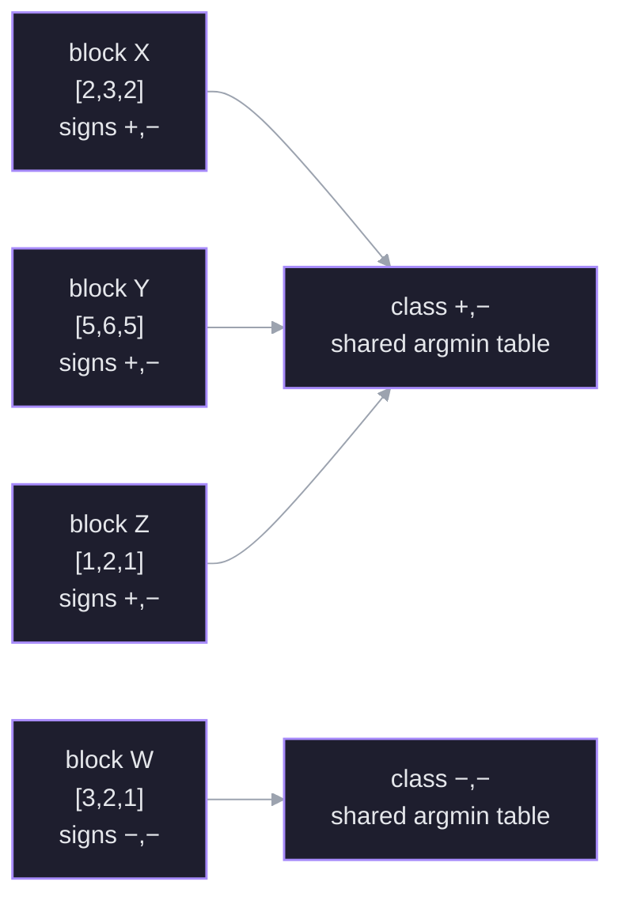
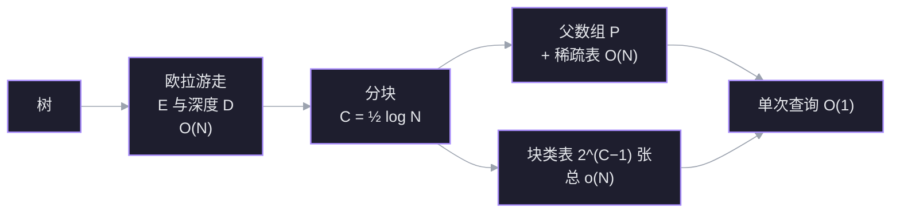

从「树上两点的最低公共祖先」出发，沿一条归约链把问题一路换形：LCA → RMQ → 稀疏表 → 分块 + $\pm1$ 查表。目标不是记住流程，而是每一步都能自己重新推出来：为什么必须换形、为什么换完更好、为什么还差一个 $\log$、最后那半个 $\log$ 又是怎么被消掉的。

材料：视频 [[LCA How to Solve an Impossible Problem (with Data Structures)]]（`Ref/`），以及 Harel–Tarjan、Bender–Farach-Colton 的原始结果。

> [!note] 问题的来历
> Aho–Hopcroft–Ullman 1973 年提出该问题；1984 年 Harel–Tarjan 首次做到 $O(n)$ 预处理、$O(1)$ 查询。视频说「十余年才有解」略过了一批更早的次优解（AHU 的 $O(n\log n)$、Tarjan 的离线并查集），准确说法是：**问题 1973 年提出，最优在线界 11 年后才拿到**。另外 $O(1)$ 依赖单位代价字 RAM 模型。

## 依赖图



读图顺序就是学习顺序。两条根（U1、U2）是你按字面就能接受的事实；每往下一层，只问「上一块已经成立，为什么自然会走到这一步」。

## 探针：先找边缘

> [!question] 1. 一棵 100 万节点的链状树，用「两点各自往上走直到相遇」找 LCA，单次查询最坏多少步？

> [!success]- ✓ 答对
> $O(n)$。链上深度可达 $n-1$，两个叶子分别在最底端时，要一路走到根才相遇。

> [!question] 2. 设「$A$ 归约到 $B$」表示任何解 $B$ 的算法都能拿来解 $A$。如果 $B$ 已有 $O(n)$ 算法，关于 $A$ 能推出什么？

> [!question] 不知道
> 这正是视频的核心工具，后面单独讲。先记住方向：箭头是「$A \le B$」，信息流从 $B$ 的算法流向 $A$。

> [!question] 3. 数组 `[3,1,4,1,5,9,2,6]`，只预计算了所有长度 4 的区间最小值，能否用两个已算结果拼出下标 1..6 的最小值？

> [!question] 不知道
> 能，而且两块允许重叠：`[1..4]` 与 `[3..6]` 覆盖了整个 1..6。重叠元素在两边都取 min 不影响结果——这条后面会变成稀疏表的全部依据。

> [!question] 4. 树里找第 $k$ 个祖先，除了沿父指针一步步走，有没有更快的预处理做法？

> [!failure]- ✗ 当时的想法：把所有祖先存进哈希表，查询 $O(1)$
> 查询确实是 $O(1)$，但空间 $O(n^2)$：链状树上每个节点都有 $\Theta(n)$ 个祖先。你在追问空间时自己修正成了 $O(n^2)$，说明你已经握住了真正的约束——**查询快必须连预处理和空间一起算**。标准答案是倍增表：存 $2^j$ 级祖先，$O(n\log n)$ 空间、$O(\log n)$ 查询。

> [!question] 5. $n$ 个节点的树，从根出发走遍每条边再回到根，每「到达或经过」一个节点记录一次，序列多长？

> [!question] 不知道
> $2n-1$：每条边向下、向上各经过一次，共 $2(n-1)$ 次，根在起点额外记一次。后面欧拉游走归约的复杂度全靠这个数。

## 无条件真理 1：树中每个节点到根有唯一路径

**为什么现在需要它？** 「公共祖先」和「最低」这两个词，只有在祖先集合是良定义的时候才有意义。这条真理负责把定义钉死；没有它，后面「往上走」这个动作都不合法。

- 树是连通、无环的无向图；指定一个根后，每个非根节点恰好有一个父节点。
- 从任意节点反复取父节点，必然到达根，且这条链唯一——如果存在两条不同的链，它们会围出一个环，与「无环」矛盾。
- **深度** $d(v)$ = $v$ 到根的边数；根的深度为 $0$。
- **祖先** = 这条链上的节点（通常包含节点自身）。**公共祖先** = 同时出现在 $u$、$v$ 两条链上的节点。

关键推论：两条链在根处汇合后完全重合，所以「公共祖先」集合是一条从某个节点一直连到根的全序链。既然全序，「最低」（深度最大）就没有歧义。

## 1. 朴素解法：两条祖先链，从根往下比

**为什么现在需要这个节点？** 它是基准线。后面每一层优化，衡量的都是「比朴素快了多少、付了什么代价」。

**建立。** 由真理 1，每个节点的祖先链是现成的：沿父指针一路向上即可。

- 从 $u$ 出发写出祖先链（自底向上）：$u \to p(u) \to p(p(u)) \to \dots \to \text{root}$。
- 对 $v$ 做同样的事。
- 两条链都反转为从根向下的顺序，从头逐个比较，**最后一个相同的节点**就是 LCA。
- 这等价于：两链的公共前缀的最后一个元素。

**数值例子。** 树：

```
        A(0)
       /    \
     B(1)   C(1)
     / \      \
   D(2) E(2)  F(2)
         |
        G(3)
```

| 查询 | $u$ 的链 | $v$ 的链 | 公共前缀 | LCA |
|---|---|---|---|---|
| LCA(D, G) | D–B–A | G–E–B–A | A, B | **B** |
| LCA(D, F) | D–B–A | F–C–A | A | **A** |
| LCA(E, G) | E–B–A | G–E–B–A | A, B, E | **E** |

第三行说明：**一个节点本身是另一个的祖先时，答案就是它自己**，不需要特判。原因是「祖先」按定义包含自身，两条链在 $E$ 处开始重合，而最后一次共同出现正是 $E$。

**成本。** 写链与比较的总步数是 $d(u)+d(v)$ 的量级，其上界是 $2(n-1)$，所以单次查询最坏 $O(n)$。链状树上取两个最深节点，就是 $\Theta(n)$；平衡树上树高 $\Theta(\log n)$，单次才便宜。**慢的根源是树高可以到 $\Theta(n)$，不是「比较」本身慢。**

> [!question] 检查点：两个节点的所有公共祖先，能否出现「两个公共祖先互不为对方的祖先」的情况？

> [!success]- ✓ 正确
> 不能。两条到根的链在第一个公共点之后完全重合，所以公共祖先集合是一条链；「最低」因此唯一。这条全序性正是朴素法「找最后一个相同节点」合法的原因。

**连接。** 这一节点只用了 U1。它同时暴露了下一条路的动机：查询次数多时，每次重走祖先链是纯浪费——树没变，为什么每次都要重算？预计算的想法自然出现。

## 2. 全预计算：查表 $O(1)$，但表格本身太大

**为什么现在需要这个节点？** 它是「预计算」最直接的想法，也是第一个被否定的想法。它的失败方式很重要：**查询已经最优了，输在预处理和空间上**。后面所有方案都在和这两个量做交易。

**建立。** 既然树是静态的，最朴素的做法是：把所有点对的答案提前算好，存成 $n\times n$ 的表 $M$，查询时直接取 $M[u][v]$。

先去掉冗余：

- **对称性**：$\mathrm{LCA}(u,v)=\mathrm{LCA}(v,u)$，所以上三角和下三角重复，只留一半，约 $n(n-1)/2$ 条。
- **对角线**：$\mathrm{LCA}(u,u)=u$，不用查表。
- 剩下的仍然是 $\Theta(n^2)$ 条。

再算代价：

| 项目 | 量级 | 以 $n=1000$ 为例 |
|---|---|---|
| 要填的条目 | $\Theta(n^2/2)$ | $\approx 5\times 10^5$ |
| 用朴素法逐条填 | 每条 $O(n)$ → 共 $O(n^3)$ | $\approx 10^9$ 步 |
| 即使每条补到 $O(1)$ | 写表本身 $\Theta(n^2)$ | $\approx 5\times 10^5$ 步 + 同样多空间 |

最后一行是致命的：**哪怕有魔法让每条答案瞬间算出，把 $\Theta(n^2)$ 条结果写下来的时间已经超过线性的目标了。** $n=10^6$ 时，$n^2/2=5\times10^{11}$ 条，任何计算机都存不下。

**连接。** 这一节点否定的不是「预计算」，而是「预计算所有点对」。它给出的约束是：预处理必须 $O(n)$ 或 $O(n\log n)$，空间同样；查询要达到 $O(1)$。三个约束同时压住，说明需要换一个**对象**去预计算——不是点对，而是某种更小的结构。这正是归约要做的事。

> [!question] 检查点：用朴素 LCA 逐对填满整张 $n\times n$ 答案表，总时间复杂度？

> [!success]- ✓ 正确
> $\Theta(n^3)$：表里有 $\Theta(n^2)$ 条，每条用 $O(n)$ 的朴素法算。

## 3. 归约：把难问题换成易问题

**为什么现在需要这个节点？** 全预计算说明「直接存答案」空间不够。要突破，只能把问题变成另一个更小的对象上的问题。归约是「换形」的合法手续；没有它，后面就算找到 RMQ 也用不上。

**建立。** 设两个问题 $A$、$B$。

- 若能把 $A$ 的每个实例 $x$ 变换成 $B$ 的一个实例 $f(x)$，并且 $B$ 的答案能还原成 $A$ 的答案，则称 **$A$ 归约到 $B$**，记 $A \le B$。
- 语义：**任何解 $B$ 的算法，都能拿来解 $A$**——先变换，再调用 $B$，再还原。所以 $B$ 容易 $\Rightarrow$ $A$ 也容易。
- 方向口诀：箭头从**难**指向**易**；$A \le B$ 读作「$A$ 不比 $B$ 难」。
- 变换本身的代价要计入总账。若变换是线性的，预处理总量仍保持线性。

视频里先给了一个**反向**例子（$RMQ \le LCA$）：把数组的最小值当根，左右两半的最小值当子树根，递归建树。这样任意区间的端点取 LCA，正好得到区间最小值——因为树根比后代浅，深度顺序天然对应数值顺序。

但它对解题方向没有帮助：它说的是「LCA 的算法能解 RMQ」。我们需要的是相反的那句——**LCA 的算法能不能由 RMQ 的算法得到**。所以真正要造的是 $LCA \le RMQ$：把树变成数组。

> [!question] 已知 RMQ 已经有 $O(n)$ 预处理、$O(1)$ 查询的解法。要解 LCA，应该建立哪个方向的归约？

> [!success]- ✓ 正确
> $LCA \le RMQ$：把树变换成数组，用 RMQ 回答问题，再把结果还原成节点。$RMQ \le LCA$ 是反方向，拿到 LCA 的算法解不了 LCA 本身。你在探针 2 卡住的正是这一点，现在已经补上。

**连接。** 现在目标改写成：怎样把一棵树**无损地**写成一个数组，使得「两个节点的 LCA」等于「数组某区间的最小值」。下一节的欧拉游走就是在造这个写法。

## 4. 欧拉游走：把树无损写成数组

**为什么现在需要这个节点？** 归约要求「树 → 数组」且不丢信息。数组上的最小值和树上的祖先关系本来是两套语言；数组元素必须同时携带两样东西：**定位**（这个位置对应哪个节点）和**高低**（谁更靠近根）。深度正好提供后者。

**第一步：中序为什么不够。** 二叉树可以「左–根–右」，根天然夹在左右子树中间；但节点有三个以上孩子时，没有唯一的「中间」位置。视频里的反例：

```
        A
      / | \
     B  C  D
```

$\mathrm{LCA}(B,C)=A$，所以数组里 $A$ 要落在 $B$、$C$ 之间；$\mathrm{LCA}(C,D)=A$，所以 $A$ 还要落在 $C$、$D$ 之间。一个 $A$ 无论放在哪，都只能满足一边。**结论：必须允许节点重复出现。**

**第二步：DFS 欧拉游走。** 从根出发，规则只有两条：

1. 每**到达**一个节点，就把它写进数组；
2. 能往下就往下；无路可走时退回父节点，并把**父节点再写一次**；直到走遍所有边、回到根。

因为每条边向下经过一次、向上经过一次，再加上根在起点的首次记录，数组长度恰好是

$$
n + (n-1) = 2n-1.
$$

这就是探针 5 的答案：每条边贡献两次经过，根额外记一次。

**数值例子。** 沿用第一节的 7 节点树，设 DFS 按字母序访问孩子：

$$
E = [A,B,D,B,E,G,E,B,A,C,F,C,A],\qquad |E|=13=2\cdot7-1.
$$

对应的深度数组逐位对齐：

$$
D = [0,1,2,1,2,3,2,1,0,1,2,1,0].
$$

注意 $D$ 的相邻两项**永远只差 $\pm1$**：欧拉游走每一步要么下到孩子（$+1$），要么退回父亲（$-1$），没有第三种移动。这条性质后面会变成消掉最后一个 $\log$ 的关键。

**第三步：记录首次出现位置。** 对每个节点只存它第一次出现在 $E$ 里的下标：

| 节点 | A | B | C | D | E | F | G |
|---|---|---|---|---|---|---|---|
| `first` | 0 | 1 | 9 | 2 | 4 | 10 | 5 |

这张表在 $O(n)$ 时间内就能建好（遍历一遍 $E$，没记过的记下）。

**第四步：公式。** 对任意两个节点 $u,v$，令 $l=\min(\text{first}[u],\text{first}[v])$、$r=\max(\dots)$，则

$$
\mathrm{LCA}(u,v) = E\Big[\; \arg\min_{i\in[l,r]} D[i] \;\Big].
$$

读法：在**深度数组**上找区间最小值的位置，再回到 $E$ 取该位置的节点。$\arg\min$ 返回的是**下标**，不是深度值——深度只是个用来比较大小的标签。

**数值验证。**

| 查询 | 区间 $[l,r]$ | 区间内 $D$ | 最小深度位置 | 结果 |
|---|---|---|---|---|
| $\mathrm{LCA}(D,G)$ | $[2,5]$ | $2,1,2,3$ | 3 | $E[3]=B$ ✓ |
| $\mathrm{LCA}(D,F)$ | $[2,10]$ | $2,1,2,3,2,1,0,1,2$ | 8 | $E[8]=A$ ✓ |
| $\mathrm{LCA}(E,G)$ | $[4,5]$ | $2,3$ | 4 | $E[4]=E$ ✓ |

第三行是「一个点是另一个的祖先」的情形，公式同样给出 $E$ 自己，不需要特判。

![[viz-lca-euler-tour-1794113962804.svg|800]]

*图：欧拉游走把树变成两条对齐的数组。上行是访问序列 $E$，下行是对应深度 $D$；竖虚线标出各节点的首次出现。查询 $D$–$G$ 只看 `first[D]=2` 到 `first[G]=5`，这段深度的最小值 1 在索引 3，回到 $E$ 得到 $B$。*

**成本。** 游走 $O(n)$、深度数组 $O(n)$、`first` 表 $O(n)$，整个归约线性。到此为止，问题已经变成：**在一个长度为 $2n-1$ 的数组上，做静态区间最小值查询。**

> [!question] 用上面的 $E$ 和 $D$，$\mathrm{LCA}(E,F)$ 是哪个节点？

> [!success]- ✓ 正确
> $A$。`first[E]=4`、`first[F]=10`，区间 $[4,10]$ 的深度是 $2,3,2,1,0,1,2$，最小值 $0$ 出现在下标 $8$，$E[8]=A$。

## 5. 为什么这个归约是对的

**为什么现在需要这个节点？** 公式能算对两个例子，不等于理解它为什么永远对。归约的正确性必须证明，否则后面所有复杂度都是在错误的地基上算的。

**建立。** 要证两件事：区间里**一定含** LCA，且**不会含**比 LCA 更浅的节点。两条合起来，最小深度就只能落在 LCA 上。

**第一件：区间一定含 LCA。** 两个首次出现位置都在 LCA 的子树里。欧拉游走是一段连续的 DFS 轨迹；从 $u$ 的首次出现走到 $v$ 的首次出现，必然要经过连接两点的树路径，而这条路径的中点就是 LCA。所以区间里至少有一个位置记录的是 LCA。

**第二件：区间不会越过 LCA。** 这是更容易出错的一半。关键在于欧拉游走的**块结构**：

- 对任意节点 $x$，从**首次进入** $x$ 到**最后一次离开** $x$ 的这段游走，恰好完整包含 $x$ 的整个子树，且中间不会出现子树外的节点。
- 原因还是 DFS：进入 $x$ 后，游走会把 $x$ 的每个孩子子树依次走完；在所有孩子走完、退回 $x$ 的父节点之前，它不可能跳出这个块。

$u$、$v$ 的首次出现都在这条块内（它们都是 LCA 的后代）。一段以块内两点为端点的连续子序列，不可能包含块外的节点——否则它就得先离开这个块再回来，而离开只有一条路：经过 LCA 的父节点，那已经超出端点所在的连续块了。所以区间里的所有节点深度都 $\ge d(\mathrm{LCA})$。

![[viz-lca-subtree-block-1794113899840.svg|800]]

*图：欧拉游走的子树块。`subtree(B)` 占据连续块 `[1..7]`，`subtree(C)` 占据 `[9..11]`；查询 $D$–$G$ 的区间 `[2..5]` 整段落在 $B$ 块内，最小值只能是 $B$（索引 3）；查询 $D$–$F$ 的区间 `[2..10]` 跨出 $B$ 块，途中经过索引 8 的 $A$（深度 0），最小值变成 $A$。*

**第三件：最小值对应的是 LCA 本身。** 区间最小深度就是 $d(\mathrm{LCA})$，且取到它的位置只能是 LCA 的出现（同深度的其他节点不在 LCA 的子树块内）。所以 $\arg\min$ 无论取哪一个，$E[\cdot]$ 都还原出同一个节点。

**连接。** 归约成立，且三步都是线性的。现在问题完全变成 RMQ：长度为 $N=2n-1$ 的静态数组，多次区间最小值查询。下一节只攻这一个问题。

> [!question] 为什么区间最小值不会取到比 LCA 更浅的节点？

> [!success]- ✓ 正确（借助图 2）
> 因为 `subtree(B)` 在欧拉序列里是一段**连续块** `[1..7]`。`D` 和 `G` 的首次出现都在块内，区间 `[2..5]` 整段被块包住；`A` 在块外的索引 8，连续区间碰不到它。块内最浅的节点就是 `B`，所以最小值只能是 `B`。查询 `D`–`F` 之所以取到 `A`，正是因为它跨出了块、途中经过索引 8 的 `A`。

## 6. 稀疏表：只预计算 2 的幂长度

**为什么现在需要这个节点？** 归约把 LCA 变成了静态 RMQ。RMQ 的全预计算是 $O(n^2)$，和 LCA 的全预计算一样不可行。要突破，必须先找到一个能**少存**的结构。

**无条件真理 2：最小值对重复元素幂等。**

对任意集合 $S$，$\min(S\cup S)=\min(S)$。更一般地，满足 $f(x,x)=x$ 的运算叫**幂等**运算——`min`、`max`、`gcd`、按位与/或都是；**加法不是**（$x+x=2x$）。这条真理是本节全部技巧的许可证：**重复覆盖不会改变答案**。

换一种说法更清楚：`min` 的结果只取决于**出现过哪些值**（集合），不取决于每个值出现几次（多重集）；`sum` 的结果取决于出现次数。重叠会把元素从集合变成多重集：`min` 对此不敏感，`sum` 敏感。

![[viz-lca-idempotence-1794114420791.svg|820]]

*图：同一组重叠块，`min` 与 `sum` 的对照。左块 `[1..4]` 与右块 `[3..6]` 重叠在 `[3..4]`，重叠元素在两边各算一次。`min` 只看出现过哪些值，重复不改变结果；`sum` 把 `1` 和 `5` 各加两次，`11+17=28` 比真实和 `22` 多了重叠部分的 `6`。*

> [!question] min 和 sum 在重叠块上的关键差别是什么？

> [!success]- ✓ 正确
> `min` 只看出现过哪些值，重复出现不改变它（`min(1,1)=1`）；`sum` 还看每个值出现几次，重叠的 `1` 和 `5` 会被各加两次（`11+17=28≠22`）。这就是「幂等」与「非幂等」在算法上的直接后果。

**建立。** 如果查询区间可以拆成两个**可能重叠**的块，而每块的答案都已预计算，那么整个区间的答案就是把两个块答案再取一次 min。

只预计算长度为 $2^k$ 的区间：

$$
st[k][i]=\min\big(A[i],\dots,A[i+2^k-1]\big),\qquad 0\le k\le \lfloor\log_2 n\rfloor.
$$

递推只需一行——长度 $2^k$ 的块由两个长度 $2^{k-1}$ 的相邻块拼成：

$$
st[k][i]=\min\big(st[k-1][i],\;st[k-1][i+2^{k-1}]\big).
$$

查询 $[l,r]$：令长度 $\ell=r-l+1$，取 $k=\lfloor\log_2\ell\rfloor$，则

$$
\mathrm{RMQ}(l,r)=\min\big(st[k][l],\;st[k][r-2^k+1]\big).
$$

为什么恰好两块就够：$2^k\le \ell<2^{k+1}$，所以两个长度 $2^k$ 的块（一个左对齐、一个右对齐）合起来必定覆盖整个区间；中间重叠多少无所谓，因为 min 幂等。

**数值例子。** $A=[3,1,4,1,5,9,2,6]$：

| $k$ | 长度 | 所有预计算值（按起点） |
|---|---|---|
| 0 | 1 | $3,1,4,1,5,9,2,6$ |
| 1 | 2 | $1,1,1,1,5,2,2$ |
| 2 | 4 | $1,1,1,1,2$ |
| 3 | 8 | $1$ |

查询 $[1,6]$（长度 $6$）：$k=\lfloor\log_2 6\rfloor=2$，两块是 $st[2][1]=\min(1,4,1,5)=1$ 与 $st[2][3]=\min(1,5,9,2)=1$，答案 $1$。两块覆盖 `[1..4]` 和 `[3..6]`，重叠的 `[3..4]` 被算了两次，对 min 无影响。

**成本。** 行数 $\lfloor\log_2 n\rfloor+1$，每行最多 $n$ 项，所以表大小 $O(n\log n)$；每项 $O(1)$ 递推，构建 $O(n\log n)$；查询两次查表加一次比较，$O(1)$。比 $O(n^2)$ 好得多，但离线性还差一个 $\log$。

**连接。** 这一节只用了 U2。它也标出了稀疏表的适用边界：凡是幂等运算都能用；求和这类非幂等运算，重叠会重复计数，应改用前缀和或 Fenwick 树。

> [!question] 查询长度 $\ell=6$ 的区间时，两块的长度 $2^k$ 中的 $k$ 是多少？

> [!success]- ✓ 正确
> $k=\lfloor\log_2 6\rfloor=2$，块长 $2^2=4$。两块覆盖 `[1..4]` 和 `[3..6]`，合起来盖住 6 个元素。

## 7. 间接寻址：把数组分成两层

**为什么现在需要这个节点？** 稀疏表已经是 $O(n\log n)$，只差一个 $\log$。这个 $\log$ 来自表的行数——长度 $1,2,4,\dots$ 每一档都要一行。直接的思路是「少存几行」，但任意区间都需要两块拼，行数降不下来。间接寻址换了个方向：**不在原数组上消 $\log$，而是先把数组缩小，让稀疏表作用在一个更小的数组上。**

**建立。** 设数组长度为 $N$——对 LCA 来说 $N=2n-1$，其中 $n$ 是树的节点数。把数组按固定大小 $C$ 切成块，另建一个**父数组** $P$，每个元素是对应块的最小值：

$$
P[j]=\min\big(A[jC],\dots,A[(j+1)C-1]\big),\qquad p=\left\lceil \frac{N}{C}\right\rceil .
$$

$P$ 扫一遍原数组就能建好，$O(N)$。实现上 $P[j]$ 存的是该最小值的**下标**而不是数值（比较时读 $D$ 的值），这样中间整块查到的是位置，能直接映射回 $E$；下面的数值例子为了直观仍写数值。

查询 $[l,r]$ 分两种情况：

1. **完全落在一个块内**：只在这个块里做 RMQ。
2. **跨块**：拆成三段——左残块、中间的若干整块、右残块。左右残块各自在块内查；中间整块的最小值，正好是父数组 $P$ 上的一次 RMQ。三者取 min。



于是问题变成：**父数组能 $O(1)$ 查询，每个块内部也能 $O(1)$ 查询，原数组就能 $O(1)$ 查询。**

**数值例子（取 $C=2$，便于手算）。** $A=[3,1,4,1,5,9,2,6]$，块为 `[3,1] [4,1] [5,9] [2,6]`，父数组 $P=[1,1,5,2]$。查询 $[1,6]$：左残块是列 1 的 `1`，中间整块是块 1、2，对应 $P[1..2]$ 的最小值 $1$，右残块是列 6 的 `2`，三者取 min 得 $1$。

![[viz-lca-indirection-1794115022100.svg|820]]

*图：一次跨块查询的三段分解。原数组按 `C=2` 分成四个 chunk；父数组 $P$ 与 chunk 居中对齐，$P[j]$ 是 chunk $j$ 的最小值。查询 `[1..6]` 被拆成琥珀色的左残块（索引 1）、紫色的中间整块（chunk 1–2，落到 $P[1]$、$P[2]$）、青色的右残块（索引 6）；中间整块在父数组上取 min 得 1，最后与左右残块合并得 1。*

**选块长。** 设每块内部用稀疏表，父数组也用稀疏表：

| 层 | 规模 | 预处理 |
|---|---|---|
| 父数组 $P$ | $p=N/C$ | $p\log p$ |
| 所有块内部 | $N/C$ 块，每块 $C\log C$ | $N\log C$ |

取 $C=\log N$：

$$
p\log p=\frac{N}{\log N}\big(\log N-\log\log N\big)=O(N),\qquad N\log C=N\log\log N.
$$

父数组那层被消成了线性，但块内那层还留着 $N\log\log N$。总的预处理是 $O(N\log\log N)$——比 $O(N\log N)$ 好，但还没到线性。因为 $N=2n-1=\Theta(n)$，写成 $O(n\log\log n)$ 也一样。

**连接。** 这一节给了两条可调的旋钮：**块长 $C$** 和**每层用什么结构**。父数组这层已经压到 $O(N)$；要再进一步，只能让块内那层也不再逐块建表。下一节利用 $\pm1$ 性质，让大量块**共享同一张表**。

> [!question] 查询跨多个块时，「中间整块」这部分用什么来回答？

> [!success]- ✓ 正确
> 父数组 $P$ 上的一次 RMQ。$P[j]$ 已经是 chunk $j$ 的最小值，中间若干整块的最小值就是 $P$ 对应区间的最小值；只有左右不满一块的残块才回到原数组块内查。

## 8. $\pm1$ 块类：让大量块共享同一张表

**为什么现在需要这个节点？** 第 7 节已经把父数组压到 $O(n)$，剩下的 $n\log\log n$ 全部来自「每个块各建一张稀疏表」。要消掉它，必须让块与块之间**共享**预处理结果。

**关键的观察：块不是随机的。** 深度数组来自欧拉游走，相邻两项永远只差 $\pm1$。所以一个长度为 $C$ 的块，除了起始深度，形状完全由 $C-1$ 个符号决定：

$$
\underbrace{[d_0,\ d_0+s_1,\ d_0+s_1+s_2,\ \dots]}_{C\text{ 个深度}},\qquad s_i\in\{+1,-1\}.
$$

块内 RMQ 问的是「区间内哪个位置最浅」。把所有深度同时加上一个常数 $d_0$，**不会改变谁最浅**，只会改变深度数值。所以：

> 块内 RMQ 的答案（最小值的**位置**）只取决于符号串 $(s_1,\dots,s_{C-1})$，与起始深度无关。

形状相同的块，可以共用同一张「区间 → 最小位置」的表。



起始深度不同的 `[2,3,2]`、`[5,6,5]`、`[1,2,1]` 形状相同，块内任意区间的「最小位置」完全一致，所以三块指向同一张表；`[3,2,1]` 的符号是 `−,−`，走另一张表。

![[viz-lca-block-class-1794117098416.svg|900]]

*图：$\pm1$ 块类的共享表（以 $C=4$ 为例）。三个块 `[2,3,2,3]`、`[4,5,4,5]`、`[1,2,1,2]` 的符号串都是 `+−+`，只是起始深度不同；各自减去起始深度后落到同一条规范形状 `[0,1,0,1]`，因此查同一张「局部区间 → 最小位置」表。查询块内 `[1..2]` 得到局部位置 2，映射回三个块分别得到全局下标 2、6、10——答案位置随块平移，表却只有一张。*

**建表成本。** 每个块类需要的是一张长度为 $C$ 的「相对深度」数组上的全部区间答案。用稀疏表建：$C\log C$。块类总数是 $2^{C-1}$（首元素深度不参与分类，只有 $C-1$ 个符号），所以所有类表的总成本：

$$
2^{C-1}\cdot C\log C.
$$

**再选块长。** 第 7 节取 $C=\log N$ 是为了让父数组那层的 $\log$ 抵消；现在这个选择在块类这层会爆炸：$2^{\log N}=N$，总成本变成 $N\log N\log\log N$，比稀疏表还差。

把 $C$ 缩小一半：

$$
C=\frac12\log N\quad\Longrightarrow\quad 2^{C-1}=\frac{\sqrt N}{2},\qquad C\log C=O(\log N\log\log N).
$$

于是类表总成本：

$$
O\!\left(\sqrt N\,\log N\,\log\log N\right)=o(N).
$$

父数组那层只变大一个常数倍：$p=N/C=2N/\log N$，$p\log p=O(N)$。三层加起来：

| 层 | 规模 | 预处理 |
|---|---|---|
| 父数组 $P$ 的稀疏表 | $2N/\log N$ | $O(N)$ |
| 块类表（共享） | $\sqrt N$ 类 | $o(N)$ |
| 每个块指向自己的类表 | $N/C$ 个指针 | $O(N)$ |
| **总计** | | $\mathbf{O(N)}$ |

**连接。** 到此，预处理线性、查询常数、空间线性。四个图拼在一起就是完整算法：树 → 欧拉数组 → 分块 → 父数组稀疏表 + $\pm1$ 块类共享表。

> [!question] 块类总数为什么是 $2^{C-1}$，而不是 $2^C$？

> [!success]- ✓ 正确
> 分类只看形状，形状由 $C-1$ 个相邻符号（$+1/-1$）决定。首元素深度 $d_0$ 只是给整个块加一个常数，不改变任何区间的「最小位置」，所以不参与分类。

> [!question] 为什么 $C$ 从 $\log n$ 减半到 $\tfrac12\log n$，类表总成本就从 $n$ 级降到 $\sqrt n$ 级？

> [!success]- ✓ 正确
> 类数 $2^{C-1}$ 从 $n$ 级降到 $\sqrt n$ 级；每张表的成本只多了一个 $\log\log n$ 因子，仍是 $o(n)$。父数组只是从 $n/\log n$ 变成 $2n/\log n$，仍为 $O(n)$。

## 9. 把四块拼起来

**为什么现在需要这个节点？** 前面每一块都单独成立了，但真正的算法是它们的**组合**；组合时的接口和常数决定了它能不能落地。

**流水线。**



**预处理（全部线性）。** 记树有 $n$ 个节点、欧拉数组长度 $N=2n-1$。

1. DFS 欧拉游走，得到 $E$、$D$，以及每个节点的 `first`。$O(N)$。
2. 按 $C=\tfrac12\log N$ 分块，算每块的 min，建父数组 $P$。$O(N)$。
3. 对 $P$ 建稀疏表（存 argmin 下标）。$p\log p=O(N)$。
4. 枚举全部 $2^{C-1}$ 种 $\pm1$ 形状，每种建一张块内 argmin 表。总 $o(N)$。
5. 为每个块记下它属于哪个类（一个 $O(1)$ 的类编号），查询时直接索引。$O(N)$。

五步是**顺序执行**的，总时间相加：$O(N)+O(N)+O(N)+o(N)+O(N)=O(N)=O(n)$。第 10 节把这个账本逐项算一遍。

**单次查询。**

1. 取 $l=\min(\text{first}[u],\text{first}[v])$、$r=\max(\dots)$。
2. 若 $l,r$ 同块：用该块的类表直接得到块内 argmin，映射回 $E$ 的下标。$O(1)$。
3. 否则拆三段：左残块、中间整块、右残块。
   - 左、右残块：各自的类表，$O(1)$；
   - 中间整块：父数组 $P$ 上的稀疏表，$O(1)$；
   - 三者比较取最小。
4. 把得到的位置代回 $E$，得到 LCA 节点。

**三个技巧各自的适用条件。** 这张表比结论本身更值得记：

| 技巧 | 在本算法中的角色 | 成立的前提 |
|---|---|---|
| 归约 | 树 → 欧拉数组，LCA → RMQ | 变换要保结构：DFS 的**子树连续块**保证区间不越界 |
| 稀疏表 | 静态 RMQ，$O(N\log N)$ | 运算必须**幂等**（`min`/`max`/`gcd`/按位与或），重叠才安全 |
| 间接寻址 | 分块 + 父数组，把两层解耦 | 子问题要**可共享**：$\pm1$ 形状只有 $2^{C-1}$ 种 |

**值不值得。** 视频结尾自己也承认这是 overkill：实务里倍增表（$O(n\log n)$ 预处理、$O(\log n)$ 查询）或欧拉游走 + 稀疏表（$O(n\log n)$ 预处理、$O(1)$ 查询）通常就够了。$O(n)$ 构造的价值在于：它把「归约」「幂等」「间接寻址 + 共享子问题」三件通用工具串成了一个可复用的思维模板。

> [!question] 这套算法里，哪一步直接依赖「`min` 是幂等的」？

> [!success]- ✓ 正确
> 稀疏表的重叠块。查询区间被两个长度 $2^k$ 的块覆盖，重叠部分会被 `min` 算两次；因为 `min` 幂等，结果不变。欧拉归约依赖的是 DFS 的子树连续块，分块依赖的是子问题可共享，都不直接依赖幂等。

一句话串起来：**归约把树变成数组，幂等让稀疏表能用重叠块，间接寻址把 $\log$ 降成 $\sqrt N$ 级（即 $\Theta(\sqrt n)$），最后 $\pm1$ 让子问题只有 $\sqrt N$ 种形状。** 四个想法单独看都是常见工具，组合起来才把「不可能的 $O(n)$」变成现实。

## 10. 复杂度账本：为什么是相加，不是相乘

**为什么现在需要这个节点？** 前面每节的复杂度都是单独算的，最后却直接写「总 $O(n)$」。这一步最容易含糊：五个预处理阶段，凭什么不是 $O(N)\times O(N)\times\cdots$？答案取决于两个阶段是**顺序**关系还是**嵌套**关系。

**先统一记号。** 树有 $n$ 个节点；欧拉数组长度 $N=2n-1$。因为 $N=\Theta(n)$，$O(N)$ 与 $O(n)$ 等价；下面用 $N$ 写公式，最后换回 $n$。令 $L=\log_2 N$，块长 $C=\tfrac12 L$。

### 10.1 相加的规则

顺序执行的阶段，总代价是各阶段代价之**和**：

$$
T(N)=T_1+T_2+T_3+T_4+T_5.
$$

理由很朴素：第 2 阶段拿到的是第 1 阶段的**输出**（一个长度为 $N$ 的数组），不是把第 1 阶段在每个节点上重跑一遍。两个阶段独立分析，只是指「可以分开算、不会互相改变量级」，不是说「两个量级要相乘」。

乘法只在一种结构里出现：**同一个操作被另一个集合的每个元素重复触发**。也就是代码里的嵌套循环：

```text
for x in X:          # |X| 次
    do_work(x)       # 每次 O(Y)
# 总代价 = |X| × O(Y)
```

本算法里真正出现乘法的地方只有两处：

- 父数组稀疏表：$p\log p$ 个表项，每项 $O(1)$ → $p\log p\times O(1)=O(N)$；
- 块类表：$2^{C-1}$ 个类，每类建一张 $C\log C$ 的表 → $2^{C-1}\times C\log C$。

其余阶段都是顺序的「扫一遍」，不加乘。

### 10.2 逐项算账

| # | 阶段 | 作用对象 | 公式 | 代入 $C=\tfrac12 L$ 后 | 量级 |
|---|---|---|---|---|---|
| 1 | 欧拉游走 | 树的 $n$ 个节点、$2(n-1)$ 条边 | 首次进入 $n$ 次、退回记录 $n-1$ 次、边移动 $2(n-1)$ 次 | $n+(n-1)+2(n-1)$ | $O(N)$ |
| 2 | 块最小值 / 父数组 | 数组的 $N$ 个元素 | 扫一遍，每个元素进一次 min | $N$ | $O(N)$ |
| 3 | 父数组稀疏表 | $p=N/C$ 个块 | $p\log p$ 个表项 × $O(1)$ | $\frac{2N}{L}\left(L-\log L\right)$ | $O(N)$ |
| 4 | 块类表 | $2^{C-1}$ 个类 | 每类 $C\log C$ | $\frac{\sqrt N}{2}\cdot\frac{L}{2}\log L$ | $o(N)$ |
| 5 | 块 → 类指针 | $p=N/C$ 个块 | 每块 $O(1)$ 记类号 | $\frac{2N}{L}$ | $O(N)$ |

逐项展开：

**第 1 项（欧拉游走）。** DFS 首次进入 $n$ 个节点各记一次，退回父节点时再记 $n-1$ 次，每条边向下、向上各移动一次：

$$
T_1=\underbrace{n}_{\text{首次进入}}+\underbrace{(n-1)}_{\text{退回记录}}+\underbrace{2(n-1)}_{\text{边移动}}=4n-3=O(n)=O(N).
$$

**第 2 项（块最小值）。** 每个元素只被读一次，块内维护当前 min：

$$
T_2=N=O(N).
$$

这里不要写成「块数 $\times$ 块长再乘别的阶段」——块数 $\times$ 块长 $=(N/C)\cdot C=N$，这个乘法只是把「每个元素一次」换个说法。

**第 3 项（父数组稀疏表）。** $p=N/C=2N/L$：

$$
T_3=p\log p=\frac{2N}{L}\big(L-\log L+O(1)\big)=2N\left(1-\frac{\log L}{L}+O\!\left(\frac1L\right)\right)=O(N).
$$

括号里的 $-\log L/L$ 是负的、趋近于 $0$，所以 $T_3$ 是 $2N$ 减去一个低阶项，仍是 $O(N)$。

**第 4 项（块类表）。** 类数 $2^{C-1}=2^{L/2-1}=\sqrt N/2$，每类表 $C\log C=\frac L2\log\frac L2=O(L\log L)$：

$$
T_4=2^{C-1}\cdot C\log C
=\frac{\sqrt N}{2}\cdot O(L\log L)
=O\!\left(\sqrt N\,L\log L\right).
$$

它为什么是 $o(N)$：把比值写出来，

$$
\frac{T_4}{N}=O\!\left(\frac{L\log L}{\sqrt N}\right)\xrightarrow{N\to\infty}0.
$$

分子是对数级、分母是 $\sqrt N$ 级，所以 $T_4$ 严格小于任何正常数倍的 $N$。

**第 5 项（指针）。** 每个块存一个类编号：

$$
T_5=\frac{N}{C}\cdot O(1)=\frac{2N}{L}=O(N).
$$

**总和。** 五项相加：

$$
T(N)=O(N)+O(N)+O(N)+o(N)+O(N)=O(N).
$$

最后换回树的规模：$N=2n-1=\Theta(n)$，所以 $T(n)=O(n)$。

### 10.3 数值感受

取 $n=2^{20}\approx 1.05\times10^6$，则 $N\approx2.10\times10^6$，$L\approx21$，$C\approx10$，$p\approx2.1\times10^5$：

| 阶段 | 操作次数（约） | 占总和 |
|---|---|---|
| 欧拉游走 | $2.1\times10^6$ | 26% |
| 块最小值 | $2.1\times10^6$ | 26% |
| 父数组稀疏表 | $3.7\times10^6$ | 46% |
| 块类表 | $1.7\times10^4$ | 0.2% |
| 指针 | $2.1\times10^5$ | 2.6% |
| **合计** | $\approx8.1\times10^6$ | 100% |

块类表那一项只有约 $17$k 次操作，连总和的 $0.2\%$ 都不到——**这就是 $o(N)$ 的直观含义：有它没它，总量级不变。** 相比之下，直接在长度 $N$ 的数组上建稀疏表要约 $N\log N\approx4.4\times10^7$ 次操作，多了一个 $\log$ 因子。

### 10.4 空间账本

空间同样是相加：

| 结构 | 大小 | 量级 |
|---|---|---|
| 欧拉数组 $E$、深度数组 $D$ | 各 $N$ | $O(N)$ |
| `first` 表 | $n$ | $O(n)\subset O(N)$ |
| 父数组 $P$ | $p=N/C$ | $O(N/\log N)$ |
| 父数组稀疏表 | $p\log p$ | $O(N)$ |
| 块类表 | $2^{C-1}\cdot C\log C$ | $o(N)$ |
| 块 → 类指针 | $p$ | $O(N/\log N)$ |
| **合计** | | $\mathbf{O(N)}$ |

### 10.5 一张图记住规则

- **顺序 → 相加**：五个 pass 一个接一个，后一个用前一个的输出。
- **嵌套 → 相乘**：`for each x in X: work(x)`，或「每个类建一张表」。
- **独立分析 ≠ 相乘**：独立性只是让你能分别估界，然后把界加起来。

对照第 2 节的全预计算：那里是 $n^2$ 个点对，每对跑一次 $O(n)$ 的朴素 LCA，嵌套关系是「对每个点对 → 爬一次祖先链」，所以是 $n^2\times n=n^3$。本算法没有这种嵌套：Euler 游走只跑一次，分块只扫一次，父数组稀疏表只在 $p$ 个块上建一次。

![[viz-lca-cost-add-vs-multiply-1794116255776.svg|900]]

*图：左栏是顺序流水线，五段代价相加；右栏是嵌套重复，点对数乘以单次爬链代价得到 $O(n^3)$。独立性只允许分开估界，不产生乘法。*

![[viz-lca-cost-breakdown-1794116112339.svg|900]]

*图：$n=2^{20}$ 时的逐项成本（对数横轴点图）。块类表约 $17$k 次操作，只占总和的 $0.2\%$；总和由三个 $O(N)$ 项主导，约为 $8.1$M。*

> [!question] 第 2 阶段「块最小值」的成本，应该写成「块数 × 块长」，还是直接写 $O(N)$？两者矛盾吗？

> [!success]- ✓ 正确
> 两者等价：$(N/C)\times C=N$。这是**阶段内部**的「每个块扫 $C$ 个元素」，不是把第 2 阶段去乘第 1 或第 3 阶段。阶段之间是顺序关系，代价相加。

一句话：**顺序相加，嵌套相乘；独立分析只意味着可以分开估界，不意味着相乘。**
