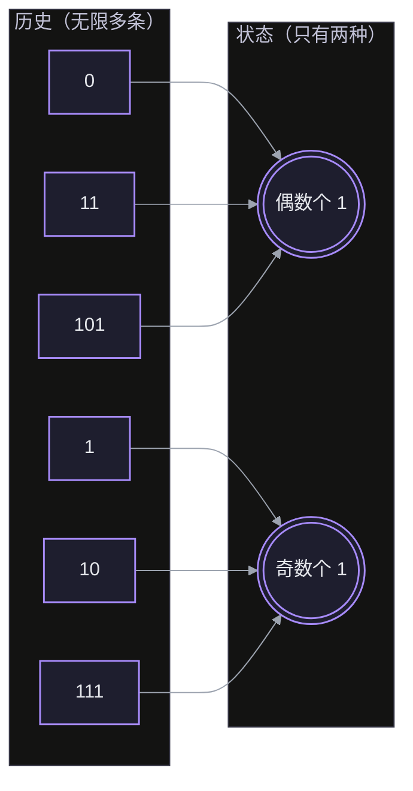
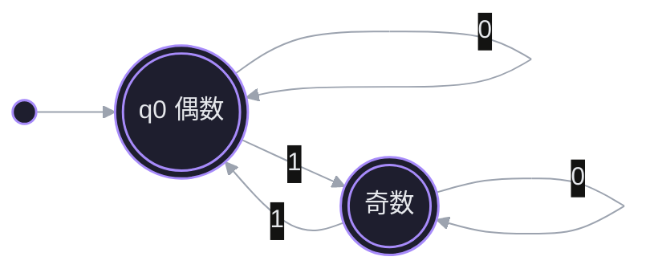
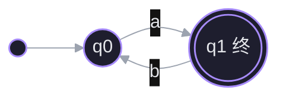
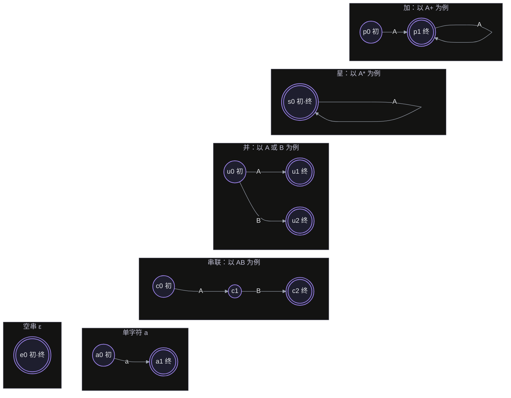
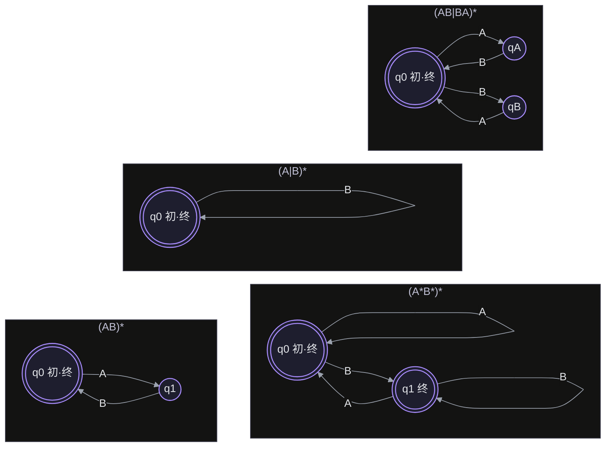
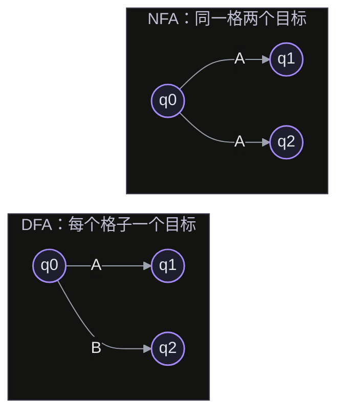
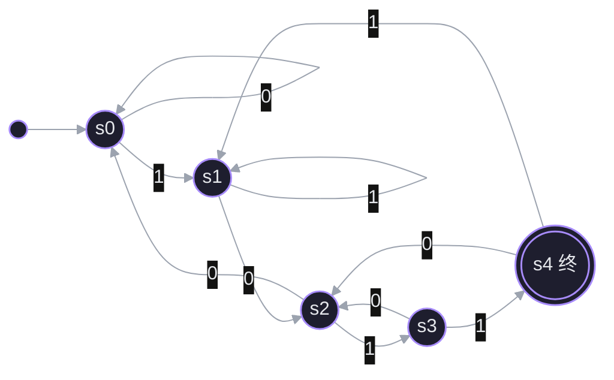
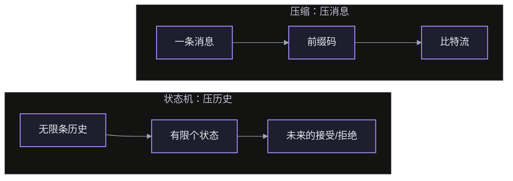
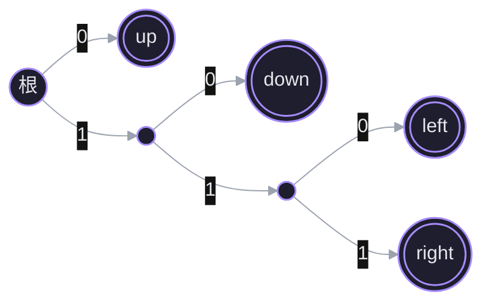

有限状态机把「已经收到什么」记成一个状态，用带标签的有向边表示下一个输入如何改变状态。

## 探针：正则语义

> [!question] (AB)* 定义的语言是下面哪一个集合？
> - A：至少一个 AB，以及任意多个 AB 串联成的串
> - B：A 和 B 任意排列组成的串
> - C：空串，以及任意多个 AB 串联成的串
> - D：我不知道

> [!failure] ✗ 不对
> 正解是 C。`*` 是「重复 0 次或多次」，0 次就是空串，所以空串必须在语言里。A 描述的是 `+`——「重复 1 次或多次」。两者只差空串这一个元素。

> [!question] 下面哪个串属于 A* 但不属于 A+？
> - A：A
> - B：空串
> - C：AA
> - D：我不知道

> [!success] ✓ 正确
> `A*` 允许 0 次重复，`A+` 不允许，所以唯一的差集就是空串。

> [!question] (A|B)* 定义的语言是下面哪一个集合？
> - A：只由 A 和 B 交替组成的串，包括空串
> - B：单个 A 或单个 B，以及空串
> - C：由 A、B 组成的任意串，包括空串
> - D：我不知道

> [!failure] ✗ 不对
> 正解是 C。`(A|B)` 每一步都可以重新选，前一步选了什么不影响下一步，所以 AAB、ABBA 都合法。交替是额外约束，要靠「记住上一位」实现——状态机要多带信息。

> [!question] 下面哪个串属于 A(BC)*？
> - A：ACB
> - B：ABC
> - C：ABCB
> - D：我不知道

> [!success] ✓ 正确
> `A(BC)*` 只允许 A 后面跟若干个完整的 BC 块；ACB 少了 B，ABCB 末尾多了一个 B。

> [!question] (A|B)* 与 (A*B*)* 定义的语言相同吗？
> - A：不相同，后者少了某些串
> - B：不相同，后者多了某些串
> - C：相同
> - D：我不知道

> [!failure] ✗ 不对
> 正解是 C。`(A*B*)*` 的每一轮都可以重新先读 A 再读 B，所以 ABAB 可以拆成 (AB)(AB)。两个表达式生成的是同一个语言：{A, B} 上所有串。你选的 A 相当于认为「只能经历一次 A→B」——但外层 `*` 允许反复进入 A*。

> [!question] 逐位读入一个二进制串，要判断 1 的个数是奇数还是偶数，最少需要几个状态？
> - A：1
> - B：2
> - C：4
> - D：我不知道

> [!success] ✓ 正确
> 只需要「奇数」「偶数」两个状态：读入 0 状态不变，读入 1 在两个状态间翻转。状态数由「需要记住的历史有多少种」决定，不由历史长度决定。

## 1. 状态：把历史压成有限种情况

判定一个串是否属于某个语言，要求只从左到右读一遍、内存有限——不可能把整条历史都记住，只能压缩。

- 压缩的判据：两个不同的历史，只要**对之后任何输入的处理结果都相同**，就没有理由分开，可以合并成一个状态。
- 这就是状态机的核心约束：下一状态只由 $\delta(\text{当前状态},\ \text{当前输入})$ 决定，过去的影响全部藏在当前状态里。
- 奇偶例子：前缀 `101` 和 `1` 都含奇数个 1，之后无论接什么，最终奇偶都一致——它们是同一个状态。历史条数无限，状态数只要 2。

历史条数无限，状态只留两种：



> [!success] ✓ 正确
> 合并的判据只看未来：对任意后续输入，两个历史的接受结果必须完全一致。长度、1 的个数都只是表面特征，不构成合并的理由。

压缩后的机器只有两个状态：



## 2. 五元组与图表示

把「状态 + 输入决定下一步」写成可计算的对象，只需要五样东西：

$$
M = (Q,\ \Sigma,\ \delta,\ q_0,\ F)
$$

- $Q$：有限状态集合
- $\Sigma$：输入字母表
- $\delta: Q \times \Sigma \to Q$：转移函数，给「当前状态 + 当前输入」返回下一状态
- $q_0 \in Q$：初态，只有一个
- $F \subseteq Q$：终态集合，可以多个，也可以是空集

图的画法：顶点是状态，边是转移、标签是输入符号；初态用一根没有起点的入箭头标出，终态画双圈。



**接受的定义**：读完整条输入串后，停在 $F$ 里的状态就接受，否则拒绝。注意判据是「读完时的状态」，不是「途中经过过终态」。

> [!success] ✓ 正确
> 空串读完不需要任何转移，停在 $q_0$；既然 $q_0 \in F$，空串就被接受。除此之外还可能接受别的串（比如自环回 $q_0$ 的那些），所以是「至少」。

## 3. 正则的基本形式 → 机器

正则描述一组串，机器判定一个串是否属于这组串。Kleene 的构造是：先给每个算子一台最小机器，再按表达式结构拼装。

| 正则 | 机器 |
|---|---|
| $\varepsilon$ | 一个状态，既是初态也是终态 |
| $a$ | 初态 $\xrightarrow{a}$ 终态 |
| $RS$ | 把 $R$ 的终态接到 $S$ 的初态 |
| $R \mid S$ | 初态分出两条路，分别走 $R$、$S$ |
| $R^*$ | 初态同时是终态；终态加一条回初态的边 |
| $R^+$ | 同星号，但初态**不是**终态 |

### 六种基本构造的图



星号和加号的机器只差一处：初态是不是终态。回边负责「重复」，初态是否终态负责「零次」。这也解释了探针第一题：`(AB)*` 的空串来自「一步都不走就停在初态」。

> [!success] ✓ 正确
> 回边提供重复，初态不在 $F$ 保证至少走一次。两者合起来就是「一个或更多」。

## 4. 复合正则：外层星是「回到入口」

探针里把 `(A*B*)*` 读成「只能走一遍 A→B」，问题出在外层 `*` 的机器长什么样。

- 内层 `A*B*`：$q_0$ 接受若干 A，$q_0 \xrightarrow{B} q_1$ 接受若干 B；$q_0$、$q_1$ 都是终态（B 可以是 0 个）。
- 外层 `*`：在每个终态上加一条回到 $q_0$ 的边。于是每读完一轮，机器可以回到 $q_0$——**A 又被允许了**。
- 读 `ABAB`：$q_0 \xrightarrow{A} q_0 \xrightarrow{B} q_1$，经回边回到 $q_0$，再 A、再 B。所以 ABAB 属于。
- 两边相等：每个 $A^*B^*$ 块都是 $\{A,B\}$ 上的串，拼起来仍在 $(A|B)^*$ 里；反过来任何 $\{A,B\}$ 串都能按 A 段 / B 段切开，每段正好是 $A^*B^*$ 的一轮。两个表达式都等于 $\Sigma^*$。

一般原则：**星号不是「重复同一段」，而是「随时可以回到这台子机器的入口」**。

### 四台机器



- `(AB)*`：每轮必须 A 后跟 B；空串合法。
- `(A|B)*`：一个状态，A、B 都是自环，所以是任意串。
- `(A*B*)*`：`q0` 收 A 段，`q0 --B--> q1` 收 B 段；`q1 --A--> q0` 就是外层星的「回到入口」，A 又重新被允许。
- `(AB|BA)*`：`qA` 是「已看到 A，等 B」，`qB` 是「已看到 B，等 A」。

读 `ABBA`：

- `(AB|BA)*`：`q0 -A→ qA -B→ q0 -B→ qB -A→ q0`，最后停在终态，属于。
- `(A*B*)*`：`q0 -A→ q0 -B→ q1 -B→ q1 -A→ q0`，回到终态，属于。
- `(AB)*`：`q0 -A→ q1 -B→ q0`，第二个 `B` 在 `q0` 没有出边，卡死——不属于。

> [!question] 在 `(A*B*)*` 的机器上逐位读 `ABBA`，最后停在哪个状态？
> - A：q1
> - B：q0
> - C：中途卡死
> - D：我不知道

> [!success] ✓ 正确
> A 段停在 `q0`，`B` 到 `q1`，第二个 `B` 自环留在 `q1`，最后的 `A` 走 `q1 --A--> q0` 回入口。停在 `q0`，是终态——这条回边就是外层星。

## 5. 转移表与确定性

状态图给人看，转移表给机器算。行是状态，列是输入符号，格子里写 $\delta(q,a)$。以 `(A*B*)*` 为例：

| $\delta$ | $A$ | $B$ |
|---|---|---|
| $q_0$（初·终） | $q_0$ | $q_1$ |
| $q_1$（终） | $q_0$ | $q_1$ |

**确定性**：每个「状态 × 符号」的格子**恰好一个**状态——不能空，也不能写两个。

- 图上的表现：同一状态出发、同一标签只有一条边。
- 两条同标签出边 → 非确定（NFA）；一条都没有 → 不完整。拒绝靠「读完停在非终态」，不靠「查不到表」。
- 确定性的好处：执行就是查表循环，读一位查一次，不需要记住备选路径，也不需要回溯。

术语：**DFA** = deterministic finite automaton，确定有限自动机，就是上面这种「每个格子恰好一个状态」的机器；**NFA** = nondeterministic finite automaton，非确定有限自动机，允许同一状态同一符号有多个目标，或允许 $\varepsilon$ 边（不读输入也能跳）。



> [!question] 一台机器的 `q0` 有两条 `A` 出边，分别指向 `q1` 和 `q2`。它是 DFA 吗？
> - A：是，状态数仍然有限
> - B：是，只要一个目标能到终态
> - C：不是，同一状态同一符号有两个目标
> - D：我不知道

> [!success] ✓ 正确
> 正解 C。DFA 的转移函数 $\delta$ 是「状态 × 符号 → 一个状态」；同一格出现两个目标，就是 NFA 的定义特征。确定性说的是「下一步唯一」。

## 6. 真实例子：以太网怎么找到帧头

以太网帧开头是 7 字节前导码，每字节 `10101010`，接着 1 字节 SFD `10101011`。接收端不知道字节边界，只能逐位读。它要找的模式是「一串交替的 `10`，紧接 `11`」：

```
(10)+11
```

机器在读到模式结尾时就接受；把前面的任意前缀也算进去，它识别的语言是 $\Sigma^*(10)^+11$。状态只需要记住「当前后缀匹配到模式的哪一段」：

| 状态 | 含义 |
|---|---|
| $s_0$ | 没有可用前缀（起点，或刚断掉） |
| $s_1$ | 后缀 `1` |
| $s_2$ | 后缀 `10` |
| $s_3$ | 后缀 `101` |
| $s_4$ | 后缀 `1011`，接受 |

| $\delta$ | 0 | 1 |
|---|---|---|
| $s_0$ | $s_0$ | $s_1$ |
| $s_1$ | $s_2$ | $s_1$ |
| $s_2$ | $s_0$ | $s_3$ |
| $s_3$ | $s_2$ | $s_4$ |
| $s_4$（终） | $s_2$ | $s_1$ |

同一张表的图形版：



关键一行：$s_3 \xrightarrow{0} s_2$。读到 `1010` 时，末尾的 `10` 仍然是模式的合法开头，所以回 $s_2$ 而不是起点——**失配不等于清零**。

对比 `Σ*10Σ*11`：它只要求「先出现 `10`，之后某处出现 `11`」，中间可以隔任意符号。那是「两个模式先后出现」，不是连续序列检测；连续性由正则的拼接保证，不由 $\Sigma^*$ 保证。

> [!question] `(10)+11` 与 `Σ*10Σ*11` 描述的是同一个语言吗？
> - A：不是，前者要求连续交替块，后者允许中间隔任意符号
> - B：是，两者都要求出现 10 和 11
> - C：不是，前者不允许空串，后者允许
> - D：我不知道

> [!success] ✓ 正确
> 正解 A。`Σ*10Σ*11` 把 `10`、`11` 当成两个先后出现的模式，中间隔着什么都行；`(10)+11` 把整段当成一个连续块。状态机检测的是连续输入，所以用后者。

## 7. Kleene：正则、DFA、NFA 是同一类语言

- 正则 → 机器：第 3 节的构造，每个算子一台小机器，按表达式结构拼装。
- DFA → 正则：把状态当未知数、边当方程，消去状态就能解出正则表达式。
- NFA → DFA：NFA 读一位后可能同时处在多个状态；把「同时可能的集合」当成一个**新状态**，就得到 DFA。这叫**子集构造**。
  - 例：`q0 --A--> q1` 和 `q0 --A--> q2` 并存；读 `A` 后同时在 $\{q_1,q_2\}$，这个集合就是 DFA 的一个状态。
  - 代价：$n$ 个状态的 NFA 最多变成 $2^n$ 个状态的 DFA；实际通常远少于这个上界。

**Kleene 定理**：正则表达式、DFA、NFA 三种描述能力完全相同，都恰好刻画「正则语言」。

> [!question] 把 NFA 变成 DFA 的核心操作是什么？
> - A：删掉多余的边
> - B：给每个状态加自环
> - C：把可能的状态集合当成一个新状态
> - D：我不知道

> [!success] ✓ 正确
> 正解 C。NFA 读一位后同时在多个状态，就把这个**集合**整体当成 DFA 的一个状态；之后每一步再用同样的方式展开。

## 8. 最少几个状态：可区分的才分开

第 1 节的合并判据现在可以精确说出来：两个前缀 $x,y$ 属于同一个状态，当且仅当对**任意**后缀 $z$，$xz$ 与 $yz$ 的接受结果相同。

- 这个关系叫**右同余**（Myhill–Nerode）：只从右边接东西来区分。
- 等价类就是状态；**最小 DFA 的状态数 = 等价类个数**。
- 例：检测器里的 `10` 和 `1010`——对任意后续输入，两者的接受结果都一致，所以合并成 $s_2$。表里 $s_3 \xrightarrow{0} s_2$ 不是「回退一步」，而是「落进同一个等价类」。
- 奇偶例子：偶数个 1 与奇数个 1 不等价（一个接空串接受，一个不接受），所以至少 2 个状态。
- 直觉：一个状态 = 对未来的一个承诺；承诺不同，才配分成两个状态。

> [!question] 为什么检测器里的 `10` 和 `1010` 能共用一个状态？
> - A：它们的长度都是偶数
> - B：它们后续的接受结果完全相同
> - C：它们都以 0 结尾
> - D：我不知道

> [!success] ✓ 正确
> 正解 B。合并不看长度、结尾这类表面特征，只看「对任意后缀的接受结果是否一致」——这就是右同余等价类。

## 9. 和熵、压缩的关系

和 [[信息论 熵与压缩]] 是同一套想法的两个方向：一个把**历史**压成状态，一个把**消息**压成比特。两条流水线做的是同一个动作：



- **状态 = 充分统计量**。最小 DFA 合并「对未来没有区别」的历史；熵那边问「平均要多少 bit 描述一个随机结果」，这边问「要记住多少种历史才能不丢未来」。两者都只保留对后续有影响的部分。
- **前缀码解码器就是有限状态机**。码树的内节点是状态，读一位走一条边，到叶子输出符号并回到根；「没有码字是另一个码字的前缀」等价于「码字都在叶子上」，所以解码不回溯。熵笔记里「长度 $L$ 的码字占 $2^{-L}$ 的概率空间」和 Kraft 不等式，说的就是这棵树的叶子预算。

  月球机器人的码树（`up=0`、`down=10`、`left=110`、`right=111`）：



- **熵率需要状态**。语言有强上下文依赖，n-gram 模型的状态就是「最近 $n-1$ 个字符」；给状态配上转移概率，熵率 $H=\sum_s \pi(s)\,H(\text{next}\mid s)$ 就是每符号的平均信息量。LLM 的上下文是同一个角色的超大状态。
- **不要直接等起来**。Shannon 熵是**分布**的平均不确定性；最小 DFA 的状态数是**语言**的结构复杂度，本身不带概率。给机器配上输入分布后，状态才成为随机变量，$\log_2 n$ 是它的上界（状态均匀时取等）。单条串的压缩对应的是 Kolmogorov 复杂度，不是 Shannon 熵。

一句话：**状态是对未来的压缩，熵是压缩的代价**。LLM 的「预测即压缩」是这条线在概率侧的样子；最小 DFA 是它在确定性侧的最小骨架。
