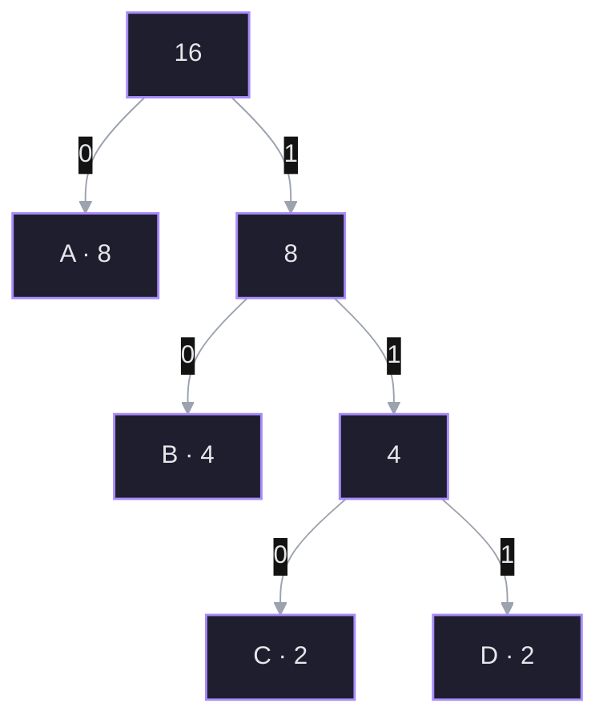
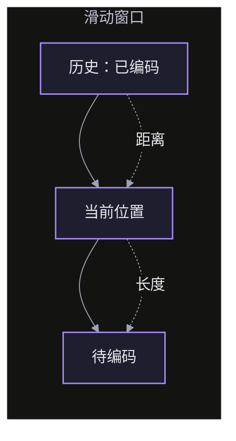
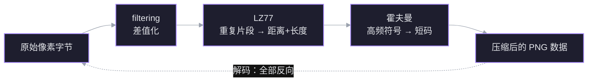

PNG 不删任何像素，只是不断把同一份信息换一种更容易压的写法：先把相邻像素的差变成主体，再用「以前出现过」和「出现得更频繁」两层编码收尾。

> 材料：[[PNG 靠什么统治无损图像 30 年]]（视频转录）

## 1. 问题：什么都不删，文件怎么变小

有损压缩（JPEG）主动丢掉一部分信息，换更小的文件；无损压缩（PNG）要求解码后每个像素与原图逐位相同。既然不能删，能利用的只剩**冗余**：

- 频率冗余：有些字节值出现得多，有些很少。
- 空间冗余：相邻像素高度相关，大片区域几乎不变。
- 重复冗余：同一段字节序列在后面再次出现。

三种冗余对应三件工具：霍夫曼、filtering、LZ77。它们不是三个竞争方案，而是流水线上前后相接的三道工序。

## 2. 霍夫曼编码：只利用「谁出现得多」

做法：

1. 统计每个符号的频率。
2. 每次取频率最低的两个节点合并，新节点频率为二者之和，放回队列。
3. 重复到只剩一个根。左走记 0，右走记 1。

高频符号离根近，编码就短。

数例：四个值 $A,B,C,D$ 出现次数 $8,4,2,2$，共 16 个符号。

码长 $A=1,\ B=2,\ C=3,\ D=3$，平均长度

$$
\frac{8\cdot1+4\cdot2+2\cdot3+2\cdot3}{16}=\frac{28}{16}=1.75\ \text{bit}
$$

定长编码要 2 bit，省下 12.5%。

**代价**：解码器必须知道码表。码表本身要存进文件，所以小数据上开销可能吃掉收益——这也是后面要说的「压缩不是无条件划算」。

## 3. 游程编码：只利用「同一个值连着出现」

`AAAAA` 记成「A × 5」。对纯色区域极有效。

但对 `ABABABAB` 完全失效：没有任何一个字符连续重复，规律藏在**整段序列**里。要利用这种冗余，就得跳出「当前值重复了几次」，去问「这段以前出现过吗」。

## 4. LZ77：利用「这段以前出现过」

维护一个滑动窗口：左边是已处理的历史，右边是待编码的输入。当前片段若在历史里出现过，就不重存，只记两个数：

- **距离**：往前找多远。
- **长度**：复制多少字节。

例：`AAAAAA` → 存一个 `A`，再存「距离 1，长度 5」。

deflate 的参数：窗口约 32 KB，单次匹配最长 258 字节（数字不必背）。

**重叠匹配**：长度可以大于距离。距离 1、长度 5 之所以成立，是因为解码是**边解边写**的——先复制一个字节，刚写出的字节立刻成为后续可复制的内容。所以 LZ77 天然包含了一部分游程编码的能力。

匹配太短（一两个字节）时，存「距离 + 长度」比直接存原字节还贵，编码器会放弃引用。

## 5. Filtering：把规律换成算法看得见的表示

考虑一行像素 `134, 138, 142, 146, 150`。人一眼看出等差 $+4$，但：

- LZ77 找不到重复片段——每个值都不同。
- 霍夫曼占不到便宜——各值频率接近。

规律存在，工具却看不见。PNG 的做法不是换算法，而是**先换表示**：存相邻值的差。

$$
134,\ 138,\ 142,\ 146,\ 150 \;\longrightarrow\; 134,\ 4,\ 4,\ 4,\ 4
$$

第一项保留原值，后面全是 4。信息一点没少，只是从「绝对值」变成了「增量」。

五种 filter（按类型号 0–4）：

| 类型 | 名称 | 预测值 | 适用 |
| --- | --- | --- | --- |
| 0 | None | 0 | 无明显规律 |
| 1 | Sub | 左侧第 $bpp$ 个字节 | 水平渐变 |
| 2 | Up | 正上方字节 | 上下两行接近 |
| 3 | Average | $\lfloor(\text{左}+\text{上})/2\rfloor$ | 平滑区域 |
| 4 | Paeth | 在左、上、左上中选最接近 $p=\text{左}+\text{上}-\text{左上}$ 的那个 | 复杂边缘 |

三个容易错的细节：

1. **单位是字节，不是像素。** 8 位 RGB 的 $bpp=3$，Sub 减的是左边**相距 3 个字节**的那个字节。
2. **八位无符号，按 256 取模。** $134-139=-5$，存成 $251$；解码时再加回去。所有运算都在 $\mathbb{Z}/256\mathbb{Z}$ 里。
3. **边界补零。** 左边、上边、左上越界时按 0 处理，第一行和第一列因此有明确规则。

**每行选哪个 filter？** 穷举是 $5^{\text{行数}}$，不现实。常用启发式：把五种结果都算出来，把字节重新解释成有符号差值（255 记作 $-1$），取绝对值之和最小的那个。和越小，说明结果越集中在 0 附近，后面越好压。这是启发式，不保证全局最优。

## 6. Deflate：两道工序串起来

分工干净：

- **filtering** 处理「空间相关」——把渐变变成常数。
- **LZ77** 处理「序列重复」——把重复片段变成两个数。
- **霍夫曼** 处理「符号频率」——把高频符号变短。

三步都可逆，所以无损。

## 7. QOI：用更简单的规则换速度

PNG 的压缩率高，但编码要逐行试多种 filter、在窗口里搜索匹配、最后建霍夫曼树——计算不轻。QOI（Quite OK Image）走另一条路：**顺序扫一遍，每个像素当场决定怎么存**。

只维护很少的状态：前一个像素、一张 64 项的索引表。每个新像素依次判断：

1. **和前一个像素完全相同** → 记连续重复次数（游程）。
2. **变化很小** → 记三个通道的差值；差值够小时三个差值塞进一个字节，稍大用两个字节。
3. **以前出现过** → 按颜色哈希到 64 项索引表，命中就只存 6 bit 的位置。
4. **都不行** → 直接存 RGB 或 RGBA。

没有滑动窗口搜索，没有逐行多 filter 尝试，也不需要霍夫曼。代价是压缩率略逊于 PNG；收益是速度。QOI 参考实现的基准报告编码速度约为 PNG 的 20–50 倍，文件大小与之接近（该倍数来自项目自报基准，随图像内容变化）。

## 8. 两种设计哲学

| | PNG | QOI |
| --- | --- | --- |
| 目标 | 压到最小 | 编解码最快 |
| 手段 | filtering + LZ77 + Huffman | 四条局部分支 |
| 实现复杂度 | 高 | 低 |
| 压缩率 | 更好 | 接近但略差 |
| 速度 | 慢 | 快一个量级以上 |

两者都不是「更好」或「更差」，而是**优化的目标不同**。选型时先问：瓶颈是带宽还是 CPU？

## 术语

- **无损压缩**：解码后与原数据逐位相同。
- **冗余**：数据中可被预测、因而可省去的部分。
- **霍夫曼编码**：按频率建树，高频符号用短码。
- **游程编码（RLE）**：把连续重复的值记成「值 + 次数」。
- **LZ77 / 后项引用**：用「距离 + 长度」指向窗口内已出现过的片段。
- **滑动窗口**：编码时可见的历史数据范围。
- **filtering**：PNG 在压缩前对每行做的差值变换，共五种。
- **Paeth 预测**：在左、上、左上加权组合出的预测值中选最接近者。
- **deflate**：LZ77 + 霍夫曼的组合算法，PNG 与 zip 都用它。
- **bpp**：每像素字节数；Sub/Average/Paeth 的左邻居按字节偏移计算。

## 自测

> [!question] 一行字节 `134, 138, 142, 146, 150` 经 Sub filter 后是什么？
> - `134, 4, 4, 4, 4`
> - `4, 4, 4, 4, 4`
> - `134, 138, 142, 146, 150`
> - 我不知道

> [!success]- 答案
> 第一个字节没有左邻居，原样保留；其余存与前一个字节的差，都是 4。

> [!question] 为什么 LZ77 允许「距离 2、长度 4」这种匹配？
> - 解码边解边写，刚生成的字节可以立刻被继续引用
> - 编码器会预读后面的数据
> - 长度和距离可以互换
> - 我不知道

> [!success]- 答案
> 解码是流式的：先复制两个字节，这两个字节写进输出后马上成为可复制的历史，剩下两个字节从刚写出的内容里取。
