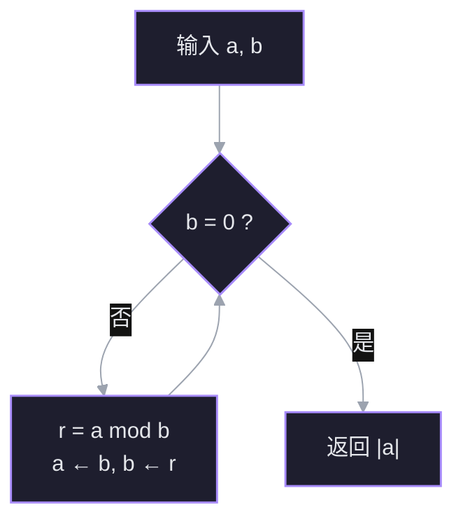

# A04 辗转相除法 GCD LCM

> [!info] 学习目标
> 从「会列举小数字」推进到「能解释并实现 $O(\log\min(a,b))$ 的辗转相除法」；面试能讲清恒等式为什么成立、为什么快、lcm 怎么防溢出。

## 1. 问题：因数太多，列举不可行

对不全为零的整数 $a,b$：

- $\gcd(a,b)$：同时整除 $a,b$ 的**最大**正整数；
- $\operatorname{lcm}(a,b)$：同时被 $a,b$ 整除的**最小**正整数；
- 若 $\gcd(a,b)=1$，称 $a,b$ **互素**。

$12$ 和 $18$ 可以脑内列举：公约数 $1,2,3,6$，得到 $\gcd=6$；公倍数 $36,72,\dots$，得到 $\operatorname{lcm}=36$。但 $1071$ 与 $462$ 的因数各有十几个，逐个试除很笨。

A05 已经有一个工具：带余除法

$$
a=qb+r,\qquad 0\le r<b.
$$

问题变成：能不能把 $(a,b)$ 换成一对其余数，而 $\gcd$ 不变？

## 2. 关键恒等式：换一对数，公约数集合不变

设 $r=a\bmod b$，即 $a=qb+r$。要证

$$
\boxed{\gcd(a,b)=\gcd(b,r)}
$$

**整个证明只需要一句话：如果 $d$ 整除 $a$ 和 $b$，那么 $d$ 也整除 $a-qb=r$。**

为什么？$a$ 是 $d$ 的整数倍，$b$ 也是 $d$ 的整数倍；两个整数倍相减，结果还是 $d$ 的整数倍。而 $a-qb$ 正好是余数 $r$。

于是两个方向都通：

- 若 $d$ 同时整除 $a,b$，由上面这句话，$d$ 也整除 $r$，所以 $d$ 同时整除 $b,r$；
- 若 $d$ 同时整除 $b,r$，则 $d$ 整除 $qb+r=a$，所以 $d$ 同时整除 $a,b$。

也就是说，**两组数的公约数逐个相同**：

$$
\{d:d\mid a,\ d\mid b\}=\{d:d\mid b,\ d\mid r\}.
$$

集合相同，最大元素当然相同，恒等式成立。

### 2.1 具体例子：$12$ 和 $8$

$$
12=1\times8+4.
$$

- $12$ 与 $8$ 的公约数：$1,2,4$；
- $8$ 与 $4$ 的公约数：$1,2,4$。

集合一模一样，所以 $\gcd(12,8)=\gcd(8,4)=4$。

拿几个 $d$ 逐个检验：

- $d=2$：$12=2\times6$，$8=2\times4$，而 $4=12-8=2(6-4)$——整除关系确实传到了余数上，所以 $2$ 在两边都在；
- $d=3$：$3\mid12$ 但 $3\nmid8$，所以 $3$ 不在左边的集合；又 $3\nmid4$，也不在右边的集合。两边同时排除，仍然一致；
- $d=4$：$4\mid12$，$4\mid8$，$4\mid4$——两边都在。

没有任何一个 $d$ 只出现在一边。

### 2.2 再看 $1071$ 和 $462$

$$
1071=2\times462+147,
$$

所以 $\gcd(1071,462)=\gcd(462,147)$。问题规模从 $(1071,462)$ 缩到 $(462,147)$，而答案没变。这一步可以反复做。

![[viz-gcd-common-divisors-venn-1794664987986.svg|700]]

### 2.3 三个容易卡住的点

- **不是「gcd 差不多」，而是两个集合完全相等。** 集合相等是逐元素比较，不是数值接近。
- **最大公约数相同，不代表 $a$ 和 $r$ 一样。** $1071\ne147$，但它们与 $b=462$ 的公约数恰好是同一批。
- **证明没用到商 $q$ 是多少。** 只用到「$r$ 是 $a$ 减去若干个 $b$」这个事实。

> [!question] $\gcd(a,b)=\gcd(b,a\bmod b)$ 成立的根本理由是什么？
> - 因为余数 $r$ 一定比 $b$ 小
> - 因为 gcd 对两个参数的顺序是对称的
> - 两边的公约数集合完全相同
> - 我不知道

> [!question] 没看懂（第一次讲解时）
> 原讲解直接从集合等式出发，跳过了「为什么整除关系会传给余数」这一步。现在拆成两步看：
>
> 1. **传下去**：$d\mid a$ 且 $d\mid b$ $\Rightarrow$ $d\mid(a-qb)=r$。两个 $d$ 的倍数相减，还是 $d$ 的倍数。
> 2. **传回来**：$d\mid b$ 且 $d\mid r$ $\Rightarrow$ $d\mid(qb+r)=a$。同理。
>
> 两条合起来，上一对的公约数和下一对的公约数逐个相同，所以最大值相同。用 $12$ 与 $8$ 的例子逐个 $d$ 检验一遍，比抽象符号直观。

> [!question] 还是模糊（第二次追问）
> 「两组公约数逐个相同」被读成了「462 的约数名单和 147 的约数名单一样」。不是这样——两个完整名单差得很远，相同的是**交集**。下面把名单拆开看。

### 2.4 到底哪两个集合相同

两个完整的约数名单并不相同：

- $462=2\times3\times7\times11$，约数有 $16$ 个：$1,2,3,6,7,11,14,21,22,33,42,66,77,154,231,462$；
- $147=3\times7^2$，约数只有 $6$ 个：$1,3,7,21,49,147$。

$462$ 有约数 $2$ 和 $11$，$147$ 有约数 $49$，彼此都没有。相同的是**同时整除那一对**的名单：

- 同时整除 $1071$ 与 $462$ 的：$1,3,7,21$；
- 同时整除 $462$ 与 $147$ 的：$1,3,7,21$。

两个交集一字不差，最大都是 $21$。所以「最大值为什么相同」根本不用另证——名单列出来，最大值就在名单里。

「逐个相同」的准确含义是：随便拿一个整数 $d$ 去试，它要么在两个交集里都出现，要么都不出现，绝不会只出现在一边。

用小数字 $12,8,4$ 逐个试一遍：

- $d=1$：$1\mid12$、$1\mid8$ → 左边在；$1\mid4$ → 右边在。**都在**。
- $d=2$：$2\mid12$、$2\mid8$ → 在；$2\mid4$ → 在。**都在**。
- $d=3$：$3\mid12$ 但 $3\nmid8$ → 左边不在；$3\nmid4$ → 右边不在。**都不在**。
- $d=4$：$4\mid12$、$4\mid8$ → 在；$4\mid4$ → 在。**都在**。
- $d=5$：$5\nmid12$、$5\nmid8$ → 不在；$5\nmid4$ → 不在。**都不在**。
- $d=6$：$6\mid12$ 但 $6\nmid8$ → 不在；$6\nmid4$ → 不在。**都不在**。
- $d=8$：$8\nmid12$ → 不在；$8\mid8$ 但 $8\nmid4$ → 不在。**都不在**。
- $d=12$：$12\mid12$ 但 $12\nmid8$ → 不在；$12\nmid4$ → 不在。**都不在**。

每一行两边的结论都一致。这就是「集合相同」的全部内容——不是「数值接近」，是**每一行都对齐**。

为什么每一行都必然对齐，而不是碰巧？靠前面那两句传递：

- 传下去：$d\mid12$ 且 $d\mid8$ $\Rightarrow$ $d\mid(12-8)=4$ —— 左边选中谁，右边一定也选中谁；
- 传回来：$d\mid8$ 且 $d\mid4$ $\Rightarrow$ $d\mid(1\times8+4)=12$ —— 右边选中谁，左边一定也选中谁。

两个方向把「只出现在一边」的可能性堵死了。一般的 $a,b,r$ 只是把 $12,8,4$ 换成字母，论证一字不改。

顺带说明 $d=8$ 这一行：$8$ 是「$8$ 与 $4$」里的那个 $8$，但 $8$ 不整除 $4$，所以它不是公约数。公约数要求**同时**整除，不是整除其中一个。

## 3. 算法：反复替换，直到余数为零

恒等式是一台「换数机器」：$(a,b)\mapsto(b,\ a\bmod b)$，答案不变。反复开动机器，直到余数为零：

$$
\begin{aligned}
1071&=2\times462+147 &&\Rightarrow (462,\ 147)\\
462&=3\times147+21 &&\Rightarrow (147,\ 21)\\
147&=7\times21+0 &&\Rightarrow \text{停，答案为 }21
\end{aligned}
$$

![[viz-euclidean-algorithm-1071-462-1794664987168.svg|700]]

**为什么最后那个数就是答案**：终止时 $r=0$，恒等式给出 $\gcd(b,0)=b$——任何数都整除 $0$，最大公约数就是 $b$ 本身。所以「最后一个非零余数」$=21$。

**为什么一定停**：$0\le r<b$，第二个参数每一步严格变小；非负整数不可能无限下降。

**为什么快**：每两步至少让较小的数减半。设 $a\ge b$：

- 若 $r\le b/2$，下一步较小数就是 $r$，已经减半；
- 若 $r>b/2$，则商 $q=1$，下一步余数是 $b-r<b/2$，两步内照样减半。

所以步数是 $O(\log\min(a,b))$。精确结论是拉梅定理（Lamé）：步数不超过较小数十进制位数的 $5$ 倍。最坏情况是相邻的斐波那契数——每步商都是 $1$，余数只缩小一点点。



多个数可以折叠：$\gcd(a,b,c)=\gcd(\gcd(a,b),c)$，$\operatorname{lcm}$ 同理。

## 4. 最小公倍数

### 4.1 从素因子看为什么 $\gcd\cdot\operatorname{lcm}=|ab|$

把两个数分解成素数幂：

$$
a=\prod_p p^{\alpha_p},\qquad b=\prod_p p^{\beta_p}.
$$

- $\gcd$ 在每个素数上取「公共部分」，即指数 $\min(\alpha_p,\beta_p)$；
- $\operatorname{lcm}$ 在每个素数上取「并集」，即指数 $\max(\alpha_p,\beta_p)$。

而 $\min+\max=\alpha_p+\beta_p$，所以逐素数相乘恰好还原 $ab$：

$$
\gcd(a,b)\cdot\operatorname{lcm}(a,b)=|ab|.
$$

![[viz-gcd-lcm-exponent-min-max-1794664892774.svg|700]]

### 4.2 先除后乘，防溢出

$$
\operatorname{lcm}(a,b)=\frac{|ab|}{\gcd(a,b)}=\left|\frac{a}{\gcd(a,b)}\cdot b\right|.
$$

因为 $a/\gcd(a,b)$ 是整数，先除不丢精度，而中间结果从 $|ab|$ 降到了原来的 $1/\gcd$。例：

$$
\operatorname{lcm}(1071,462)=\frac{1071}{21}\times462=51\times462=23562.
$$

若直接算 $1071\times462$ 或许还放得下，但换成 $10^9$ 量级的两个数，乘积就超出 `long long` 了。

## 5. C++：函数库里有，就用现成的

### 5.1 官方最短路径：`std::gcd` / `std::lcm`

C++17 起在 `<numeric>` 中：

```cpp
#include <iostream>
#include <numeric>

int main() {
    long long a = 1071, b = 462;
    std::cout << std::gcd(a, b) << '\n';   // 21
    std::cout << std::lcm(a, b) << '\n';   // 23562
}
```

要点：

- 需要 `-std=c++17` 或更新的标准；
- 结果保证非负，`std::gcd(0, 0) = 0`；
- `std::lcm` 的结果若无法用该类型表示，行为未定义——传 `long long` 并留意量级。

### 5.2 需要手写时：六行循环

```cpp
long long gcd(long long a, long long b) {
    while (b != 0) {
        long long r = a % b;
        a = b;
        b = r;
    }
    return a < 0 ? -a : a;
}

long long lcm(long long a, long long b) {
    if (a == 0 || b == 0) return 0;
    long long t = a / gcd(a, b) * b;   // 先除后乘
    return t < 0 ? -t : t;
}
```

要点：

- **负数**：C++ 的 `%` 结果符号随被除数，但绝对值仍严格变小，循环照样收敛；最后统一取绝对值。
- **零**：`gcd(a, 0) = |a|`，`lcm(a, 0) = 0`，要单独判断，否则 `lcm` 会除以 $0$。
- **极端值**：`-LLONG_MIN` 会溢出，这种边界交给 `std::gcd` 更稳。
- 函数无状态，可加 `constexpr`，让编译器在编译期算常量。

### 5.3 多个数

利用结合律折叠，初值取单位元：

```cpp
long long g = 0;                       // gcd 的单位元
for (long long x : v) g = std::gcd(g, x);

long long l = 1;                       // lcm 的单位元
for (long long x : v) l = std::lcm(l, x);
```

`std::gcd(0, x) = |x|`，所以从 $0$ 开始折叠不会污染结果。

### 5.4 选读：扩展欧几里得

普通算法只给 $g=\gcd(a,b)$；扩展版还能同时求出**贝祖系数** $x,y$，使

$$
ax+by=g.
$$

做法是把每步带余除法里的余数不断代回去整理，最后得到 $a,b$ 的系数。它不改变复杂度，仍是 $O(\log\min(a,b))$。用途很集中：求**模逆元**（$ax\equiv1\pmod m$）、解一次同余方程、中国剩余定理、RSA。日常工程用到时再查模板即可，这里不展开。

## 6. 直观理解

- **几何版**：$\gcd(a,b)$ 是用同样大小的正方形铺满 $a\times b$ 矩形时，正方形的最大边长。辗转相除法就是不断从矩形上切掉最大的正方形：$1071\times462$ 先切 $2$ 个 $462\times462$，剩 $147\times462$；再切 $3$ 个 $147\times147$，剩 $147\times21$；最后正好 $7$ 个 $21\times21$ 铺满。切的次数就是取模的次数。
- **数轴版**：$\operatorname{lcm}$ 是两列等间距刻度第一次重合的位置；$\gcd$ 是能同时整除两段长度的最大刻度。
- **素因子版**：见 4.1——$\gcd$ 取指数最小值，$\operatorname{lcm}$ 取最大值，两者互补。

## 7. 拓展延伸

- **更相减损术**：$\gcd(a,b)=\gcd(a-b,b)$，只减不除，是辗转相除法在中国古代的对应版本；大数相差悬殊时很慢。
- **二进制 GCD（Stein 算法）**：只用移位和减法，避免昂贵的整数除法，适合嵌入式；位复杂度 $O(\log^2 n)$。
- **时间复杂度对照**：辗转相除法 $O(\log\min(a,b))$，试除法 $O(\sqrt{\min(a,b)})$，输入 $10^{18}$ 时差了好几个数量级。

## 8. 术语

| 英文 | 中文 | 含义 |
| ---- | ---- | ---- |
| divisor / multiple | 因数 / 倍数 | 整除关系两侧 |
| common divisor | 公约数 | 同时整除两数 |
| greatest common divisor, gcd | 最大公因数 | 公约数中最大者 |
| least common multiple, lcm | 最小公倍数 | 公倍数中最小者 |
| Euclidean algorithm | 辗转相除法 / 欧几里得算法 | 用余数迭代求 gcd |
| remainder / modulo | 余数 / 取模 | $a\bmod b$ |
| coprime | 互素 | $\gcd(a,b)=1$ |
| Bézout coefficients | 贝祖系数 | $ax+by=\gcd(a,b)$ 中的 $x,y$ |
| extended Euclidean algorithm | 扩展欧几里得 | 同时求 gcd 与贝祖系数 |
| Lamé's theorem | 拉梅定理 | 步数不超过较小数位数的 5 倍 |

## 9. 总结

$\gcd$ 靠恒等式 $\gcd(a,b)=\gcd(b,a\bmod b)$ 迭代到零：两边公约数集合逐个相同，所以最大值相同。每两步较小数至少减半，因此是 $O(\log\min(a,b))$。$\operatorname{lcm}$ 由 $|ab|/\gcd$ 得到，计算时先除后乘防溢出。C++ 中优先用 `<numeric>` 的 `std::gcd` / `std::lcm`，需要自己写时就是六行循环。
