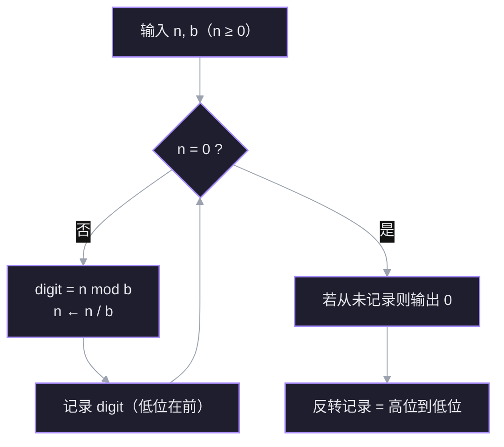

$b$ 进制的一切算法都踩在同一条更底层的事实上：**带余除法**。位置记数法不是公理，而是它的定理。先把这条地基钉住，后面除基取余、Horner、取位公式都从它长出来。

## 1. 带余除法与位置表示

对任意整数 $a$ 和底 $b\ge 2$，存在**唯一**的整数对 $(q,r)$，使

$$
a=bq+r,\qquad 0\le r<b.
$$

$q$ 是商，$r$ 是余数。唯一性只要一行：若 $a=bq+r=bq'+r'$，则 $b(q-q')=r'-r$；右边绝对值小于 $b$，左边却是 $b$ 的倍数，只能两边都是 $0$，即 $q=q'$、$r=r'$。

**为什么它是引擎**：任何「把 $n$ 拆成 $b$ 的倍数 + 零头」的动作，都是这条定理的一次应用。零头 $r$ 就是当前最低位，剩下的 $bq$ 继续拆。

例：$1071=16\times66+15$，余 $15$ 就是十六进制的个位 `F`；$66=16\times4+2$；$4=16\times0+4$。余数依次 $15,2,4$，倒过来读就是 `42F`。

**位置表示是它的定理**：对 $n\ge0$、$b\ge2$，存在唯一的 $k\ge0$ 与各位 $d_i$，使

$$
n=d_kb^k+d_{k-1}b^{k-1}+\cdots+d_1b+d_0,\qquad 0\le d_i<b,
$$

最高位 $d_k\ne0$（$n=0$ 单独写成一位 `0`）。存在性就是反复用带余除法；唯一性由 $0\le r<b$ 保证。

为什么每一位必须落在 $0..b-1$：$d_i\ge b$ 可以向上进位，$d_i<0$ 可以向下借位，只有规范范围才唯一。前导零同样破坏唯一性（$13=1101_2=01101_2$），所以规范写法不允许前导零。

其中 $d_0$ 是**最低位**（least significant digit），$d_k$ 是**最高位**（most significant digit）。位数（$n>0$）为

$$
k+1=\lfloor\log_b n\rfloor+1.
$$

> [!question] 反复做 $n=bq+r$（$0\le r<b$）并把商 $q$ 当作新的 $n$。对 $n>0$，这个过程为什么一定在有限步停下？
> - 因为 $b\ge2$，$n$ 的位数总是有限的
> - 每次新的 $n$ 都严格变小，而非负整数不能无限下降
> - 余数 $r$ 迟早会等于 $0$，所以会停
> - 我不知道

> [!success]- ✓ 正确
> 对。$b\ge2$、$n>0$ 时，$q=\lfloor n/b\rfloor<n$，序列严格递减；非负整数不能无限递减，所以最多 $\lfloor\log_b n\rfloor+1$ 步就停。$r=0$ 只是停止的那一刻，不是必然停止的原因。

## 2. 除基取余：把引擎反过来用

位置表示说「$n$ 是各位乘权之和」，带余除法说「$n$ 是 $b$ 的倍数加零头」。把两句话接起来：零头就是最低位，剩下的商继续拆。

$$
n=bq_0+r_0,\qquad q_0=bq_1+r_1,\qquad\cdots
$$

因为 $0\le r_i<b$，$r_0$ 正好是 $d_0$，$r_1$ 是 $d_1$，依此类推。于是：

1. 反复做 $n\gets n/b$，记录余数 $n\bmod b$；
2. 商为 0 时停止（终止性上一题已证）；
3. 把余数**倒序**读出，就是高位到低位。

$1071$ 转十六进制：

| 步骤 | 商 | 余数 |
| ---- | ---- | ---- |
| $1071\div16$ | 66 | 15 → `F` |
| $66\div16$ | 4 | 2 |
| $4\div16$ | 0 | 4 |

余数低位在前是 `F, 2, 4`，倒序得到 `42F`。探针里你已经答对「余数对应最低位」，这一步算过了。

## 3. 反向：Horner 从最高位累加

已知各位数字，定义式是 $n=\sum d_i b^i$。直接算要先算幂，再逐项乘加。换一种读法——从最高位开始，每读一位就把已有结果整体左移一位（乘 $b$），再加上新数字：

$$
n=(\cdots((d_k)\,b+d_{k-1})\,b+\cdots)\,b+d_0.
$$

例：`42F` 按十六进制读，

$$
((4)\cdot16+2)\cdot16+15=66\cdot16+15=1071.
$$

每一步只做一次乘法和一次加法，共 $k$ 次乘加，且**不需要预先算 $b^i$**。这与除基取余正好互逆：一个从低位剥，一个从高位堆。

> [!question] 解析一个进制字符串时，为什么 Horner 比「先算各位的权、再乘权求和」更常用？
> - 乘权求和要先知道字符串长度，才能确定最高位的权
> - 乘权求和需要浮点幂运算，会引入误差
> - Horner 每一步都取模，能顺便校验数字范围
> - 我不知道

> [!success]- ✓ 正确
> 对。权 $b^{k-1-i}$ 依赖总长度 $k$，而字符串是流式读入的，读到第一位时还不知道后面有几位。Horner 只维护一个累加值，读一位更新一次，与长度无关。浮点幂不是本质障碍——$b^i$ 完全可以用整数连乘。

## 4. 取某一位：定位法与剥位法

问题：不要整个表示，只要第 $i$ 位 $d_i$。

把 $n$ 按 $b^i$ 切开。设

$$
n=A\cdot b^{i+1}+d_i\cdot b^i+R,\qquad 0\le R<b^i.
$$

两边除以 $b^i$：

$$
\frac{n}{b^i}=A\cdot b+d_i+\frac{R}{b^i},\qquad 0\le\frac{R}{b^i}<1.
$$

取整把小数部分抹掉，得 $\lfloor n/b^i\rfloor=A\cdot b+d_i$；再 $\bmod b$，$A\cdot b$ 消失，只剩 $d_i$：

$$
\boxed{d_i=\left\lfloor\frac{n}{b^i}\right\rfloor\bmod b}
$$

这就是**定位法**：先把目标位挪到个位，再取个位。

**剥位法**是同一个动作重复 $i$ 次：反复 $n\gets\lfloor n/b\rfloor$。两者等价，靠的是

$$
\left\lfloor\frac{\lfloor n/b\rfloor}{b}\right\rfloor=\left\lfloor\frac{n}{b^2}\right\rfloor,
$$

即「连续除以 $b$」等于「一次除以 $b^i$」。

数例：取 $90$ 的二进制第 $3$ 位（从 $0$ 开始）。定位法：$\lfloor90/8\rfloor=11$，$11\bmod2=1$。剥位法：$90\to45\to22\to11$，$11\bmod2=1$。

工程上取一位用剥位法：不需要算 $b^i$，也不会碰 `pow` 的浮点误差；定位法适合需要随机访问某一位、且 $b^i$ 已缓存或可快速计算的场合。

> [!question] 剥位法与定位法等价，靠的是哪个恒等式？
> - $\lfloor n/b\rfloor=\lfloor n/b^2\rfloor$
> - $n\bmod b^2=d_i$
> - $\lfloor\lfloor n/b\rfloor/b\rfloor=\lfloor n/b^2\rfloor$
> - 我不知道

> [!success]- ✓ 正确
> 对。两次除以 $b$ 等于一次除以 $b^2$，所以剥 $i$ 次再取模，与一次 $\lfloor n/b^i\rfloor$ 再取模结果相同。这个恒等式对实数也成立，这也是剥位法不需要预知位数的原因。

## 5. 按位分组：一种基是另一种基的幂

二进制写起来太长，八进制/十六进制是它的压缩写法。压缩为什么能**逐位**做，而不用重新除？

设 $B=b^k$。表示式里第 $j$ 个 $B$ 位对应 $b$ 进制的 $k$ 位，因为

$$
d\cdot B^j=d\cdot b^{kj}.
$$

也就是：$B$ 进制的一位，正好是 $b$ 进制连续的 $k$ 位；$8=2^3$ 所以三位一组，$16=2^4$ 所以四位一组。( 如果数值是16和8的话,8的4/3位一组这种非整数是不可以接受的)

分组规则：以小数点为界，整数部分从右往左、小数部分从左往右；整数部分最左不足 $k$ 位左补零，小数部分最右不足 $k$ 位右补零。

例：$1071=10000101111_2$。

- 八进制：补成 $010\,000\,101\,111$ → $2057_8$；
- 十六进制：补成 $0100\,0010\,1111$ → $42F_{16}$。

小数同样：$0.1011_2=0.101\,100_8=0.54_8$，$0.1011_2=0.1011_{16}=0.B_{16}$。

**条件**：只有「一个基是另一个基的整数次幂」才能直接分组。八进制和十六进制之间不能 3/4 位硬套，必须先经二进制（或按 12 位一组）。

> [!question] 哪一对进制之间可以直接按位分组、不需要经过十进制？
> - 八进制与十六进制
> - 十进制与二进制
> - 十六进制与二进制
> - 我不知道

> [!success]- ✓ 正确
> 对。$16=2^4$，一位十六进制正好对四位二进制；八进制虽然也是 $2$ 的幂，但 $16$ 不是 $8$ 的整数次幂，所以八↔十六要先经二进制。十进制与任何非十的幂都不满足条件。

## 6. 负数：C++ 的 `/` 不是数学的带余除法

数学要求余数落在 $[0,b)$，C++ 的整数除法从 C++11 起规定**向零截断**，余数符号跟着被除数走。于是同一个 $-7$、同一个底 $3$，有两种拆法：

- 数学：$-7=3\times(-3)+2$，商 $-3$、余 $2$；
- C++：`-7 / 3 == -2`，`-7 % 3 == -1`，因为 $-7=3\times(-2)+(-1)$。

两边都满足恒等式

$$
(a/b)\cdot b+a\%b=a,
$$

区别只在余数的范围。C++ 的 `%` 给出的是「离 $0$ 最近的同号余数」，不是「最小非负余数」。

要拿欧几里得余数（$0\le r<b$，$b>0$）：

```cpp
long long r = ((a % b) + b) % b;
long long q = (a - r) / b;
```

![[viz-cpp-negative-modulo-two-splits-1794662830203.svg|650]]

**补码视角**：负数的位型不是「符号位 + 绝对值」，而是补码。`-1` 转成 `unsigned` 后是全 1；想看补码位型，先转无符号再按位取。要输出负数的「数字串」，通常先取幅值：`unsigned long long u = n < 0 ? 0ULL - (unsigned long long)n : n;`，这样对 `LLONG_MIN` 也安全——`std::abs(LLONG_MIN)` 和 `-LLONG_MIN` 都是未定义行为，因为 $2^{63}$ 超出 `long long` 范围。

> [!question] 在 C++ 中，`-7 / 3` 和 `-7 % 3` 分别是多少？
> - `-3` 和 `2`
> - `-2` 和 `-1`
> - `-2` 和 `1`
> - 我不知道

> [!success]- ✓ 正确
> 对。向零截断给出商 $-2$，再由恒等式 $-7=3\times(-2)+r$ 得 $r=-1$。数学上的 $q=-3,r=2$ 也满足恒等式，只是余数范围不同；做题时先看题目要哪一种，别把 `%` 当成数学 mod。

## 7. 小数：乘基取整

整数靠「除基取余」剥低位，小数靠「乘基取整」剥高位。设小数部分 $0\le f<1$，目标是

$$
f=\frac{e_1}{b}+\frac{e_2}{b^2}+\cdots,\qquad 0\le e_i<b.
$$

两边乘 $b$：

$$
bf=e_1+\underbrace{\left(\frac{e_2}{b}+\cdots\right)}_{<1}.
$$

所以 $e_1=\lfloor bf\rfloor$，剩下的小数部分 $f\gets bf-e_1$，继续乘。和整数一样，这是带余除法的另一种写法，只是「余数」变成了小数部分。

例：$0.625$ 转二进制。$0.625\times2=1.25$ 取 $1$；$0.25\times2=0.5$ 取 $0$；$0.5\times2=1.0$ 取 $1$，余 $0$ 停。得 $0.101_2$，顺序就是高位到低位。

**什么时候停**：把 $f=p/q$ 写成最简分数。每一步 $f\mapsto bf-\lfloor bf\rfloor$ 的分母仍是 $q$（约分前是 $q$，约分只会更小），所以状态只有有限种，必循环。终止当且仅当 $q\mid b^m$，即 $q$ 的所有素因子都整除 $b$：

- $1/10$ 在二进制下：$10=2\times5$，$5\nmid2$，所以无限循环，周期 $0011$；
- $1/3$ 在三进制下：$q=3\mid3$，所以是 $0.1_3$；
- $1/6$ 在十二进制下：$6\mid12$，所以是 $0.2_{12}$。

**double 陷阱**：`double` 里的 `0.1` 不是实数 $1/10$，而是 $3602879701896397/2^{55}$，这是有限二进制小数（55 位后停）。演示「无限循环」要用有理数 $p/q$ 推，不能拿 `double` 跑乘 2 取整下结论。

> [!question] 十进制实数 $0.1$（也就是 $1/10$），写成二进制是什么？
> - 无限循环小数
> - 有限位小数，共 55 位
> - 无法用二进制表示
> - 我不知道

## 8. C++ 落地：`<charconv>` 与手写

### 官方最短路径：`std::to_chars` / `std::from_chars`

C++17 的 `<charconv>` 支持 **2~36 进制**，无动态内存、无 locale：

```cpp
#include <charconv>
#include <iostream>
#include <string_view>

int main() {
    char buf[64];
    auto res = std::to_chars(buf, buf + sizeof buf, 1071, 16);
    std::cout << std::string_view(buf, res.ptr - buf) << '\n';  // 42f

    int n = 0;
    std::from_chars("42F", "42F" + 3, n, 16);
    std::cout << n << '\n';                                     // 1071
}
```

- `std::to_chars` 的 10 以上数字用**小写**字母（`42f`）；`std::from_chars` 大小写都接受。
- 不写进制参数时默认十进制。
- 需要 `if (res.ec != std::errc{})` 判断缓冲区是否够大；解析失败时 `from_chars` 返回的指针不指向末尾。

### 手写：除基取余

```cpp
#include <algorithm>
#include <string>

std::string to_base(long long n, int base) {
    static constexpr char DIGITS[] = "0123456789ABCDEFGHIJKLMNOPQRSTUVWXYZ";
    if (n == 0) return "0";

    bool negative = n < 0;
    unsigned long long u = negative ? -static_cast<unsigned long long>(n)
                                    : static_cast<unsigned long long>(n);

    std::string s;
    while (u != 0) {
        s += DIGITS[u % base];
        u /= base;
    }
    if (negative) s += '-';
    std::reverse(s.begin(), s.end());
    return s;
}
```

要点：

- 余数天然是**低位在前**，所以要反转。
- 负数先取幅值；先转 `unsigned long long` 再取负，对 `LLONG_MIN` 也安全。
- `base` 限定在 $[2,36]$；超过 36 需要自定义字符表。
- 大整数（几百位）每次除法 $O(k)$，总复杂度 $O(k^2)$；机器整数则是 $O(\log_b n)$。

### 各位数字与位数

```cpp
#include <vector>

std::vector<int> digits_low_to_high(long long n, int base) {
    std::vector<int> digits;
    do {
        digits.push_back(static_cast<int>(n % base));
        n /= base;
    } while (n != 0);
    return digits;                       // digits[0] 是个位
}

int digit_at(long long n, int base, int pos) {
    while (pos-- > 0) n /= base;         // 剥掉右边 pos 位
    return static_cast<int>(n % base);   // 再取最低位
}

int digit_count(long long n, int base) {
    int k = 1;
    while (n >= base) {                  // n = 0 也算 1 位
        n /= base;
        ++k;
    }
    return k;
}
```

`digit_at` 只适用于非负 $n$；负数请先取绝对值。`digits_low_to_high` 用 `do-while` 保证 $n=0$ 时也返回一位 `0`。

### 手写：从字符串读回数值

```cpp
#include <cctype>
#include <string_view>

long long from_base(std::string_view s, int base) {
    long long n = 0;
    for (char c : s) {
        int d = (c >= '0' && c <= '9')
                    ? c - '0'
                    : std::toupper(static_cast<unsigned char>(c)) - 'A' + 10;
        n = n * base + d;                // Horner
    }
    return n;
}
```

不处理正负号与前缀（`0x`、`0b`）；`std::from_chars` 也不接受 `0x`。工程里优先用它，自己写通常是为了加校验或支持更大进制。

## 直观理解

- **除基取余 = 剥最低位**：$n\bmod b$ 是剥下来的那一位，$n/b$ 是剩下的部分；剥到 0 就结束。
- **定位法 = 先右移再取最低位**：$\lfloor n/b^i\rfloor$ 把目标位挪到个位，`% b` 把它取出来。
- **按位分组**：二进制三位一组就是八进制，四位一组就是十六进制，因为 $8=2^3$、$16=2^4$。
- 算法流程：



## 拓展延伸

- **小数部分**：乘基取整。$0.625\times2=1.25$ 取 1，$0.25\times2=0.5$ 取 0，$0.5\times2=1.0$ 取 1，得 $0.101_2$。小数可能无限循环，只能截断到指定精度（十进制的 $0.1$ 在二进制中是无限循环）。
- **反求进制**：若 $(\texttt{101})_b=26$，即 $b^2+1=26$，解得 $b=5$。一般把表示按 $b$ 展开成多项式解方程；同时所有数字必须满足 $d_i<b$。
- **补码视角**：C++ 有符号负数以补码存储，转成 `unsigned` 后 `-1` 会变成全 1；想看补码位型，先转无符号再调 `to_base`。
- **C++20 `std::format`**：`"{:b}"`、`"{:o}"`、`"{:x}"` 只能做二/八/十六进制，任意进制仍要用 `to_chars` 或手写。
- **Base62 / URL 短链**：字符表扩到 `0-9A-Za-z`，本质仍是除基取余。
- **大整数**：Python 的 `int` 自动处理任意精度；C++ 需自己写高精度除法，复杂度从 $O(\log n)$ 升到 $O(k^2)$。

## 术语

| 英文 | 中文 | 含义 |
| ---- | ---- | ---- |
| radix / base | 基数 / 进制 | 每一位的进位单位 $b$ |
| positional notation | 位置记数法 | 数字的权随位置变化 |
| digit | 数位 / 数字 | 某一位上的值，$0\le d<b$ |
| least significant digit | 最低位 | $d_0$，个位 |
| most significant digit | 最高位 | $d_{k-1}$ |
| quotient / remainder | 商 / 余数 | 带余除法 $n=bq+r$ |
| base conversion | 进制转换 | 在不同 $b$ 之间改写表示 |
| Horner's method | 秦九韶 / 霍纳法 | 从高位乘基累加还原数值 |
| two's complement | 补码 | 有符号整数的存储方式 |

## 总结

$b$ 进制的每一位满足 $d_i=\lfloor n/b^i\rfloor\bmod b$。转换用除基取余，余数低位在前、倒序读出；反向用 Horner 乘基累加。C++17 优先 `std::to_chars` / `std::from_chars`（2~36 进制），需要自定义字符表或补码位型时再手写循环。
