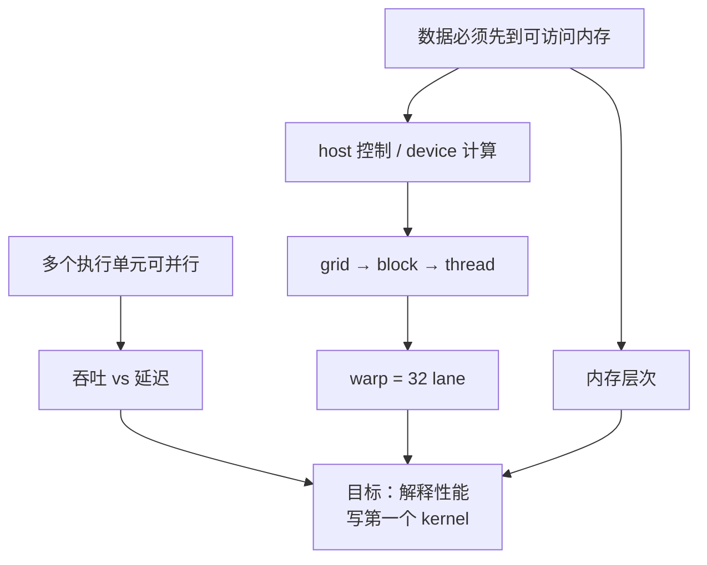
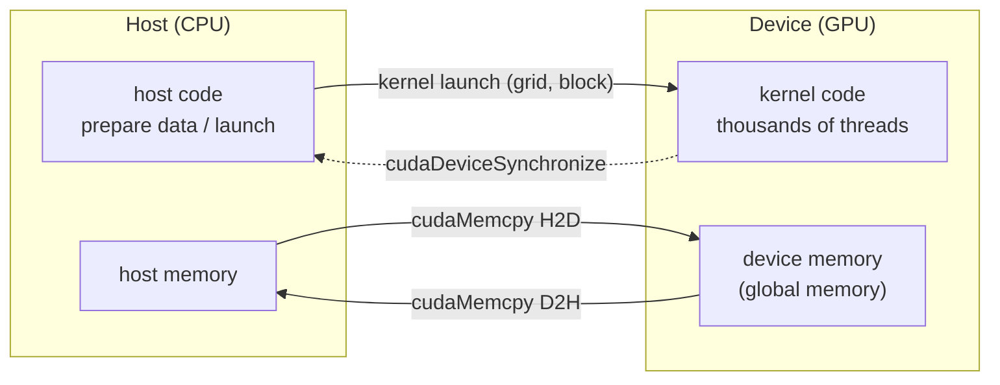
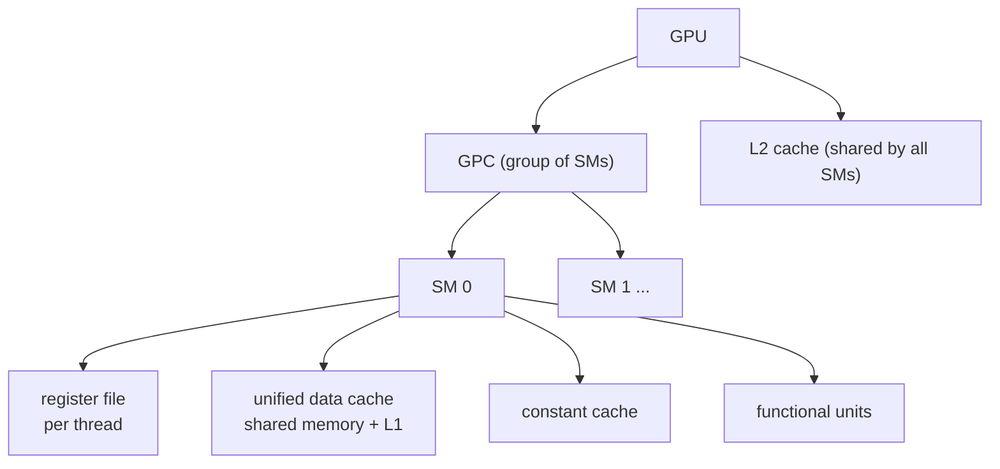
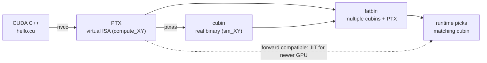

把 GPU 的吞吐模型、CUDA 的异构执行模型、平台兼容机制串成一条依赖链：从三条无条件真理出发，推出「为什么 GPU 快」，再推出「代码怎么落到 GPU」，最后落到第一个 kernel。线程索引、warp/SIMT、内存层次的细节见 [[C02 Programming Model]]。

## 依赖图



读图顺序就是学习顺序：根节点是三条不需要证明的真理；每往下一层，只问「上一层已经成立了，为什么自然会走到这一步」。不要按目录背结论，按边推。

## 探针：先找边缘

先不看下文，凭现在的理解回答。答不出或答错都很正常——探针的目的就是找到边缘。

> [!question] 1. 1000 个完全独立的数据元素，每个做同样的加法。CPU 和 GPU 谁更可能快？为什么？

> [!success]- ✓ 答案
> GPU 更可能快：同一套运算作用在海量数据上，能把工作拆成大量并行任务。但前提是数据搬运、同步、kernel 启动的开销可控；数据量小、串行依赖强时 CPU 可能更快。

> [!question] 2. 一个 GPU kernel 的输入数据，最开始在哪？谁负责把它搬过去？

> [!success]- ✓ 答案
> 最开始在 host（CPU 直连内存）。host code 通过 `cudaMemcpy` 把数据搬到 device 显存，再 launch kernel；算完再搬回来。

> [!question] 3. 两个 thread block 之间能不能用 `__syncthreads()` 同步？

> [!success]- ✓ 答案
> 不能。`__syncthreads()` 只同步同一个 block 内的线程；block 之间没有执行顺序保证。需要跨 block 同步时，拆成多次 kernel launch，或用 Cooperative Groups。

## 三条无条件真理

这三条不是 CUDA 的事实，是任何计算都成立的事实。先按字面接受它们，后面所有 CUDA 设计都从它们推出来。

### 真理 1：计算 = 某个执行单元对某些数据执行指令

一个执行单元在某一时刻执行一条指令流；它要算的数据，必须在它能访问的内存里。

- 这条真理同时定义了「算」和「数据在哪」两件事。
- 它没有说执行单元有多少个，也没说内存有多快——那些是下一层的事。

### 真理 2：多个执行单元可以同时执行

同一时刻，多个执行单元可以各自执行各自的指令流。于是总吞吐可以随执行单元数量上升，而单条指令流的延迟不一定变短。

- 「并行」不是让一个线程跑得更快，而是让很多线程同时跑。
- 这条真理是 GPU 存在的全部理由。

### 真理 3：数据必须先到执行单元能访问的内存

执行单元够不到的数据，算不了。内存有层级：越靠近执行单元越快、越小、越贵；越远越慢、越大、越便宜。

- 所以「把数据搬到正确的位置」和「算」同等重要。
- 这条真理直接推出 host/device 分工和内存层次。

> [!question] 检查点：这三条里，哪一条直接解释了「GPU 为什么要把晶体管花在大量 ALU 上」？

> [!success]- ✓ 答案
> 真理 2。既然多个执行单元可以同时执行，把晶体管花在更多 ALU 上就能提高总吞吐；代价是缓存和控制逻辑变少，单线程延迟变差。


## 1. 从真理到 GPU：吞吐 vs 延迟

**为什么现在需要这个节点？** 真理 2 说并行可以提高总吞吐，但没有说一个芯片应该把晶体管花在哪。CPU 和 GPU 给出了两种不同答案。

| | CPU | GPU |
|---|---|---|
| 优化目标 | 单线程**延迟**（latency） | 总**吞吐**（throughput） |
| 并行规模 | 几十个线程 | 成千上万个线程 |
| 晶体管去向 | 大缓存 + 复杂控制流 | 大量数据运算单元 |
| 擅长 | 分支多、串行依赖强 | 同一套运算作用在海量数据上 |

GPU 用较低的单线程性能换高得多的总吞吐，所以「一个线程算一个元素」在 CUDA 里很自然。

但 GPU 不是对所有任务都更快：只有工作能拆成大量并行任务、且数据搬运/同步/kernel 启动开销可控时，吞吐优势才体现；串行依赖强、分支杂乱、数据量又小的任务可能不如 CPU。

> [!question] 检查点：一个任务有 8 个元素，每个元素依赖前一个元素的结果。GPU 的吞吐优势还能发挥吗？

> [!success]- ✓ 答案
> 很难。这是强串行依赖，8 个元素无法同时算；GPU 的大量 ALU 闲着，反而要付数据搬运和启动开销。CPU 的高单线程性能更合适。

## 2. 异构执行：host 控制，device 计算

**为什么现在需要这个节点？** 真理 3 要求数据先到位，真理 2 要求大量执行单元同时有活干。一个自然的组织方式是分工：一个处理器负责控制和搬运，另一个负责并行计算。

- **host** = CPU 及其直连内存；**device** = GPU 及其显存。
- 程序总是从 CPU 开始：host code 通过 CUDA API 搬数据、启动 GPU 代码、等待完成。
- 跑在 GPU 上的函数叫 **kernel**，启动它叫 **launch**；一次 launch 等于同时启动成千上万个线程执行同一段代码。
- CPU 和 GPU 可以同时执行，性能最好时两边都不闲着。



> [!question] 检查点：`__global__` 函数在哪调用、在哪执行？它能不能直接读写 host 的普通变量？

> [!success]- ✓ 答案
> 在 host 调用（`kernel<<<...>>>()`），在 device 执行。不能直接读写 host 的普通变量；host 和 device 有各自的内存，必须通过 `cudaMemcpy` 等 API 搬。device 代码也不能调用 host 函数。

## 3. 内存层次：越近越快越小

**为什么现在需要这个节点？** 真理 3 说数据必须先到执行单元能访问的内存。不同内存离执行单元的距离不同，速度、容量、作用域都不同。

- 寄存器：每个线程私有，最快，数量有限。
- shared memory + L1：每个 SM 内共享，比 global 快得多，容量小；shared memory 由 block 内线程共享。
- L2：所有 SM 共享，容量比 L1 大，速度慢一些。
- global memory（显存）：所有线程可见，容量最大，延迟最高。

写 kernel 的核心工作之一，就是让数据尽量在寄存器/shared memory 里被复用，减少对 global memory 的往返。细节见 [[C02 Programming Model]]。

> [!question] 检查点：寄存器最快，为什么不让所有数据都放寄存器？

> [!success]- ✓ 答案
> 寄存器是每个线程私有的，数量非常有限。放不下时数据会溢出到 local/global memory，延迟骤增；寄存器用量还直接影响一个 SM 能驻留多少线程。容量和速度必须折中。

## 4. 线程层次：grid → block → thread

**为什么现在需要这个节点？** 一次 launch 要同时启动成千上万个线程。硬件不可能把它们当成一团散沙来调度，必须有层级。

- **thread**：最小执行单位。
- **thread block**：一组线程，**一定跑在同一个 SM 上**，因此可以用 shared memory 通信、用 `__syncthreads()` 同步。
- **grid**：一组 thread block，所有 block 尺寸相同。
- grid 和 block 都可以是 1D/2D/3D，方便把线程索引直接映射到图像、矩阵。

block 之间**没有执行顺序保证**：可能并行、可能串行、可能任意顺序，所以不同 block 不能互相等待或依赖对方结果。正因如此，任意大的 grid 才能排队跑在任意小的 GPU 上。需要跨 block 同步时，拆成多次 kernel launch，或用 Cooperative Groups；不要用全局变量 + 自旋等待去凑。

> **Cluster（CC 9.0+）**：可选的第三层分组，相邻 block 组成 cluster，保证同 GPC 同时调度，cluster 内可互访 shared memory（distributed shared memory）。入门先了解概念。

索引公式、`dim3`、二维映射、warp/SIMT 和内存层次都在 [[C02 Programming Model]]。

> [!question] 检查点：为什么「block 之间没有顺序保证」反而是好事？

> [!success]- ✓ 答案
> 因为硬件可以按自己的资源和调度情况，把任意大的 grid 拆开、排队、复用任意小的 GPU；如果 block 之间必须有顺序或同步，grid 的大小就被硬件规模锁死了。

> [!question] 检查点：为什么 shared memory 能让 block 内的线程通信，而不同 block 之间不行？

> [!success]- ✓ 答案
> shared memory 是每个 SM 内的资源，一个 block 固定跑在同一个 SM 上，所以 block 内线程能访问同一块 shared memory；不同 block 可能落在不同 SM，没有共享的 shared memory，也没有执行顺序保证。

## 5. 硬件层次：block 落在 SM 上

**为什么现在需要这个节点？** 上一层的 block 需要有一个物理落点：它到底跑在 GPU 的哪个部件上？这个部件有多少资源，决定了同时能驻留多少 block。



- **SM** 是调度线程块的基本硬件单位；寄存器文件、shared memory + L1 的统一缓存、常量缓存和运算单元都在 SM 内。
- **GPC** 是 SM 的分组，再往上是整个 GPU 和显存。
- 不同架构的 SM 数、寄存器/缓存大小都不同，**写程序不要依赖具体数值**。
- 线程块被调度到某一个 SM 上；寄存器/共享内存用量决定一个 SM 能同时驻留多少 block（occupancy）。

> [!question] 检查点：一个 SM 的 shared memory 被某个 block 用掉一大半，会发生什么？

> [!success]- ✓ 答案
> 这个 SM 能同时驻留的 block 数会减少，occupancy 下降，可能掩盖不了内存延迟。共享内存不是越多越好，要按 block 的实际需求分配。

## 6. Warp：32 个 lane 一起走

**为什么现在需要这个节点？** block 是软件层面的调度单位，但 SM 内部真正执行时，线程并不是一个一个走的，而是按 warp 分组。

- 一个 warp = 32 个 lane，SM 以 warp 为单位调度。
- 同一 warp 的 32 个线程执行同一条指令（SIMT）；分支不同时会发生 divergence，两条路径串行执行。
- 所以 block 的线程数尽量取 32 的倍数；否则最后一个 warp 会有 lane 闲置。

`hello<<<2, 4>>>` 每个 block 只有 4 个线程，却要占满一个 warp（32 lane），**lane 利用率 4/32 = 12.5%**。这就是「block 线程数尽量取 32 的倍数」的直接原因。

> [!question] 检查点：block 有 40 个线程，硬件实际按几个 warp 调度？最后一个 warp 有多少 lane 闲置？

> [!success]- ✓ 答案
> 2 个 warp（32 + 8）。第二个 warp 只有 8 个 lane 在工作，24 个闲置，利用率 8/32 = 25%。

## 7. 平台：同一份代码怎么落到不同 GPU

**为什么现在需要这个节点？** 前面讲的是「程序怎么跑」，但同一份 CUDA 代码要面对不同架构的 GPU。需要一套机制回答：这份二进制能不能在目标卡上跑？

每块 GPU 有一个 **compute capability X.Y**，对应 SM 版本：CC 12.0 → `sm_120`（本机 RTX 5060 Laptop 就是 12.0），编译时用 `-arch=sm_120` 指定。

| | NVIDIA Driver | CUDA Toolkit |
|---|---|---|
| 类比 | GPU 的操作系统 | 写/编译/分析 GPU 程序的工具箱 |
| 内容 | 所有 GPU 使用方式的基础（CUDA、Vulkan、Direct3D…） | nvcc、头文件、库（cuBLAS/cuDNN/CUTLASS…）、性能工具 |
| 安装 | Windows 侧；WSL2 里**不要**装 Linux 驱动 | WSL2 里装 toolkit（不含驱动组件） |

CUDA Runtime API 建在 Driver API 之上；两者可以混用。多数场景不必手写 kernel：cuBLAS/cuDNN/CUTLASS、Triton、TensorRT 已覆盖大部分需求，自己写的价值在库里没有的算子、算子融合、特殊布局，以及把前后处理搬上 GPU（如 groundzero 的 letterbox + 归一化 + HWC→CHW，已在 `03_yolo` 落地）。



- **PTX**：NVIDIA GPU 的虚拟指令集架构（类汇编），版本如 `compute_80`。
- **cubin**：针对某个 SM 版本的真实二进制，如 `sm_120`。
- **fatbin**：可执行文件/库中装 GPU 代码的容器，可同时放多份 cubin + 多份 PTX，运行时挑最合适的。
- **二进制兼容**：同一 major 内，minor ≥ 编译目标的 GPU 能直接跑该 cubin（8.6 能跑在 8.6/8.9，不能跑在 8.0）；跨 major 不兼容（8.6 不能跑在 9.0）。
- **PTX 前向兼容**：带 `compute_80` PTX 的程序可在更高 CC 的 GPU 上由驱动 JIT 成 cubin；JIT 结果会缓存，驱动升级后失效。

发布时常用 `-gencode` 同时打包「目标 cubin + 一份 PTX」：当前 GPU 直接跑 cubin，未来 GPU 用 PTX JIT 兜底。

> [!question] 检查点：用 `-arch=sm_86` 编译出的 cubin，能在 sm_90 的 GPU 上直接跑吗？如果同时打包了 `compute_86` 的 PTX 呢？

> [!success]- ✓ 答案
> cubin 不能：跨 major（8 → 9）不兼容，没有匹配的 kernel image。如果 fatbin 里还带了 `compute_86` 的 PTX，驱动可以在 sm_90 上 JIT 出 cubin 再跑，所以「cubin + PTX」一起打包才稳。

## 8. 第一个 kernel

**为什么现在需要这个节点？** 前面所有节点都是模型；这里把它落成能编译、能运行、能观察的最小代码。

完整代码：`/home/akiha/deep_learning/cuda/c01/hello.cu`

```cpp
#include <cstdio>
#include <cuda_runtime.h>

__global__ void hello() {
    printf("block %u/%u, thread %u/%u\n",
           blockIdx.x, gridDim.x, threadIdx.x, blockDim.x);
}

int main() {
    hello<<<2, 4>>>();
    cudaDeviceSynchronize();   // device printf 是缓冲的，同步后才刷出
    printf("last error: %s\n", cudaGetErrorString(cudaGetLastError()));
    return 0;
}
```

- `__global__`：在 host 调用、在 device 执行的 kernel，返回 `void`。
- `<<<2, 4>>>`：2 个 block × 每 block 4 个线程。
- **每次 launch 后查 `cudaGetLastError()`**：kernel 经常静默失败，不查错误码会以为跑成功了。
- `cudaDeviceSynchronize()`：device printf 是缓冲的，不同步可能看不到输出；也是 host 等待 device 完成的显式点。

```bash
cd ~/deep_learning/cuda/c01
nvcc hello.cu -o hello      # 本机 wrapper 自动加 -ccbin g++-14 -U_GNU_SOURCE -arch=sm_120
./hello
```

## 实验：环境与 hello 输出

| 项 | 值 |
|---|---|
| GPU | NVIDIA GeForce RTX 5060 Laptop GPU（8 GB，WSL2） |
| Compute capability | **12.0 → sm_120** |
| SM 数 / 每 SM 最大线程数 / warp size | **26 / 1536 / 32** |
| global memory / shared memory per SM | **8.52 GB / 100 KB** |
| nvcc | CUDA **12.8.93**（另有 13.1.115 可切换） |
| host compiler | **g++-14**（系统 gcc 15 超出 CUDA 12.8 支持范围） |

`hello<<<2, 4>>>` 输出：

```
block 0/2, thread 0/4
block 0/2, thread 1/4
block 0/2, thread 2/4
block 0/2, thread 3/4
block 1/2, thread 0/4
block 1/2, thread 1/4
block 1/2, thread 2/4
block 1/2, thread 3/4
last error: no error
```

1. 8 个线程 = 2 block × 4 thread；每个 block 只有 4 个线程，却要占满一个 warp（32 lane），**lane 利用率 4/32 = 12.5%**。这就是「block 线程数尽量取 32 的倍数」的直接原因。
2. 输出看起来是 block 0 全打印完再 block 1，但**只是本次调度的偶然结果**，block 之间没有顺序保证。
3. 26 个 SM × 1536 线程 = 39936 个常驻线程上限；grid 可以有上百万个 block，靠排队复用 SM。

## 补充检查点

> [!question] 1. 为什么每次 kernel launch 后都要查 `cudaGetLastError()`？

> [!success]- ✓ 答案
> kernel 启动/执行失败常常不会让 host 程序崩溃，而是静默留下错误码；不查就会以为跑成功了。它是异步的，错误可能在下一次同步或 API 调用时才暴露。

> [!question] 2. 一个 grid 有 100 万个 block，GPU 只有 26 个 SM，怎么跑？

> [!success]- ✓ 答案
> 排队复用。SM 同时只驻留有限个 block，跑完一批再调度下一批；block 之间没有顺序保证，所以任意大的 grid 都能在任意小的 GPU 上推进。

## 识别信号

- 问「GPU 为什么快 / 适合什么任务」→ 答吞吐与并行，不是单核频率；CPU 优化延迟，GPU 优化吞吐。
- 一段代码里同时有 `__global__`、`<<<>>>`、`cudaMemcpy` → 先划分 host / device 边界再读逻辑。
- 问「这份二进制能不能在我的卡上跑」→ compute capability + PTX + fatbin 三件套，缺 kernel image 就是架构不匹配。
- 问 block / thread 数量怎么定 → 先看是不是 32 的倍数（lane 利用率），再看 1536 线程/SM 的上限。
- 本机编译报 gcc / glibc 版本错 → 直接查下面的坑表，用 nvcc wrapper，不要改代码。

## 坑（本机 WSL2 + Ubuntu 25.10）

| 坑 | 现象 | 解决 |
|---|---|---|
| 系统 gcc 15 太新 | `unsupported GNU version! gcc versions later than 14 are not supported` | 装 `g++-14`，nvcc 加 `-ccbin g++-14` |
| glibc 2.43 的 C23 数学函数 | `cospi / sinpi / rsqrt` 的 `exception specification is incompatible` | nvcc 加 `-U_GNU_SOURCE` |
| 默认架构 | 不写 `-arch` 可能生成旧架构 cubin，在 sm_120 上无 kernel image | 默认加 `-arch=sm_120` |

已封装为 `~/.local/bin/nvcc` wrapper（PATH 中优先于 `/usr/local/cuda/bin/nvcc`），直接 `nvcc hello.cu -o hello` 即可。另装 CUDA 13.1 toolkit 用于对照新版手册，但 `/usr/local/cuda` 默认仍指 12.8，与 torch 2.11.0+cu128 一致。

**CUDA 程序 = host 管数据搬运、device 管并行计算**；平台层用 CC + fatbin 回答「怎么在不同 GPU 上跑」。下一章 [[C02 Programming Model]] 把模型落成可运行的 kernel。
