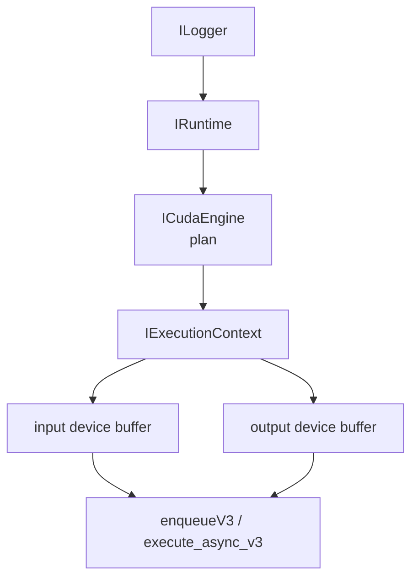
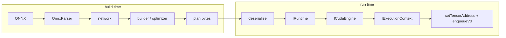

---
tags:
  - 功能实现
  - TensorRT
  - CUDA
  - 推理部署Inference
  - 学习路径LearningPath
  - 对象生命周期Lifetime
  - 显存绑定TensorBinding
---

# TensorRT 部署学习路径：从 runtime 到 CUDA 加速 · 功能实现

**时间:** 2026-10-26
**标签:** #功能实现 #TensorRT #CUDA #推理部署Inference #学习路径LearningPath #对象生命周期Lifetime #显存绑定TensorBinding #执行上下文ExecutionContext
**关联:** [[CUDA/主页|CUDA 主页]] · [[N018 CUDA-cuDNN-TensorRT三层结构]]（三层分工）· [[N022 ONNX与TensorRT Engine的区别]]（engine 是什么）· [[N024 ONNX编译成engine的原理]]（build 原理）· [[N025 拿到ONNX转engine的标准操作]]（trtexec）· [[N026 TensorRT-engine推理全流程]]（groundzero 推理）· [[N027 数值精度与量化 FP32-FP16-BF16-TF32-INT8]]（精度）· [[E002 TensorRT11的API变化]]（TRT 11 坑）

## 一句话

**不按 TensorRT 文档目录学，按「一张图从进入程序到输出框/关键点」的链路学；先 runtime，后 builder；先跑通，再重写，最后加速。**

## 为什么这样学

导师那段话已经把 runtime 的骨架说完了：

```
Logger → Runtime → Engine → Context → Buffer → setTensorAddress → enqueue
```

觉得「要讲的东西太多」，是因为按章节学。链路上每个环节只问三件事：

1. 它为什么存在？
2. 它失败时是什么现象？
3. 它的内存/生命周期归谁管？

## 现状（2026-10-26）

已有：

- CUDA C01/C02 + vecAdd（0.60 ms / 335 GB/s）
- groundzero 的 `best.onnx` / `best.engine`：输入 `[1,3,640,640]`，输出 `[1,300,30]`
- Python 版 engine 推理脚本
- 一份能跑的 C++ TensorRT 节点（可当对照）
- 笔记 [[N018 CUDA-cuDNN-TensorRT三层结构]] ~ [[N027 数值精度与量化 FP32-FP16-BF16-TF32-INT8]]、[[E002 TensorRT11的API变化]]

缺口：

1. C++ API 每一行背后的机制
2. 脱离参考代码从零重写
3. 前后处理搬上 CUDA、做性能剖析
4. 工程化与移植

方法：**三遍法** —— 跑通 → 拆解 → 重写/优化。

## 总路线（4 周，约 90 min/天）

| 周 | 主题 | 原理重点 | 实战产出 |
| --- | --- | --- | --- |
| 0（10/26） | 诊断 | 对象模型、数据流 | 一页图 + 5 个自测题 |
| 1（10/26–11/01） | Runtime API | Logger/Runtime/Engine/Context、反序列化、内存绑定、stream | `trt_lab/01_deserialize` + `02_runner` |
| 2（11/02–11/08） | YOLO 端到端 | letterbox、HWC/CHW、pose 解码、逆映射 | `03_yolo` CLI + 数值对齐 + benchmark |
| 3（11/09–11/15） | CUDA 加速 | kernel 融合、pinned memory、stream overlap、nsys/ncu | `04_cuda` + 加速比/瓶颈报告 |
| 4（11/16–11/22） | 工程化 | ROS2、groundzero、C++ builder、移植 | `05_ros2` + demo + 报告 |

> 每天只有 45 min 就拉成 6 周；builder/移植想彻底吃透，第 4 周顺延 3～5 天。

## 每周任务

### 第 1 周 · Runtime API

1. **对象生命周期**：Logger / Runtime / Engine / Context 谁依赖谁；engine 是 plan，context 保存一次推理状态；多 stream 要多 context。
2. **反序列化**：`ifstream(ate|binary)` → `deserializeCudaEngine`；Ultralytics 导出的 engine 开头有 JSON 头；版本/GPU 校验。
3. **内存与绑定**：`getIOTensorName` / `getTensorShape` / `getTensorDataType`；按 dtype 算字节；`cudaMalloc`；`setTensorAddress`；RAII 释放。
4. **执行与同步**：`enqueueV3(stream)`（对应 Python 的 `execute_async_v3`）、`cudaMemcpyAsync`、`cudaStreamSynchronize`、事件计时、错误检查。
5. **动态 shape**：`setInputShape`、optimization profile；`getTensorShape` 在设 shape 前可能返回 `-1`。

### 第 2 周 · YOLO 端到端 C++ 重写

1. letterbox 数学 + 逆映射（`scale`、`dx/dy`）
2. BGR→RGB、`/255`、HWC→CHW；与 Python 逐元素对比
3. H2D/infer/D2H；pinned memory；分阶段计时
4. pose 输出 `[1,300,30]` 解码：`x1,y1,x2,y2,score,cls` + 8 个关键点；**end2end 已做 NMS，不要再写 NMS**
5. 封装 `YoloTRT` 类；和导师 `YOLOCuda` 逐行对照；C++ vs Python 数值对齐（max abs diff / IoU）

### 第 3 周 · CUDA 加速与剖析

1. preprocess kernel：letterbox + normalize + HWC→CHW 融合
2. postprocess kernel：decode + 阈值过滤（groundzero 不需要 NMS）
3. pinned memory + streams + 前后帧 overlap；CUDA Graph 选做
4. `nsys` 看时间线，`ncu` 看 occupancy / 带宽 / stall
5. CPU 前后处理 vs CUDA 前后处理端到端对比

### 第 4 周 · 工程化与落地

1. ROS2 节点：`image_transport`、自定义消息、参数、生命周期、线程安全
2. groundzero pose 端到端：关键点、FP16、精度对比 PyTorch
3. C++ builder：OnnxParser → network → config → build → serialize；看懂 build log / tactic / workspace
4. 移植：engine 不可跨 GPU/TRT 版本；Jetson Orin 上重建；INT8 校准选做
5. capstone：demo + 报告 + 15 问自测

## 必须能答的 12 个原理问题

1. engine 和 plan 是什么关系？为什么不能跨 GPU / TRT 版本？
2. Logger / Runtime / Engine / Context 的生命周期与销毁顺序？
3. `deserializeCudaEngine` 做了什么？为什么不需要 builder？
4. TRT 11 为什么用 tensor name 而不是 binding index？
5. `setTensorAddress` 绑定的是谁的内存？谁负责释放？
6. `enqueueV3` 是同步还是异步？谁负责同步？stream 起什么作用？
7. 动态 shape 为什么需要 `setInputShape` / optimization profile？`getTensorShape` 何时返回 `-1`？
8. FP16 engine 为什么不能用 `sizeof(float)` 分配？
9. Ultralytics engine 文件开头为什么有 JSON？直接反序列化会怎样？
10. 多线程 / 多 stream 为什么要多 context？engine 可以共享吗？
11. 预处理、H2D、推理、D2H、后处理各占多少时间？怎么测？
12. FP16 与 INT8 的本质区别？INT8 校准什么时候值得做？

## 故障注入实验

| 故意做错 | 预期现象 | 学到的机制 |
| --- | --- | --- |
| 输出 buffer 开小 | 越界 / 崩溃 / 错误码 | 显存所有权与尺寸校验 |
| FP16 engine 按 float 分配 | 绑定错位、结果全错 | dtype 决定字节数 |
| 去掉 `cudaStreamSynchronize` | 读到旧数据 / 随机错 | 异步执行与同步 |
| 动态 engine 不 `setInputShape` | enqueue 失败 | profile 与 shape 绑定 |
| 先销毁 runtime 再用 engine | crash | 对象生命周期 |
| 输入 HWC 当 CHW | 结果全是垃圾 | 内存布局 |

## 导师代码的 7 个拆解点

1. `sizeof(float)` 硬编码 → FP16/INT8 engine 会分配错，要用 `getTensorDataType`
2. `tensor_malloc(0/1)` 假设 0 是输入、1 是输出 → 应遍历 `numIOTensors` + `getTensorIOMode`
3. `dims.d[2]` 假设三维 → 用 `nbDims` 连乘，并处理 `-1`
4. `cudaMalloc` 没查返回值、没 `cudaFree` → 用 RAII
5. `ifstream` 整文件读取 → Ultralytics engine 有 JSON 头，需要跳过
6. Logger/Runtime 必须比 Engine/Context 活得久 → 析构顺序
7. 动态 engine 要 `setInputShape` 后再取输出 shape

## 对象与数据流




build-time 与 run-time 的边界：



## 代码与笔记组织

```
~/deep_learning/groundzero/trt_lab/
├── 01_deserialize/   ✅ 2026-10-26
├── 02_runner/        ⬜
├── 03_yolo/          ⬜
├── 04_cuda/          ⬜
├── 05_ros2/          ⬜
└── bench/            ⬜
```

笔记按 `T01～T07` 写，每篇五段：**一句话 → 原理图 → 代码 → 实验数据 → 自测题**。
图优先 Mermaid；线程/内存布局用英文标签 PNG。

## 验收标准（“吃透”的定义）

1. 白纸画出对象生命周期 + 数据流，不看笔记
2. 能解释每行 API 的输入 / 副作用 / 失败模式
3. 能脱离参考代码从零写一个最小 runner
4. 能复现并修复「故障注入」里的 6 类错误
5. 能给出分阶段耗时表，并指出瓶颈在预处理、PCIe 还是推理
6. 能换模型 / 尺寸 / 精度 / 设备

## 当前进度

- [x] 2026-10-26 `01_deserialize`：编译并跑通 `best.engine` 与 `best_trtexec.engine`
  - `best.engine` 检测到 JSON 头，剥掉 1018 字节
  - 两者 I/O 都是 `images [1,3,640,640] FP32` → `output0 [1,300,30] FP32`
  - 静态 profile：min = opt = max
- [ ] `02_runner`：cudaMalloc + setTensorAddress + enqueueV3

## 资源（只读用到的节）

- TensorRT 11.4 C++ API：`ILogger` / `IRuntime` / `ICudaEngine` / `IExecutionContext` / `Deserializing a Plan` / `setTensorAddress` / `enqueueV3`
- TensorRT Best Practices
- `trtexec --verbose`、`polygraphy`（可选）
- Nsight Systems / Nsight Compute
- CUDA 指南 C03/C04/C06/C08（按需）
