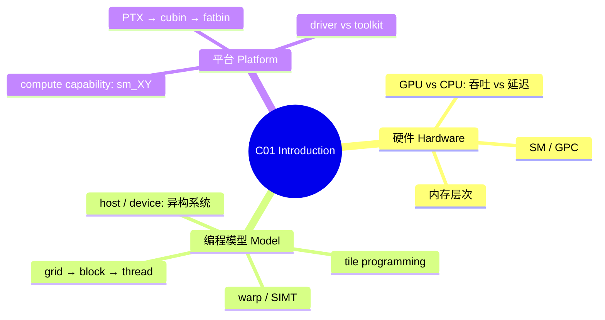
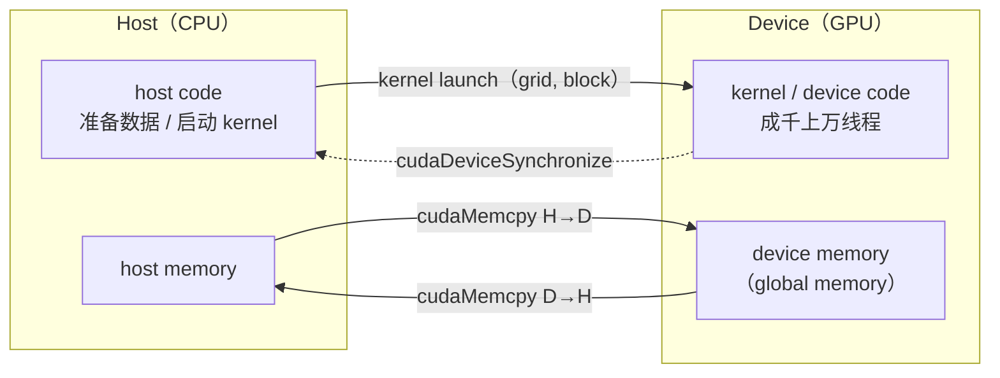
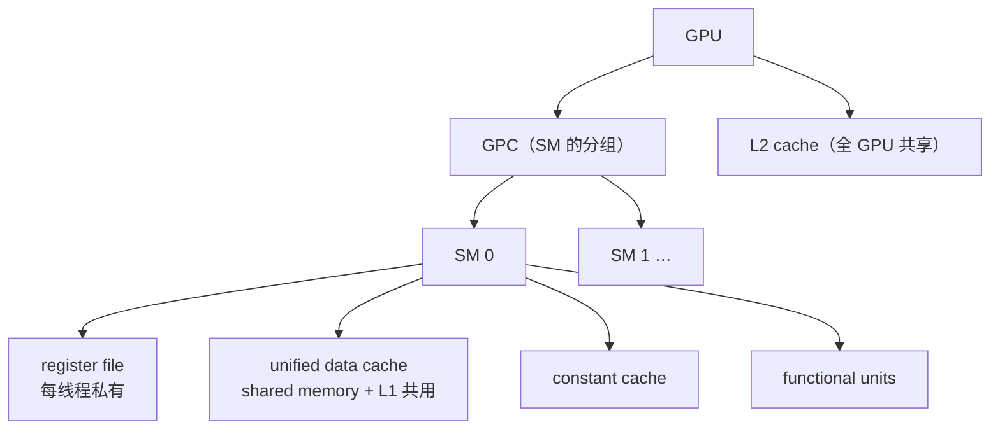
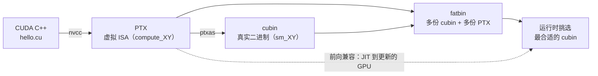

---
tags:
  - GPU架构
  - CUDA平台
  - 异构计算
  - SIMT
  - 线程层次
  - 内存层次
  - ComputeCapability
---

# C01 Introduction · GPU、CUDA 编程模型与平台

**时间:** 2026-10-24
**来源:** *CUDA Programming Guide* 13.4.2, Chapter 1（pp. 3–19）· [中文图解 1.1 Introduction](https://okazaki-yumemi.github.io/CUDA_PROGRAMMING_GUIDE_simplified-Chinese/01-introduction/introduction.html)
**原文:** [[cuda-programming-guide.pdf|CUDA Programming Guide 13.4.2]] · [PDF 图版（原书图 + 编程含义）](https://okazaki-yumemi.github.io/CUDA_PROGRAMMING_GUIDE_simplified-Chinese/figures.html)
**标签:** #GPU架构 #CUDA平台 #异构计算 #SIMT #线程层次 #内存层次 #ComputeCapability
**关联:** [[CUDA/主页|CUDA 主页]] · [[CUDA/学习笔记/学习笔记|CUDA 学习笔记]] · 下一章 [[C02 Programming Model]] · 落地场景：groundzero 预处理 kernel

## 一句话

CUDA 不是「把 for 循环搬到 GPU」这么简单，而是一套**异构系统模型**：host（CPU）负责数据搬运和启动，device（GPU）用 **grid → block → thread** 的层级把上百万线程映射到 SM 上，warp 以 **SIMT** 方式执行；平台层再用 **compute capability / PTX / cubin / fatbin** 回答「同一份代码怎么在不同 GPU 上跑」。

> 验收句（主页要求）：**CUDA 程序 = host 管数据搬运、device 管并行计算。**



*本讲导图：三块内容——硬件长什么样、程序怎么映射上去、平台怎么把代码送到 GPU。*

## 实际情况

### 0. 背景：从图形到通用计算

- GPU 最初是**三维图形的专用处理器**，用固定功能硬件加速实时渲染中的并行操作；
- 到 **2003 年**，图形流水线的部分阶段变成完全可编程，可以为每个顶点/像素并行运行自定义代码；
- **2006 年**，NVIDIA 推出 **CUDA**（Compute Unified Device Architecture），让任意计算负载都能使用 GPU 的吞吐能力，**不再依赖图形 API(Application Program Interface)**；
- 此后 GPU 计算扩展到流体/能源等科学模拟、数据库与分析，以及图像分类、扩散模型、LLM 等 AI 负载。

> 一句话：GPU 的「通用并行计算」能力，是图形硬件逐渐可编程 + CUDA 把编程接口统一之后的结果。

### 1. GPU 为什么快：吞吐 vs 延迟

CPU 和 GPU 的设计目标不同，不是「GPU 是更快的 CPU」：

| | CPU | GPU |
|---|---|---|
| 优化目标 | 单线程**延迟**（latency） | 总**吞吐**（throughput） |
| 并行规模 | 几十个线程 | 成千上万个线程 |
| 晶体管去向 | 大缓存 + 复杂控制流 | 大量数据运算单元 |
| 擅长 | 分支多、串行依赖强的代码 | 同一套运算作用在海量数据上 |

GPU 用**较低的单线程性能**换**高得多的总吞吐**。所以在 CUDA 里，「一个线程算一个元素」通常比「一个线程算一大块」更自然。

但 GPU **不是对所有任务都更快**：只有工作能拆成大量并行任务，并且数据搬运、同步、kernel 启动这些开销可控时，吞吐优势才容易体现。串行依赖强、分支杂乱、数据量又小的任务，GPU 可能还不如 CPU。

### 2. 异构系统：host、device 与 kernel

CUDA 程序默认跑在**异构系统**上（CPU + GPU）：

- **host** = CPU 及其直连内存（host memory）
- **device** = GPU 及其直连显存（device memory）
- 程序**总是从 CPU 开始执行**；host code 通过 CUDA API：
  1. 在 host / device 之间搬数据；
  2. 启动 GPU 上的代码；
  3. 等待拷贝或 GPU 代码完成。
- 跑在 GPU 上的函数叫 **kernel**，启动 kernel 叫 **launch**。一次 launch 可以理解为「同时启动成千上万个线程执行同一段 kernel 代码」。
- CPU 和 GPU **可以同时执行**；性能最好时两边都不闲着。



*图 1 · 异构系统：host 负责搬运与启动，device 负责并行计算。*

### 3. GPU 硬件模型：SM 与 GPC

从 CUDA 编程模型看，GPU 是：

```
GPU
├── GPC（Graphics Processing Cluster）
│   ├── SM（Streaming Multiprocessor）
│   │   ├── register file（每线程私有）
│   │   ├── unified data cache（L1 + shared memory，运行时划分）
│   │   ├── constant cache
│   │   └── 若干 functional units
│   └── ...
└── L2 cache（全 GPU 共享）
```

- **SM** 是调度线程块的基本硬件单位；一个 SM 内还有寄存器文件、统一数据缓存（shared memory 和 L1 共用同一块物理资源，比例可运行时配置）、常量缓存和运算单元。
- **GPC** 是 SM 的分组；更上层才是整个 GPU 和显存。
- 不同架构的 SM 数量、寄存器/缓存大小、运算单元数量都不同——**写程序不要依赖具体数值**。



*图 2 · 硬件层次：GPU → GPC → SM；L2 由所有 SM 共享。对应原书图 2。*
**编程含义：** 线程块会被调度到某一个 SM 上；寄存器/共享内存用量决定一个 SM 能同时驻留多少 block（occupancy）。

### 4. 线程层次：grid → block → thread

启动 kernel 时用**执行配置** `<<<grid, block>>>` 指定：

- **thread**：最小执行单位；
- **thread block**：一组线程，**一定跑在同一个 SM 上**，因此可以用 shared memory 通信、用 `__syncthreads()` 同步；
- **grid**：一组 thread block，所有 block 的尺寸相同。

grid 和 block 都可以是 1D / 2D / 3D，方便把线程索引直接映射到图像、矩阵等数据。

kernel 内用内建变量定位自己：

| 变量 | 含义 |
|---|---|
| `threadIdx.{x,y,z}` | 线程在 block 内的坐标 |
| `blockIdx.{x,y,z}` | block 在 grid 内的坐标 |
| `blockDim.{x,y,z}` | 每个 block 的线程数 |
| `gridDim.{x,y,z}` | grid 中的 block 数 |

![[c01_grid_block_thread.png]]

*图 3 · 2×2 个 block、每 block 4×4 个线程；橙色是 `blockIdx=(1,0)` 里被选中的 `threadIdx=(2,1)`。对应原书图 3 / 图 4。*
**编程含义：** 用 `blockIdx / threadIdx / blockDim / gridDim` 算出每个线程负责的数据坐标；block 之间的调度顺序没有保证。

全局唯一编号（1D 例子）：

```cpp
int tid = blockIdx.x * blockDim.x + threadIdx.x;
```

**两条最重要的约束：**

1. **block 之间没有执行顺序保证**：可能并行、可能串行、可能任意顺序。因此不同 block 的线程**不能互相等待或依赖对方结果**（除非用跨 block 的显式机制）。
2. 正因为如此，CUDA 才能把「任意大的 grid」跑在「任意小的 GPU」上：block 排队上 SM 即可。

需要**跨 block 的全局同步**时，通常拆成多次 kernel launch，或使用 Cooperative Groups / cluster 等专门机制；不要自己用全局变量 + 自旋等待去「凑」同步。

> **Cluster（CC 9.0+）**：可选的第三层分组，把相邻 block 组成 cluster，保证它们跑在同一个 GPC 内并同时调度；cluster 内可以互相访问 shared memory（distributed shared memory），并用 Cooperative Groups 同步。入门阶段先了解概念即可。

### 5. Warp 与 SIMT

- 一个 block 内的线程按 **32 个一组**划分为 **warp**；warp 内的线程编号叫 lane（0–31）。
- **SIMT**（Single-Instruction Multiple-Threads）：同一 warp 的 32 个线程**同一条指令、同一时刻**推进，但每个线程可以有**自己的控制流**。
- 当 warp 内线程走不同分支时，不满足条件的 lane 会被**掩码屏蔽（masked off）**，等另一条分支执行完再回来——这叫 **warp divergence**。分支越分散，利用率越低。
- 因此：**block 的线程数尽量取 32 的倍数**。不是 32 的倍数也能跑，但最后一个 warp 会有空闲 lane，浪费运算单元和访存带宽。
- **SIMT ≠ SIMD**：SIMD 是一条指令锁死一个数据宽度、单一控制流；SIMT 允许每个线程独立分支，没有固定数据宽度。

![[c01_warp_divergence.png]]

*图 4 · warp divergence：一个 warp 里两条分支只能串行执行，每一段都有一半 lane 被掩码。对应原书图 7。*
**编程含义：** 条件分支不是绝对不能用，但要关注活跃 lane 数和两条路径的成本；能按 warp 对齐的分支最划算。

> 写代码时不必时时想着 warp，但理解它才能理解后面的 **global memory coalescing** 和 **shared memory bank conflict**。

### 6. Tile programming（块级编程）

除了「每线程写一份代码」的 SIMT 模型，CUDA 还支持 **tile programming**：

- 程序员以**整个 thread block** 为单位，操作多维数据块 **tile**；
- 编译器负责把 tile 操作映射到 block 内的各个线程；
- 程序员只指定 grid 维度，**block 内线程数由编译器决定**；
- tile 是**不可变**的（每次操作产生新 tile），维度必须是**编译期已知的 2 的幂**；
- tile 只存在于 tile code 中，不一定有内存实体（编译器决定放寄存器/shared memory）；
- 数据在 **array（device memory 中的可变多维数组）** 与 tile 之间通过 **load / store** 移动；load/store 以 **tile space**（把数组按 tile 形状切分后的坐标系）索引，越界可指定填充（如 0）。

**不要混淆 block 和 tile**：block 是**执行单位**，tile 是**数据单位**；一个 block 可以处理很多不同形状的 tile。两种模型可以在同一个程序里共存，按 kernel 选择。

### 7. GPU 内存层次

| 存储 | 位置 | 可见范围 | 特点 |
|---|---|---|---|
| **global memory** | GPU DRAM | 全 GPU 所有 SM | 容量大、延迟高；device code 里的「全局」 |
| **system / host memory** | CPU DRAM | CPU | 通过 PCIe/NVLink 访问，延迟更高 |
| **register file** | SM 内 | 单线程私有 | 最快；由编译器分配 |
| **shared memory** | SM 内（统一缓存） | 同一 block / cluster | 线程间交换数据；按 block 分配 |
| **L1 cache** | SM 内 | 单 SM | 与 shared memory 共用物理资源 |
| **L2 cache** | GPU 内 | 全 GPU | 所有 SM 共享 |
| **constant cache** | SM 内 | 全 GPU（只读） | 缓存 `__constant__` 数据和 kernel 参数 |

![[c01_memory_hierarchy.png]]

*图 5 · 内存层次：越靠上越快、越小；越靠下越慢、越大（未按比例）。*

几个关键点：

- **统一虚拟地址空间**：CPU 和每块 GPU 的虚拟地址互不重叠，给定地址能判断它在 host 还是哪块 device 上。
- **locality domain**：大 GPU 内可按内存 + SM 划分子域，把计算和它要用的内存放在同一域内可提升性能；不划分也能正确运行。
- **寄存器是 per-thread 的，shared memory 是 per-block 的**。如果每个线程需要的寄存器 × block 线程数超过 SM 的寄存器文件，kernel 直接**无法启动**，只能减小 block。
- **Unified Memory**：一次分配，CPU/GPU 都能访问，由 runtime 或硬件按需迁移。但它不是「免费共享」——**迁移越少越快**，能放对地方就放对地方。
- **mapped memory**（把 host 内存映射给 GPU）走 PCIe/NVLink，延迟高、带宽低，不能替代 unified memory 或显式拷贝。

### 8. CUDA 平台：CC、PTX、cubin、fatbin

#### 8.1 Compute Capability（CC）

每块 NVIDIA GPU 有一个 **compute capability X.Y**，表示它支持的特性与硬件参数：

- 直接对应 SM 版本：CC 12.0 → **sm_120**（本机 RTX 5060 Laptop 就是 12.0）；
- 编译时用 `-arch=sm_120` 指定目标；
- 不同 CC 的功能/资源见手册附录。

#### 8.2 Driver vs Toolkit

| | NVIDIA Driver | CUDA Toolkit |
|---|---|---|
| 类比 | **GPU 的操作系统** | 写/编译/分析 GPU 程序的工具箱 |
| 内容 | 所有 GPU 使用方式的基础（CUDA、Vulkan、Direct3D…） | nvcc、头文件、库（cuBLAS/cuFFT/cuDNN/CUTLASS…）、性能工具 |
| 安装 | Windows 侧（WSL2 里**不要**装 Linux 驱动） | WSL2 里装 toolkit（不含驱动组件） |

- **CUDA Runtime API** 建立在更底层的 **CUDA Driver API** 之上；本手册主要讲 runtime API，但两者可以混用。
- 很多场景不必自己写 kernel：cuBLAS/cuDNN/CUTLASS 等库已经针对各架构优化；Triton、Warp 等 DSL 也能直接编译到 CUDA 平台。

> **先问一句：真的需要自己写 kernel 吗？**
> 已有库（cuBLAS / cuFFT / cuDNN / CUTLASS）通常比手写更快、更可移植；PyTorch、TensorRT 等框架和 Triton 等 DSL 也能覆盖大部分推理场景。自己写 kernel 的真正价值在于：**库里没有的操作、算子融合（fusion）、特殊数据布局、以及把预处理/后处理搬上 GPU**——比如 groundzero 的 letterbox + 归一化 + HWC→CHW。

#### 8.3 PTX → cubin → fatbin

```
CUDA C++  --nvcc-->  PTX（虚拟 ISA）  --ptxas/JIT-->  cubin（真实 GPU 二进制）
                              └──────── fatbin 容器 ────────┘
```



*图 6 · 编译链路：源码 → PTX → cubin；fatbin 把多份目标代码打包在一起。对应原书图 10。*
**编程含义：** 发布时通常同时打包目标 cubin + 一份 PTX：当前 GPU 直接跑 cubin，未来 GPU 用 PTX JIT 兜底。

- **PTX**：NVIDIA GPU 的**虚拟指令集架构**（类汇编），提供对物理 ISA 的抽象；版本如 `compute_80`。
- **cubin**：针对某个 SM 版本的真实二进制（如 `sm_120`）。
- **fatbin**：可执行文件/库中存放 GPU 代码的容器，可同时包含**多个 cubin + 多份 PTX**；运行时挑选最合适的。
- **二进制兼容规则**：
  - 同一 major 内，**minor ≥ 编译目标**的 GPU 能直接跑该 cubin（8.6 的 cubin 能跑在 8.6/8.9，不能跑在 8.0）；
  - **跨 major 不兼容**（8.6 的 cubin 不能跑在 9.0）。
- **PTX 前向兼容**：程序里带 `compute_80` 的 PTX，可以在更高 CC 的 GPU 上由驱动 **JIT 编译**成 cubin；JIT 结果会缓存（compute cache），驱动升级后缓存失效。
- **Binary finalization（CC 10.0+）**：同 family 内，驱动可在加载时把某个架构的 cubin **re-finalize** 到另一个兼容架构（off-target finalization）；比 PTX JIT 便宜，但仍增加加载时间。9.x 及更早不适用。

> 实用结论：发布程序时常用 `-gencode` 同时打包「目标 cubin + 一份 PTX」，兼顾当前机器性能和未来 GPU 的前向兼容。

### 9. 第一个 kernel：hello + device query

完整代码：`/home/akiha/deep_learning/cuda/c01/hello.cu`

```cpp
#include <cstdio>
#include <cuda_runtime.h>

__global__ void hello() {
    printf("  block %u/%u, thread %u/%u\n",
           blockIdx.x, gridDim.x, threadIdx.x, blockDim.x);
}

int main() {
    cudaDeviceProp p;
    cudaGetDeviceProperties(&p, 0);

    printf("Device: %s\n", p.name);
    printf("Compute capability: %d.%d (sm_%d%d)\n", p.major, p.minor, p.major, p.minor);
    printf("SMs: %d | max threads/SM: %d | warp size: %d\n",
           p.multiProcessorCount, p.maxThreadsPerMultiProcessor, p.warpSize);
    printf("Global memory: %.2f GB | shared mem/SM: %zu KB\n",
           p.totalGlobalMem / 1e9, p.sharedMemPerMultiprocessor / 1024);

    hello<<<2, 4>>>();
    cudaDeviceSynchronize();

    printf("cudaGetLastError: %s\n", cudaGetErrorString(cudaGetLastError()));
    return 0;
}
```

要点：

- `__global__` 表示「在 host 调用、在 device 执行」的 kernel；
- `<<<2, 4>>>` = 2 个 block × 每 block 4 个线程；
- device 端的 `printf` 是缓冲的，`cudaDeviceSynchronize()` 保证输出刷出来；
- **每次 launch 后检查 `cudaGetLastError()`**——kernel 经常「静默失败」，不查错误码会以为跑成功了。

### 10. 术语表

| 中文 | English | 一句话 |
|---|---|---|
| 主机 / 设备 | host / device | CPU 侧 / GPU 侧 |
| 内核 | kernel | GPU 上并行执行的函数 |
| 线程块 | thread block | 一组同 SM 的线程 |
| 网格 | grid | 一组 thread block |
| 流式多处理器 | SM | GPU 的基本调度单元 |
| 线程束 | warp | 32 个线程的执行分组 |
| 线程束分歧 | warp divergence | warp 内线程走不同分支导致掩码 |
| 计算能力 | compute capability | GPU 特性版本，对应 sm_XY |
| 全局内存 | global memory | GPU 显存，全 GPU 可见 |
| 共享内存 | shared memory | block 内共享的片上内存 |
| 统一内存 | unified memory | CPU/GPU 都可访问、按需迁移 |
| 局部域 | locality domain | GPU 内内存 + SM 的子域 |
| 并行线程执行 | PTX | NVIDIA GPU 虚拟 ISA |
| GPU 二进制 | cubin | 针对某 SM 版本的机器码 |
| 胖二进制 | fatbin | 装多个 cubin/PTX 的容器 |

## 实验数据

### 环境

| 项 | 值 |
|---|---|
| GPU | NVIDIA GeForce RTX 5060 Laptop GPU（8 GB，WSL2） |
| Compute capability | **12.0 → sm_120** |
| SM 数 | **26** |
| 每 SM 最大线程数 | **1536** |
| warp size | **32** |
| global memory | **8.52 GB** |
| shared memory / SM | **100 KB** |
| nvcc | CUDA **12.8.93**（另有 13.1.115 可切换） |
| host compiler | **g++-14**（系统 gcc 15 超出 CUDA 12.8 支持范围） |

### 编译与运行

```bash
cd ~/deep_learning/cuda/c01
nvcc hello.cu -o hello      # 本机 wrapper：-ccbin g++-14 -U_GNU_SOURCE -arch=sm_120
./hello
```

`hello<<<2, 4>>>` 输出：

```
Device: NVIDIA GeForce RTX 5060 Laptop GPU
Compute capability: 12.0 (sm_120)
SMs: 26 | max threads/SM: 1536 | warp size: 32
Global memory: 8.52 GB | shared mem/SM: 100 KB
hello<<<2, 4>>>:
  block 0/2, thread 0/4
  block 0/2, thread 1/4
  block 0/2, thread 2/4
  block 0/2, thread 3/4
  block 1/2, thread 0/4
  block 1/2, thread 1/4
  block 1/2, thread 2/4
  block 1/2, thread 3/4
cudaGetLastError: no error
```

### 观察与结论

1. **8 个线程 = 2 block × 4 thread**；每个 block 只有 4 个线程，却要占满一个 warp（32 lane），**lane 利用率 4/32 = 12.5%**。这直接验证了「线程数尽量取 32 的倍数」。
2. 输出顺序看起来是 block 0 全打印完再 block 1，但**这只是本次调度的偶然结果**；block 之间没有顺序保证，不能依赖。
3. 本机 26 个 SM、每 SM 1536 线程，理论上限 `26 × 1536 = 39936` 个常驻线程；grid 可以有上百万个 block，靠排队复用 SM。
4. 编译环境有两个坑（详见下方「踩坑记录」），都会在后续章节反复用到。

### 踩坑记录（本机 WSL2 + Ubuntu 25.10）

| 坑 | 现象 | 解决 |
|---|---|---|
| 系统 gcc 15 太新 | `unsupported GNU version! gcc versions later than 14 are not supported` | 装 `g++-14`，nvcc 加 `-ccbin g++-14` |
| glibc 2.42 的 C23 数学函数 | `cospi / sinpi / rsqrt` 的 `exception specification is incompatible` | nvcc 加 `-U_GNU_SOURCE`，让 glibc 不声明这批 C23 函数 |
| 默认架构 | 不写 `-arch` 时可能生成旧架构 cubin，在 sm_120 上无 kernel image | 默认加 `-arch=sm_120` |

已封装为 `~/.local/bin/nvcc` wrapper（PATH 中优先于 `/usr/local/cuda/bin/nvcc`），所以直接 `nvcc hello.cu -o hello` 即可。wrapper 内容见 `/home/akiha/.local/bin/nvcc`。

> 另外装了 **CUDA 13.1 toolkit**（`/usr/local/cuda-13.1`）用于对照新版手册，但 `/usr/local/cuda` 默认仍指向 **12.8**，与 `torch 2.11.0+cu128` 保持一致。

## 相关

- 下一章：**C02 Programming Model**（线程/内存模型展开，写入真实 kernel）
- 后续：C03 The CUDA platform、C04 Intro to CUDA C++、C06 Writing SIMT Kernels
- 项目：① 向量加法（C02/C04）→ ② 朴素矩阵乘（C04/C06）→ ③ 图像灰度化（C06）
- 落地：groundzero 预处理 kernel（letterbox + 归一化 + HWC→CHW，阶段 3）
- 延伸讲座：北大未名超算队 × LCPU **AI Infra Seminars**（B 站合集），其中 1.1 CUDA Programming Model、2.1 Memory Abstraction、2.2 FP32 GEMM 与本线高度重合，可作为补充讲解（见主页评估）
- 中文对照：[1.1 Introduction 译文](https://okazaki-yumemi.github.io/CUDA_PROGRAMMING_GUIDE_simplified-Chinese/01-introduction/introduction.html) · [PDF 图版](https://okazaki-yumemi.github.io/CUDA_PROGRAMMING_GUIDE_simplified-Chinese/figures.html)（基于 Release 13.3；本笔记按 13.4.2，版本差异以官方 PDF 为准）
