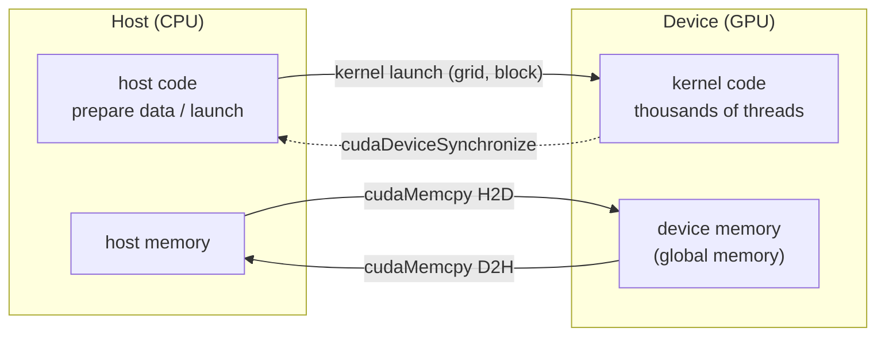
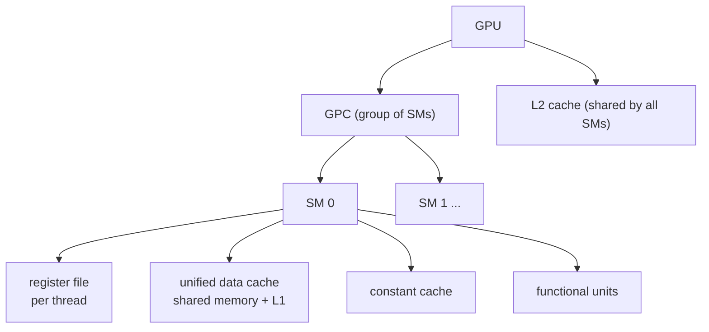
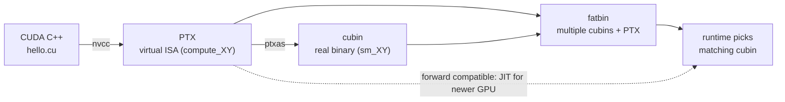

把 GPU 的吞吐模型、CUDA 的异构执行模型，以及「同一份代码怎么落到不同 GPU」的平台机制串起来。线程索引、warp/SIMT、内存层次的展开见 [[C02 Programming Model]]。

## GPU 为什么快：吞吐 vs 延迟

CPU 和 GPU 的设计目标不同，不是「GPU 是更快的 CPU」：

| | CPU | GPU |
|---|---|---|
| 优化目标 | 单线程**延迟**（latency） | 总**吞吐**（throughput） |
| 并行规模 | 几十个线程 | 成千上万个线程 |
| 晶体管去向 | 大缓存 + 复杂控制流 | 大量数据运算单元 |
| 擅长 | 分支多、串行依赖强 | 同一套运算作用在海量数据上 |

GPU 用较低的单线程性能换高得多的总吞吐，所以「一个线程算一个元素」在 CUDA 里很自然。但 GPU 不是对所有任务都更快：只有工作能拆成大量并行任务、且数据搬运/同步/kernel 启动开销可控时，吞吐优势才体现；串行依赖强、分支杂乱、数据量又小的任务可能不如 CPU。

GPU 从固定功能的图形处理器演化到可编程流水线；2006 年 CUDA 统一了通用计算接口，之后才扩展到科学模拟、数据库和 AI 负载。

## 异构系统：host、device、kernel

- **host** = CPU 及其直连内存；**device** = GPU 及其显存。
- 程序总是从 CPU 开始：host code 通过 CUDA API 搬数据、启动 GPU 代码、等待完成。
- 跑在 GPU 上的函数叫 **kernel**，启动它叫 **launch**；一次 launch 等于同时启动成千上万个线程执行同一段代码。
- CPU 和 GPU 可以同时执行，性能最好时两边都不闲着。



## 硬件层次：GPU → GPC → SM



- **SM** 是调度线程块的基本硬件单位；寄存器文件、shared memory + L1 的统一缓存、常量缓存和运算单元都在 SM 内。
- **GPC** 是 SM 的分组，再往上是整个 GPU 和显存。
- 不同架构的 SM 数、寄存器/缓存大小都不同，**写程序不要依赖具体数值**。
- 线程块被调度到某一个 SM 上；寄存器/共享内存用量决定一个 SM 能同时驻留多少 block（occupancy）。

## 线程层次：grid → block → thread

- **thread**：最小执行单位。
- **thread block**：一组线程，**一定跑在同一个 SM 上**，因此可以用 shared memory 通信、用 `__syncthreads()` 同步。
- **grid**：一组 thread block，所有 block 尺寸相同。
- grid 和 block 都可以是 1D/2D/3D，方便把线程索引直接映射到图像、矩阵。

block 之间**没有执行顺序保证**：可能并行、可能串行、可能任意顺序，所以不同 block 不能互相等待或依赖对方结果。正因如此，任意大的 grid 才能排队跑在任意小的 GPU 上。需要跨 block 同步时，拆成多次 kernel launch，或用 Cooperative Groups；不要用全局变量 + 自旋等待去凑。

> **Cluster（CC 9.0+）**：可选的第三层分组，相邻 block 组成 cluster，保证同 GPC 同时调度，cluster 内可互访 shared memory（distributed shared memory）。入门先了解概念。

索引公式、`dim3`、二维映射、warp/SIMT 和内存层次都在 [[C02 Programming Model]]。

## Tile programming

以整个 thread block 为单位操作多维数据块 **tile**，编译器把 tile 操作映射到 block 内的线程；程序员只指定 grid 维度，block 内线程数由编译器决定。tile 不可变，维度必须是编译期已知的 2 的幂，只存在于 tile code 中（不一定有内存实体）。数据在 device memory 的 **array** 与 tile 之间用 **load / store** 按 tile space 索引，越界可填充。

block 是**执行单位**，tile 是**数据单位**；一个 block 可以处理多种形状的 tile，两种模型可在同一程序中共存。

## 平台：compute capability、PTX、cubin、fatbin

每块 GPU 有一个 **compute capability X.Y**，对应 SM 版本：CC 12.0 → `sm_120`（本机 RTX 5060 Laptop 就是 12.0），编译时用 `-arch=sm_120` 指定。

| | NVIDIA Driver | CUDA Toolkit |
|---|---|---|
| 类比 | GPU 的操作系统 | 写/编译/分析 GPU 程序的工具箱 |
| 内容 | 所有 GPU 使用方式的基础（CUDA、Vulkan、Direct3D…） | nvcc、头文件、库（cuBLAS/cuDNN/CUTLASS…）、性能工具 |
| 安装 | Windows 侧；WSL2 里**不要**装 Linux 驱动 | WSL2 里装 toolkit（不含驱动组件） |

CUDA Runtime API 建在 Driver API 之上；两者可以混用。多数场景不必手写 kernel：cuBLAS/cuDNN/CUTLASS、Triton、TensorRT 已覆盖大部分需求，自己写的价值在库里没有的算子、算子融合、特殊布局，以及把前后处理搬上 GPU（如 groundzero 的 letterbox + 归一化 + HWC→CHW）。



- **PTX**：NVIDIA GPU 的虚拟指令集架构（类汇编），版本如 `compute_80`。
- **cubin**：针对某个 SM 版本的真实二进制，如 `sm_120`。
- **fatbin**：可执行文件/库中装 GPU 代码的容器，可同时放多份 cubin + 多份 PTX，运行时挑最合适的。
- **二进制兼容**：同一 major 内，minor ≥ 编译目标的 GPU 能直接跑该 cubin（8.6 能跑在 8.6/8.9，不能跑在 8.0）；跨 major 不兼容（8.6 不能跑在 9.0）。
- **PTX 前向兼容**：带 `compute_80` PTX 的程序可在更高 CC 的 GPU 上由驱动 JIT 成 cubin；JIT 结果会缓存，驱动升级后失效。

发布时常用 `-gencode` 同时打包「目标 cubin + 一份 PTX」：当前 GPU 直接跑 cubin，未来 GPU 用 PTX JIT 兜底。

## 第一个 kernel

完整代码：`/home/akiha/deep_learning/cuda/c01/hello.cu`

```cpp
#include <cstdio>
#include <cuda_runtime.h>

__global__ void hello() {
    printf("block %u/%u, thread %u/%u\n",
           blockIdx.x, gridDim.x, threadIdx.x, blockDim.x);
}

int main() {
    hello<<<2, 4>>>();
    cudaDeviceSynchronize();   // device printf 是缓冲的，同步后才刷出
    printf("last error: %s\n", cudaGetErrorString(cudaGetLastError()));
    return 0;
}
```

- `__global__`：在 host 调用、在 device 执行的 kernel，返回 `void`。
- `<<<2, 4>>>`：2 个 block × 每 block 4 个线程。
- **每次 launch 后查 `cudaGetLastError()`**：kernel 经常静默失败，不查错误码会以为跑成功了。

```bash
cd ~/deep_learning/cuda/c01
nvcc hello.cu -o hello      # 本机 wrapper 自动加 -ccbin g++-14 -U_GNU_SOURCE -arch=sm_120
./hello
```

## 实验：环境与 hello 输出

| 项 | 值 |
|---|---|
| GPU | NVIDIA GeForce RTX 5060 Laptop GPU（8 GB，WSL2） |
| Compute capability | **12.0 → sm_120** |
| SM 数 / 每 SM 最大线程数 / warp size | **26 / 1536 / 32** |
| global memory / shared memory per SM | **8.52 GB / 100 KB** |
| nvcc | CUDA **12.8.93**（另有 13.1.115 可切换） |
| host compiler | **g++-14**（系统 gcc 15 超出 CUDA 12.8 支持范围） |

`hello<<<2, 4>>>` 输出：

```
block 0/2, thread 0/4
block 0/2, thread 1/4
block 0/2, thread 2/4
block 0/2, thread 3/4
block 1/2, thread 0/4
block 1/2, thread 1/4
block 1/2, thread 2/4
block 1/2, thread 3/4
last error: no error
```

1. 8 个线程 = 2 block × 4 thread；每个 block 只有 4 个线程，却要占满一个 warp（32 lane），**lane 利用率 4/32 = 12.5%**。这就是「block 线程数尽量取 32 的倍数」的直接原因。
2. 输出看起来是 block 0 全打印完再 block 1，但**只是本次调度的偶然结果**，block 之间没有顺序保证。
3. 26 个 SM × 1536 线程 = 39936 个常驻线程上限；grid 可以有上百万个 block，靠排队复用 SM。

## 坑（本机 WSL2 + Ubuntu 25.10）

| 坑 | 现象 | 解决 |
|---|---|---|
| 系统 gcc 15 太新 | `unsupported GNU version! gcc versions later than 14 are not supported` | 装 `g++-14`，nvcc 加 `-ccbin g++-14` |
| glibc 2.42 的 C23 数学函数 | `cospi / sinpi / rsqrt` 的 `exception specification is incompatible` | nvcc 加 `-U_GNU_SOURCE` |
| 默认架构 | 不写 `-arch` 可能生成旧架构 cubin，在 sm_120 上无 kernel image | 默认加 `-arch=sm_120` |

已封装为 `~/.local/bin/nvcc` wrapper（PATH 中优先于 `/usr/local/cuda/bin/nvcc`），直接 `nvcc hello.cu -o hello` 即可。另装 CUDA 13.1 toolkit 用于对照新版手册，但 `/usr/local/cuda` 默认仍指 12.8，与 torch 2.11.0+cu128 一致。

**CUDA 程序 = host 管数据搬运、device 管并行计算**；平台层用 CC + fatbin 回答「怎么在不同 GPU 上跑」。下一章 [[C02 Programming Model]] 把模型落成可运行的 kernel。