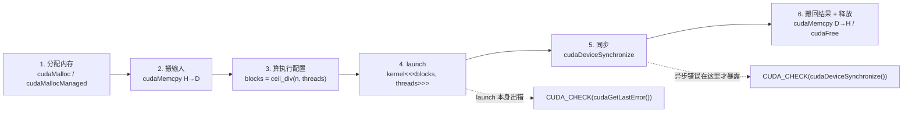
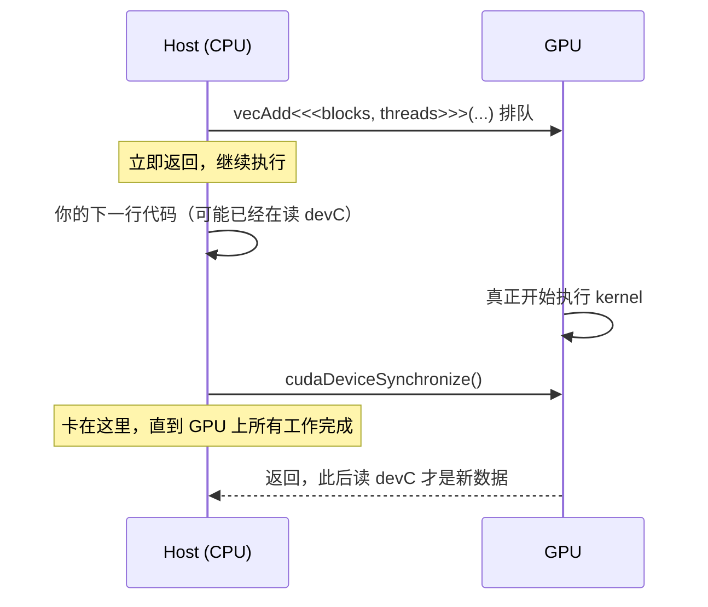

---
tags:
  - CUDA编程模型
  - 线程索引
  - 显式内存
  - 统一内存
  - 异步与同步
  - 错误检查
---

# C02 Programming Model · 把模型写成能跑的 kernel

**时间:** 2026-10-24
**来源:** *CUDA Programming Guide* 13.4.2 —— 概念部分 Chapter 1.2（pp. 5–14，已在 [[C01 Introduction]] 讲完）＋ 落地部分 **2.1 Intro to CUDA C++（pp. 21–37）** · [中文图解站](https://okazaki-yumemi.github.io/CUDA_PROGRAMMING_GUIDE_simplified-Chinese/)
**原文:** [[cuda-programming-guide.pdf|CUDA Programming Guide 13.4.2]] · [PDF 图版](https://okazaki-yumemi.github.io/CUDA_PROGRAMMING_GUIDE_simplified-Chinese/figures.html)
**标签:** #CUDA编程模型 #线程索引 #显式内存 #统一内存 #异步与同步 #错误检查
**代码:** `~/deep_learning/cuda/c02/vector_add.cu`（5 个实验）
**关联:** [[CUDA/主页|CUDA 主页]] · 上一章 [[C01 Introduction]] · 下一章 [[C03 The CUDA platform]]

## 一句话

C01 讲的是「grid → block → thread 映射到 SM、warp 按 SIMT 跑」的**模型**；这一章把它落成固定套路：**分配 → 搬数据 → 配 grid/block → launch → 同步 → 回收**。其中真正决定程序对不对的是三件事——**索引算得对不对**（谁负责哪个元素）、**同步有没有做**（launch 是异步的，不管它就跑完了吗）、**错误有没有查**（kernel 静默失败是常态）。



*图 0：本章的固定六步。第 4 步返回时 kernel 可能还没开始跑，第 5 步才是「它真的做完了」的分界线；两个虚线箭头是仅有的两个该查错误的时机。*

## 实际情况

### 0. 概念已经在 C01，这一章补什么

Guide 的 1.2 Programming Model 有 6 个小节，C01 已经全部过了一遍。C02 不再重复，只做「概念 → 代码」的对应：

| 1.2 的概念 | C01 的结论 | 本章对应的代码 |
| ---- | ---- | ---- |
| 1.2.1 异构系统 | host 管搬运，device 管计算 | 六步流程、`cudaMemcpy` |
| 1.2.2.1 blocks & grids | grid/block 是两层索引，block 上限 1024 线程 | `<<<blocks, threads>>>`、`dim3` |
| 1.2.2.2 warps & SIMT | 32 线程一个 warp，分支会串行 | block 大小取 32 的倍数 |
| 1.2.2.3 tile programming | tile 是 block 级的数据块 | 本章不涉及（C07） |
| 1.2.3.1–3.3 DRAM / 片上内存 / cache | 全局内存慢，共享内存快 | 显式 vs 统一内存 |
| 1.2.3.4 unified memory | 驱动替你搬页 | `cudaMallocManaged` 实测 |

### 1. 执行配置：`<<<grid, block>>>`

```cpp
__global__ void vecAdd(const float* A, const float* B, float* C, int n) {
    int i = blockIdx.x * blockDim.x + threadIdx.x;   // 全局下标
    if (i < n) C[i] = A[i] + B[i];                   // 越界线程直接退出
}
```

- `__global__` 函数返回 `void`，从 host 调用、在 device 执行；`__device__` / `__host__` 是另外两种。
- `<<<Dg, Db>>>` 分别是 grid 维度和 block 维度，一维时可直接写整数，多维用 `dim3(x, y, z)`（没写的维度默认 1）。
- 当前 GPU 一个 block **最多 1024 线程**（本机 `maxThreadsPerBlock = 1024`），因为一个 block 必须整个住在同一个 SM 上、共享它的资源。
- `blockDim.x` 是 block 大小，`blockIdx.x` 是 block 编号，两者都是**从 0 开始**。

**索引公式（一维）：全局下标 = block 编号 × block 大小 + 块内编号。**

![[c02_index_mapping.png]]
*图 1：4 个 block × 4 个线程 = 16 个线程，但 N = 14。最后两个线程的 `i` 已经是 14、15，越界，被 `if (i < n)` 挡掉。注意它们是**同一 warp 里的部分线程退出**——这就是 C01 说的 warp divergence，只是这里代价可以忽略。*
**编程含义：** 多 launch 几个线程几乎不花钱，但**多 launch 整个什么都不做的 block 是浪费**——所以 block 数要算准，只让最后一个 block 有零头。

**block 数怎么算：**

```cpp
int threads = 256;
int blocks  = (n + threads - 1) / threads;   // 手写向上取整
// 或者用 CCCL 的（需 #include <cuda/cmath>）
int blocks2 = cuda::ceil_div(n, threads);
```

`(n + t - 1) / t` 利用整数除法向下取整的特性凑出向上取整；`cuda::ceil_div` 是 CUDA 13 起 CCCL 提供的等价物。**写成 `n / t` 是最常见的漏算 bug**：n = 1025、t = 1024 时只得到 1 个 block，最后一个元素永远没人算。

### 2. 二维 / 三维索引

二维问题（图像、矩阵）用二维网格最自然：

```cpp
__global__ void fillIndex2D(int* out, int H, int W) {
    int col = blockIdx.x * blockDim.x + threadIdx.x;   // x 是最内层、变化最快的
    int row = blockIdx.y * blockDim.y + threadIdx.y;
    if (row < H && col < W)
        out[row * W + col] = row * W + col;            // 二维 → 一维：row * W + col
}
```

- **x 方向是变化最快的维度**，对应内存里连续的下标——这不是随便定的，后面做 memory coalescing 时「相邻线程访问相邻地址」就靠它。
- 二维/三维只是「逻辑上的坐标系」，显存仍然是一维的，最终都要展平成 `row * W + col`。
- 三维同理：`i = (blockIdx.z * gridDim.y + blockIdx.y) * gridDim.x * blockDim.x + ...`，实际很少手写，一般只用一个维度铺满、其它维度管坐标。

本机验证（H=1000、W=1024、block=16×16）：`grid=(64,63)`，共 1,032,192 个线程跑 1,024,000 个元素，写回的每个元素都等于自己的展平下标，0 个错。

### 3. 内存在哪：显式管理 vs 统一内存

GPU 只能直接读**显存**，CPU 只能直接读**主机内存**，两边之间是 PCIe。于是有两种写法：

| | 显式管理（explicit） | 统一内存（unified / managed） |
| ---- | ---- | ---- |
| 分配 | `cudaMalloc`（显存）+ `cudaMallocHost`（锁页主机内存） | `cudaMallocManaged` 一次分配，两边都能用 |
| 搬迁 | 手动 `cudaMemcpy` | 驱动按页自动搬 |
| 代码量 | 多，要记住每个指针在哪 | 少，像写普通 CPU 程序 |
| 可控性 | 完全可控：何时搬、搬什么 | 黑盒，性能取决于驱动和架构 |
| 释放 | `cudaFree` / `cudaFreeHost` | `cudaFree` |

```cpp
// 显式
float *dA, *hA;
cudaMalloc(&dA, n * sizeof(float));          // 显存
cudaMallocHost(&hA, n * sizeof(float));      // 锁页主机内存（page-locked）
cudaMemcpy(dA, hA, n * sizeof(float), cudaMemcpyHostToDevice);
vecAdd<<<blocks, threads>>>(dA, dB, dC, n);
cudaDeviceSynchronize();
cudaMemcpy(hA, dA, n * sizeof(float), cudaMemcpyDeviceToHost);
```

**几个容易含糊的点：**

- `cudaMemcpy` 的第四个参数是方向：`cudaMemcpyHostToDevice` / `DeviceToHost` / `DeviceToDevice`；写 **`cudaMemcpyDefault`** 让运行时看指针地址自己判断（统一内存下必须用它）。
- `cudaMemcpy` **是同步的**：函数返回时拷贝已经完成。所以「拷贝回结果」这一步天然起到了等待 kernel 的作用。
- `cudaMallocHost` 分配的是**锁页内存（page-locked / pinned）**：不会被换出到磁盘，DMA 可以直接搬，比普通 `malloc` 的缓冲区快；但锁太多会拖慢整个系统，**只锁真正要跟 GPU 来回传的缓冲区**。
- 普通 `malloc` 的指针不能直接传给 kernel——CPU 和 GPU 的地址空间不是一回事（统一内存除外）。

**统一内存不是免费的**（本机实测，见下）：`cudaMallocManaged` 的便利是驱动帮你搬页，代价是**缺页（page fault）发生在 kernel 执行路径上**。本机 WSL2 上连 `cudaMemPrefetchAsync` / `cudaMemAdvise` 都返回 `invalid device ordinal`（不支持），所以 managed 内存只能按 PCIe 直接访问，比显式拷贝慢 **约 21 倍**。

### 4. kernel launch 是异步的

这是新手最容易踩的坑：`vecAdd<<<...>>>(...)` **这一行返回时，kernel 大概率还没开始跑**。host 继续往下走，如果下一行就去读结果，读到的是旧数据。



*图 2：launch 只是「把任务放进队列」。`cudaDeviceSynchronize()` 是 host 与 device 之间唯一可靠的会合点。*

- `cudaDeviceSynchronize()` 等待的是**该设备上所有 stream 的所有工作**；多 stream 场景应改用 `cudaStreamSynchronize` 或 CUDA Event（C08）。
- 反过来，`cudaMemcpy`（同步版）已经隐含了一次等待，所以「kernel → memcpy 回主机」这个顺序天然安全；但如果你要**在 host 上计时**或**连续 launch 多个 kernel**，就必须显式同步。

### 5. 错误检查：不查就等于没写

每个 CUDA API 都返回 `cudaError_t`，成功是 `cudaSuccess`。生产代码应该每个调用都查，一个宏就够：

```cpp
#define CUDA_CHECK(expr)                                                     \
    do {                                                                     \
        cudaError_t result_ = (expr);                                        \
        if (result_ != cudaSuccess)                                          \
            fprintf(stderr, "CUDA Runtime Error: %s:%i:%d = %s\n",           \
                    __FILE__, __LINE__, (int)result_,                        \
                    cudaGetErrorString(result_));                            \
    } while (0)
```

**三个必须分清的概念：**

1. **kernel launch 不返回 `cudaError_t`**（三重尖括号是语言扩展，不是函数）。所以 launch 后要手动查一次 `cudaGetLastError()`，确认「配置合法、没有排队失败」。
2. **launch 后查到 `cudaSuccess` 不代表算对了**——只代表参数和配置没触发错误。非法内存访问这类**异步错误**要等 kernel 真正执行时才发生，通常由后面的 `cudaDeviceSynchronize()` 报出来。
3. **错误状态是「粘」的**：出错后不清除，后面每次 `cudaGetLastError()` 都会再吐同一条。`cudaGetLastError()` 读一次就清零，`cudaPeekAtLastError()` 读不清零。

本机实验 5 的实测行为：

```
<<<8192,4096>>> -> invalid configuration argument (9)     ← block 超过 1024
peek=9 peek=9 get=9 再 get=0                               ← get 后状态被重置
合法 launch 后 cudaGetLastError = no error (不代表 kernel 算对了)
```

> 另一个查错途径：设环境变量 `CUDA_LOG_FILE=cudaLog.txt`，驱动会把更详细的错误信息写进该文件（guide 2.1.7.3）。

## 实验数据

### 环境

| 项 | 值 |
| ---- | ---- |
| GPU | RTX 5060 Laptop 8GB（WSL2）· CC 12.0 / sm_120 |
| SM | 26 个 · 1536 threads/SM · warp 32 · block 上限 1024 |
| 编译 | `nvcc vector_add.cu -o vector_add`（wrapper 自动加 `-arch=sm_120`） |
| 规模 | n = 16,778,216 个 float（约 64 MiB/数组，故意取非 256 倍数） |

### 实验 1：正确性

CPU 串行版与 GPU 版逐元素比较，**最大误差 = 0**（两边都是同一套 IEEE-754 单精度加法、同一顺序，没有用容差比较）。
launch 配置 `blocks = ceil_div(n, 256) = 65540`，最后一个 block 有 24 个线程因越界退出。

### 实验 2：block 大小扫描（每次 20 次 launch 取平均）

| threads/block | blocks | ms/launch | 有效带宽 GB/s |
| ---- | ---- | ---- | ---- |
| 64 | 262,160 | 0.6008 | 335.1 |
| 128 | 131,080 | 0.6009 | 335.1 |
| 256 | 65,540 | 0.6001 | 335.5 |
| 512 | 32,770 | 0.5965 | 337.5 |
| 1024 | 16,385 | 0.6421 | 313.6 |

![[c02_block_sweep.png]]
*图 3：block 从 64 涨到 1024，吞吐几乎不动（约 335 GB/s），1024 还略差一点。*
**编程含义：** 向量加法是**访存瓶颈（memory-bound）**：每个元素只做一次加法，却要读 8 B、写 4 B。此时 SM 里有多少线程、怎么切 block 都不重要，**瓶颈在 DRAM 带宽**，block 大小的影响被掩盖了。所以「调 block 大小能提速」这句话只对 compute-bound 的 kernel 成立；对 memory-bound 的 kernel，该想的是**减少搬运量、合并访问、用更快的存储层**。有效带宽按 3n×4 B / 时间算（读 A、读 B、写 C）。

### 实验 3：统一内存，本机是反例

| 方式 | 时间 |
| ---- | ---- |
| 显式 `cudaMalloc` + `cudaMemcpy` | **0.60 ms** |
| `cudaMallocManaged` 第 1 次 launch | 12.68 ms |
| `cudaMallocManaged` 第 2 次 launch | 11.82 ms |
| `cudaMemPrefetchAsync` / `cudaMemAdvise` | `invalid device ordinal`（不支持） |

**慢约 21 倍，且第二次 launch 并没有变快。** 折算下来 192 MiB 数据用了 12 ms，约 16 GB/s——正是 PCIe 的量级，说明页**没有驻留到显存**，kernel 每次都在跨 PCIe 读主机内存。WSL2 下连主动预取的 API 都不支持，所以这台机器上**统一内存只适合写原型，不适合跑性能**。

> 顺带抓到一个真实行为：`cudaMemPrefetchAsync` 失败后没有查错，错误状态一直留着，**后来的 `cudaGetLastError()` 仍会吐出那条旧错误**（`cudaDeviceSynchronize()` 自己成功了，返回 no error）。这就是「粘性错误状态」的现场。

### 实验 4：二维索引

`H=1000, W=1024, block=(16,16) → grid=(64,63)`，1,032,192 线程 / 1,024,000 元素，全部下标与 `row*W+col` 一致，0 个错。抽样 `h[1023]=1023`、`h[1024]=1024`（换行处正确）。

### 踩坑记录

| 现象 | 原因 | 解法 |
| ---- | ---- | ---- |
| 最后一个元素总是错的 / 是 0 | blocks 用了 `n / t` 而不是向上取整 | `(n+t-1)/t` 或 `cuda::ceil_div` |
| 结果全是旧数据 | launch 异步，没同步就读 | launch 后 `cudaDeviceSynchronize()` |
| 程序直接 segfault 或 `invalid argument` | 把 `malloc` 的指针传给 kernel | host/device 指针分开，用 `cudaMalloc` |
| kernel 明明越界了却什么都不报 | 没查 `cudaGetLastError()` / 没同步 | 用 `CUDA_CHECK` 包住两者 |
| 查到 `cudaSuccess` 但结果是错的 | launch 成功 ≠ 执行正确 | 同步后再查一次，并做 CPU 对照 |
| 统一内存比显式拷贝慢 20 倍 | WSL2 上页不迁移、prefetch 不支持 | 性能敏感路径一律显式管理 |

## 相关

- 上一章：[[C01 Introduction]]（模型与硬件）
- 下一章：[[C03 The CUDA platform]]（CC、驱动 / toolkit、二进制兼容）
- 后续：[[C04 Intro to CUDA C++]]（grid-stride loop、共享内存）、C08 异步执行（stream / event）、C09 统一内存（prefetch、advise）
- 中文图解站：[阅读地图](https://okazaki-yumemi.github.io/CUDA_PROGRAMMING_GUIDE_simplified-Chinese/guide-index.html) · [PDF 图版](https://okazaki-yumemi.github.io/CUDA_PROGRAMMING_GUIDE_simplified-Chinese/figures.html)
- 落地：groundzero 的预处理 kernel（letterbox + 归一化 + HWC→CHW）就是「二维索引 + 显式内存」的直接应用
