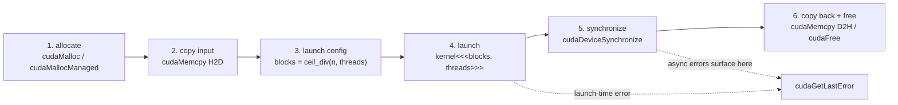

把 C01 的 grid → block → thread 模型落成固定套路：**分配 → 搬数据 → 配 grid/block → launch → 同步 → 回收**。程序是否正确取决于三件事：索引算得对不对、同步有没有做、错误有没有查。



第 4 步返回时 kernel 可能还没开始跑，第 5 步才是「它真的做完了」的分界线。

## 执行配置与索引

```cpp
__global__ void vecAdd(const float* A, const float* B, float* C, int n) {
    int i = blockIdx.x * blockDim.x + threadIdx.x;   // 全局下标
    if (i < n) C[i] = A[i] + B[i];                   // 越界线程直接退出
}
```

- `__global__` 函数返回 `void`，从 host 调用、在 device 执行；另有 `__device__` / `__host__`。
- `<<<Dg, Db>>>` 是 grid 和 block 维度，一维可直接写整数，多维用 `dim3(x, y, z)`（未写的维度默认 1）。
- 一个 block **最多 1024 线程**（本机 `maxThreadsPerBlock = 1024`）：block 必须整个住在同一个 SM 上并共享其资源。
- `blockDim.x` 是 block 大小，`blockIdx.x` 是 block 编号，都从 0 开始。

**一维索引公式：全局下标 = block 编号 × block 大小 + 块内编号。**

![[c02_index_mapping.png]]
*4 个 block × 4 个线程 = 16 个线程，但 N = 14；最后两个线程的 `i` 是 14、15，被 `if (i < n)` 挡掉。它们是同一 warp 里的部分线程退出，即 warp divergence，只是这里代价可忽略。*

多 launch 几个线程几乎不花钱，**多 launch 整个空转的 block 是浪费**，所以 block 数要算准，只让最后一个 block 有零头：

```cpp
constexpr int threads = 256;
int blocks = (n + threads - 1) / threads;   // 向上取整
// CUDA 13+ 的 CCCL 等价物（#include <cuda/cmath>）：cuda::ceil_div(n, threads)
```

写成 `n / t` 是最常见的漏算 bug：n = 1025、t = 1024 时只得到 1 个 block，最后一个元素永远没人算。

### 二维 / 三维

```cpp
__global__ void fillIndex2D(int* out, int H, int W) {
    int col = blockIdx.x * blockDim.x + threadIdx.x;   // x 是最内层、变化最快
    int row = blockIdx.y * blockDim.y + threadIdx.y;
    if (row < H && col < W)
        out[row * W + col] = row * W + col;            // 二维 → 一维
}
```

- **x 方向变化最快**，对应内存里连续的下标；后面做 memory coalescing 时「相邻线程访问相邻地址」就靠它。
- 二维/三维只是逻辑坐标系，显存仍是一维，最终都要展平成 `row * W + col`。
- 三维同理，实际很少手写，一般只用一个维度铺满、其它维度管坐标。

本机验证（H=1000、W=1024、block=16×16）：`grid=(64,63)`，1,032,192 个线程跑 1,024,000 个元素，所有写回值都等于自己的展平下标，0 个错；换行处 `h[1023]=1023`、`h[1024]=1024` 正确。

![[c01_grid_block_thread.png]]
*2×2 个 block、每 block 4×4 个线程；橙色为 `blockIdx=(1,0)` 中的 `threadIdx=(2,1)`。*

## Warp 与 SIMT

- block 内的线程按 **32 个一组**划成 **warp**，组内编号叫 lane（0–31）。
- **SIMT**：同一 warp 的 32 个线程同一条指令、同一时刻推进，但每个线程可以有自己的控制流。
- warp 内走不同分支时，不满足条件的 lane 被**掩码屏蔽**，等另一条分支执行完再回来，这叫 **warp divergence**；分支越分散，利用率越低。
- **block 线程数尽量取 32 的倍数**：不是也能跑，但最后一个 warp 会有空闲 lane，浪费运算单元和带宽。
- **SIMT ≠ SIMD**：SIMD 一条指令锁死数据宽度、单一控制流；SIMT 允许每线程独立分支，没有固定数据宽度。

![[c01_warp_divergence.png]]
*一个 warp 里两条分支只能串行执行，每段都有一半 lane 被掩码。*

写代码不必时时想着 warp，但理解它才能理解后面的 **global memory coalescing** 和 **shared memory bank conflict**。

## 内存层次

| 存储 | 位置 | 可见范围 | 特点 |
|---|---|---|---|
| **global memory** | GPU DRAM | 全 GPU | 容量大、延迟高；device code 的「全局」 |
| **system / host memory** | CPU DRAM | CPU | 经 PCIe/NVLink 访问，延迟更高 |
| **register file** | SM 内 | 单线程私有 | 最快；编译器分配 |
| **shared memory** | SM 内（统一缓存） | 同一 block / cluster | 线程间交换数据；按 block 分配 |
| **L1 cache** | SM 内 | 单 SM | 与 shared memory 共用物理资源 |
| **L2 cache** | GPU 内 | 全 GPU | 所有 SM 共享 |
| **constant cache** | SM 内 | 全 GPU（只读） | 缓存 `__constant__` 数据和 kernel 参数 |

![[c01_memory_hierarchy.png]]
*越靠上越快、越小；越靠下越慢、越大（未按比例）。*

- **寄存器 per-thread，shared memory per-block**。每线程寄存器数 × block 线程数超过 SM 的寄存器文件，kernel 直接**无法启动**，只能减小 block。
- **统一虚拟地址空间**：CPU 和每块 GPU 的地址互不重叠，给定地址能判断它在 host 还是哪块 device。
- **locality domain**：大 GPU 内可按内存 + SM 划分子域，把计算和它要用的内存放在同一域内可提升性能；不划分也能正确运行。
- **Unified Memory** 一次分配、两边可访问、由 runtime/硬件按需迁移，但不是免费共享，**迁移越少越快**。
- **mapped memory**（host 内存映射给 GPU）走 PCIe/NVLink，延迟高、带宽低，不能替代显式拷贝。

## 显式内存 vs 统一内存

| | 显式管理 | 统一内存 |
|---|---|---|
| 分配 | `cudaMalloc`（显存）+ `cudaMallocHost`（锁页主机内存） | `cudaMallocManaged` 一次分配 |
| 搬迁 | 手动 `cudaMemcpy` | 驱动按页自动搬 |
| 可控性 | 完全可控：何时搬、搬什么 | 黑盒，性能取决于驱动和架构 |
| 释放 | `cudaFree` / `cudaFreeHost` | `cudaFree` |

```cpp
constexpr int N = 1 << 24;
constexpr size_t BYTES = N * sizeof(float);
float *hA, *hB, *hC, *dA, *dB, *dC;

cudaMallocHost(&hA, BYTES);                // 锁页主机内存（hB/hC 同理）
cudaMalloc(&dA, BYTES);                    // 显存（dB/dC 同理）
cudaMemcpy(dA, hA, BYTES, cudaMemcpyHostToDevice);
cudaMemcpy(dB, hB, BYTES, cudaMemcpyHostToDevice);
int blocks = (N + 255) / 256;
vecAdd<<<blocks, 256>>>(dA, dB, dC, N);
cudaDeviceSynchronize();
cudaMemcpy(hC, dC, BYTES, cudaMemcpyDeviceToHost);
```

- `cudaMemcpy` 第四个参数是方向；写 **`cudaMemcpyDefault`** 让运行时按指针地址判断（统一内存下必须用它）。
- `cudaMemcpy`（同步版）返回时拷贝已完成，所以「kernel → 拷回主机」天然等到 kernel 结束。
- `cudaMallocHost` 分配**锁页内存**：不被换出，DMA 可直接搬，比普通 `malloc` 缓冲区快；但锁太多会拖慢系统，只锁真正要来回传的缓冲区。
- 普通 `malloc` 的指针不能直接传给 kernel；host/device 指针要分开。

本机 WSL2 上 `cudaMemPrefetchAsync` / `cudaMemAdvise` 返回 `invalid device ordinal`（不支持），managed 内存只能按 PCIe 直接访问，实测见下。**统一内存适合写原型，不适合跑性能。**

## kernel launch 是异步的

```mermaid
sequenceDiagram
    participant H as Host (CPU)
    participant G as GPU
    H->>G: vecAdd launch (blocks, threads) enqueued
    Note over H: returns immediately
    H->>H: next line (may read devC too early)
    G->>G: kernel actually starts
    H->>G: cudaDeviceSynchronize()
    Note over H: blocks until all GPU work completes
    G-->>H: return; devC now valid
```

- `cudaDeviceSynchronize()` 等待**该设备上所有 stream 的所有工作**；多 stream 场景用 `cudaStreamSynchronize` 或 CUDA Event（C08）。
- `cudaMemcpy` 已隐含一次等待；但**在 host 上计时**或**连续 launch 多个 kernel** 时必须显式同步。

## 错误检查

每个 CUDA API 返回 `cudaError_t`，成功是 `cudaSuccess`。三个必须分清的点：

1. **kernel launch 不返回 `cudaError_t`**（`<<<>>>` 是语言扩展，不是函数），launch 后要手动查一次 `cudaGetLastError()`，确认配置合法、没有排队失败。
2. **launch 后 `cudaSuccess` 不代表算对了**：非法内存访问这类异步错误要等 kernel 真正执行，通常由后面的 `cudaDeviceSynchronize()` 报出。
3. **错误状态是粘的**：`cudaGetLastError()` 读一次清零，`cudaPeekAtLastError()` 读不清零。

本机实验：

```
<<<8192,4096>>> -> invalid configuration argument (9)   ← block 超过 1024
peek=9 peek=9 get=9 再 get=0                             ← get 后状态被重置
合法 launch 后 cudaGetLastError = no error (不代表算对了)
```

> 更详细的驱动错误可设 `CUDA_LOG_FILE=cudaLog.txt`，日志写进该文件（guide 2.1.7.3）。

## 实验数据

| 项 | 值 |
|---|---|
| GPU | RTX 5060 Laptop 8GB（WSL2）· CC 12.0 / sm_120 |
| SM | 26 个 · 1536 threads/SM · warp 32 · block 上限 1024 |
| 编译 | `nvcc vector_add.cu -o vector_add`（wrapper 自动加 `-arch=sm_120`） |
| 规模 | n = 16,778,216 个 float（约 64 MiB/数组，故意取非 256 倍数） |

**正确性**：CPU 串行版与 GPU 版逐元素比较，**最大误差 = 0**（同一套 IEEE-754 单精度加法、同一顺序，没有用容差）。`blocks = ceil_div(n, 256) = 65540`，最后一个 block 有 24 个线程越界退出。

**block 大小扫描**（每次 20 次 launch 取平均）：

| threads/block | blocks | ms/launch | 有效带宽 GB/s |
|---|---|---|---|
| 64 | 262,160 | 0.6008 | 335.1 |
| 128 | 131,080 | 0.6009 | 335.1 |
| 256 | 65,540 | 0.6001 | 335.5 |
| 512 | 32,770 | 0.5965 | 337.5 |
| 1024 | 16,385 | 0.6421 | 313.6 |

![[c02_block_sweep.png]]
*block 从 64 涨到 1024，吞吐几乎不动（约 335 GB/s），1024 还略差。*

向量加法是**访存瓶颈（memory-bound）**：每元素只做一次加法，却要读 8 B、写 4 B，瓶颈在 DRAM 带宽，block 怎么切都被掩盖。所以「调 block 大小能提速」只对 compute-bound 的 kernel 成立；memory-bound 该想的是**减少搬运量、合并访问、用更快的存储层**。有效带宽按 3n×4 B / 时间算。

**统一内存实测**：

| 方式 | 时间 |
|---|---|
| 显式 `cudaMalloc` + `cudaMemcpy` | **0.60 ms** |
| `cudaMallocManaged` 第 1 次 launch | 12.68 ms |
| `cudaMallocManaged` 第 2 次 launch | 11.82 ms |
| `cudaMemPrefetchAsync` / `cudaMemAdvise` | `invalid device ordinal`（不支持） |

慢约 21 倍，第二次 launch 也没变快。192 MiB 数据用了 12 ms，约 16 GB/s，正是 PCIe 量级——页没有驻留显存，kernel 每次跨 PCIe 读主机内存。顺带抓到粘性错误的现场：prefetch 失败后没查，后来的 `cudaGetLastError()` 仍吐出那条旧错误（`cudaDeviceSynchronize()` 自己返回 no error）。

## 坑

| 现象 | 原因 | 解法 |
|---|---|---|
| 最后一个元素总是错的 / 是 0 | blocks 用了 `n / t` | `(n+t-1)/t` 或 `cuda::ceil_div` |
| 结果全是旧数据 | launch 异步，没同步就读 | launch 后 `cudaDeviceSynchronize()` |
| 程序 segfault 或 `invalid argument` | 把 `malloc` 的指针传给 kernel | 用 `cudaMalloc`，host/device 指针分开 |
| kernel 越界却什么都不报 | 没查 `cudaGetLastError()` / 没同步 | launch 后查错，同步后再查一次 |
| 查到 `cudaSuccess` 但结果错 | launch 成功 ≠ 执行正确 | CPU 对照 |
| 统一内存比显式拷贝慢 20 倍 | WSL2 页不迁移、prefetch 不支持 | 性能敏感路径用显式管理 |

索引、同步、错误检查三件事做对，kernel 才能可信；性能优化（coalescing、shared memory、occupancy）按 [[CUDA/主页|主页]] 的路线继续。

> PS：工程里通常用一个宏包住所有调用——`#define CUDA_CHECK(expr) do { cudaError_t e=(expr); if(e!=cudaSuccess) fprintf(stderr, "%s:%d %s\n", __FILE__, __LINE__, cudaGetErrorString(e)); } while(0)`；launch 后单独 `CUDA_CHECK(cudaGetLastError())`，同步后再 `CUDA_CHECK(cudaDeviceSynchronize())`。需要立即中止时把 `fprintf` 换成 `exit(1)` 或抛异常。