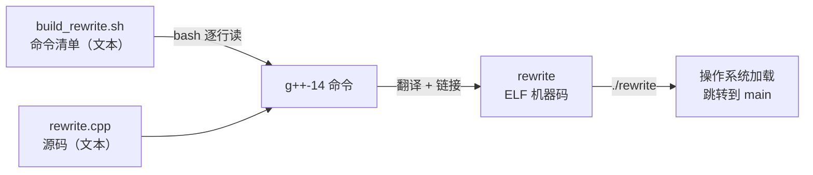

---
tags:
  - TensorRT
  - 编译链接
  - 动态库
  - Shell脚本
  - RPATH
  - C++
---

# T00 从 .cpp 到可执行文件 · `build_rewrite.sh` 到底在干什么

**时间:** 2026-10-26
**来源:** 本机 `trt_lab/01_deserialize/build_rewrite.sh` + `g++-14` / `ld.so` 实测
**标签:** #TensorRT #编译链接 #动态库 #Shell脚本 #RPATH #C++
**代码:** `~/deep_learning/groundzero/trt_lab/01_deserialize/build_rewrite.sh`
**关联:** [[TensorRT 部署学习路径]] · [[CUDA/主页|CUDA 主页]] · [[C01 Introduction]]（编译与运行）

## 一句话

`rewrite.cpp` 是你写的**文本**，CPU 不认识；`g++-14` 把它**翻译**成机器能执行的 ELF 文件 `rewrite`；`build_rewrite.sh` 只是把这条又长又容易敲错的翻译命令**存进一个文本文件**，省得每次手打。脚本本身不参与运行，**真正跑起来的是 `rewrite`**。



## 实际情况

### 0. 先认清文件夹里的三种文件

| 文件 | 本质 | 谁在执行它 | 本机大小 / 权限 |
| ---- | ---- | ---- | ---- |
| `rewrite.cpp` | C++ 源码，纯文本，里面有一个 `main` 函数 | **没人直接执行**，它是给编译器看的 | 89 B，`rw-r--r--` |
| `build_rewrite.sh` | shell 脚本，纯文本，里面是一串终端命令 | `bash` 逐行解释 | 480 B，`rwxr-xr-x` |
| `rewrite` | 编译产物，ELF 机器码 | **操作系统**直接加载 | 约 17 KB，`rwxr-xr-x` |

三者的关系：

```
人写源码(.cpp) ──g++翻译──> 可执行文件(rewrite) ──OS加载──> CPU 执行
                    ↑
        .sh 只是把“g++翻译”这一步的命令存起来
```

**先纠正一个说法：** 你写的不是「一个函数」，是一个**源文件**，里面有一个 `main` 函数。编译器处理的单位是**文件**，不是函数；`main` 只是整个程序开始执行的那个入口。

### 1. `.sh` 是什么？为什么能直接 `./` 执行？

shell 脚本没有魔法，它就是一个文本文件，内容是你本来会在终端里一行行敲的命令。打开看：

```bash
cat build_rewrite.sh
```

第一行 `#!/usr/bin/env bash` 叫 **shebang**，告诉系统「请用 bash 来解释这个文件」。再加上可执行权限（`chmod +x`），你才能：

```bash
./build_rewrite.sh
```

- `./` 的意思是「当前目录下的这个文件」。不加 `./` 时，shell 只会去 `PATH` 里找，找不到就报 `command not found`。
- 没有执行权限时，也可以显式交给 bash：`bash build_rewrite.sh`。
- 脚本是**每次运行都现场解释**的，不会变成机器码，也不会被链接进 `rewrite`。

`set -euo pipefail` 是脚本的自我保护：

| 选项 | 作用 |
| ---- | ---- |
| `-e` | 任何一条命令失败就立刻退出，不继续往下跑 |
| `-u` | 用到未定义变量就报错，防止拼错变量名 |
| `-o pipefail` | 管道中任意一段失败，整条管道就算失败 |

### 2. 不用脚本也能编译

脚本里真正干活的就一条 `g++-14` 命令。你完全可以打开终端，直接把它敲一遍：

```bash
g++-14 -std=c++17 -O2 \
  -I/home/akiha/opt/TensorRT-11.4.0.106/include \
  -I/usr/local/cuda/include \
  rewrite.cpp -o rewrite \
  -L/home/akiha/opt/TensorRT-11.4.0.106/lib \
  -L/usr/local/cuda/lib64 \
  -Wl,-rpath,/home/akiha/opt/TensorRT-11.4.0.106/lib \
  -lnvinfer -lcudart
```

效果和 `./build_rewrite.sh` 完全一样。

**那为什么还要脚本？**

1. 命令太长、参数太多，手敲容易漏；
2. 每次改完代码都要重新编译，不想重复敲；
3. 把「这个项目是怎么编译的」写成文件，换台机器、过两个月还能照着做。

所以脚本 = **保存下来的命令清单**，不是新语言，也不是 CUDA 的一部分。

### 3. `g++-14` 收到命令后做了什么？

一条命令内部其实有四步，只是临时文件被藏起来了：

| 阶段 | 输入 | 输出 | 单独执行 |
| ---- | ---- | ---- | ---- |
| 预处理 | `.cpp` + `#include` | 展开后的源码 | `g++ -E` |
| 编译 | 展开后的源码 | 汇编 `.s` | `g++ -S` |
| 汇编 | `.s` | 目标文件 `.o` | `g++ -c` |
| 链接 | `.o` + 库 | 可执行文件 | `g++`（不加 `-c`） |

做个实验，只走到「目标文件」这一步：

```bash
g++-14 -std=c++17 -O2 -c rewrite.cpp -o /tmp/rewrite.o

file /tmp/rewrite.o
# ELF 64-bit LSB relocatable, x86-64 ...

nm -C /tmp/rewrite.o | grep -E " T main| U "
# 0000000000000000 T main
#                  U std::cout
#                  U std::ostream::put(char)
```

- `T main`：`main` 已经变成机器码，**定义**在这个文件里；
- `U std::cout`：`cout` 还没找到，**未定义**，等链接时从 `libstdc++` 补上。

`.o` **不能直接运行**，因为还有洞没填；链接器的工作就是把这些洞补上，生成完整的可执行文件。

### 4. `./rewrite` 又发生了什么？

```bash
file rewrite
# ELF 64-bit LSB pie executable, x86-64, dynamically linked
```

1. shell 让操作系统执行这个文件；
2. 内核发现它是 ELF，启动动态加载器 `ld-linux-x86-64.so.2`；
3. 加载器读取文件里的 `NEEDED`（依赖哪些库）和 `RUNPATH`（去哪找），把库装进内存；
4. 跳到程序入口 `_start`，最终调用 `main`；
5. CPU 执行机器码，打印 `hello`。

**这一步和 bash 无关**，`./rewrite` 不需要脚本解释。

### 5. 「函数」在这里到底是什么角色？

- 一个 C++ 程序由一个或多个**函数**组成，`main` 是规定的入口；
- 编译器把所有函数翻译成机器码，打包进可执行文件；
- 运行时由操作系统调用 `main`，`main` 再调用别的函数；
- **没有任何一步是「shell 调用你的函数」**。

以后调用 `nvinfer1::createInferRuntime` 也一样：它是 TensorRT 库里的一个函数，链接时把库接上，运行时由你的 `main` 调用它。

`main` 的返回值就是进程退出码：

```bash
./rewrite
echo $?    # 0
```

### 6. 三个时刻，三套路径

| 时刻 | 谁在干活 | 要找什么 | 谁告诉它 | 找不到的报错 |
| ---- | ---- | ---- | ---- | ---- |
| **编译** | g++ 前端 | `.h` 头文件 | `-I` | `fatal error: NvInfer.h: No such file or directory` |
| **链接** | `ld` | `libnvinfer.so` 等 | `-L` + `-l` | `cannot find -lnvinfer` / `undefined reference` |
| **运行** | 动态加载器 `ld.so` | `libnvinfer.so.11` | RUNPATH / `LD_LIBRARY_PATH` / `ldconfig` | `error while loading shared libraries: libnvinfer.so.11` |

**关键：这三条路径互相独立。** 编译通过不代表链接通过，链接通过不代表运行能找到库。

### 7. 逐段拆命令

| 片段 | 作用 |
| ---- | ---- |
| `g++-14` | host 编译器；本机系统 gcc 15 超出 CUDA 12.8 支持范围 |
| `-std=c++17` | TensorRT 11 的 C++ 接口要求 |
| `-O2` | 优化级别 |
| `-I$TRT/include` | 让 `#include <NvInfer.h>` 找得到 |
| `-I$CUDA/include` | 让 `#include <cuda_runtime.h>` 找得到 |
| `rewrite.cpp` | 源文件 |
| `-o rewrite` | 输出可执行文件名 |
| `-L$TRT/lib` | 链接时去这里找 `libnvinfer.so` |
| `-L$CUDA/lib64` | 链接时去这里找 `libcudart.so` |
| `-Wl,-rpath,$TRT/lib` | **把库目录写进可执行文件**，运行时用 |
| `-lnvinfer` | 链接 `libnvinfer.so` |
| `-lcudart` | 链接 `libcudart.so` |

`-Wl,` 的意思是「逗号后面的参数转交给链接器 `ld`」；`-rpath` 是 `ld` 的选项，不是 g++ 的。

### 8. `-l` 的命名规则与符号链接

`-lnvinfer` 不是完整文件名，链接器会补成 `libnvinfer.so`。本机这三个文件是符号链接：

```
libnvinfer.so        -> libnvinfer.so.11        （链接期用）
libnvinfer.so.11     -> libnvinfer.so.11.4.0    （运行期的 SONAME）
libnvinfer.so.11.4.0                             （真正的实现，约 670 MB）
```

- **链接期**只认不带版本号的 `libnvinfer.so`；
- **运行期**只认 SONAME `libnvinfer.so.11`（链接时已经写进 ELF 的 `NEEDED`）；
- 所以只装运行时包、没有 dev 符号链接时，会出现「旧程序能跑、但新程序编译不了」。

### 9. RUNPATH / LD_LIBRARY_PATH / ldconfig 的分工

| 方式 | 生效范围 | 什么时候用 |
| ---- | ---- | ---- |
| `-Wl,-rpath,<dir>` → RUNPATH | 写死在某个可执行文件里 | 发布程序，固定依赖目录 |
| `LD_LIBRARY_PATH=<dir>` | 当前 shell 的所有进程 | 临时调试，不改二进制 |
| `/etc/ld.so.conf.d/*.conf` + `ldconfig` | 全系统 | 系统级安装的库 |

本机的实际情况：

- `libcudart.so.12` 被 `/etc/ld.so.conf.d/000_cuda.conf` 注册了，加载器直接能找到，**不需要 rpath**；
- `libnvinfer.so.11` 装在 `~/opt/TensorRT-11.4.0.106/lib`，不在系统缓存里，**必须靠 rpath**。

验证：

```bash
readelf -d rewrite | grep -i runpath
# (RUNPATH) Library runpath: [/home/akiha/opt/TensorRT-11.4.0.106/lib]
```

> 现代 `ld` 默认生成 `RUNPATH` 而不是老的 `RPATH`。区别只在搜索顺序：`LD_LIBRARY_PATH` 会先于 RUNPATH 生效。

### 10. 为什么这里不用 nvcc

| 情况 | 用什么 |
| ---- | ---- |
| 纯 host C++，只调用 TensorRT / CUDA Runtime API | **g++** |
| 有 `__global__`、`<<<>>>`、`.cu` 文件 | **nvcc** |
| 两者混合 | nvcc 编 `.cu`，g++ 编 `.cpp`，最后一起链接 |

`rewrite.cpp` 现在只有 `iostream`，没有 device 代码，所以 g++ 足够。等第 3 周写预处理 kernel 时，才会引入 nvcc——那时用 `~/.local/bin/nvcc` wrapper（自动加 `-ccbin g++-14 -U_GNU_SOURCE -arch=sm_120`）。

**注意两个脚本的差异：**

- nvcc 编 CUDA 头文件时，本机需要 `-U_GNU_SOURCE` 绕开 glibc 2.42 的 C23 符号冲突；
- 但纯 host 的 g++ 编译**不能**加 `-U_GNU_SOURCE`，否则 libstdc++ 的 `<fstream>` 会缺 `__c_locale`。这就是 `build.sh` 里那句注释的来历。

### 11. 反直觉现象：写了 `-lnvinfer`，`ldd` 里却没有

`rewrite.cpp` 只打印 `hello`，没有调用任何 `nvinfer1::` 符号。Ubuntu 的链接器默认开启 `--as-needed`：**库里的符号一个都没用到，就把这个依赖丢掉**。

```bash
readelf -d rewrite | grep NEEDED
# 只有 libstdc++.so.6 / libc.so.6
```

等代码真的调用 `createInferRuntime` 后，`NEEDED` 才会出现：

```bash
readelf -d deserialize_demo | grep NEEDED
# libnvinfer.so.11
# libcudart.so.12
```

**结论：编译命令里写了 `-l`，不代表最终二进制依赖它；以 `readelf -d` / `ldd` 为准。**

### 12. 警告不等于失败

引入 `NvInfer.h` 后会刷出一大屏 `deprecated` 警告（`IPluginV2`、`IStreamReader` 等），但退出码仍是 0。判断成功看两处：

```bash
./build_rewrite.sh; echo $?   # 0 才是成功
```

想清静可以加 `-Wno-deprecated-declarations`，但不建议一开始就加——先知道它们在说什么。

## 实验数据

### 环境

- 编译器：`g++-14` 14.3.0
- TensorRT：11.4.0.106，`lib/` 共 6.4 GB，`libnvinfer.so.11.4.0` 单文件约 670 MB
- CUDA：12.8（`/usr/local/cuda`）
- 系统：Ubuntu 25.10 / WSL2，RTX 5060 Laptop

### 文件与编译

```text
$ ls -l
-rwxr-xr-x  build_rewrite.sh    480 B
-rw-r--r--  rewrite.cpp          89 B
-rwxr-xr-x  rewrite           17 KB

$ ./build_rewrite.sh
built: .../01_deserialize/rewrite

$ ./rewrite
hello

$ file rewrite
ELF 64-bit LSB pie executable, x86-64, dynamically linked
```

### 目标文件实验

```text
$ g++-14 -std=c++17 -O2 -c rewrite.cpp -o /tmp/rewrite.o
$ file /tmp/rewrite.o
ELF 64-bit LSB relocatable

$ nm -C /tmp/rewrite.o | grep -E " T main| U "
0000000000000000 T main
                 U std::cout
```

### 观察与结论

| 观察 | 结论 |
| ---- | ---- |
| `rewrite.cpp` 没有执行权限 | 源码不是给系统执行的 |
| `build_rewrite.sh` 有执行权限、首行是 `#!` | 它是交给 bash 解释的脚本 |
| `rewrite` 是 ELF、有执行权限 | 它才是机器能直接跑的东西 |
| `.o` 里有 `T main` 和 `U cout` | 编译只完成一半，链接才补齐依赖 |
| `readelf -d rewrite` 只有 RUNPATH，没有 nvinfer | `--as-needed` 丢掉了未使用的库 |
| `deserialize_demo` 的 NEEDED 有 `libnvinfer.so.11` | 真正调用符号后才建立依赖 |

### 踩坑记录

| 现象 | 原因 | 修法 |
| ---- | ---- | ---- |
| `./build_rewrite.sh: Permission denied` | 没有执行权限 | `chmod +x build_rewrite.sh` 或 `bash build_rewrite.sh` |
| `./build_rewrite.sh: No such file or directory` | 不在文件所在目录，或 shebang 路径不对 | `pwd` 确认目录；用 `bash build_rewrite.sh` |
| `NvInfer.h: No such file or directory` | 没加 `-I` | 补 `-I$TRT/include` |
| `cannot find -lnvinfer` | 没加 `-L`，或目录不对 | 补 `-L$TRT/lib` |
| `undefined reference to nvinfer1::...` | 少了 `-l`，或库写在源文件前面 | 库放最后；检查 `-lnvinfer` |
| `error while loading shared libraries: libnvinfer.so.11` | 运行时找不到库 | 加 `-Wl,-rpath,...` 或临时 `LD_LIBRARY_PATH` |
| 一屏 `deprecated` 警告 | TensorRT 头文件里的旧接口 | 不是错误；确认 `$?` 为 0 |
| `unsupported GNU version! gcc versions later than 14` | 系统 gcc 15 | 用 `g++-14` / nvcc wrapper |
| `<fstream>` 报 `__c_locale` 缺失 | 给 host 编译加了 `-U_GNU_SOURCE` | host 编译不要加这个宏 |

## 自测题

1. `rewrite.cpp`、`build_rewrite.sh`、`rewrite` 三者的区别是什么？哪个是机器码？
2. 删掉 `build_rewrite.sh` 还能编译吗？你会怎么编译？
3. `./rewrite` 里的 `./` 是什么意思？为什么不能直接输入 `rewrite`？
4. `g++ -c` 和 `-o` 分别做什么？为什么 `.o` 不能直接运行？
5. `main` 函数是什么？谁调用它？shell 会直接调用你的函数吗？
6. `-I`、`-L`、`-l`、`-rpath` 分别解决哪个时刻的问题？
7. 为什么 hello 版的 `ldd` 里没有 `libnvinfer`？什么时候才会出现？
8. 什么情况下必须用 nvcc，什么情况下 g++ 就够？

## 相关

- [[TensorRT 部署学习路径]] —— 当前所在阶段：`01_deserialize`
- [[C01 Introduction]] —— CUDA 程序的编译与运行、本机 WSL2 踩坑
- `~/deep_learning/cuda/glibc_cuda_compat.h` —— glibc 2.42 与 CUDA 头文件冲突的兼容头
- 下一步：`01_deserialize` 第 2 步，用 `ifstream` 把 engine 文件读进内存
