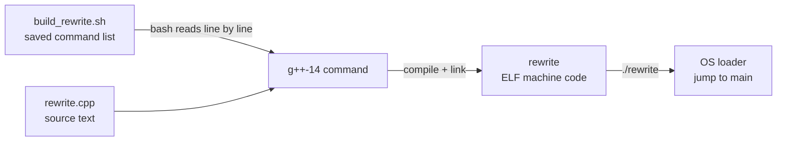

`rewrite.cpp` 是文本，`g++-14` 把它翻译成 ELF 可执行文件 `rewrite`；`build_rewrite.sh` 只是把这条长命令存进文本文件。脚本不参与运行，真正跑起来的是 `rewrite`。这篇把**编译、链接、加载**三个时刻的路径拆开。



## 三种文件与四步编译

| 文件 | 本质 | 谁在执行 | 本机 |
|---|---|---|---|
| `rewrite.cpp` | C++ 源码，纯文本，含 `main` | 没人直接执行，给编译器看 | 89 B，`rw-r--r--` |
| `build_rewrite.sh` | shell 脚本，一串终端命令 | `bash` 逐行解释 | 480 B，`rwxr-xr-x` |
| `rewrite` | ELF 机器码 | **操作系统**加载 | 约 17 KB，`rwxr-xr-x` |

脚本没有魔法：首行 `#!/usr/bin/env bash` 是 shebang，加执行权限后 `./build_rewrite.sh` 才能直接跑；`./` 表示当前目录，不加会去 `PATH` 里找。没有执行权限时用 `bash build_rewrite.sh`。`set -euo pipefail` 让任一条命令、未定义变量、管道任一段失败时立即退出。

`g++` 一条命令内部有四步，临时文件被藏起来了：

| 阶段 | 输入 | 输出 | 单独执行 |
|---|---|---|---|
| 预处理 | `.cpp` + `#include` | 展开后的源码 | `g++ -E` |
| 编译 | 展开后的源码 | 汇编 `.s` | `g++ -S` |
| 汇编 | `.s` | 目标文件 `.o` | `g++ -c` |
| 链接 | `.o` + 库 | 可执行文件 | `g++`（不加 `-c`） |

```bash
g++-14 -std=c++17 -O2 -c rewrite.cpp -o /tmp/rewrite.o
nm -C /tmp/rewrite.o | grep -E " T main| U "
# 0000000000000000 T main
#                  U std::cout
```

`T main` 表示 `main` 已定义成本文件的机器码；`U std::cout` 表示还没找到，链接时从 `libstdc++` 补上。`.o` 不能直接运行，因为还有洞没填。

`./rewrite` 时：内核发现 ELF，启动动态加载器 `ld-linux-x86-64.so.2`，加载器按 `NEEDED`（依赖哪些库）和 `RUNPATH`（去哪找）装载库，跳到 `_start`，最终调用 `main`。这一步与 bash 无关，返回值就是进程退出码。

## 一条 g++ 命令

```bash
g++-14 -std=c++17 -O2 \
  -I/home/akiha/opt/TensorRT-11.4.0.106/include \
  -I/usr/local/cuda/include \
  rewrite.cpp -o rewrite \
  -L/home/akiha/opt/TensorRT-11.4.0.106/lib \
  -L/usr/local/cuda/lib64 \
  -Wl,-rpath,/home/akiha/opt/TensorRT-11.4.0.106/lib \
  -lnvinfer -lcudart
```

| 片段 | 作用 |
|---|---|
| `g++-14` | host 编译器；系统 gcc 15 超出 CUDA 12.8 支持范围 |
| `-std=c++17` | TensorRT 11 的 C++ 接口要求 |
| `-I<dir>` | 编译期让 `#include <NvInfer.h>` / `<cuda_runtime.h>` 找得到 |
| `-L<dir>` | 链接期去这里找 `libnvinfer.so` / `libcudart.so` |
| `-Wl,-rpath,<dir>` | **把库目录写进可执行文件**，运行期用 |
| `-lnvinfer` / `-lcudart` | 链接 `libnvinfer.so` / `libcudart.so` |

`-Wl,` 表示「逗号后面的参数转交给链接器 `ld`」；`-rpath` 是 `ld` 的选项，不是 g++ 的。脚本的价值只是把这条长命令保存下来，换机器、隔几个月还能照着做。

## 三个时刻，三套路径

| 时刻 | 谁在干活 | 要找什么 | 谁告诉它 | 找不到的报错 |
|---|---|---|---|---|
| **编译** | g++ 前端 | `.h` 头文件 | `-I` | `fatal error: NvInfer.h: No such file or directory` |
| **链接** | `ld` | `libnvinfer.so` 等 | `-L` + `-l` | `cannot find -lnvinfer` / `undefined reference` |
| **运行** | `ld.so` | `libnvinfer.so.11` | RUNPATH / `LD_LIBRARY_PATH` / `ldconfig` | `error while loading shared libraries: libnvinfer.so.11` |

**三条路径互相独立**：编译通过不代表链接通过，链接通过不代表运行能找到库。

### `-l` 与符号链接

`-lnvinfer` 不是完整文件名，链接器会补成 `libnvinfer.so`。本机三个文件是符号链接：

```
libnvinfer.so        -> libnvinfer.so.11        （链接期用）
libnvinfer.so.11     -> libnvinfer.so.11.4.0    （运行期 SONAME）
libnvinfer.so.11.4.0                             （实现，约 670 MB）
```

链接期只认不带版本号的 `libnvinfer.so`；运行期只认 SONAME `libnvinfer.so.11`（链接时已写进 ELF 的 `NEEDED`）。只装运行时包、没有 dev 符号链接时，会出现「旧程序能跑、新程序编译不了」。

### RUNPATH / LD_LIBRARY_PATH / ldconfig

| 方式 | 生效范围 | 什么时候用 |
|---|---|---|
| `-Wl,-rpath,<dir>` → RUNPATH | 写死在某个可执行文件里 | 发布程序，固定依赖目录 |
| `LD_LIBRARY_PATH=<dir>` | 当前 shell 的所有进程 | 临时调试，不改二进制 |
| `/etc/ld.so.conf.d/*.conf` + `ldconfig` | 全系统 | 系统级安装的库 |

本机：`libcudart.so.12` 已被 `/etc/ld.so.conf.d/000_cuda.conf` 注册，加载器直接能找到，**不需要 rpath**；`libnvinfer.so.11` 装在 `~/opt/TensorRT-11.4.0.106/lib`，不在系统缓存，**必须靠 rpath**。

```bash
readelf -d rewrite | grep -i runpath
# (RUNPATH) Library runpath: [/home/akiha/opt/TensorRT-11.4.0.106/lib]
```

> 现代 `ld` 默认生成 `RUNPATH` 而不是老的 `RPATH`；区别只在搜索顺序：`LD_LIBRARY_PATH` 先于 RUNPATH 生效。

## g++ 还是 nvcc

| 情况 | 用什么 |
|---|---|
| 纯 host C++，只调用 TensorRT / CUDA Runtime API | **g++** |
| 有 `__global__`、`<<<>>>`、`.cu` 文件 | **nvcc** |
| 两者混合 | nvcc 编 `.cu`，g++ 编 `.cpp`，最后一起链接 |

`rewrite.cpp` 只有 `iostream`，没有 device 代码，g++ 足够。第 3 周写预处理 kernel 时才引入 nvcc，用 `~/.local/bin/nvcc` wrapper（自动加 `-ccbin g++-14 -U_GNU_SOURCE -arch=sm_120`）。注意 nvcc 需要 `-U_GNU_SOURCE` 绕开 glibc 2.42 的 C23 符号冲突，但**纯 host 的 g++ 不能加**，否则 libstdc++ 的 `<fstream>` 会缺 `__c_locale`。

## 反直觉：写了 `-lnvinfer`，`ldd` 里却没有

`rewrite.cpp` 只打印 `hello`，没有调用任何 `nvinfer1::` 符号。Ubuntu 的链接器默认开启 `--as-needed`：**库里的符号一个都没用到，就把这个依赖丢掉**。

```bash
readelf -d rewrite | grep NEEDED
# 只有 libstdc++.so.6 / libc.so.6
```

等代码真的调用 `createInferRuntime` 后，`NEEDED` 才出现：

```bash
readelf -d deserialize_demo | grep NEEDED
# libnvinfer.so.11
# libcudart.so.12
```

**编译命令里写了 `-l`，不代表最终二进制依赖它；以 `readelf -d` / `ldd` 为准。**

引入 `NvInfer.h` 后会刷一屏 `deprecated` 警告（`IPluginV2`、`IStreamReader` 等），退出码仍是 0。判断成功看 `./build_rewrite.sh; echo $?` 是否为 0，不要被警告吓到；想清静可加 `-Wno-deprecated-declarations`，但一开始先看清它们在说什么。

## 实验与坑

环境：`g++-14` 14.3.0；TensorRT 11.4.0.106（`lib/` 6.4 GB，`libnvinfer.so.11.4.0` 约 670 MB）；CUDA 12.8；Ubuntu 25.10 / WSL2，RTX 5060 Laptop。

```text
$ ls -l
-rwxr-xr-x  build_rewrite.sh    480 B
-rw-r--r--  rewrite.cpp          89 B
-rwxr-xr-x  rewrite           17 KB

$ ./build_rewrite.sh && ./rewrite
hello
$ file rewrite
ELF 64-bit LSB pie executable, x86-64, dynamically linked
```

| 现象 | 原因 | 修法 |
|---|---|---|
| `Permission denied` / `No such file or directory` | 没执行权限 / 不在文件目录 | `chmod +x`、`bash build_rewrite.sh`、`pwd` 确认 |
| `NvInfer.h: No such file or directory` | 没加 `-I` | 补 `-I$TRT/include` |
| `cannot find -lnvinfer` | 没加 `-L` 或目录不对 | 补 `-L$TRT/lib` |
| `undefined reference to nvinfer1::...` | 少了 `-l`，或库写在源文件前面 | 库放最后，检查 `-lnvinfer` |
| 运行时报 `libnvinfer.so.11` 找不到 | 运行时找不到库 | 加 `-Wl,-rpath,...` 或临时 `LD_LIBRARY_PATH` |
| 一屏 `deprecated` 警告 | TensorRT 头文件的旧接口 | 不是错误；确认 `$?` 为 0 |
| `unsupported GNU version! gcc later than 14` | 系统 gcc 15 | 用 `g++-14` / nvcc wrapper |
| `<fstream>` 报 `__c_locale` 缺失 | 给 host 编译加了 `-U_GNU_SOURCE` | host 编译不要加 |

这篇对应 `01_deserialize` 的编译环节；`01_deserialize` 与 `02_start` 已完成，下一步 `02_runner`（`cudaMalloc` + `setTensorAddress` + `enqueueV3`），路线见 [[TensorRT 部署学习路径]]。CUDA 侧的编译坑见 [[C01 Introduction]]。

> PS：排查动态库优先用 `ldd ./rewrite`（看实际解析到哪）、`readelf -d rewrite | grep -E 'NEEDED|RUNPATH'`（看写进 ELF 的依赖）、`LD_DEBUG=libs ./rewrite`（看加载器搜索过程）、`nm -C`（看符号定义/未定义）。