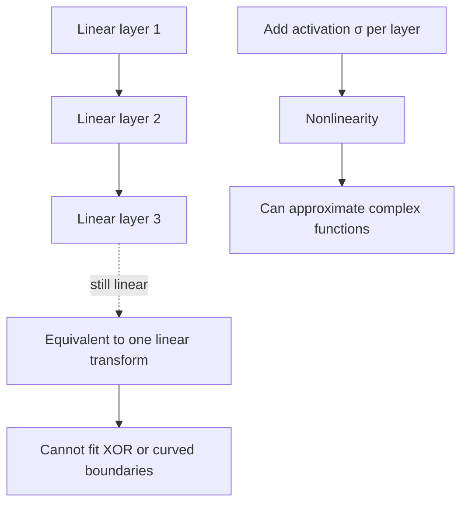
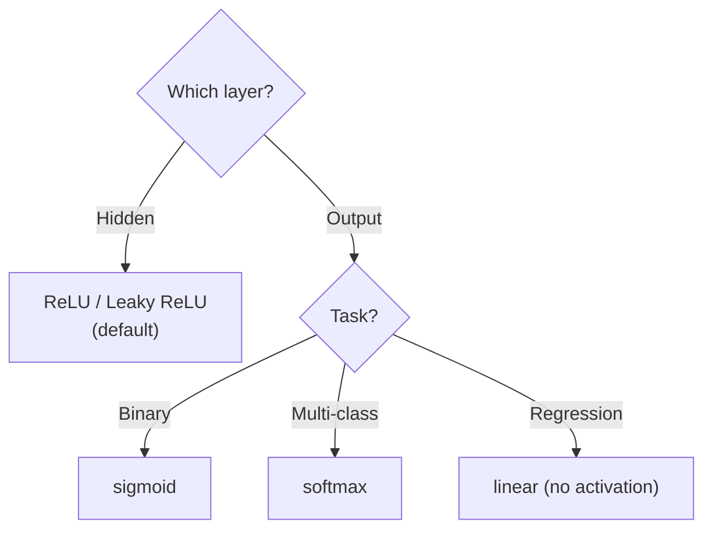
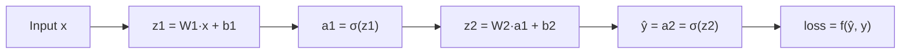
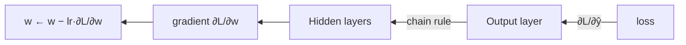

神经网络做一次预测要经过「前向传播」：逐层加权求和、过激活函数，最后用损失函数衡量预测与真实差多远。反向传播再沿这条路径把误差传回去，用梯度下降更新权重。这篇按这四步串起来。

## 为什么需要激活函数

全连接层本质是「矩阵乘法 + 偏置」，是线性运算。**多个线性变换复合仍是线性变换**（矩阵相乘还是矩阵），所以多层全连接等价于一层——加再多层也没用，连 XOR 都拟合不了。



## 常用激活函数

| 函数 | 公式 | 输出范围 | 优点 | 缺点 |
| ---- | ---- | ---- | ---- | ---- |
| sigmoid | `1/(1+e⁻ˣ)` | (0, 1) | 天然像概率，二分类输出层 | 饱和区梯度消失、非零中心（更新 zigzag）、含 exp 慢 |
| tanh | `(eˣ−e⁻ˣ)/(eˣ+e⁻ˣ)` | (−1, 1) | 零中心，收敛比 sigmoid 快 | 仍有饱和区、梯度消失 |
| ReLU | `max(0, x)` | [0, +∞) | 正区间导数恒 1（不饱和）、一个 max 很快、稀疏激活 | 负区间导数为 0，可能 Dead ReLU（神经元再也更新不了） |
| Leaky ReLU | `max(αx, x)`，α≈0.01 | (−∞, +∞) | 负区间给小斜率，解决死神经元 | 多一个超参数 |

sigmoid 的导数 `σ'(x)=σ(x)(1−σ(x))`，两端趋近 0，是梯度消失的典型来源。

### 怎么选



## 前向传播

数据从输入层一路「加权求和 → 激活」传到输出层。每层两步：

```
z = W·x + b        # 线性：加权求和 + 偏置
a = σ(z)           # 非线性：过激活函数
```



一层层 `z → a` 串起来，最后输出 `a_L` 就是预测。

单神经元数值例：`z = w·x + b`，`w=2, b=1, x=3`，激活用 ReLU：

```
z = 2×3 + 1 = 7
a = ReLU(7) = 7      ← 这个神经元的输出(预测)
```

## 损失函数

| 任务 | 损失 | 公式 | 说明 |
| ---- | ---- | ---- | ---- |
| 回归 | MSE 均方误差 | `L = (1/n)·Σ(y_pred − y_true)²` | 差的平方求平均 |
| 二分类 | BCE 二值交叉熵 | `L = −Σ[y·log(ŷ) + (1−y)·log(1−ŷ)]` | 配合 sigmoid |
| 多分类 | CE 交叉熵 | `L = −Σ y·log(ŷ)` | 配合 softmax |

**softmax** 把多分类输出层的一串数归一化成概率分布（和=1），再和 one-hot 标签算交叉熵。

MSE 数值例：预测 `[1.0, 2.0]`，真实 `[1.5, 2.5]`：

```
L = [(1.0−1.5)² + (2.0−2.5)²] / 2 = (0.25+0.25)/2 = 0.25
```

## 反向传播

目标是求 loss 对每个权重的偏导 `∂L/∂w`。核心是**链式法则**，从输出层往回一层层拆：

```
∂L/∂w = ∂L/∂a · ∂a/∂z · ∂z/∂w
        (误差)   (激活导数)  (输入)
```



直觉：误差从输出层倒着传回每层，每层承担自己的责任。

### 梯度下降

```
w ← w − lr · ∂L/∂w
```

梯度指向 loss 上升最快的方向，所以**减**梯度就是往下走。`lr` 是步长：太大震荡发散、太小收敛慢。

| 变体 | 每步用 | 特点 |
| ---- | ---- | ---- |
| 批量 BGD | 全数据集 | 稳但慢、显存大 |
| 随机 SGD | 1 个样本 | 快但震荡 |
| 小批量 Mini-batch | 一批（32/64） | 折中，最常用 |

链式法则数值例：`L=(w·x−y)²`，`x=2, y=1, w=3, lr=0.01`：

```
L = (3×2 − 1)² = 25
∂L/∂w = 2·(w·x − y)·x = 2×5×2 = 20
w ← 3 − 0.01×20 = 2.8
```

### 反向传播 ≠ 梯度下降

**反向传播**求梯度（链式法则 + 误差回传），**梯度下降**用梯度更新权重（`w − lr·梯度`）。PyTorch 里 `loss.backward()` 做前者、`optimizer.step()` 做后者。

## 坑与边界

- ReLU 在 x=0 不可导，框架约定次梯度取 0，反向照常进行。
- sigmoid 输出恒正导致非零中心，深层网络收敛慢，所以隐藏层不用它。
- Dead ReLU 一旦发生不可逆；学习率过大时更容易出现，可换 Leaky ReLU。
- MSE 对离群值敏感（一个大错 6²=36 比三个小错 3×2²=12 还重），异常值多的回归可换 L1/Huber。
- `lr=0` 权重不动；`lr` 过大 loss 震荡甚至 NaN。

## 总结

激活函数给网络注入非线性（多层线性复合仍线性）；隐藏层默认 ReLU/Leaky ReLU，输出层按任务选 sigmoid/softmax/线性。前向是逐层 `z=Wx+b → a=σ(z)`；损失衡量预测与真实差距，回归 MSE、分类交叉熵；反向传播用链式法则从输出层回传求 `∂L/∂w`，梯度下降沿负梯度 `w ← w−lr·∂L/∂w` 更新。两者分工不同，合起来才是训练循环。