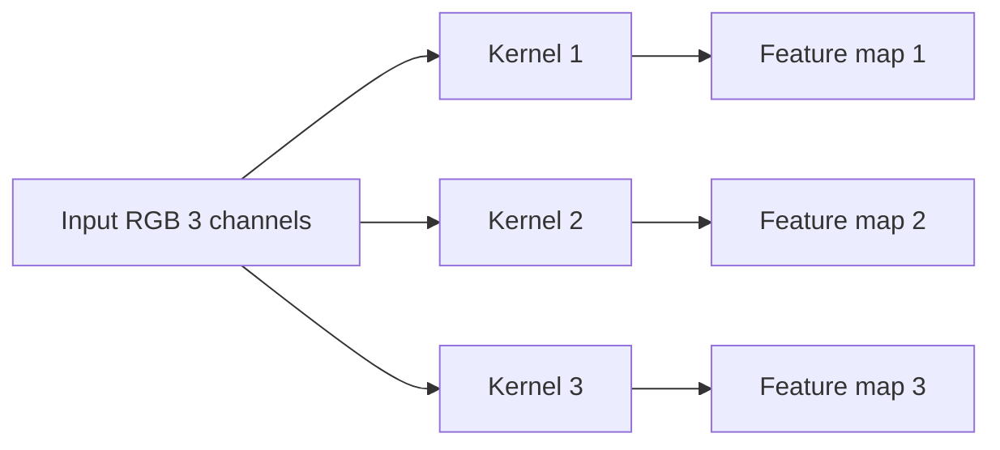
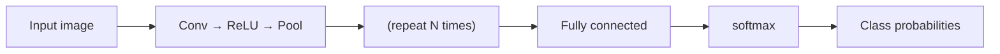

卷积提特征、池化压缩空间、全连接做分类，三者组成 CNN 的一条流水线。这篇先讲卷积怎么算、输出尺寸怎么定、多通道多核怎么组织，再讲池化、感受野和整体架构。

## 图像与全连接的问题

一张图是像素矩阵，即 3 维张量 `[H, W, C]`：灰度 1 通道、彩色 3 通道（RGB）。批量处理时是 4 维 `[N, C, H, W]`。

全连接直接处理图像有三个问题：

1. **参数量爆炸**：28×28 图连到 128 个神经元要 28×28×128 ≈ 10 万参数
2. **丢失空间结构**：拉平成一维后，相邻像素关系没了
3. **平移不变性差**：物体挪一点，输入完全变了

## 卷积运算

卷积核（filter/kernel）是 `k×k` 小矩阵，在输入图上滑动，每个位置做「对应位置相乘再求和」，所有位置构成**输出特征图**。

```
输入 5×5           核 3×3           输出 3×3(步幅1,无填充)
┌─────────────┐   ┌─────────┐      ┌──────────┐
│ 0  0  1  1  1│   │ 1  0 -1 │      │ -3 -3  0 │
│ 0  0  1  1  1│ ⊛ │ 1  0 -1 │  =   │ -3 -3  0 │
│ 0  0  1  1  1│   │ 1  0 -1 │      │ -3 -3  0 │
│ 0  0  1  1  1│   └─────────┘      └──────────┘
│ 0  0  1  1  1│
└─────────────┘

左上角第一个 3×3 窗口:
  0 0 1        1 0 -1
  0 0 1   ⊙    1 0 -1   逐元素相乘再求和:
  0 0 1        1 0 -1   (0+0−1)+(0+0−1)+(0+0−1) = −3

→ 这个核是竖边检测器: 窗口左 0 右 1 的竖边输出 −3(强响应),
  纯 0 或纯 1 的均匀区域输出 0。
```

### 步幅与填充

- **步幅 stride**：核每次滑动的像素数（s=1 逐像素，s=2 隔一个跳一个，输出变小）
- **填充 padding**：在输入边缘补 0，让输出保持尺寸（p=1 常配 3×3 核）

### 输出尺寸公式

```
out = (in − k + 2p) / s + 1
```

- 例：28×28，核 3×3，p=1，s=1 → (28−3+2)/1+1 = **28**（尺寸不变）
- 例：28×28，核 3×3，p=0，s=2 → (28−3+0)/2+1 = **13**（下采样）

## 多通道与多卷积核



- **多通道输入**：RGB 是 3 通道，核也要 3 通道，逐通道卷积后**相加**成一个输出通道
- **多卷积核**：一个核扫出一张输出特征图，N 个核 → N 张（分别捕捉边缘/纹理/颜色）
- 记忆：**输出通道数 = 卷积核个数**

### 局部连接 + 权值共享

1. **局部连接**：每个输出只看到一个小窗口（窗口大小 = 感受野）
2. **权值共享**：同一个核扫全图，参数不随位置变

| 方案 | 参数量（28×28 → 128 维） |
| ---- | ---- |
| 全连接 | 28×28×128 ≈ **10 万** |
| 卷积 3×3×32 核 | 3×3×1×32 ≈ **288** |

差几个数量级，这是卷积能堆深层的底气。

## 池化：无参降采样

池化**无参、无核**，只是固定规则，用来缩小特征图、减少计算量、增强平移不变性。

| 类型 | 规则 | 特点 |
| ---- | ---- | ---- |
| 最大池化 Max | 取窗口最大值 | 保留最强特征，最常用 |
| 平均池化 Avg | 取窗口平均值 | 保留整体背景信息 |

```
最大池化 2×2, 步幅 2: 4×4 → 2×2

输入               输出
┌────────────┐    ┌──────┐
│ 1  3  2  4 │    │ 6  8 │
│ 5  6  7  8 │ →  │ 9  6 │
│ 9  0  1  2 │    └──────┘
│ 3  4  5  6 │
└────────────┘

4 个 2×2 窗口分别取最大:
[1,3,5,6]→6   [2,4,7,8]→8
[9,0,3,4]→9   [1,2,5,6]→6
```

## 卷积与池化的分工

| | 卷积 | 池化 |
| ---- | ---- | ---- |
| 在做什么 | 学特征（乘加 + 偏置） | 固定下采样（max/avg） |
| 有参数吗 | 有（核 + 偏置） | **无** |
| 对图像的侧重 | **内容**：提取什么特征 | **空间**：压缩 + 抗平移 |
| 输出 | 特征图，越堆越「语义」 | 特征图，越缩越小 |

卷积管「看什么」，池化管「看得多粗、扛不扛挪」。

**感受野**：输出特征图上一个点对应输入图多大区域。层越深、卷积/池化堆越多，感受野越大，后面的神经元能「看到」更大范围——这是 CNN 逐层从局部到全局提取特征的原因。

只堆卷积不池化：特征图不变小、计算量大、感受野小、对位置敏感。两者成对出现，才能「特征越抽象、感受野越大、越抗平移」。

## CNN 整体架构



**分工**：卷积/池化负责特征提取（边缘纹理 → 高层语义），全连接负责分类决策。

| 网络 | 年份 | 核心贡献 |
| ---- | ---- | ---- |
| LeNet-5 | 1998 | 开山之作（手写数字） |
| AlexNet | 2012 | 深度 + ReLU + Dropout，掀起深度学习 |
| VGG | 2014 | 小卷积核（3×3）堆叠 |
| GoogLeNet | 2014 | Inception + 1×1 卷积 |
| ResNet | 2015 | 残差连接，解决深度退化（任务一主角） |

## 坑与边界

- ✗ 「卷积核 = 模板匹配」→ 核是学出来的特征提取器，不只匹配
- ✗ 忽略偏置 → 每个输出通道也有一个 bias
- ✗ 忘记公式的 `+1`，或搞反 stride/padding 对尺寸的影响
- ✗ 「池化是为了提特征」→ 池化不学习，只管压缩和不变性
- ✗ 「池化有参数要训练」→ 池化零参数
- ✗ 「卷积越多感受野越小」→ 卷积 + 池化反复堆，感受野越来越大

## 总结

卷积是核在输入上滑动「相乘求和」得到特征图；图像是 `[H,W,C]` 张量，批量是 `[N,C,H,W]`；步幅控制滑动间隔、填充控制边缘，`out=(in−k+2p)/s+1` 是核心公式；输出通道数 = 核个数；局部连接 + 权值共享让参数量骤减并保留空间结构。池化是无参降采样（max/avg），负责压缩和抗平移；感受野随深度增大；CNN = 卷积+激活+池化（特征提取）→ 全连接（分类）→ softmax。