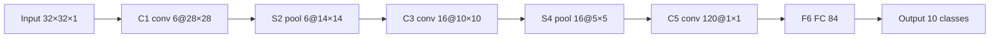

LeNet-5 和 AlexNet 是经典 CNN 的前两站：前者证明「卷积 + 池化 + 全连接」能识别手写数字，后者把这套骨架放大加深、加上 ReLU/Dropout/数据增强，拿下 2012 ImageNet 冠军。两篇合成一条线看，架构同源，差别在规模和训练技巧。

## LeNet-5：CNN 开山之作

LeCun 1998 年为手写数字识别设计，共 7 层（不计输入）：卷积提特征、池化降采样、全连接分类。

- 前半段（C1~S4）：卷积 + 池化反复，负责特征提取
- 后半段（C5~输出）：全连接，负责分类

### 各层参数

| 层 | 类型 | 核/单元 | 输出尺寸 | 参数量 |
| ---- | ---- | ---- | ---- | ---- |
| 输入 | — | — | 32×32×1 | 0 |
| C1 | 卷积 | 6 个 5×5，s=1 | 28×28×6 | (5×5×1+1)×6 = **156** |
| S2 | 平均池化 | 2×2，s=2 | 14×14×6 | 0 |
| C3 | 卷积 | 16 个 5×5 | 10×10×16 | (5×5×6+1)×16 = **2416** |
| S4 | 平均池化 | 2×2，s=2 | 5×5×16 | 0 |
| C5 | 卷积 | 120 个 5×5 | 1×1×120 | (5×5×16+1)×120 = **48120** |
| F6 | 全连接 | 120→84 | 84 | (120+1)×84 = **10164** |
| 输出 | 全连接 | 84→10 | 10 | (84+1)×10 = **850** |

总参数量约 **6 万**。两条规律：

1. **卷积层参数 =（核大小 × 输入通道数 + 1 偏置）× 卷积核个数**
2. **池化层零参数**

尺寸变化用 `out=(in−k+2p)/s+1` 核对：C1 `(32−5)+1=28`；S2 `(28−2)/2+1=14`；C3 `(14−5)+1=10`；C5 `(5−5)+1=1×1`（等价于全连接，把 5×5 每个位置都连上）。

### batch

训练一次喂 batch 张图，拼成 `[N,C,H,W]` 一起前向：GPU 擅长并行，一批比一张张快，梯度也更稳。batch 是超参数：太大吃显存、太小梯度抖，由 DataLoader 决定（见 [[N015 数据加载Dataset与DataLoader]]）。

## AlexNet：放大加强版

Krizhevsky 等 2012 年拿下 ImageNet 冠军，把 top-5 错误率从 ~26% 打到 ~15.3%，证明「深 CNN + 大数据 + GPU」可行。骨架和 LeNet 完全一样，只是更深、更宽、图更大。

```mermaid
flowchart LR
    IN["Input 224×224×3"] --> C1["Conv1 96@55×55"] --> P1["MaxPool"]
    P1 --> C2["Conv2 256@27×27"] --> P2["MaxPool"]
    P2 --> C3["Conv3 384@13×13"] --> C4["Conv4 384@13×13"] --> C5["Conv5 256@13×13"] --> P3["MaxPool"]
    P3 --> F6["FC6 4096"] --> F7["FC7 4096"] --> F8["FC8 1000"]
```

### 各层参数

| 层 | 类型 | 核/单元 | 输出 | 参数量 |
| ---- | ---- | ---- | ---- | ---- |
| 输入 | — | — | 224×224×3 | 0 |
| Conv1 | 卷积 | 96 个 11×11，s=4 | 55×55×96 | (11×11×3+1)×96 ≈ **3.5 万** |
| MaxPool1 | 最大池化 | 3×3，s=2 | 27×27×96 | 0 |
| Conv2 | 卷积 | 256 个 5×5，p=2 | 27×27×256 | (5×5×96+1)×256 ≈ **61 万** |
| MaxPool2 | 最大池化 | 3×3，s=2 | 13×13×256 | 0 |
| Conv3 | 卷积 | 384 个 3×3，p=1 | 13×13×384 | (3×3×256+1)×384 ≈ **89 万** |
| Conv4 | 卷积 | 384 个 3×3，p=1 | 13×13×384 | (3×3×384+1)×384 ≈ **133 万** |
| Conv5 | 卷积 | 256 个 3×3，p=1 | 13×13×256 | (3×3×384+1)×256 ≈ **88 万** |
| MaxPool3 | 最大池化 | 3×3，s=2 | 6×6×256 | 0 |
| FC6 | 全连接 | 9216→4096 | 4096 | (9216+1)×4096 ≈ **3775 万** |
| FC7 | 全连接 | 4096→4096 | 4096 | (4096+1)×4096 ≈ **1678 万** |
| FC8 | 全连接 | 4096→1000 | 1000 | (4096+1)×1000 ≈ **410 万** |

总参数量约 **6000 万**。关键洞察：

1. **全连接层吞掉绝大部分参数**——三个全连接加起来占 ~95%+
2. **卷积层参数其实很少**——权值共享
3. 这是后来 VGG/ResNet 少用全连接、用全局平均池化替代的动机

## 两代对比

| | LeNet-5 | AlexNet |
| ---- | ---- | ---- |
| 年份 / 任务 | 1998 / 手写数字 | 2012 / ImageNet 1000 类 |
| 输入 | 32×32×1 | 224×224×3 |
| 层数 | 7 | 8（5 卷积 + 3 全连接） |
| 参数 | ~6 万 | ~6000 万 |
| 激活 | sigmoid/tanh | **ReLU** |
| 抗过拟合 | 无 | Dropout + 数据增强 + LRN |
| 池化 | 平均池化 | 最大池化 + 重叠池化（3×3, s=2） |

### AlexNet 的四点新东西

| 新点 | 作用 |
| ---- | ---- |
| **ReLU** 替代 sigmoid/tanh | 缓解梯度消失、收敛更快（见 [[N004 激活函数sigmoid-tanh-relu-leakyrelu]]） |
| **重叠池化** | 略提精度、缓一点过拟合 |
| **Dropout**（全连接 p=0.5） | 缓解过拟合（见 [[N012 过拟合与Dropout]]） |
| **数据增强 + LRN** | 扩数据、通道间归一化，提泛化（见 [[N012 过拟合与Dropout]]） |

主线：**深了 → 参数多 → 容易过拟合 → 用 Dropout + 数据增强 + LRN 顶住。** 当年受限于显存用两块 GPU 并行，是工程细节，不是核心思想。

## 坑与边界

- ✗ LeNet-5 是 **7 层**（C1/S2/C3/S4/C5/F6/输出），不是 5 层，名字里的 5 只是型号
- ✗ AlexNet 是 **8 层**（5 卷积 + 3 全连接），不是 5 层
- ✗ 以为池化有参数——池化零参数
- ✗ 以为参数大头在卷积——AlexNet 恰恰相反，全连接占 ~95%
- ✗ C5 看成全连接——它本质是卷积（核尺寸 = 特征图尺寸 → 输出 1×1），效果等价全连接

## 总结

LeNet-5 = 「卷积→池化」反复提特征 + 全连接分类，7 层约 6 万参数；AlexNet 是同一骨架的放大版，8 层约 6000 万参数，参数大头在全连接。卷积层参数 =（核大小×入通道+1）×核数，池化零参数；特征图随层变小、语义变强。AlexNet 的真正贡献是「更深 + ReLU + Dropout + 数据增强 + LRN」的组合拳，它也是走向 ResNet 的跳板。