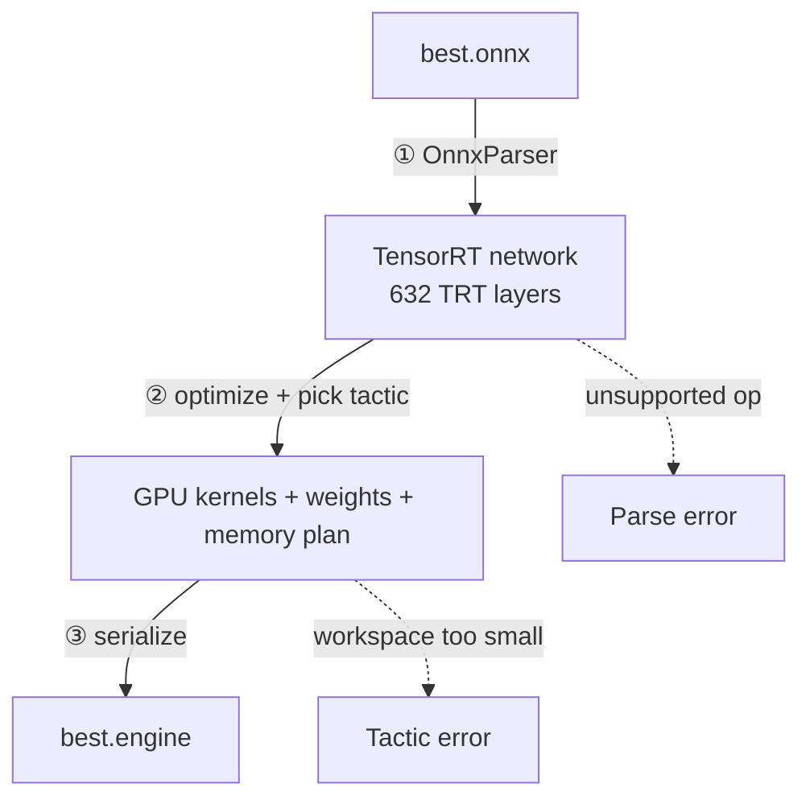

ONNX 描述「要算什么」，engine 是「针对某块 GPU、某个 TensorRT 版本、某个输入尺寸和精度编译好的执行计划」。前者可跨平台拷贝，后者只能在本机 build、本机运行。这篇从两者区别讲到编译原理、trtexec 标准操作和 runtime 推理。

## ONNX vs Engine

| | ONNX | TensorRT Engine |
| ---- | ---- | ---- |
| 性质 | 通用计算图（算子 + 权重） | 针对特定 GPU/版本/精度编译后的推理计划 |
| 可移植性 | 跨框架、跨硬件 | **不可移植** |
| 谁执行 | onnxruntime / OpenCV DNN / TensorRT | 只能由 TensorRT Runtime 加载 |
| 内容 | 原始算子、FP32 权重 | 融合后的层、选好的 kernel、低精度权重、内存方案 |
| 能否训练 | 否 | 否 |
| 类比 | C 源码 | 针对某台机器编译出的可执行文件 |

engine 里装的是：GPU kernel 机器码（针对 sm_120 等 compute capability 编译）、按最优布局排好的权重、内存分配方案、输入输出绑定表、TensorRT 与设备版本信息。**没有 ONNX 图、没有 PyTorch 代码、没有预处理/NMS/后处理**，所以 `onnx.load()` 打不开，也不能继续训练。

不可移植的绑定项：GPU 架构（Orin 是 Ampere SM 8.7，RTX 5060 是 Blackwell）、TensorRT 大版本、CUDA/JetPack、输入 shape/batch、精度设置。开发机上 build 的 engine 拷到 Orin 会 load 失败；正确做法是只把 ONNX 当跨设备产物。

## 编译原理：Parse → Optimize/Tactic → Serialize

```
best.onnx
   │ ① Parse（解析）               ~0.03 秒，纯 CPU
   ▼
TensorRT 内部网络（TensorRT 层组成的图，在内存里）
   │ ② Optimize + Tactic 选择      ~35 秒，需要 GPU
   ▼
编译好的 GPU kernel + 权重 + 内存布局方案（在内存里）
   │ ③ Serialize（序列化）         <1 秒
   ▼
best.engine（二进制文件）
```



### ① Parse

`OnnxParser` 读 ONNX（protobuf），把每个 ONNX 节点翻译成 TensorRT 自己的层。groundzero 实测 **421 个 ONNX 节点 → 632 个 TRT 层**，因为一个节点可能被拆成几层（Reshape 拆成 Slice + Shuffle）。层类型以 ELEMENTWISE 222、CONVOLUTION 111、ACTIVATION 95 为主。

这一步没有任何 GPU 代码，很快。不支持的算子会在 Parse 阶段直接报错，和显存/workspace 无关。

### ② Optimize + Tactic

- **算子融合**：`Conv → Add → Sigmoid` 合成一个 fused kernel，减少显存读写；常量提前算掉
- **逐层选最快实现（Tactic）**：同一个卷积有几十种 tile/访存/指令方案，TensorRT 在**你的 GPU 上真实试跑**、测时间、选最快
- **内存规划**：算中间结果生命周期，可复用的 buffer 共用显存
- **精度**：TensorRT 11 只支持 strongly-typed，ONNX 里是 FP32 就是 FP32 kernel（可用 TF32 加速）；FP16/INT8 必须在 ONNX 图里改好

这解释了 build 为什么慢（试跑候选 kernel）、为什么必须在目标 GPU 上做、为什么需要 workspace。**workspace 是 build 期的临时显存，不是推理时的显存。**

groundzero 的 build 数据：FP32 约 35~40 秒，activation memory 约 32.7 MB，weights 约 10.4 MB。

### ③ Serialize

把 kernel、权重、内存方案、绑定表打包成二进制 plan。`trtexec` build 完会自动用随机数据跑一遍推理并打印 latency，这不是 build 的一部分；Python 脚本 build 完不会自动测。

## 标准操作四步

拿到任何 ONNX：**查输入输出 → 确认静态/动态 shape → build → 加载验证**。90% 的失败能从前两步定位。

### 1. 查 ONNX 输入输出

```python
import onnx
m = onnx.load("model.onnx")
onnx.checker.check_model(m)

for i in m.graph.input:
    print("input ", i.name, [d.dim_value or d.dim_param for d in i.type.tensor_type.shape.dim],
          onnx.TensorProto.DataType.Name(i.type.tensor_type.elem_type))
for o in m.graph.output:
    print("output", o.name, [d.dim_value or d.dim_param for d in o.type.tensor_type.shape.dim],
          onnx.TensorProto.DataType.Name(o.type.tensor_type.elem_type))
```

要确认四件事：输入名字（绑定要用）、输入 shape（静态/动态）、dtype（engine 输入必须是 FP32 或图里指定类型）、输出 shape（决定后处理）。groundzero：`images [1,3,640,640] FLOAT` → `output0 [1,300,30] FLOAT`。

顺便统计算子，不支持的会在 Parse 阶段报错：

```python
import collections
print(collections.Counter(n.op_type for n in m.graph.node))
```

### 2. 静态 / 动态 shape

| shape | 类型 | build |
| ---- | ---- | ---- |
| `[1,3,640,640]` | 静态 | 直接 build，最简单 |
| `[-1,3,640,640]` 或 `["batch",...]` | 动态 | 必须给 min/opt/max profile |

静态优先：导出时 `dynamic=False, batch=1`，部署最省事。

### 3. trtexec build

静态：

```bash
trtexec \
  --onnx=/abs/path/best.onnx \
  --saveEngine=/abs/path/best.engine \
  --memPoolSize=workspace:2048M
```

动态加 shape profile：

```bash
trtexec --onnx=model_dynamic.onnx --saveEngine=model.engine \
  --minShapes=images:1x3x640x640 \
  --optShapes=images:1x3x640x640 \
  --maxShapes=images:4x3x640x640 \
  --memPoolSize=workspace:2048M
```

常用参数：

| 参数 | 作用 | 建议 |
| ---- | ---- | ---- |
| `--onnx` / `--saveEngine` | 输入 / 输出路径 | 绝对路径最稳，engine 放 ONNX 同目录 |
| `--memPoolSize=workspace:2048M` | build 期临时显存 | 2 GB 起步 |
| `--verbose` | 逐层日志 | 排查问题时加 |
| `--timingCacheFile=cache.bin` | 复用测速结果 | 反复 build 加速 |
| `--profilingVerbosity=detailed` | engine 保留层名 | 需要 profile 时加 |

**单位坑**：只认 `B/K/M/G`，**不认 `MiB`**。写 `2048MiB` 会被解析成 2048 **字节**，日志显示 `workspace: 0.00195312 MiB`，随后所有 tactic 因显存不足失败，报 `Could not find any implementation for node`——看起来像模型不支持，实际是单位写错。详见 [[DeepLearningRM/Errors/Errors#E005 trtexec workspace单位写错导致build失败|E005]]。

FP16/INT8 在 TensorRT 11 下不能靠 `--fp16`：先把精度烤进 ONNX（FP16 用 ModelOpt AutoCast，INT8 用 Q/DQ + 校准），再 build。老版本 TensorRT 才有 `--fp16`。

### 4. Python build（可选）

```python
import tensorrt as trt

logger  = trt.Logger(trt.Logger.WARNING)
builder = trt.Builder(logger)
network = builder.create_network()                    # TRT 11 默认 explicit batch
parser  = trt.OnnxParser(network, logger)
parser.parse_from_file("best.onnx")

config = builder.create_builder_config()
config.set_memory_pool_limit(trt.MemoryPoolType.WORKSPACE, 2 << 30)
serialized = bytes(builder.build_serialized_network(network, config))
open("best.engine", "wb").write(serialized)
```

`build_serialized_network` 返回 `IHostMemory`，要 `bytes()` 包一层才能写文件。parse 失败时 `parser.get_error(i)` 逐条打印。

## Runtime 推理

TensorRT 要自己管显存，不像 onnxruntime 的 `sess.run`：

```python
runtime = trt.Runtime(logger)
engine  = runtime.deserialize_cuda_engine(open("best.engine", "rb").read())
context = engine.create_execution_context()

inp = torch.from_numpy(blob).cuda()
out = torch.empty(tuple(engine.get_tensor_shape("output0")),
                  dtype=torch.float32, device="cuda")

context.set_input_shape("images", tuple(inp.shape))
context.set_tensor_address("images", inp.data_ptr())
context.set_tensor_address("output0", out.data_ptr())
context.execute_async_v3(torch.cuda.current_stream().cuda_stream)
torch.cuda.synchronize()
result = out.cpu().numpy()
```

- 输入/输出名用 `engine.get_tensor_name(i)` 动态读，别写死
- 绑定按**名字**，不按顺序；地址传 `data_ptr()`，TensorRT 不帮你分配
- 异步执行后必须 `synchronize()`，否则读到未完成结果
- 第一次推理要 warmup，计时前先跑几遍
- Ultralytics 导出的 engine 前面多了「4 字节 JSON 长度 + JSON 元数据」，直接反序列化会报 `header.magicTag ... failed`，要先按长度跳过（见 [[DeepLearningRM/Errors/Errors#E006 Ultralytics导出的engine带JSON头导致反序列化失败|E006]]）

命令行冒烟：

```bash
trtexec --loadEngine=best.engine --iterations=200
```

能打印 Throughput / Latency 就说明 engine 可用。

## 例子：groundzero 从开发机到 Orin

```bash
# 开发机：导出 FP32 ONNX（通用、可拷贝）
# best.pt --model.export(format="onnx", imgsz=640, opset=17, dynamic=False, batch=1)--> best.onnx

# Orin：在目标机 build（不要拷开发机的 engine）
/usr/src/tensorrt/bin/trtexec \
  --onnx=best.onnx --saveEngine=best.engine \
  --memPoolSize=workspace:4096M --verbose

# 先锁功耗，否则 FPS 被限制
sudo nvpmodel -m 0 && sudo jetson_clocks

# 验证
python -c "
from ultralytics import YOLO
m = YOLO('best.engine', task='pose')
r = m.val(data='traffic-signs.ndjson', imgsz=640)
print(r.box.map50, r.pose.map)
"
```

姿态任务对精度比纯检测敏感，重点看 **pose mAP50-95**。

另一条路线（本机 RTX 5060）用 Python builder 把 YOLOv8n 检测模型 `[1,3,640,640] → [1,8,8400]` 转 engine，build 一次 31.5 秒、15.3 MB；推理 3.7ms/张，onnxruntime-CPU 75ms，**加速 20 倍**。前后处理（letterbox、解码、NMS）完全复用 ONNX 版，只换推理引擎。

### 验证顺序

1. 输出 shape 是否与 ONNX 一致
2. 高置信度行的类别、分数是否接近原模型
3. 坐标映射回原图后位置是否一致
4. 关键点/类别是否一致
5. 最后才看可视化图

直接看图容易把「前后处理错」误判成「engine 错」。

## 坑与边界

| 现象 | 原因 | 解决 |
| ---- | ---- | ---- |
| `trtexec: command not found` | PATH 没设 / 非交互 shell | 全路径或 source `.bashrc` |
| `libnvonnxparser.so.11: cannot open` | 缺 `LD_LIBRARY_PATH` | 指向 `$TENSORRT_ROOT/lib` |
| `workspace: 0.00195312 MiB` | 单位写成 `2048MiB` | 改 `2048M` |
| `Could not find any implementation for node` | workspace 太小，tactic 无法试跑 | 加大 workspace |
| Parse 阶段 unsupported op | ONNX 有 TRT 不支持的算子 | 换 opset / 改导出 / 用 plugin |
| 反序列化 `magicTag` 失败 | engine 与 GPU/TRT 版本不匹配，或 Ultralytics 的 JSON 头 | 本机重 build / 跳过 JSON 头 |
| 输出全 0 / 错乱 | 绑错张量地址或 shape | 按名字绑定，核对输出 shape |
| 推理结果和原模型差很多 | 预处理不一致（RGB/BGR、归一化、letterbox） | 逐步对照原模型预处理 |
| `--fp16` 没效果 | TensorRT 11 strongly-typed，开关已移除 | 精度写进 ONNX 图 |

其他：engine 不是「更小的模型文件」，可能比 ONNX 大也可能小；engine 默认不含 NMS（`nms=True` 才会嵌入且输出结构会变）；onnxruntime 和 OpenCV DNN 都不能加载 `.engine`。

## 总结

ONNX 是通用计算图，engine 是针对目标 GPU/TRT 版本/输入 shape/精度编译出的执行计划，只含前向、不可移植。编译三步：Parse 把 ONNX 翻成 TRT 层（快）、Optimize+Tactic 融合算子并逐层试跑选最快 kernel（慢，需要 GPU 和 workspace）、Serialize 打包成二进制。标准操作是「查输入输出 → 判静态/动态 → trtexec build → runtime 验证」；workspace 单位写 `M/G` 不写 `MiB`；TensorRT 11 的精度必须预先写进 ONNX。