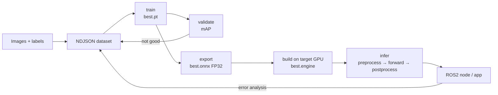

一条模型链路：图片 + 标注训练出 `.pt`，导出成通用 `.onnx`，在目标设备编译成 `.engine`，再写推理代码把输出变成框和关键点，最后接到 ROS2。每一步产物格式不同，先搞清「谁吃谁」。



## 八个阶段

| # | 阶段 | 输入 | 核心动作 | 产物 | 工具 |
| - | ---- | ---- | ---- | ---- | ---- |
| 0 | 任务定义 | 需求 | 决定 detect / pose / segment / classify | `task` | — |
| 1 | 数据准备 | 图片 + 标注 | 整理类别、关键点、train/val 划分 | NDJSON / data.yaml | Ultralytics 格式 |
| 2 | 训练 | 数据集 + 预训练 `.pt` | 前向 → 损失 → 反向 → 更新 | `best.pt` / `last.pt` | `model.train()` |
| 3 | 评估 | `best.pt` + val | 算 mAP / precision / recall | 指标、曲线、混淆矩阵 | `model.val()` |
| 4 | 导出 | `best.pt` | 把 PyTorch 图固化成通用图 | `best.onnx`（FP32） | `model.export()` |
| 5 | 引擎构建 | `best.onnx` | TensorRT 针对目标 GPU 编译 | `best.engine` | `trtexec` / Ultralytics |
| 6 | 推理 | 单图 / 视频帧 | 预处理 → 前向 → 后处理 | 框 + 关键点 + 分数 | TensorRT Runtime |
| 7 | 应用 | 推理结果 | 转 ROS2 消息 / 控制信号 | 话题、服务 | ROS2 节点 |
| 8 | 迭代 | 错误样本 | 补数据 / 调增广 / 调参 → 重训 | 新 `best.pt` | — |

### 数据

检测要框 `(cx, cy, w, h)` 归一化到 [0,1]；姿态还要关键点 `(x, y, visibility)`。groundzero 用 NDJSON：一行一张图，含 `class_names`、`kpt_shape:[8,3]`、`split`、标注。`train` 用来学，`val` 用来调参和早停。`flip_idx` 告诉程序翻转后关键点如何对应；不写则 Ultralytics 自动关闭翻转增广（见 [[N020 NDJSON数据集与YOLO姿态估计pose训练]]）。

### 训练

```
前向 forward：图片 → 网络 → 预测
损失 loss：预测 vs 标注 → 一个数
反向 backward：算每个权重的梯度
更新 optimizer：按梯度改权重
```

| 词 | 含义 |
| ---- | ---- |
| epoch | 把整个训练集看一遍 |
| batch | 一次送进 GPU 的图片数 |
| iteration | 一次参数更新（通常 = 一个 batch） |

`best.pt` 是验证指标最好的权重，部署用这个；`last.pt` 是最后一轮，用于续训。`.pt` 里还有训练参数和优化器状态，推理只用网络权重。

### 评估

| 指标 | 含义 |
| ---- | ---- |
| precision | 检出的目标里有多少是真的 |
| recall | 真实目标里有多少被检出 |
| IoU | 预测框和真实框的重叠程度 |
| mAP50 | IoU≥0.5 的平均精度 |
| mAP50-95 | IoU 0.5~0.95 取平均，更严格 |
| box / pose mAP | 框 / 关键点的指标 |

只看 mAP50 容易高估；姿态任务重点看 **pose mAP50-95**。

### 导出

`.pt` 依赖 PyTorch，不能直接给 C++/TensorRT。`.onnx` 是通用计算图，只描述「算什么」。

| 参数 | 作用 | groundzero |
| ---- | ---- | ---- |
| `opset` | ONNX 算子集版本 | 17 |
| `simplify` | 简化计算图 | True |
| `dynamic` | 可变输入尺寸 | False（固定 640 最快） |
| `batch` | 导出 batch | 1 |
| `nms` | 是否把 NMS 嵌进模型 | False（后处理自己做） |
| `quantize` | 量化精度 | None（FP32） |

### 引擎构建

TensorRT 在**目标设备**上编译，做层融合、kernel 选择、精度选择、内存规划。

| 精度 | 含义 | 代价 |
| ---- | ---- | ---- |
| FP32 | 最高精度 | 最慢、最占显存 |
| FP16 | 半精度，通常损失很小 | 快、显存减半，需实测 |
| INT8 | 8 位整数，需要校准数据 | 最快最省，精度风险最大 |

本机 RTX 5060 + TensorRT 11.4：

```bash
trtexec --onnx=best.onnx --saveEngine=best.engine --memPoolSize=workspace:2048M
```

TensorRT 11 是 strongly-typed，没有 `--fp16` 开关；要 FP16 必须把精度写进 ONNX（ModelOpt AutoCast），INT8 用 Q/DQ。换到 Orin 时按目标机 TensorRT 版本决定。原理见 [[N019 TensorRT部署onnx转engine并推理]]。

### 推理

```
原图
 │ letterbox：等比缩放 + 灰边补到 640×640
 │ BGR→RGB、/255、HWC→CHW、加 batch
 ▼
engine 前向 → 原始输出张量
 │ 解码：框 + 类别分数（+ 关键点）
 │ NMS：去掉重复框
 │ 坐标映射：640 空间 → 原图
 ▼
最终框 + 关键点
```

- **letterbox** 保持长宽比，空白填灰 114，避免变形
- **NMS** 保留分数最高、去掉重叠大的框
- **关键点解码** 比 detect 多 `8×3` 个值，不能套 detect 解码
- 预处理细节见 [[N026 TensorRT-engine推理全流程]]，坐标变换见 [[N028 图像坐标与Letterbox仿射变换]]

### 应用与迭代

ROS2 节点订阅 `sensor_msgs/Image`，发布自定义检测/关键点消息；端到端 FPS 不等于 engine 纯推理 FPS。迭代看验证集错误（漏检/误检/关键点偏），优先级 **补数据、修标注 → 调增广 → 调超参 → 换模型规模**，每次只动一个变量。

## 关键选择

| 需求 | 选择 |
| ---- | ---- |
| 只要框 / 框+点 / 像素掩码 | `task=detect` / `pose` / `segment` |
| 设备小、要实时 | `yolo26n` |
| 精度优先 | `yolo26m/l`（Orin 上 FPS 会降） |
| 数据少 | 预训练 + 增广；数据多/分布特殊从零训 |
| 部署 NVIDIA | ONNX → TensorRT engine |
| 部署 Intel | ONNX → OpenVINO IR |
| 通用 CPU | ONNX + onnxruntime / OpenCV DNN |
| 最低延迟 | 静态 shape + FP16 + TensorRT |
| 最高精度 | FP32 ONNX / FP32 engine（只做对照） |

## groundzero 实测链路

| 阶段 | 输入 | 产物 | 关键数字 |
| ---- | ---- | ---- | ---- |
| 训练 | `traffic-signs.ndjson`（597 张：480 train / 117 val） | `best.pt` | 100 epochs，box/pose mAP50 均 99.3% |
| 导出 | `best.pt` | `best.onnx` | 10.3 MB，opset 17，静态 `[1,3,640,640]` |
| 构建 FP32 | `best.onnx` | `best_trtexec.engine` | 11.56 MiB，39.9 s，629 qps，纯 GPU 1.385 ms |
| 构建 FP16 | `best.onnx` → `best.fp16.onnx` | `best.engine` | ModelOpt 转 404/437 节点（92.45%），7.7 MB，纯 GPU 0.690 ms |
| 推理 FP32 | 一张 4096×3072 val 图 | 框 + 8 关键点 | 端到端 5.10 ms（196 FPS），框中心偏差约 18 px |
| 推理 FP16 | 同一张图 | 同上 | 端到端 4.35 ms（230 FPS），框差 <1 px，关键点最大差 1.39 px |
| 精度对比 | 117 张 val | mAP | pose mAP50-95 0.96911 → 0.96871 |

推理输出的类别和框能与 val 标注对上，说明训练 → 导出 → 编译 → 前后处理没有某一环错位。重训后只要重跑导出和 build，`infer_engine.py` 不用改。

### 文件地图

| 路径（`~/deep_learning/groundzero/`） | 作用 |
| ---- | ---- |
| `traffic-signs.ndjson` | 交通标志 pose 数据集（6 类、8 关键点） |
| `new.py` | 训练脚本（`yolo26n-pose.pt` 微调 100 epochs） |
| `runs/pose/train-4/weights/best.pt` | 最佳权重，6.4 MB |
| `runs/pose/train-4/weights/best.onnx` | 通用图，10.3 MB |
| `runs/pose/train-4/weights/best_fp32.engine` | FP32 engine 基线，12.2 MB |
| `runs/pose/train-4/weights/best.engine` | FP16 engine，7.7 MB |
| `export_onnx.py` / `export_engine.py` / `infer_engine.py` | 导出 / 构建 / 推理脚本 |
| `results/` | letterbox 预览、推理结果图 |

### 完整命令

```bash
cd ~/deep_learning/groundzero
python new.py                 # 训练 → best.pt
python export_onnx.py         # best.pt → best.onnx
trtexec --onnx=runs/pose/train-4/weights/best.onnx \
        --saveEngine=runs/pose/train-4/weights/best.engine \
        --memPoolSize=workspace:2048M
python infer_engine.py        # 预处理 → engine → 解码 → 原图坐标
```

## 术语速查

`tensor` 张量（多维数组）、`weights` 权重、`checkpoint` 权重+训练状态、`inference` 推理；`forward` 前向、`loss` 损失、`gradient` 梯度、`backward` 反向、`optimizer` 优化器、`lr` 学习率、`AMP` 自动混合精度、`augmentation` 数据增广；`overfitting` 过拟合、`precision/recall` 精确率/召回率、`IoU` 交并比、`confidence` 置信度、`NMS` 非极大值抑制、`mAP50/mAP50-95`；`keypoint` 关键点、`pose` 姿态、`kpt_shape` 关键点形状、`visibility` 可见性；`letterbox` 等比补边；`ONNX` 通用图、`opset` 算子集版本、`TensorRT` 推理编译器、`engine/plan` 执行计划、`FP32/FP16/INT8` 精度、`calibration` 校准、`workspace` 构建临时显存；`Jetson Orin` 边缘设备、`JetPack` Jetson SDK、`ROS2 node` 节点。

## 容易混的几组

| 容易混 | 区别 |
| ---- | ---- |
| `.pt` vs `.onnx` vs `.engine` | PyTorch 权重 vs 通用图 vs 硬件专用引擎 |
| train vs val vs predict | 训练 vs 验证 vs 推理 |
| mAP50 vs mAP50-95 | 宽松 vs 严格 |
| confidence vs IoU | 分数阈值 vs 重叠阈值 |
| best.pt vs last.pt | 验证最好 vs 最后一轮 |
| static vs dynamic | 固定尺寸（快）vs 可变尺寸（灵活） |
| NMS 嵌入 vs 外部 | 导出进模型 vs 后处理自己写 |

## 总结

数据 → 训练（`.pt`）→ 评估（mAP）→ 导出（`.onnx` FP32）→ 编译（`.engine`，目标 GPU + 选定精度）→ 推理（预处理 → 前向 → 后处理）→ ROS2。产物格式决定下一步：`.pt` 给 PyTorch，`.onnx` 给通用运行时，`.engine` 只给目标 NVIDIA 设备。精度和速度是权衡，engine 只算前向，其余全在自己的代码里。