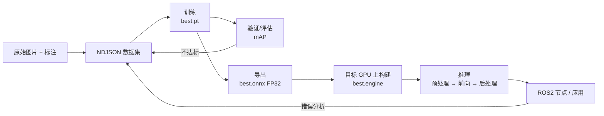

---
tags:
  - 功能实现
  - 模型流程Pipeline
  - 训练Training
  - 评估Eval
  - 导出ONNX
  - TensorRT
  - 推理Inference
  - 术语表Glossary
---

# 模型全流程总览：从数据到 Orin 部署 · 功能实现 · N023

**时间:** 2026-10-22
**标签:** #功能实现 #模型流程Pipeline #训练Training #评估Eval #导出ONNX #TensorRT #推理Inference #术语表Glossary #JetsonOrin
**关联:** [[N020 NDJSON数据集与YOLO姿态估计pose训练]]（数据 + 训练）· [[N021 Ultralytics训练参数全解]]（参数）· [[N022 ONNX与TensorRT Engine的区别]]（导出/部署）· [[N024 ONNX编译成engine的原理]]（编译内部三步）· [[N025 拿到ONNX转engine的标准操作]]（操作手册）· [[N019 TensorRT部署onnx转engine并推理]]（Python 实战）

## 一句话

一条模型链路可以压缩成一句话：**「图片 + 标注」训练出 `.pt`，`.pt` 导出成通用的 `.onnx`，`.onnx` 在 Orin 上编译成专用的 `.engine`，最后写推理代码把 engine 的输出变成框和关键点。** 每一步的产物格式不同，先搞清「谁吃谁」，专有名词就只是标签而已。

## 0. 先看全景

```
原始图片 + 标注
      │  数据整理
      ▼
NDJSON 数据集 ──► 训练 ──► best.pt ──► 验证/评估
                              │
                              │ 导出
                              ▼
                          best.onnx（FP32，通用）
                              │
                              │ 在目标 GPU 上 trtexec
                              ▼
                     best.engine（目标 GPU 专用）
                              │
                              │ 推理
                              ▼
       图片 ──► 预处理 ──► engine 前向 ──► 后处理 ──► 框 + 关键点
                                                    │
                                                    ▼
                                             ROS2 节点 / 应用
```



## 1. 八个阶段总表

| # | 阶段 | 输入 | 核心动作 | 产物 | 工具 | 关键选择 |
| - | ---- | ---- | ---- | ---- | ---- | ---- |
| 0 | 任务定义 | 需求 | 决定是检测 / 姿态 / 分割 / 分类 | `task` | — | detect / pose / segment / classify |
| 1 | 数据准备 | 图片 + 标注 | 整理类别、关键点、train/val 划分 | NDJSON / data.yaml | Ultralytics 数据格式 | 类别数、关键点定义、`flip_idx` |
| 2 | 训练 | 数据集 + 预训练 `.pt` | 前向 → 损失 → 反向 → 更新 | `best.pt` / `last.pt` / 曲线 | `model.train()` | 模型规模、epochs、batch、imgsz、增广、优化器 |
| 3 | 评估 | `best.pt` + val 集 | 算 mAP / precision / recall | 指标、曲线、混淆矩阵 | `model.val()` | val 集、conf / IoU 阈值 |
| 4 | 导出 | `best.pt` | 把 PyTorch 图固化成通用图 | `best.onnx`（FP32） | `model.export()` | opset、simplify、dynamic、batch、nms |
| 5 | 引擎构建 | `best.onnx` | TensorRT 针对 Orin 编译优化 | `best_fp16.engine` | `trtexec` / Ultralytics | FP16 / FP32 / INT8、workspace、静态/动态 |
| 6 | 推理 | 单张图 / 视频帧 | 预处理 → engine 前向 → 后处理 | 框 + 关键点 + 分数 | TensorRT Runtime | 阈值、NMS、letterbox |
| 7 | 应用 | 推理结果 | 转成 ROS2 消息 / 控制信号 | 话题、服务、动作 | ROS2 节点 | 话题名、QoS、发布频率 |
| 8 | 迭代 | 错误样本 | 补数据 / 调增广 / 调参 → 重训 | 新 `best.pt` | — | 先数据，后增广，最后超参 |

## 2. 每一步在干什么（通俗版）

### 2.1 数据准备：把「图片 + 答案」整理成训练器认识的格式

- 检测任务要 **框**：`(cx, cy, w, h)`，通常归一化到 `[0,1]`。
- 姿态任务还要 **关键点**：每个点 `(x, y, visibility)`。
- groundzero 用 **NDJSON**：一行一张图，包含 `class_names`、`kpt_shape:[8,3]`、`split`、标注。
- `train / val` 划分：训练用 train，调参和早停看 val；最终报告再用 test（如果有）。
- `flip_idx`：告诉程序「水平翻转后，第 i 个关键点应该变成第几个」。没写的话，Ultralytics 会**自动关闭翻转增广**（groundzero 就是这种情况）。

### 2.2 训练：让模型从「预训练权重」变成「你的任务专家」

一次训练循环做四件事：

```
前向 forward：图片 → 网络 → 预测
损失 loss：预测 vs 标注 → 一个数
反向 backward：算每个权重的梯度
更新 optimizer：按梯度改权重
```

必须分清三个词：

| 词 | 含义 |
| ---- | ---- |
| **epoch** | 把整个训练集看一遍 |
| **batch** | 一次送进 GPU 的图片数 |
| **iteration** | 一次参数更新（通常 = 一个 batch） |

- `best.pt`：验证指标最好的权重，**部署用这个**。
- `last.pt`：最后一轮的权重，用于断点续训。
- `.pt` 里不只有权重，还有训练参数、优化器状态；推理时只用到网络权重。

### 2.3 评估：用没参与训练的数据看真实水平

| 指标 | 含义 |
| ---- | ---- |
| **precision** | 检出的目标里，有多少是真的 |
| **recall** | 真实目标里，有多少被检出 |
| **IoU** | 预测框和真实框的重叠程度 |
| **mAP50** | IoU≥0.5 时的平均精度 |
| **mAP50-95** | IoU 从 0.5 到 0.95 取平均，更严格 |
| **box mAP** | 框的指标 |
| **pose mAP** | 关键点的指标（groundzero 重点看这个） |

> 只看 mAP50 容易高估；姿态任务尤其要看 **pose mAP50-95**。

### 2.4 导出：把 PyTorch 模型变成通用格式

- `.pt` 依赖 PyTorch，不能直接给 C++ / TensorRT 用。
- `.onnx` 是**通用计算图**：只描述「算什么」，不含训练状态。
- 导出时做的选择：

| 参数 | 作用 | groundzero 建议 |
| ---- | ---- | ---- |
| `opset` | ONNX 算子集版本 | 17（兼容性和新算子折中） |
| `simplify` | 简化计算图 | `True` |
| `dynamic` | 是否支持可变输入尺寸 | `False`（固定 640 最快） |
| `batch` | 导出时的 batch | `1` |
| `nms` | 是否把 NMS 嵌进模型 | `False`（后处理自己做） |
| `quantize` | 是否量化 | `None`（FP32，保持精度） |

### 2.5 引擎构建：把通用图编译成目标 GPU 的机器码

- `.onnx` 还是「通用图纸」，TensorRT 要在**目标设备**上把它编译成 `.engine`。
- 编译时会做层融合、kernel 选择、精度选择、内存规划。
- 关键选择：

| 选择 | 含义 | 代价 |
| ---- | ---- | ---- |
| **FP32** | 最高精度 | 最慢、最占显存 |
| **FP16** | 半精度，通常精度损失很小 | 速度快、显存减半；需实测 |
| **INT8** | 8 位整数，需要校准数据 | 最快、最省，但精度风险最大 |

groundzero 在 **RTX 5060 + TensorRT 11.4** 上构建，实际是 **FP32**：

```bash
trtexec --onnx=best.onnx --saveEngine=best.engine --memPoolSize=workspace:2048M
```

> TensorRT 11 是 **strongly-typed**，没有 `--fp16` 开关；要 FP16 必须把精度写进 ONNX（如 ModelOpt AutoCast），或用 Q/DQ 做 INT8。见 [[N024 ONNX编译成engine的原理]]、[[N025 拿到ONNX转engine的标准操作]]。换到 Orin 时，若该版本 TensorRT 仍支持 `--fp16`，再按目标机版本决定。

### 2.6 推理：engine 只算「前向」，前后处理都要自己写

```
原图
 │  letterbox：等比缩放 + 灰边补到 640×640
 │  BGR→RGB、/255、HWC→CHW、加 batch 维
 ▼
engine 前向 → 原始输出张量
 │  解码：框 + 类别分数（+ 关键点）
 │  NMS：去掉重复框
 │  坐标映射：640 空间 → 原图
 ▼
最终框 + 关键点
```

- **letterbox**：不直接拉伸，保持长宽比，空白处填灰（114），避免目标变形。
- **NMS**：多个框指向同一目标时，保留分数最高的，去掉重叠大的。
- **关键点解码**：pose 输出比 detect 多出 `8 × 3` 个值，不能套 detect 的解码。

### 2.7 应用：把结果接到 ROS2

- 推理节点订阅 `sensor_msgs/Image`，发布自定义检测/关键点消息。
- 注意：预处理、推理、后处理都在节点里，端到端 FPS 不等于 engine 的纯推理 FPS。

### 2.8 迭代：模型不是一次训完就结束

- 看验证集的错误：漏检？误检？关键点偏？
- 优先级：**补数据 / 修标注 → 调增广 → 调超参 → 换模型规模**。
- 每次改动只动一个变量，否则不知道是谁起的作用。

## 3. 关键选择速查

| 你的需求 | 选择 | 说明 |
| ---- | ---- | ---- |
| 只要框 | `task=detect` | 输出 `[1, 4+nc, 8400]` 一类 |
| 要框 + 关键点 | `task=pose` | 输出多出 `kpt_shape` 对应维度 |
| 要像素级掩码 | `task=segment` | 输出 mask |
| 设备小 / 要实时 | `yolo26n` | n = nano，最快 |
| 精度优先 | `yolo26m/l` | 更大，但 Orin 上 FPS 会降 |
| 数据少 | 预训练 + 增广 | 迁移学习 |
| 数据多 / 分布特殊 | 从零训练 | 需要更多数据和时间 |
| 部署 NVIDIA | ONNX → TensorRT engine | Orin 上用 FP16 |
| 部署 Intel | ONNX → OpenVINO IR | 不是 Orin 路线 |
| 通用 CPU 推理 | ONNX + onnxruntime / OpenCV DNN | 最方便，但慢 |
| 最低延迟 | 静态 shape + FP16 + TensorRT | 固定 640、batch=1 |
| 最高精度 | FP32 ONNX / FP32 engine | 慢，通常只做对照 |
| 最小模型 | INT8 / 剪枝 / 蒸馏 | 需要校准或额外训练 |

## 4. 术语表

| 术语 | 中文 | 一句话解释 | 出现在哪 |
| ---- | ---- | ---- | ---- |
| tensor | 张量 | 多维数组，GPU 上的基本数据单位 | 训练 / 推理 |
| weights | 权重 | 网络里可学习的数 | `.pt` / `.onnx` |
| checkpoint | 检查点 | 保存的权重 + 训练状态 | `best.pt` / `last.pt` |
| inference | 推理 | 用训练好的模型做预测 | 部署 |
| epoch | 轮 | 整个训练集过一遍 | 训练 |
| batch | 批 | 一次送进 GPU 的样本数 | 训练 |
| iteration | 迭代 | 一次参数更新 | 训练 |
| forward | 前向 | 输入 → 网络 → 输出 | 训练 / 推理 |
| loss | 损失 | 预测和答案的差距，越小越好 | 训练 |
| gradient | 梯度 | 损失对权重的变化方向 | 反向传播 |
| backward | 反向传播 | 从损失倒推每层梯度 | 训练 |
| optimizer | 优化器 | 按梯度更新权重的算法（SGD/AdamW） | 训练 |
| learning rate | 学习率 | 每次更新走多大一步 | 训练 |
| AMP | 自动混合精度 | 部分计算用 FP16，加速省显存 | 训练 |
| augmentation | 数据增广 | 随机翻转/缩放/变色，提升泛化 | 训练 |
| overfitting | 过拟合 | 训练集好、验证集差 | 评估 |
| precision | 精确率 | 检出的有多少是真的 | 评估 |
| recall | 召回率 | 真的有多少被检出 | 评估 |
| IoU | 交并比 | 两个框的重叠程度 | 评估 / NMS |
| confidence | 置信度 | 模型对某个结果的把握 | 推理 |
| NMS | 非极大值抑制 | 去掉重复框 | 后处理 |
| mAP50 | — | IoU≥0.5 的平均精度 | 评估 |
| mAP50-95 | — | IoU 0.5~0.95 的平均精度 | 评估 |
| keypoint | 关键点 | 姿态任务里的特征点 | pose |
| pose | 姿态 | 框 + 关键点 | groundzero |
| kpt_shape | 关键点形状 | `[点数, 每点维度]`，如 `[8,3]` | 数据 |
| visibility | 可见性 | 关键点是否可见/被遮挡 | 数据 |
| letterbox | 等比补边 | 保持比例缩放到目标尺寸 | 预处理 |
| ONNX | 开放神经网络交换格式 | 通用模型图 | 导出 |
| opset | 算子集版本 | ONNX 用的算子版本 | 导出 |
| TensorRT | NVIDIA 推理编译器 | 把 ONNX 编译成 engine | 部署 |
| engine / plan | 推理引擎 / 计划 | 针对特定 GPU 编译好的执行方案 | 部署 |
| FP32 | 单精度 | 32 位浮点，精度最高 | 训练 / 导出 |
| FP16 | 半精度 | 16 位浮点，更快更省 | engine |
| INT8 | 8 位整数 | 量化精度，需要校准 | engine |
| quantization | 量化 | 降低数值精度来换速度 | 部署 |
| calibration | 校准 | INT8 用一批数据确定缩放系数 | INT8 |
| workspace | 工作区 | TensorRT 编译时的临时显存 | engine 构建 |
| Jetson Orin | NVIDIA 边缘设备 | 跑 TensorRT engine 的目标硬件 | 部署 |
| JetPack | Jetson SDK | 含 CUDA / TensorRT / cuDNN | Orin |
| ROS2 node | ROS2 节点 | 订阅/发布话题的进程 | 应用 |

## 5. groundzero 文件地图（截至 2026-10-22，全链路已打通）

| 路径 | 作用 | 当前状态 |
| ---- | ---- | ---- |
| `groundzero/traffic-signs.ndjson` | 交通标志 pose 数据集（6 类、8 关键点） | ✅ 已有 |
| `groundzero/new.py` | 训练脚本（`yolo26n-pose.pt` 微调 100 epochs） | ✅ 已跑通 |
| `groundzero/runs/pose/train-4/weights/best.pt` | 最佳权重 | ✅ 6.4 MB |
| `groundzero/runs/pose/train-4/weights/best.onnx` | 通用模型图，输入 `[1,3,640,640]` | ✅ 10.7 MB |
| `groundzero/export_onnx.py` | 导出 FP32 ONNX | ✅ 已跑通 |
| `groundzero/runs/pose/train-4/weights/best.engine` | Python builder 构建的 engine | ✅ 12 MB |
| `groundzero/runs/pose/train-4/weights/best_trtexec.engine` | trtexec 构建的 engine | ✅ 11.56 MB |
| `groundzero/infer_engine.py` | 预处理 → 推理 → 解码 → 画图 + 计时 | ✅ 已跑通 |
| `groundzero/results/` | letterbox 预览、推理结果图 | ✅ 已生成 |
| ROS2 节点 | 订阅图像、发布检测/关键点 | ⬜ 后续 |

## 6. 一次完整链路的命令（已实际跑通）

```bash
cd ~/deep_learning/groundzero

# 1. 训练（100 epochs，已跑完）
python new.py

# 2. 导出 FP32 ONNX：best.pt -> best.onnx
python export_onnx.py

# 3. 构建 engine：best.onnx -> best.engine
trtexec --onnx=runs/pose/train-4/weights/best.onnx \
        --saveEngine=runs/pose/train-4/weights/best.engine \
        --memPoolSize=workspace:2048M

# 4. 推理验证：预处理 -> engine -> 解码 -> 原图坐标
python infer_engine.py
```

每一步的原理和踩过的坑：

| 步骤 | 对应笔记 |
| ---- | ---- |
| 数据 + 训练 | [[N020 NDJSON数据集与YOLO姿态估计pose训练]]、[[N021 Ultralytics训练参数全解]] |
| 导出 ONNX / engine 概念 | [[N022 ONNX与TensorRT Engine的区别]]、[[N019 TensorRT部署onnx转engine并推理]] |
| engine 编译原理 | [[N024 ONNX编译成engine的原理]] |
| 任意 ONNX 转 engine 操作 | [[N025 拿到ONNX转engine的标准操作]] |
| engine 推理全流程 | [[N026 TensorRT-engine推理全流程]] |

## 6.1 链路实测：每一步的产物和数字

| 阶段 | 输入 | 产物 | 关键数字 |
| ---- | ---- | ---- | ---- |
| 训练 | `traffic-signs.ndjson`（597 张：480 train / 117 val） | `best.pt` | 100 epochs，box/pose mAP50 均 99.3% |
| 导出 | `best.pt` | `best.onnx` | 10.7 MB，opset 17，静态 `[1,3,640,640]` |
| 构建 | `best.onnx` | `best_trtexec.engine` | 11.56 MiB，39.9 s，629 qps（纯 GPU 1.59 ms） |
| 推理 | 一张 4096×3072 val 图 | 框 + 8 关键点 + 结果图 | 端到端 5.10 ms（196 FPS），框中心偏差约 18 px |

**链路是闭环的**：推理输出的类别和框能与 val 标注对上，说明「训练 → 导出 → 编译 → 前后处理」没有某一环偷偷错位。下一次重训后，只要重新执行第 2、3 步，`infer_engine.py` 不用改。

## 7. 最容易混淆的几组

| 容易混 | 区别 |
| ---- | ---- |
| `.pt` vs `.onnx` vs `.engine` | PyTorch 权重 vs 通用图 vs 硬件专用引擎 |
| train vs val vs predict | 训练 vs 验证 vs 推理 |
| mAP50 vs mAP50-95 | 宽松 vs 严格 |
| confidence vs IoU | 分数阈值 vs 重叠阈值 |
| FP16 vs INT8 | 半精度（无需校准）vs 量化（需校准） |
| best.pt vs last.pt | 验证最好 vs 最后一轮 |
| static vs dynamic | 固定输入尺寸（快）vs 可变尺寸（灵活） |
| NMS 嵌入 vs 外部 | 导出进模型 vs 后处理自己写 |

## 8. 一页总结

```
数据（图片+标注）
  → 训练（.pt）
  → 评估（mAP）
  → 导出（.onnx，FP32）
  → 编译（.engine，目标 GPU + 选定精度）
  → 推理（预处理 → 前向 → 后处理）
  → 应用（ROS2）
```

**记住四件事：**

1. **产物格式决定下一步**：`.pt` 给 PyTorch，`.onnx` 给通用运行时，`.engine` 只给目标 NVIDIA 设备。
2. **精度和速度是权衡**：FP32 → FP16 → INT8，越来越快，但都要验证精度；TensorRT 11 strongly-typed 时精度要写进 ONNX。
3. **engine 只算前向**：letterbox、NMS、坐标映射、关键点解码、ROS2 封装，全在自己的代码里。
4. **groundzero 全链路已在本机 RTX 5060 跑通**：训练 → ONNX → engine → 推理，产物和数字见 6.1 节。

**标签:** #功能实现 #模型流程Pipeline #训练Training #评估Eval #导出ONNX #TensorRT #推理Inference #术语表Glossary #JetsonOrin
