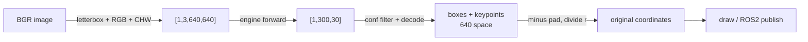

engine 只负责 `[1,3,640,640]` 进、`[1,300,30]` 出；预处理、绑定显存、解码、逆映射、画图全要自己写。engine 从哪来见 [[N019 TensorRT部署onnx转engine并推理]]，这篇是拿到 engine 之后的推理管线。

## 数据流

```
原图 4096×3072 (BGR)
  → letterbox → 640×640，r=0.15625，pad(left,top)=(80,0)
  → RGB /255 / HWC→CHW → [1,3,640,640] float32
  → best.engine → [1,300,30]
  → 置信度过滤 → 逆映射 → 原图坐标的框 + 8 关键点
```



## 预处理：letterbox

模型输入固定 640×640，直接 `cv2.resize` 会压扁长宽比，框和关键点全偏，所以必须等比缩放 + 补灰边。

```python
r = min(640 / h, 640 / w)                  # 用长边算比例
new_w, new_h = round(w * r), round(h * r)
resized = cv2.resize(img, (new_w, new_h))
dw, dh = (640 - new_w) / 2, (640 - new_h) / 2
left, right = round(dw - 0.1), round(dw + 0.1)
top, bottom = round(dh - 0.1), round(dh + 0.1)
padded = cv2.copyMakeBorder(resized, top, bottom, left, right,
                            cv2.BORDER_CONSTANT, value=(114, 114, 114))
```

必须记住三件事：缩放比例 `r`、左上补边 `(left, top)`、补边值 114。groundzero：`4096×3072`（高×宽），`r=0.15625`，缩放后 `640×480`，左右各补 80。坐标原点、连续像素单位、正逆变换推导见 [[N028 图像坐标与Letterbox仿射变换]]。

```python
rgb = cv2.cvtColor(padded, cv2.COLOR_BGR2RGB)  # OpenCV 是 BGR，训练是 RGB
x = rgb.astype(np.float32) / 255.0             # 归一化
x = np.transpose(x, (2, 0, 1))[None]           # HWC -> CHW，再加 batch
x = np.ascontiguousarray(x)                    # TensorRT 要求内存连续
```

## 加载 engine：5 个动作

```python
logger  = trt.Logger(trt.Logger.WARNING)
runtime = trt.Runtime(logger)
engine  = runtime.deserialize_cuda_engine(read_engine_bytes(engine_path))
context = engine.create_execution_context()

in_name  = engine.get_tensor_name(0)   # "images"
out_name = engine.get_tensor_name(1)   # "output0"

x = torch.from_numpy(blob).cuda()
y = torch.empty(tuple(engine.get_tensor_shape(out_name)),
                dtype=torch.float32, device="cuda")

context.set_tensor_address(in_name,  x.data_ptr())
context.set_tensor_address(out_name, y.data_ptr())
context.execute_async_v3(torch.cuda.current_stream().cuda_stream)
torch.cuda.synchronize()
out = y.cpu().numpy()
```

- **logger / runtime 要一直存活**，否则 engine 可能失效
- 绑定按张量名字，不按顺序；地址传 `data_ptr()`，TensorRT 不分配显存
- 异步执行后必须 `synchronize()`
- 第一次推理初始化 CUDA kernel，计时前先 warmup
- Ultralytics 导出的 engine 前有 4 字节小端 JSON 长度 + JSON 元数据（groundzero 是 1014 字节），后面才是 `ftrt`；直接 `read_bytes()` 会报 `magicTag` 失败，要按长度跳过（见 [[错误记录#E006 Ultralytics导出的engine带JSON头导致反序列化失败|E006]]）

## 解码 [1,300,30]

这版模型是 **end2end**，输出已做过 NMS，每行 30 列：

| 列 | 含义 |
| ---- | ---- |
| 0~3 | `x1, y1, x2, y2`（xyxy，640 坐标系） |
| 4 | 置信度 `score` |
| 5 | 类别索引 |
| 6~29 | 8 个关键点 × `(x, y, conf)` |

```python
for row in out[0]:
    x1, y1, x2, y2, score, cls = row[:6]
    if score < 0.25:
        continue
    kpts = row[6:].reshape(8, 3)
```

300 行里大部分是低分填充，groundzero 这张图只有 1 行 `score>0.25`。普通 YOLOv8 检测输出是 `[1,84,8400]`，要自己解码 + NMS；这版 `[1,300,30]` **不要再写 NMS**。

## 逆映射

```python
box = [(x1 - left) / r, (y1 - top) / r,
       (x2 - left) / r, (y2 - top) / r]

kpts[:, 0] = (kpts[:, 0] - left) / r
kpts[:, 1] = (kpts[:, 1] - top) / r
# 第三列 conf 不参与变换
```

漏掉关键点的逆映射是这类任务最常见的 bug：框看起来对、点却飘在左上角。

## 验证：先比数值，再看图

groundzero 第一张验证图：

```
预测框 [660.6, 2437.5, 1165.9, 3743.3]
标注框 [632.2, 2416.9, 1157.4, 3736.6]
中心偏差 18.5 / 13.7 px（原图 4096 宽，约 0.4%）
预测类别 Down，置信度 0.9136，标注类别 Down
```

顺序：

1. 输出 shape 是否为 `[1,300,30]`
2. 高置信度行的 `cls` 是否等于标注类别
3. 框的数值是否接近标注（先不画图）
4. 画图看关键点是否落在物体角点上
5. 最后才看整体视觉效果

## 性能：三个数字

| 数字 | 含义 | groundzero 实测 |
| ---- | ---- | ---- |
| trtexec latency | **纯 GPU kernel**，预分配 buffer、无拷贝 | 1.59 ms |
| 脚本内 engine 段 | kernel + 每次 H2D/D2H + 显存分配 + synchronize | 3.79 ms |
| 端到端 | 预处理 + engine + 后处理 | 5.10 ms（196 FPS） |

单张图分阶段（RTX 5060，FP32 / FP16）：

| 阶段 | FP32 | FP16 |
| ---- | ---- | ---- |
| 预处理 | 1.16 ms | 1.05 ms |
| engine 推理 | 3.79 ms | 3.44 ms |
| 后处理 | 0.14 ms | 0.15 ms |
| **端到端** | **5.10 ms（196 FPS）** | **4.35 ms（230 FPS）** |

**部署指标看端到端。** 优化顺序：预分配输入输出 tensor、循环里 `copy_`；预处理尽量上 GPU；多流/批处理；最后才考虑 FP16。纯 kernel 换 FP16 约 2 倍，端到端只快 15%，瓶颈在拷贝和 CPU 前后处理。

## 坑与边界

| 现象 | 原因 |
| ---- | ---- |
| 框整体偏移 | 忘了减 `left/top`，或除错 `r` |
| 框对、关键点全错 | 只逆映射了框 |
| 颜色异常 / 精度下降 | BGR 没转 RGB，或忘了 `/255` |
| `set_tensor_address` 报错 | 输入 shape 不对，或内存不连续 |
| 结果是上一帧的 | 忘了 `synchronize()` |
| 第一次特别慢 | CUDA kernel 初始化，计时前 warmup |
| 第 8 个点在 (0,0) | 关键点 `conf=0` 表示未标注，应跳过 |
| 自己写 NMS 后结果变少 | end2end 输出已 NMS，重复做会过度抑制 |

## 在全流程里的位置

前四步（数据 → 训练 → 导出 → build）见 [[N023 模型全流程总览 从数据到Orin部署]]，本篇是最后一步：

```bash
cd ~/deep_learning/groundzero

python new.py                 # ① 训练，产物 best.pt
python export_onnx.py         # ② 导出，产物 best.onnx
trtexec --onnx=runs/pose/train-4/weights/best.onnx \
        --saveEngine=runs/pose/train-4/weights/best.engine \
        --memPoolSize=workspace:2048M          # ③ build
python export_engine.py       # ③' 或一步导出 FP16 engine
python infer_engine.py        # ④ 推理验证
```

## 总结

engine 推理是一条自己负责前后处理的数据管线：letterbox（记 `r` 和 `pad`）→ RGB → 归一化 → CHW → batch；Runtime → deserialize → Context → `set_tensor_address` → `execute_async_v3` → `synchronize`；`[1,300,30]` 按列拆成框/分数/类别/关键点；框和关键点用同一组 `r`、`pad` 逆映射；验证先比数值再看图，性能看端到端。