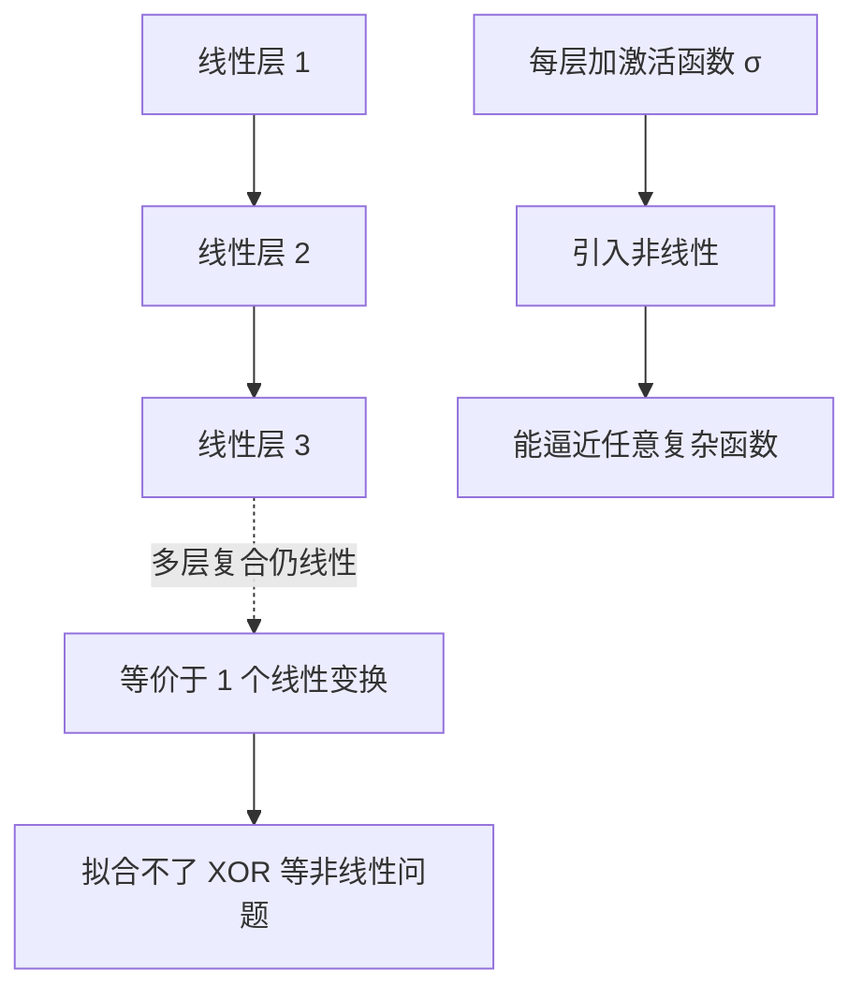
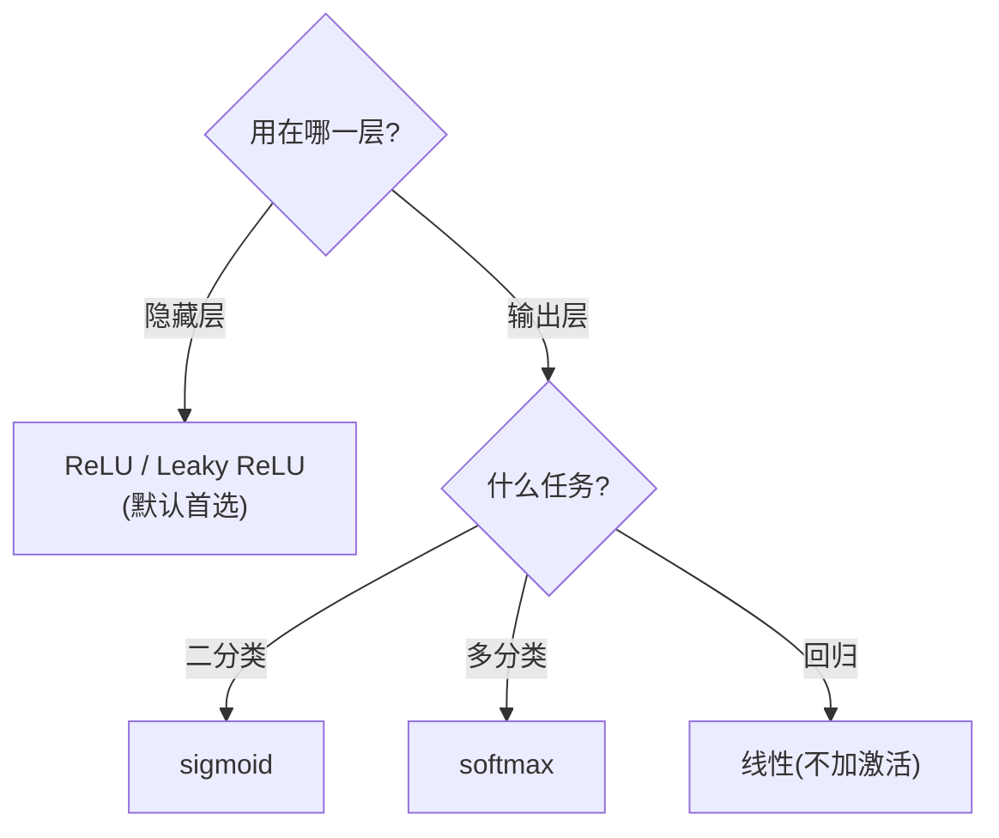

---
tags:
  - 概念原理
  - 激活函数Activation
  - sigmoid
  - Tanh
  - ReLU
  - LeakyReLU
---

# 激活函数：sigmoid / tanh / ReLU / Leaky ReLU · 概念原理 · N004

**时间:** 2026-10-17
**标签:** #概念原理 #激活函数Activation #sigmoid #Tanh #ReLU #LeakyReLU
**关联:** [[N005 前向传播与损失函数]]（激活函数用在前向传播里）

## 实际情况

参考视频第二章 2.3~2.7。核心问题：**为什么全连接网络需要「非线性」？**

### 1. 为什么需要激活函数（非线性）

全连接层本质是「矩阵乘法 + 偏置」（线性运算）。**多个线性变换复合仍是线性变换**（矩阵相乘还是矩阵），所以多层全连接等价于一层——加再多层也没用。没有非线性，网络连「异或 XOR」这种简单问题都拟合不了。

激活函数就是把「非线性」注入每一层，让网络有表达能力。

### 2. sigmoid：σ(x) = 1/(1+e⁻ˣ)

- 输出压到 **(0, 1)**，天然像「概率」→ 二分类输出层首选
- 导数 `σ'(x) = σ(x)(1−σ(x))`，两端趋近 0
- 缺点：**饱和区梯度消失**（x 很大或很小时导数≈0，反向传播梯度乘起来越来越小）；**非零中心**（输出恒正，梯度更新走 zigzag）；含 exp 计算慢

### 3. tanh：(eˣ − e⁻ˣ)/(eˣ + e⁻ˣ)

- 输出 **(−1, 1)**，**零中心**（比 sigmoid 好，收敛更快）
- 缺点：仍有饱和区、梯度消失

### 4. ReLU：max(0, x)

- 输出 **[0, +∞)**
- 优点：正区间**导数恒为 1**（不饱和，缓解梯度消失）、计算快（一个 max）、稀疏激活（负半轴直接置 0）
- 缺点：**负区间导数为 0** → 神经元可能「死掉」（Dead ReLU：一旦某次输出恒 ≤0，梯度恒 0，这个神经元就再也更新不了）

### 5. Leaky ReLU：max(αx, x)，α 取 0.01

- 负区间给一个小斜率 α，**解决死神经元**
- 是 ReLU 的改良版

### 6. 应用选择（决策图）

| 位置 | 常用 | 原因 |
| ---- | ---- | ---- |
| 隐藏层 | **ReLU / Leaky ReLU** | 快、缓解梯度消失 |
| 二分类输出 | sigmoid | 输出当概率 |
| 多分类输出 | softmax | 归一化成概率分布 |
| 回归输出 | 无 / 线性 | 输出任意实数 |

## 思考

（留白 —— ReLU 在 x=0 处不可导，为什么反向传播还能正常进行？）

## 总结

**本质：** 激活函数给全连接网络注入非线性（多层线性复合仍线性）；sigmoid(0,1) 适合二分类输出但有饱和/非零中心问题，tanh(−1,1) 零中心更好，ReLU 是隐藏层默认（快 + 缓解梯度消失但有死神经元），Leaky ReLU 用负区间小斜率解决死神经元。
**标签:** #概念原理 #激活函数Activation #sigmoid #Tanh #ReLU #LeakyReLU
