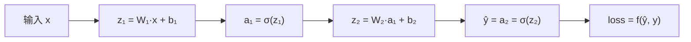

---
tags:
  - 概念原理
  - 前向传播
  - 损失函数Loss
  - MSE均方误差
  - 交叉熵CrossEntropy
---

# 前向传播与损失函数：从输入到预测再到误差 · 概念原理 · N005

**时间:** 2026-10-17
**标签:** #概念原理 #前向传播 #损失函数Loss #MSE均方误差 #交叉熵CrossEntropy
**关联:** [[N004 激活函数]]（激活函数是前向的一步）· [[N006 反向传播与梯度下降]]（loss 是反向的起点）

## 实际情况

参考视频第二章 2.8~2.9。

### 1. 前向传播（forward）

数据从输入层一路「加权求和 → 激活」传到输出层，得到预测值的过程。每层两步：

```
z = W·x + b        # 线性：加权求和 + 偏置
a = σ(z)           # 非线性：过激活函数
```



一层一层的 `z → a` 串起来，最后输出 `a_L` 就是预测。**前向 = 用当前权重算一次预测**（对应 autograd 里「算 loss」之前那一步，见 [[N002 自动求导autograd]]）。

### 2. 损失函数（loss）：衡量预测差多远

| 任务 | 损失函数 | 公式 | 说明 |
| ---- | ---- | ---- | ---- |
| 回归 | **MSE** 均方误差 | L = (1/n)·Σ(y_pred − y_true)² | 差的平方求平均 |
| 二分类 | **BCE** 二值交叉熵 | L = −Σ[y·log(ŷ) + (1−y)·log(1−ŷ)] | 配合 sigmoid |
| 多分类 | **CE** 交叉熵 | L = −Σ y·log(ŷ) | 配合 softmax |

**softmax**：多分类时把输出层的一串数归一化成概率分布（和=1），然后和 one-hot 标签算交叉熵。

训练的目标就是**让 loss 越小越好**，loss 是反向传播的起点。

### 3. 简单计算：MSE

预测 [1.0, 2.0]，真实 [1.5, 2.5]：
```
L = [(1.0−1.5)² + (2.0−2.5)²] / 2 = (0.25 + 0.25) / 2 = 0.25
```

### 4. 完整前向数值例（单神经元）

一个神经元 `z = w·x + b`，`w=2, b=1`，输入 `x=3`，激活 σ 是 ReLU：

```
z = 2×3 + 1 = 7
a = ReLU(7) = 7      ← 这就是这个神经元的输出(预测)
```

## 思考

（留白 —— 分类任务为什么普遍用交叉熵而不是 MSE？交叉熵对「错误预测」的惩罚比 MSE 更重，体现在公式的哪里？）

## 总结

**本质：** 前向传播 = 逐层 `z=Wx+b` → `a=σ(z)` 算出预测；损失函数衡量预测与真实的差距，回归用 MSE、分类用交叉熵（配 softmax/sigmoid）。loss 越小越好，它是反向传播的起点。
**标签:** #概念原理 #前向传播 #损失函数Loss #MSE均方误差 #交叉熵CrossEntropy
