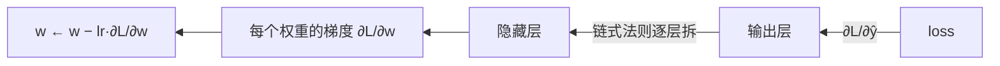

---
tags:
  - 概念原理
  - 反向传播Backprop
  - 梯度下降GradientDescent
  - 优化器Optimizer
  - 链式法则
---

# 反向传播与梯度下降：链式法则与权重更新 · 概念原理 · N006

**时间:** 2026-10-17
**标签:** #概念原理 #反向传播Backprop #梯度下降GradientDescent #优化器Optimizer #链式法则
**关联:** [[N005 前向传播与损失函数]]（loss 是起点）· [[N002 自动求导autograd]]（PyTorch 自动实现）

## 实际情况

参考视频第二章 2.10~2.11。理论层面：反向传播是「原理」，autograd 是「PyTorch 自动帮你做」（见 [[N002 自动求导autograd]]）。

### 1. 反向传播（backprop）：用链式法则求梯度

目标是求 **loss 对每个权重的偏导** ∂L/∂w。核心是**链式法则**，从输出层往回一层层拆：

```
∂L/∂w = ∂L/∂a · ∂a/∂z · ∂z/∂w
        (误差)   (激活导数)  (输入)
```



**直觉**：误差从输出层「倒着传」回每一层，每层分走自己那一份责任。前向算出预测 → 反向算出「每个权重该负多少责任（梯度）」。

### 2. 梯度下降（gradient descent）：沿负梯度更新

```
w ← w − lr · ∂L/∂w
```

- 梯度指向「loss 上升最快的方向」，所以**减**梯度就是往下降走
- `lr`（学习率）= 步长：太大震荡发散、太小收敛慢（要调）

三种变体（按一次用多少样本算梯度）：

| 变体 | 每步用 | 特点 |
| ---- | ---- | ---- |
| 批量 BGD | 全数据集 | 稳但慢、显存大 |
| 随机 SGD | 1 个样本 | 快但震荡 |
| **小批量 Mini-batch** | 一批(如 32/64) | **折中，最常用** |

### 3. 简单计算：链式法则

`L = (w·x − y)²`，x=2，y=1，w=3（lr=0.01）：

```
L = (3×2 − 1)² = 25
∂L/∂w = 2·(w·x − y)·x = 2×5×2 = 20     ← 链式法则拆开算
w ← 3 − 0.01×20 = 2.8                     ← 梯度下降更新
```

### 4. 反向传播与梯度下降的关系（易混点）

- **反向传播** = 求「梯度 ∂L/∂w」的方法（链式法则 + 误差回传）
- **梯度下降** = 拿到梯度后「怎么更新权重」的策略（w − lr·梯度）
- 两者不是一回事，但配合起来就是**训练的核心循环**：反向求梯度 → 梯度下降更新

## 思考

（留白 —— 学习率 lr 设为 0 会发生什么？设为非常大（如 100）会发生什么？）

## 总结

**本质：** 反向传播 = 链式法则从输出层往回算每层梯度（∂L/∂w）；梯度下降 = 沿负梯度 `w ← w − lr·∂L/∂w` 更新权重。两者配合 = 训练的核心循环。PyTorch 里由 autograd 的 `loss.backward()` + 手动 `w -= lr*w.grad` 自动/半自动完成。
**标签:** #概念原理 #反向传播Backprop #梯度下降GradientDescent #优化器Optimizer #链式法则
