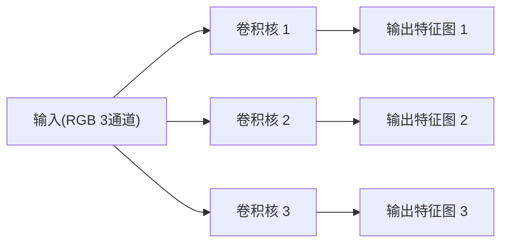

---
tags:
  - 概念原理
  - 卷积Convolution
  - 步幅stride
  - 填充padding
  - 多通道卷积
  - 权值共享
  - 感受野
---

# 卷积层：运算 / 步幅 / 填充 / 输出公式 / 多卷积核 · 概念原理 · N007

**时间:** 2026-10-17
**标签:** #概念原理 #卷积Convolution #步幅stride #填充padding #多通道卷积 #权值共享 #感受野
**关联:** [[N008 池化与CNN整体架构]]（卷积 → 池化）· [[N001 张量基础dtype-shape-device与GPU]]（图像 = 张量）

## 实际情况

参考视频第二章 2.12~2.18，**本章重点**。

### 1. 图像在计算机里的本质

一张图 = **像素矩阵**，即一个 3 维张量 `[高 H, 宽 W, 通道 C]`：
- 灰度图：1 通道
- 彩色图：3 通道（RGB）

（连接 [[N001 张量基础dtype-shape-device与GPU]]：深度学习里批量处理时是 4 维 `[N, C, H, W]`。）

### 2. 全连接的问题 → 为什么用卷积

1. **参数量爆炸**：28×28 图像全连接到 128 个神经元要 28×28×128 ≈ 10 万参数；大图更离谱
2. **丢失空间结构**：全连接把图「拉平成一维」，相邻像素的空间关系没了
3. **平移不变性差**：物体挪一点，全连接的输入就完全变了

### 3. 卷积运算：核在图上滑动「相乘求和」

卷积核（filter/kernel）是 `k×k` 的小矩阵，在输入图上**滑动**，每个位置做「对应位置相乘再求和」，输出一个值，所有位置构成**输出特征图**。

```
输入 5×5           核 3×3           输出 3×3(步幅1,无填充)
┌─────────────┐   ┌─────────┐      ┌──────────┐
│ 0  0  1  1  1│   │ 1  0 -1 │      │ -3 -3  0 │
│ 0  0  1  1  1│ ⊛ │ 1  0 -1 │  =   │ -3 -3  0 │
│ 0  0  1  1  1│   │ 1  0 -1 │      │ -3 -3  0 │
│ 0  0  1  1  1│   └─────────┘      └──────────┘
│ 0  0  1  1  1│
└─────────────┘

左上角第一个 3×3 窗口:
  0 0 1        1 0 -1
  0 0 1   ⊙    1 0 -1   逐元素相乘再求和:
  0 0 1        1 0 -1   (0+0−1)+(0+0−1)+(0+0−1) = −3

→ 这个核是「竖边检测器」:窗口左 0 右 1 的竖边输出 −3(强响应),
  纯 0 或纯 1 的均匀区域输出 0。核滑动扫全图 → 输出特征图。
```

### 4. 步幅 stride 与填充 padding

- **步幅 stride**：核每次滑动的像素数（s=1 逐像素，s=2 隔一个跳一个，输出变小）
- **填充 padding**：在输入边缘补 0，让输出保持尺寸（p=1 常配 3×3 核）

### 5. 输出特征图大小公式（重点记）

```
out = (in − k + 2p) / s + 1
```

- `in` 输入边长，`k` 核大小，`p` 填充，`s` 步幅
- 例：输入 28×28，核 3×3，p=1，s=1 → out = (28−3+2)/1+1 = **28**（尺寸不变）
- 例：输入 28×28，核 3×3，p=0，s=2 → out = (28−3+0)/2+1 = **13**（下采样）

### 6. 多卷积核（立体图直观理解）



- **多通道输入**：RGB 图是 3 通道，核也要 3 通道，逐通道卷积后**相加**成一个输出通道
- **多卷积核**：一个核扫出**一张**输出特征图，N 个核 → **N 张**输出（每张捕捉不同特征：边缘/纹理/颜色…）
- 记忆：**输出通道数 = 卷积核个数**

### 7. 卷积的两大性质 + 参数量对比

1. **局部连接**：每个输出只看到一个小窗口（窗口大小 = 感受野）
2. **权值共享**：同一个核扫全图，参数不随位置变 → 参数量骤减

| 方案 | 参数量(28×28→128 维) |
| ---- | ---- |
| 全连接 | 28×28×128 ≈ **10 万** |
| 卷积 3×3×32 核 | 3×3×1×32 ≈ **288** |

差几个数量级，这就是卷积能堆深层的底气。

### 8. 常见误区

- ✗ 「卷积核 = 模板匹配」→ 实际是学出来的特征提取器，不只匹配
- ✗ 忽略偏置 → 卷积也有 bias（每个输出通道一个）
- ✗ 记错公式 → 忘记 `+1` 或混淆 stride/padding 的影响方向

## 思考

（留白 —— 一个 3×3 核、padding=1 的卷积，输出边长不变，那「感受野」是多少？堆两层 3×3 卷积呢？）

## 总结

**本质：** 卷积 = 核在输入上滑动「相乘求和」得到输出特征图；图像本质是 `[H,W,C]` 张量；步幅控制滑动间隔、填充控制边缘与尺寸；`out=(in−k+2p)/s+1` 是核心公式；多核 = 多输出通道；局部连接 + 权值共享让参数量骤减、保留空间结构。
**标签:** #概念原理 #卷积Convolution #步幅stride #填充padding #多通道卷积 #权值共享 #感受野
