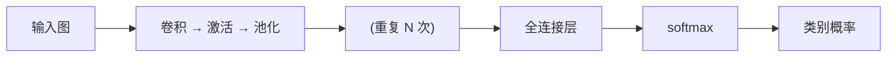

---
tags:
  - 概念原理
  - 池化Pooling
  - 最大池化MaxPooling
  - 平均池化AvgPooling
  - 感受野ReceptiveField
  - 全连接FC
---

# 池化与 CNN 整体架构：降采样与特征提取流水线 · 概念原理 · N008

**时间:** 2026-10-17
**标签:** #概念原理 #池化Pooling #最大池化MaxPooling #平均池化AvgPooling #感受野ReceptiveField #全连接FC
**关联:** [[N007 卷积层运算步幅填充多卷积核]]（卷积 → 池化）

## 实际情况

参考视频第二章 2.19~2.20。

### 1. 池化（pooling）：降采样

池化**无参、无核**——没有要学习的参数，也不是卷积核，只是固定的规则，用来**缩小特征图**（降采样）、减少计算量、增强平移不变性。

| 类型 | 规则 | 特点 |
| ---- | ---- | ---- |
| **最大池化 Max** | 取窗口最大值 | 保留最强特征，最常用 |
| **平均池化 Avg** | 取窗口平均值 | 保留整体背景信息 |

```
最大池化 2×2,步幅 2:4×4 → 2×2

输入               输出
┌────────────┐    ┌──────┐
│ 1  3  2  4 │    │ 6  8 │
│ 5  6  7  8 │ →  │ 9  6 │
│ 9  0  1  2 │    └──────┘
│ 3  4  5  6 │
└────────────┘

4 个 2×2 窗口分别取最大:
[1,3,5,6]→6   [2,4,7,8]→8
[9,0,3,4]→9   [1,2,5,6]→6
```

### 2. 感受野（receptive field）

输出特征图上的**一个点，对应输入图多大的区域**。层越深、卷积/池化堆越多，感受野越大——后面的神经元能「看到」更大的范围。这是 CNN 能逐层提取从局部到全局特征的原因。

### 3. CNN 整体架构（一条流水线）



**分工**：卷积/池化负责**特征提取**（从边缘纹理到高层语义），全连接负责**分类决策**。

### 4. CNN 家族速览（本章简介）

| 网络 | 年份 | 核心贡献 |
| ---- | ---- | ---- |
| LeNet-5 | 1998 | 开山之作（手写数字） |
| AlexNet | 2012 | 深度 + ReLU + Dropout，掀起深度学习 |
| VGG | 2014 | 小卷积核(3×3)堆叠 |
| GoogLeNet | 2014 | Inception + 1×1 卷积 |
| ResNet | 2015 | **残差连接，解决深度退化**（任务一主角） |

## 思考

（留白 —— 池化「无参」为什么反而是优点？如果池化也带参数可学习，会带来什么问题？）

## 总结

**本质：** 池化是无参无核的降采样（最大/平均），缩小特征图、增强平移不变；感受野 = 输出一点对应输入的感知范围，层越深越大；CNN 整体 = 卷积+激活+池化（特征提取）→ 全连接（分类）→ softmax（概率）。家族演进：LeNet→AlexNet→VGG→GoogLeNet→ResNet。
**标签:** #概念原理 #池化Pooling #最大池化MaxPooling #平均池化AvgPooling #感受野ReceptiveField #全连接FC
