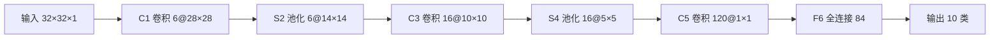

---
tags:
  - 概念原理
  - LeNet
  - 卷积Convolution
  - 池化Pooling
  - 全连接FC
  - 特征提取
  - 批Batch
---

# LeNet-5 架构与各层参数 · 概念原理 · N009

**时间:** 2026-10-17 20:30
**标签:** #概念原理 #LeNet #卷积Convolution #池化Pooling #全连接FC #特征提取 #批Batch
**关联:** [[N007 卷积层运算步幅填充多卷积核]]（层怎么算）· [[N008 池化与CNN整体架构]]（池化）· [[N004 激活函数sigmoid-tanh-relu-leakyrelu]]（LeNet 用 sigmoid/tanh）· [[DLC2.jpg]]（第四章 4.1~4.13 手写笔记总图）

## 实际情况

参考视频第四章 4.2~4.4（LeNet 理论）。LeNet-5 是 LeCun 1998 年的 CNN 开山之作，就是为**手写数字识别**（正是任务一 MNIST 这类问题）设计的。

### 1. 整体架构：一张图看懂

CNN 的骨架 = **「卷积 → 池化」反复堆 + 全连接分类**，LeNet-5 共 7 层（不计输入层）：

- **前半段（C1~S4）**：卷积 + 池化反复，负责**特征提取**
- **后半段（C5~输出）**：全连接，负责**分类**

### 2. 各层参数表（重点：参数怎么算）

| 层 | 类型 | 核/单元 | 输出尺寸 | 参数量 |
| ---- | ---- | ---- | ---- | ---- |
| 输入 | — | — | 32×32×1 | 0 |
| C1 | 卷积 | 6 个 5×5 核，s=1 | 28×28×6 | (5×5×1+1)×6 = **156** |
| S2 | 平均池化 | 2×2，s=2 | 14×14×6 | 0 |
| C3 | 卷积 | 16 个 5×5 核 | 10×10×16 | (5×5×6+1)×16 = **2416** |
| S4 | 平均池化 | 2×2，s=2 | 5×5×16 | 0 |
| C5 | 卷积 | 120 个 5×5 核 | 1×1×120 | (5×5×16+1)×120 = **48120** |
| F6 | 全连接 | 120→84 | 84 | (120+1)×84 = **10164** |
| 输出 | 全连接 | 84→10 | 10 | (84+1)×10 = **850** |

总参数量 ≈ **6 万**。两个规律：

1. **卷积层参数量 =（核大小 × 输入通道数 + 1 偏置）× 卷积核个数**（连接 [[N007 卷积层运算步幅填充多卷积核]]：核个数 = 输出通道数）
2. **池化层没有参数**——它只是固定规则的下采样，不学习

### 3. 尺寸为什么这样变

用输出公式 `out = (in − k + 2p) / s + 1`（见 [[N007 卷积层运算步幅填充多卷积核]]）：
- C1：32×32，核 5×5，p=0，s=1 → (32−5)/1+1 = **28**
- S2：28×28，池 2×2，s=2 → (28−2)/2+1 = **14**
- C3：14×14，核 5×5 → (14−5)/1+1 = **10**
- C5：5×5，核 5×5 → (5−5)/1+1 = **1×1**（等价于全连接，把 5×5 每个位置都连上）

### 4. 特征提取的「分工」

- **卷积 + 池化（前端）**：逐层从「边缘 → 纹理 → 形状」抽象，特征图越来越小、越来越「语义」
- **全连接（后端）**：把前端抽出来的特征**组合判断**，输出 10 类得分
- 一句话：**卷积负责「看懂局部」，全连接负责「综合决策」**

### 5. batch（批）与数据传输

训练不是一张张喂图，而是一次喂 **batch 张**，拼成一个 4 维张量 `[batch, C, H, W]` 一起前向（连接 [[N001 张量基础dtype-shape-device与GPU]]：批处理维度 N）：
- **为什么**：GPU 擅长并行，一次算一批比一张张快得多；一批的梯度也更稳定
- **batch 是超参数**：太大吃显存、太小梯度抖；是下一步「数据加载 Dataset/DataLoader」要定的核心参数

### 6. 常见误区

- ✗ 把「层数」数错——LeNet-5 是 **7 层**（C1/S2/C3/S4/C5/F6/输出），不是 5 层，名字里的 5 只是型号
- ✗ 以为池化有参数——池化**零参数**
- ✗ C5 看成全连接——它本质是卷积（核尺寸 = 特征图尺寸 → 输出 1×1），只是效果等价全连接

## 思考

（留白 —— C1 用 6 个核、C3 用 16 个核，为什么核个数要「越来越多」？和「输出通道数 = 卷积核个数」有什么关系？）

## 总结

**本质：** LeNet-5 = 「卷积→池化」反复提特征 + 全连接分类，共 7 层约 6 万参数；卷积层参数 =（核大小×入通道+1）×核数，池化零参数；特征图随层变小、语义变强；训练按 batch 喂 `[N,C,H,W]` 张量并行加速。
**标签:** #概念原理 #LeNet #卷积Convolution #池化Pooling #全连接FC #特征提取 #批Batch
