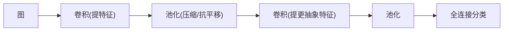

---
tags:
  - 概念原理
  - 卷积Convolution
  - 池化Pooling
  - 特征提取
  - 感受野ReceptiveField
  - 平移不变性
---

# 卷积与池化的作用及对图像的侧重 · 概念原理 · N010

**时间:** 2026-10-17 20:30
**标签:** #概念原理 #卷积Convolution #池化Pooling #特征提取 #感受野ReceptiveField #平移不变性
**关联:** [[N007 卷积层运算步幅填充多卷积核]]（卷积怎么算）· [[N008 池化与CNN整体架构]]（池化怎么算）· [[N009 LeNet-5架构与各层参数]]（两者怎么配合）

## 实际情况

参考视频第四章（LeNet/AlexNet 里反复讲）。卷积和池化是 CNN 的两大支柱，但**各管一摊**——搞清它俩「各自侧重什么」，是看懂所有经典网络的前提。

### 1. 卷积：负责「提取什么特征」

卷积的核是**学出来的特征提取器**，每个核专门响应一种模式：

| 核类型 | 响应什么 |
| ---- | ---- |
| 竖边检测核 | 图像里的竖直边缘 |
| 横边检测核 | 水平边缘 |
| 纹理核 | 特定纹理 |
| 更深层的核 | 组合出的形状 / 物体部件 |

- 卷积对图像的侧重：**决定「抓什么」**——它保留空间结构，且靠局部连接 + 权值共享（见 [[N007 卷积层运算步幅填充多卷积核]]）只学小窗口里的模式
- 逐层抽象：浅层学边缘、中层学纹理、深层学形状（连接 [[N009 LeNet-5架构与各层参数]] 的「特征提取分工」）

### 2. 池化：负责「抽象到什么程度 + 抗不抗平移」

池化是**固定规则的下采样**（最大池化取窗口最大、平均池化取平均），不学习：

- **降维、减小计算量**：特征图尺寸骤减，后续层参数变少
- **增大感受野**：一个池化后单元的「视野」变大了，能看到更大范围
- **平移不变性**：物体在图中挪一点，最大池化取「窗口里的最大响应」仍然会响应到，位置细节被模糊掉——这是我们要的「容忍小位移」

- 池化对图像的侧重：**决定「空间压缩与不变性」**——它不管特征「是什么」，只管把特征图缩小、让响应对小位移鲁棒

### 3. 它俩的分工（重点理解）

| | 卷积 | 池化 |
| ---- | ---- | ---- |
| 在做什么 | 学特征（乘加 + 偏置） | 固定下采样（取 max/avg） |
| 有参数吗 | 有（核 + 偏置） | **无** |
| 对图像的侧重 | **内容**：提取什么特征 | **空间**：压缩 + 抗平移 |
| 输出 | 特征图（越堆越「语义」） | 特征图（越缩越小） |

一句话：**卷积管「看什么」，池化管「看得多粗、扛不扛挪」。**

### 4. 为什么必须「卷积 + 池化」成对出现

只堆卷积：特征图不变小，计算量大、感受野小、对位置敏感 → 容易过拟合、难泛化。
配合池化：每提一轮特征就压缩一轮，**特征越抽象、感受野越大、越抗平移**，这正是图像识别需要的鲁棒性。

### 5. 常见误区

- ✗ 「池化是为了提特征」→ 错，池化不学习，只管压缩和不变性
- ✗ 「卷积越多感受野越小」→ 错，卷积 + 池化反复堆，感受野**越来越大**
- ✗ 「池化有参数要训练」→ 池化零参数

## 思考

（留白 —— 最大池化会「丢掉」窗口里非最大值的信息，那为什么说它反而让模型更鲁棒、更不容易过拟合？丢信息是坏事吗？）

## 总结

**本质：** 卷积 = 学出来的特征提取器，管「看什么」（内容）；池化 = 固定下采样，管「压缩 + 抗平移 + 感受野」（空间）；两者成对堆叠，让特征越来越抽象、感受野越来越大、对小位移越来越鲁棒——这是 CNN 能识别图像的核心机制。
**标签:** #概念原理 #卷积Convolution #池化Pooling #特征提取 #感受野ReceptiveField #平移不变性
