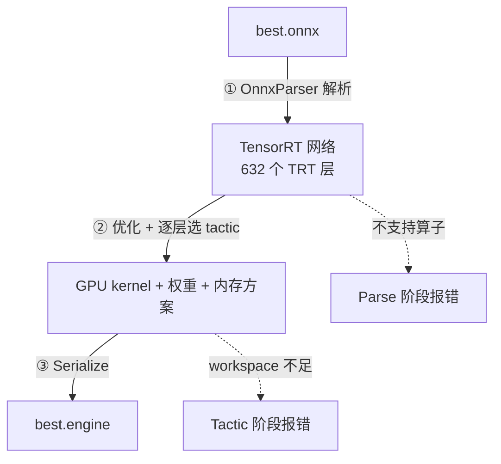

---
tags:
  - 概念原理
  - ONNX
  - TensorRT
  - Engine
  - 编译原理Compiler
  - Tactic
  - 算子融合OperatorFusion
  - 序列化Serialization
---

# ONNX 编译成 engine 的原理：Parser / 优化 / Tactic / 序列化 · 概念原理 · N024

**时间:** 2026-10-22
**标签:** #概念原理 #ONNX #TensorRT #Engine #编译原理Compiler #Tactic #算子融合OperatorFusion #序列化Serialization #Workspace
**关联:** [[N022 ONNX与TensorRT Engine的区别]]（两者定位）· [[N023 模型全流程总览 从数据到Orin部署]]（全流程位置）· [[N019 TensorRT部署onnx转engine并推理]]（Python 实战）· [[N025 拿到ONNX转engine的标准操作]]（操作手册）

## 一句话

**engine 不是「ONNX + TensorRT 的容器」，而是 TensorRT 把 ONNX 图经过「解析 → 优化 + 选 kernel → 序列化」三步，编译出的 GPU 可执行文件。** 中间产物只在内存里，不落盘。

## 实际情况

groundzero 的交通标志 pose 模型：

```
best.onnx   输入 images  [1, 3, 640, 640] FLOAT
            输出 output0 [1, 300, 30]      FLOAT
      │
      │ trtexec / Python Builder（RTX 5060 Laptop，TensorRT 11.4）
      ▼
best.engine 11.56 MiB，build 约 35~40 秒
```

## 0. 三步全景

```
best.onnx
   │
   │ ① Parse（解析）               ~0.03 秒，纯 CPU
   ▼
TensorRT 内部网络（TensorRT 层组成的图，在内存里）
   │
   │ ② Optimize + Tactic 选择      ~35 秒，需要 GPU
   ▼
编译好的 GPU kernel + 权重 + 内存布局方案（在内存里）
   │
   │ ③ Serialize（序列化）         <1 秒
   ▼
best.engine（二进制文件）
```



## 1. Parse：ONNX 节点 → TensorRT 层

`OnnxParser` 读 ONNX（protobuf 格式），把每个 ONNX 节点翻译成 TensorRT 自己的「层」。

实测 groundzero 模型：

| ONNX | TensorRT |
| ---- | ---- |
| 421 个节点 | 632 个层 |

层类型分布（top）：

```
ELEMENTWISE       222
CONVOLUTION       111
ACTIVATION         95
CONSTANT           70
SLICE              34
SHUFFLE            34
CONCATENATION      26
CAST               18
MATRIX_MULTIPLY     4
UNSQUEEZE           4
GATHER              4
POOLING             3
SOFTMAX             2
RESIZE              2
TOPK                2
REDUCE              1
```

**为什么节点数和层数不一样？** ONNX 里一个节点可能被拆成几层。例如 Reshape 会被拆成 Slice + Shuffle，所以 421 → 632，不是一一对应。

**这一步还没有任何 GPU 代码。** 只是把「ONNX 表示」换成「TensorRT 表示」，所以很快。

对应日志：

```
[I] Start parsing network model.
[I] ONNX IR version: 0.0.8 / Opset version: 17
[I] Finished parsing network model. Parse time: 0.0322252
```

失败模式：ONNX 里有 TensorRT 不支持的算子 → **Parse 阶段直接报错**，和显存、workspace 无关。

## 2. Optimize + Tactic：真正「编译」的地方

TensorRT 拿着 632 层的图做四件事。

### 2.1 算子融合（Operator Fusion）

把连续的小算子合并成一个大 kernel，减少显存读写：

```
Conv → Add → Sigmoid   ⇒   一个 fused kernel
```

权重里的常量也会被提前算掉（日志里 `CONSTANT 70` 层）。

### 2.2 给每一层挑最快的实现（Tactic）

同一个卷积，TensorRT 内部有几十种候选实现：不同的 tile 大小、不同的显存访问模式、不同指令。**它会在你的 GPU 上真实试跑候选，测时间，选最快的。**

这解释了三件事：

1. 为什么 build 要 35 秒——时间花在试跑上，不是模型大
2. 为什么 build 必须在目标 GPU 上做——候选 kernel 的性能是这块卡测的
3. 为什么需要 workspace——试跑要临时显存

`workspace` 是 **build 期**的临时显存，不是 engine 运行时的显存。

### 2.3 内存规划（Memory Planning）

算出每个中间结果的生命周期，让可以复用的 buffer 共用一块显存。日志最后会给出：

```
Total Activation Memory: 32770048 bytes   ← 中间激活，约 32.7 MB
Total Weights Memory:    10438976 bytes   ← 权重，约 10.4 MB
```

### 2.4 精度：strongly-typed

TensorRT 11 **只支持 strongly-typed 网络**：

- ONNX 里是 FP32 → engine 就是 FP32 kernel（可额外使用 TF32 加速）
- 想 FP16/INT8，必须**在 ONNX 图里就把精度改掉**（FP16 用 NVIDIA ModelOpt AutoCast 烤进图，INT8 用 Q/DQ），不能靠 build 参数开关
- 这就是 TRT 11 没有 `BuilderFlag.FP16`、`trtexec` 也没有 `--fp16` 的原因

## 3. Serialize：engine 里到底装了什么

| 内容 | 说明 |
| ---- | ---- |
| GPU kernel 机器码 | 针对 sm_120（RTX 5060）编译 |
| 权重 | 已按最优内存布局排好 |
| 内存分配方案 | 每个 buffer 多大、如何复用 |
| 输入输出绑定表 | 名字、shape、dtype、地址偏移 |
| 版本 / 设备元信息 | TensorRT 11.4、compute capability 12.0 |

**engine 里没有的东西：**

- 没有 ONNX 图，所以 `onnx.load()` 打不开
- 没有 PyTorch 代码，不需要 `best.pt`
- 没有预处理 / NMS / 后处理
- 不能训练

**因此 engine 不可移植**：换 GPU 架构、换 TensorRT 大版本、换输入 shape，都要重新 build。

## 4. 命令与内部步骤的对应

```bash
trtexec \
  --onnx=best.onnx \              # ① 的输入
  --saveEngine=best.engine \      # ③ 的输出路径
  --memPoolSize=workspace:2048M   # ② 的临时显存
```

Python API 做的是同一件事：

```python
network = builder.create_network()                    # 空图
parser  = trt.OnnxParser(network, logger)             # 解析器
parser.parse_from_file("best.onnx")                   # ① 填充 network
serialized = builder.build_serialized_network(        # ② 编译
    network, config)
open("best.engine", "wb").write(bytes(serialized))    # ③ 写文件
```

`build_serialized_network` 返回 `IHostMemory`，所以要 `bytes()` 包一层再写文件。

## 5. build 完为什么还会打印 latency

`trtexec` build 结束后会**自动用随机数据跑一遍推理**，这不是 build 的一部分：

```
Engine built in 39.9 sec          ← ② 编译耗时
Throughput: 629.27 qps            ← 编译后的测试
Latency: mean 1.59 ms             ← 纯 GPU 前向，不含前后处理
```

Python 脚本 build 完不会自动测，需要自己写推理代码。

## 6. 常见误解

| 误解 | 实际 |
| ---- | ---- |
| engine 是 ONNX 的压缩包 | 是编译后的 kernel + 权重 + 内存方案，不含图 |
| build 慢是因为模型大 | 慢在逐层试跑候选 kernel |
| engine 可以拷给别人 | 与 GPU 架构、TRT 版本、输入 shape 绑定 |
| workspace 是推理时用的显存 | 是 build 期的临时显存 |
| trtexec 的 latency 是端到端 | 只是 GPU 前向，不含预处理和后处理 |
| TRT 11 可以 `--fp16` | 不能，精度必须预先写进 ONNX 图 |

## 7. 术语表

| 术语 | 含义 |
| ---- | ---- |
| Parser | 把 ONNX 节点翻译成 TensorRT 层的组件 |
| Layer | TensorRT 网络中的一层（卷积、激活、切片等） |
| Tactic | 某一层的具体 kernel 实现方案 |
| Workspace | build 期用于试跑候选 kernel 的临时显存 |
| Serialize | 把编译结果写成二进制 plan 文件 |
| Plan | engine 文件的另一种叫法（执行计划） |
| Strongly typed | 图里写什么精度就用什么精度，TRT 11 强制模式 |
| Activation Memory | 推理过程中间结果的显存 |
| TF32 | FP32 的加速模式，精度略低、速度更快 |
| Timing cache | 记录 tactic 测速结果，加速重复 build |

## 总结

从 ONNX 到 engine，本质是**一次针对特定 GPU 的编译**：

1. **Parse** 把 ONNX 图翻译成 TensorRT 层（快，纯 CPU）
2. **Optimize + Tactic** 融合算子、逐层试跑选最快 kernel、规划显存（慢，需要 GPU 和 workspace）
3. **Serialize** 把 kernel、权重、内存方案打包成二进制

理解这三步之后，build 过程中的所有日志、耗时和报错都能对上号：**Parse 报错找算子，Tactic 报错找 workspace，反序列化报错找 GPU / 版本。**
