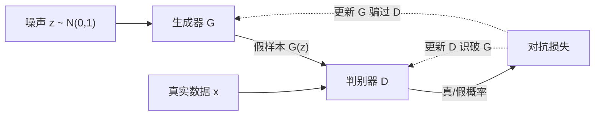

生成模型要学的不是 $X \to Y$ 的映射，而是数据本身的概率分布 $p(x)$：学出来之后既能**密度估计**（判断样本有多正常），也能**采样**（造出训练集里没有的新实例）。本讲两条路线：自编码器/VAE 走“压缩到潜变量再解码”，GAN 走“噪声直接映射成数据，靠两个网络对抗”。

## 三种学习范式的位置

| 范式 | 数据形态 | 目标 |
| --- | --- | --- |
| 监督 | 成对 $(x, y)$ | 学 $x \to y$ |
| 无监督 | 只有 $x$ | 学数据分布、结构 |
| 生成 | 只有 $x$ | **显式建模 $p(x)$ 并从中采样** |

生成模型的三个用途：

- **去偏 debiasing**：数据有偏，学出的分布也有偏，可以用生成模型修正。
- **异常检测**：$p(x)$ 很低 = 罕见样本（自动驾驶里的少见路况、医学影像里的罕见病灶）。
- **样本生成**：图像、文本、音频、分子设计。

## 潜变量模型：柏拉图的洞穴

墙上看到的影子是观测数据 $x$；洞里真正经过的物体是**潜变量 $z$**。数据的高维变化其实由少数几个轴驱动，目标是学出这组 $z$。

- 编码器 encoder：$x \to z$，抓主要变化轴；
- 解码器 decoder：$z \to \hat{x}$，还原数据。

## 自编码器 Autoencoder

**没有标签，目标是重建自己**：输入 $x$，编码成低维 $z$，再解码回 $\hat{x}$，最小化 $x$ 与 $\hat{x}$ 的差。

```
x ──encoder──▶ z ──decoder──▶ x̂
                  ▲
              瓶颈 bottleneck（维度很小）
```

损失就是逐像素差（如 MSE）。中间那层维度刻意压小，形成**信息瓶颈**：能还原出来，说明 $z$ 抓住了数据的关键结构，本质是**压缩 + 表征学习**。

**局限：无法用来生成**。编码是确定性的，同一个 $x$ 永远得到同一个 $\hat{x}$；潜空间里随机取一个点，解码出来可能是无意义的垃圾。

## 变分自编码器 VAE

把瓶颈层从“确定的一个点”换成“一个分布”。编码器不再输出 $z$，而是输出**均值 $\mu$ 和标准差 $\sigma$**：

```
z ~ N(μ(x), σ(x)²)
```

解码器从采到的 $z$ 重建 $\hat{x}$。

### 损失 = 重建项 + 正则项

```
L = 重建损失(x, x̂)                      # 学得像
  + D( N(μ, σ²) , N(0, 1) )              # 潜空间形状接近标准正态
```

第二项也叫 distributional loss / KL 正则。它把编码器学出的分布往标准正态拉，原因是要保证潜空间的两个性质：

- **连续性 continuity**：潜空间里相近的点，解码后内容也相近。
- **完整性 completeness**：潜空间里任意采样点都能解出有意义的东西，没有“空洞”。

如果只做重建不管形状：不同类别的点可能挤在一起（潜空间里相邻、解码出正方形和三角形），或者中间出现大片无意义区域。正态先验把均值拉向 0、方差约束在合理范围，既不让分布太尖（一点偏差就解不出东西），也不让各方差各的均值离得太远（出现断层）。

注意正则不是把 $\mu$ 硬压成 0：重建项仍在拉扯，最终是两项的平衡。

### 重参数化技巧 reparameterization trick

采样 `z ~ N(μ, σ²)` 这一步是随机的，梯度没法穿过随机节点。改写为：

```
z = μ + σ ⊙ ε,    ε ~ N(0, I)
```

$\mu, \sigma$ 是网络的确定输出，$\epsilon$ 是外部采样的随机数（不参与求导）。这样 $z$ 在计算图里仍是确定节点，梯度可以一路回传到编码器。

**数字示例**：某维输出 `μ = 2.0, σ = 0.5`，采样 `ε = -0.4`，则 `z = 2.0 + 0.5 × (-0.4) = 1.8`。换一次采样 `ε = 0.6` 得到 `z = 2.3`，但 $\mu,\sigma$ 不变 —— 随机性被隔离在 $\epsilon$ 里。

### 潜变量的可解释性

训练好的 VAE，不同潜变量维度常对应不同语义特征。固定其他维、只微调某一维再解码，能看到输出沿某个属性平滑变化（如人脸的表情、光照、朝向）。这也是它适合做去偏的原因：可以定位并扰动“敏感属性”方向。

## 生成对抗网络 GAN

不压缩、不显式建模 $z$ 的含义，只关心**造得像**。两个网络对抗：



- **生成器 G**：噪声 → 假样本，目标是骗过 D。
- **判别器 D**：输入真实或生成样本，输出“真的概率”，目标是分对。

### 对抗目标

```
min_G max_D  E_{x~p_data}[log D(x)] + E_{z~p_z}[log(1 - D(G(z)))]
```

- D 想**最大化**：真样本判真、假样本判假。
- G 想**最小化**：让 $D(G(z))$ 尽量大，即假样本被判真。

训练时交替更新：固定 G 训 D 若干步 → 固定 D 训 G → 循环。理想均衡点：$G$ 完全复现真实分布，$D$ 只能瞎猜（输出 0.5）。

**一维直观**：真实数据点集中在某处，G 初始把噪声映射到别处；D 先学会分开；G 把生成点往真实点挪；D 再调整边界；反复拉锯，生成分布逐渐贴合真实分布。

### 优缺点

- 优点：生成质量高（尤其图像），不需要显式密度函数，采样一次前向即可。
- 缺点：训练不稳定（两个网络互相追逐，容易震荡/模式崩溃），调参困难。后续很多工作专门改训练稳定性。

## CycleGAN：无配对翻译

普通 GAN 是“噪声 → 数据”。CycleGAN 是“**一个图像域 → 另一个图像域**”，且**不需要成对数据**（没有同一场景的“马”和“斑马”对齐图）。

结构：两个生成器 $G: X \to Y$、$F: Y \to X$，两个判别器 $D_X, D_Y$，加一条**循环一致性损失**：

```
F(G(x)) ≈ x          # 转过去再转回来，要回到原图
G(F(y)) ≈ y
```

这样即使没有配对监督，也能学出风格迁移（照片 → 油画、夏天 → 冬天），也能用在音频上：把一个人的声音波形转成另一个人的音色（讲者把 Alexander 的声音做成 Obama 风格就是这类方法）。

## 识别信号

- 任务是重建、降维、生成、翻译 → 先归到自编码器家族，再问「要不要潜空间」。
- 要求潜空间连续、能采样出新样本 → VAE（重建项 + KL 项），普通 AE 不行。
- 要逼真样本、不写显式似然 → GAN，靠判别器给信号。
- 没有配对数据做翻译 → CycleGAN，用循环一致性代替成对监督。
- 问 VAE 怎么反传 → 重参数化 `z = μ + σ⊙ε`，采样这一步才可导。
- 问 GAN 训练崩 → 判别器太强或模式崩塌，调平衡、用 Wasserstein / 谱归一化。

## 易错点

- 自编码器能重建 ≠ 能生成；确定性映射没有“从分布采样”的能力。
- VAE 的 $\mu, \sigma$ 是**每个潜变量维度**各一组，不是整个 $z$ 一个标量。
- 重参数化不是近似：$\mu + \sigma \epsilon$ 与 $N(\mu, \sigma^2)$ 同分布，只是把随机性挪到了不参与求导的 $\epsilon$。
- GAN 的 D 和 G 不是同时朝同一个目标优化，loss 不会像普通训练那样单调下降。
- CycleGAN 的关键是**无配对** + 循环一致性，不是简单的“两个 GAN 拼起来”。

## 总结

- **自编码器**：$x \to z \to \hat{x}$，靠重建做无监督压缩，瓶颈逼出有用表征，但确定性、不能采样。
- **VAE**：瓶颈改为 $\mu,\sigma$ 采样，损失 = 重建 + 正态先验正则；重参数化 $z=\mu+\sigma\odot\epsilon$ 让梯度能回传；潜空间连续、完整、可解释。
- **GAN**：$G$ 把噪声变成数据、$D$ 判真伪，$\min_G \max_D$ 对抗训练；生成质量高但难训练。
- **CycleGAN**：无配对域翻译，靠循环一致性约束。
- 下一讲（L6）的扩散模型是第三条路：不一次生成，而是**逐步去噪**。
