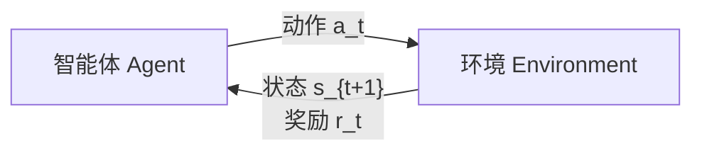

监督学习有成对 $(x,y)$，无监督只有 $x$，强化学习**两者都没有**：只有与环境交互得到的 $(s, a, r)$ 三元组，数据是在训练过程中一边玩一边生成的。目标不是预测某个标签，而是学一个**策略**，让长期累积奖励最大。

## 三种范式对照

| 范式 | 数据 | 目标 |
| --- | --- | --- |
| 监督 | $(x, y)$ 成对 | 学 $x \to y$ |
| 无监督 | 只有 $x$ | 学数据结构 / 分布 |
| 强化学习 | $(s_t, a_t, r_t)$ 三元组 | 最大化长期回报 |

“吃苹果”的类比：监督学习是有人告诉你“这是苹果”；无监督是看到一堆苹果自己聚出类别；RL 是吃了苹果和垃圾食品，发现吃苹果活得更久，于是以后多吃苹果。

## 术语



| 术语 | 含义 |
| --- | --- |
| **agent** | 做决策的主体（无人机、Mario、你） |
| **environment** | agent 所处的世界 |
| **action $a$** | agent 发给环境的动作，动作空间 $\mathcal{A}$ 可以离散（左/右/停）或连续（转向角） |
| **state $s$** | 环境返回的快照（棋盘上棋子的位置），**不评价好坏** |
| **reward $r$** | 刚执行动作的即时反馈，**直接反映动作好坏**，可以为负 |
| **policy $\pi$** | 策略：$s \to a$，给定状态怎么选动作 |
| **return $R_t$** | 从 $t$ 开始的折扣累积奖励 |

### 回报与折扣

```
R_t = r_t + γ·r_{t+1} + γ²·r_{t+2} + ...
```

$\gamma \in [0,1)$ 是**折扣因子**。“今天给你 5 块”和“一年后给你 5 块”，人会选今天 —— 未来的奖励要打折。$\gamma$ 越接近 1，越看重长远；越接近 0，越短视。

奖励可以很**稀疏**：下棋可能只在最后一步 +1 或 -1。这时折扣后的回报仍然定义得出来，但“今天该走哪一步”很难归因。

## Q 函数

$Q(s, a)$ = 在状态 $s$ 执行动作 $a$ 之后，**期望**能拿到的总回报。

```
Q(s, a) = E[ R_t | s_t = s, a_t = a ]
```

期望来自两个随机性：后续策略本身可能是随机的，环境的状态转移也可能是随机的。

**如果 Q 函数已知，决策就变成查表**：把当前状态下所有动作代入，取最大：

```
a* = argmax_a Q(s, a)
π(s) = argmax_a Q(s, a)
```

这就是**值学习 value learning** 的路线：先学 Q，再从 Q 导出策略。

### 为什么 Q 很难“直觉预测”

Breakout 里两个画面：

- A：球垂直落向球拍，球拍不动 —— 看起来稳，但球会一直垂直弹，只在中间打洞。
- B：球从侧面来，球拍急忙右移 —— 看起来危险，但打中角落后会连锁打穿整排砖块。

人凭直觉多选 A，RL 玩几百万局后发现 B 的 Q 更高。**Q 函数的排序不一定符合人类直觉**。

## Deep Q-Network（DQN）

用神经网络拟合 Q。两种输入输出设计：

| 设计 | 输入 | 输出 | 效率 |
| --- | --- | --- | --- |
| 1 | $(s, a)$ | 一个 Q 值 | 每个动作跑一次网络 |
| 2 | $s$ | **所有动作的 Q 值** | 一次前向拿到全部，实际更常用 |

### 训练目标

最优情况下，当前动作拿到的回报应该是：

```
target = r_t + γ · max_a' Q(s_{t+1}, a')
```

也就是**贝尔曼方程**：当前动作的价值 = 即时奖励 + 折扣后的下一状态最优价值。

- 预测：网络输出的 $Q(s_t, a_t)$
- 目标：上面那个 `target`
- 损失：两者之差的平方（或绝对值）

```
L = ( r_t + γ·max_a' Q(s_{t+1}, a') − Q(s_t, a_t) )²
```

实际实现里 `target` 用的 Q 来自一次完整 rollout 后的真实回报（或目标网络），不是凭空造的标签。

**数值示例**：某状态网络输出三个动作的 Q 值为 `[23, 0, 20]`，选 max 对应“左”。执行后环境返回 $r = 1$、新状态的最大 Q 为 `18`，取 $\gamma = 0.9$：

```
target = 1 + 0.9 × 18 = 17.2
loss   = (17.2 − 23)² = 33.64
```

梯度下降把 $Q(s,\text{左})$ 往 17.2 拉。

### 2015 Atari 突破

DeepMind 直接把游戏画面像素喂进 CNN，输出每个动作的 Q 值，用上面这套目标训练。算法只有几十行，却在 50% 以上的 Atari 游戏上超过人类水平，且**没有任何人工标签或游戏规则先验**。

### 两个局限

1. **只适合离散动作空间**：要对每个动作算 Q、取 argmax。连续动作（转向角 0.37 弧度）没法枚举。
2. **确定性策略**：永远选 argmax，不会“偶尔试试别的”，在随机环境里表现受限。

## 策略梯度 Policy Gradient

不再学 Q，**直接学策略** $\pi_\theta(a \mid s)$：网络输出动作空间上的**概率分布**，然后按分布**采样**动作。

```
值学习：  s → Q(s,·) → argmax → a
策略学习：s → π(a|s) → 采样   → a
```

- 离散动作：输出 softmax 概率，如 `[0.9, 0.05, 0.05]`，90% 走左，10% 仍可能停 —— 保留了探索。
- 连续动作：输出分布的参数。例如转向角服从 $N(\mu, \sigma^2)$，网络输出 $\mu = -1$、$\sigma = 0.5$，采样得 `-0.8 rad`。为什么不直接取 $\mu$？因为要保留随机性；正态只是常用选择（单峰、只需两个参数），多峰场景可以换别的分布。

### 训练循环（以自动驾驶为例）

- agent = 车；state = 相机/激光雷达观测；action = 转向角（连续）；reward = 撞车前行驶的距离。

```
1. 随机初始化策略网络
2. 跑一局直到终止（随机策略会很快撞车）
3. 记录整条轨迹的 (s, a, r)
4. 更新：降低“撞车前那几步动作”的概率，提高“远离事故那段动作”的概率
5. 重复，车会越开越远
```

### 损失函数

```
L = − log π_θ(a_t | s_t) · R_t
```

直觉：

| 情况 | 效果 |
| --- | --- |
| 动作概率高、回报高 | loss 很负（好），梯度强化这个动作 |
| 动作概率高、回报低 | loss 接近 0 或正，被抑制 |
| 动作概率低、回报高 | loss 变负，**鼓励这个少见的动作** |

名字叫 policy gradient，就是因为对**策略本身**求梯度。$\log \pi$ 而非 $\pi$ 是为了数值稳定和梯度形式。

### 探索 vs 利用

策略梯度有个明显缺陷：概率极低、但从没被采样到的动作，永远拿不到数据，也就永远学不到它可能回报很高。所以：

- 初期要**随机初始化**，保证动作覆盖面；
- 训练中持续保留随机性（温度、熵奖励等），别过早收敛到“看起来最好”的那条路。

这就是 **exploration vs exploitation**：明知当前路不错，也要偶尔试试别的。

## 现实世界的难点

上面五步里最致命的是**第 2 步：必须跑到终止状态**。真车不能为了学习去撞车。

两个出路：

1. **仿真**：在模拟器里撞无数次。MIT 的工作用真实街道数据构建**数据驱动仿真器**（画面是真实道路、真实车辆、真实光照），2020 年首次实现“纯仿真训练 → 实车部署”的端到端自动驾驶。
2. **从模仿开始再 RL**：AlphaGo 先用人类棋谱做监督学习（模仿），再自我对弈产生奖励信号做 RL；后续 AlphaZero 证明**完全从零自我对弈**也能达到同样水平，且能推广到国际象棋等。

## 与 LLM 的关系

LLM 的训练流程和 AlphaGo 很像：

1. 预训练 = 模仿：在海量文本上学“预测下一个词”；
2. 对齐 = RL：人类点赞/点踩训练一个 reward model，再用策略梯度类方法最大化“被点赞”的概率。

RLHF 就是把“人类偏好”变成奖励信号。

## 识别信号

- 题面有状态、动作、奖励、长期回报、试错 → 强化学习，不是监督学习（没有标签，只有延迟奖励）。
- 问「怎么估动作价值」→ Bellman 方程 + TD 目标 `r + γ·max Q(s',·)`。
- 动作空间连续或需要随机策略 → 策略梯度；DQN 的 `argmax` 在连续动作上没法用。
- 训练不收敛、奖励涨但行为退化 → 查经验回放、目标网络、探索率。
- 听到 RLHF / 对齐 → 本质是策略梯度对语言模型做微调，奖励模型代替人。

## 易错点

- state 和 reward 不是一回事：state 是环境快照，不评价好坏；reward 直接评价刚做的动作。
- Q 是**期望**回报，不是某一次 rollout 的实际回报；单局结果有噪声。
- DQN 的 target 里有 `max`，这使它天然偏向离散动作。
- 策略梯度不是“选最好的动作”，而是**调整动作被采样的概率**。
- 稀疏奖励并不意味着不能学，只是归因难、方差大。

## 总结

- RL 的数据是 $(s, a, r)$，目标是最大化折扣回报 `R_t = Σ γ^k r_{t+k}`。
- **值学习（DQN）**：网络输出所有动作的 Q 值，`target = r + γ max Q(s', ·)`，用 TD 误差训练，动作取 argmax；离散动作、确定性。
- **策略梯度**：网络直接输出动作分布并采样，损失 `−log π(a|s) · R`，按回报高低调整动作概率；支持连续动作、天然带探索。
- 真实世界靠仿真；LLM 的 RLHF 复用同一套“先模仿、再用奖励微调”的思路。
