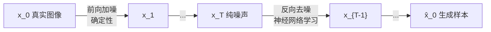

这一讲回头看：神经网络为什么能拟合一切，却在训练分布之外频频失败；以及当前两条前沿 —— **扩散模型**（生成）和 **LLM**（语言）。核心线索是同一个：模型学的是训练分布，分布外没有保证。

## 万能逼近定理及其两个漏洞

1989 年的 **universal approximation theorem**：一个**单隐层**前馈网络，就能以任意精度逼近任意连续函数。

两个关键 caveat：

1. **不保证隐层规模**：可能需要天文数字的神经元。
2. **不保证泛化**：定理只说能在训练数据上逼近，没说测试分布上表现如何。

这就是过拟合的另一种说法。它把深度学习的定位讲清楚了：AI 只是一种技术，会经历涨潮与质疑，不是点石成金的魔法。

## 泛化：网络是极强的函数拟合器

经典实验（*Understanding deep neural networks requires rethinking generalization*）：

- 取 ImageNet 每张图，用骰子**随机改标签**（同一类别的两张图可能被改成完全不同的标签）。
- 随机化比例从 0% 逐步加到 100%。
- 结果：**测试集**精度随随机化程度稳步下降；但**训练集**精度，只要训练够久，几乎总能拟合到很高。

含义：网络能把任意映射背下来，训练误差低不代表学到了语义。模型在训练分布内可以完美拟合，但对**分布外 out-of-distribution** 的行为没有理论保证。

“garbage in, garbage out”：数据有限、任务不合适、模型规模与任务复杂度不匹配，都会导致“训练集表现好、真实场景一塌糊涂”。

## 失败模式

### 数据偏差

用自然图像训练黑白上色模型：狗吐舌头的图片在数据里占比过高，模型学到“嘴部区域 → 红色”，给别的图也涂出红舌头；耳朵出现绿色也是训练集里某种相关性被放大。

### 分布外样本

自动驾驶事故：训练时的街景数据里，该路口**没有施工护栏**；实际行驶时护栏立起来了，这是训练集里没见过的异常，车反复朝护栏转向，最终酿成事故。

这类问题的本质是**不确定性**：模型不知道自己不知道。安全关键场景（自动驾驶、医疗、安防）需要模型在低置信时把决策交给人。

### 对抗攻击 adversarial attack

对输入加一点**人眼几乎不可见**的扰动，就能让 CNN 把“神庙”判成“鸵鸟”，且置信度极高。

原理正好是梯度下降的反面：

```
正常训练：固定输入 x，调权重 W      → 降低 loss
对抗攻击：固定权重 W，调输入 x      → 提高 loss
```

沿 $\partial L / \partial x$ 的方向改像素，就能找到让模型崩溃的 $x'$。不仅能做 2D 图片，MIT CSAIL 还造出过**真实 3D 物体**，从任何角度拍都能骗过分类器。

大模型上的对应物是 **jailbreak**：构造提示词绕过安全对齐。

### 算法偏见

训练数据里的社会偏见会被模型学走并放大（人脸识别的种族/性别差异、招聘筛选等）。这既是技术问题也是伦理问题。

## 扩散模型 diffusion

VAE/GAN 都是**一步生成**：噪声（或潜变量）→ 数据。扩散模型改成**迭代去噪**：把难的一步拆成很多简单的小步。

### 两个过程



- **前向过程 forward**：对训练图逐步加入高斯噪声，$t=0 \to T$，最后变成纯噪声。这一步不需要学，是确定的加噪公式。
- **反向过程 reverse**：训练一个网络，输入 $x_t$，预测 $x_{t-1}$（或少一步的噪声）。

### 训练损失

相邻两步之间只差一点噪声，所以直接做**均方误差**：

```
L = || x_{t-1} − f_θ(x_t, t) ||²
```

实践中等价且更稳的做法是让网络**预测被加进去的噪声 $\epsilon$**，再反推 $x_{t-1}$：

```
L = || ε − ε_θ(x_t, t) ||²
```

前向过程给每一对 $(x_t, x_{t-1})$ 提供了天然的监督信号 —— 不需要标签，也没有对抗训练。

**数值直觉**：原图某像素 `0.8`，第 $t$ 步加了噪声 `ε = -0.3` 得 `x_t = 0.5`。网络看到 0.5，要能说出“这里被加了 -0.3”，减掉就回到 0.8。

### 采样

训练好后从纯噪声 $x_T \sim N(0, I)$ 开始，反复调用网络预测噪声并减去一小部分，逐步得到 $x_{T-1}, x_{T-2}, \dots, x_0$。不同的初始噪声 → 完全不同的生成结果，多样性好。

为什么有效：每一步的任务都极其简单（去掉一点点噪声），网络容易学；同时起点是纯随机噪声，信息容量最大，所以能生成多样且高质量的样本，不像 VAE 容易模糊、GAN 容易模式崩溃。

### 条件生成：文生图

无条件扩散只学 $p(x)$；文生图学 $p(x \mid \text{text})$：

1. 文本经 tokenizer → embedding 模型得到向量；
2. 该向量与图像特征在训练中混合/交叉注意力，网络学会“文本 ↔ 图像”的对应；
3. 训练时一部分样本带文本条件、一部分不带，兼顾条件生成与无条件质量。

embedding 模型通常单独预训练，也可以在扩散训练中微调。

### 不止图像

扩散作用在**连续值**上，所以任何连续空间都能用：分子/蛋白质的 3D 原子坐标、音频波形等。

## 大语言模型 LLM

LLM 就是**在超大规模文本上训练的超大神经网络**。GPT-3 约 1750 亿参数，后续模型更大；也有小几个数量级的“小语言模型”保持不错能力。

### 流程

```
原始文本 (Common Crawl / Wikipedia / 代码)
   → tokenize 切块 → token ID
   → embedding
   → Transformer
   → 词表上的概率分布
```

### 训练目标：下一个 token 预测

给定前文，预测下一个 token。模型输出的是**整个词表上的概率分布**，本质是分类问题，损失用**交叉熵**：

```
L = − log p_θ( 真实的下一个 token | 前文 )
```

**关键**：标签就藏在文本自身里，不需要任何人工标注。这是“自监督”最漂亮的例子。

**数值示例**：词表 `{deep, learning, is, awesome}`，真实下一词是 `learning`，模型给出概率 `[0.1, 0.7, 0.1, 0.1]`，则 `L = −log 0.7 ≈ 0.357`。若模型给 `0.9`，损失降到 `0.105`。

训练好的基座模型再做指令微调/对齐，才成为能对话的助手。

### 仍存在的问题

| 问题 | 说明 |
| --- | --- |
| 不确定性 | “高概率”不等于“高置信”，如何量化仍是开放问题 |
| 幻觉 hallucination | 生成流畅但事实错误；有工作指出**良好校准的模型必然会产生幻觉** |
| 越狱 | 对抗式提示词绕过安全限制 |
| 长程规划 / 逻辑 | 推理模型有进步，但离可靠还很远 |

### 涌现能力 emergent abilities

按模型规模（参数量、数据量、算力）系统评测：跨过某个阈值后，某些能力会**突然出现**（阶跃式提升），而不是平滑增长。规模本身会解锁新的能力层级。

## 这一讲的落点

- 网络是强大的**函数逼近器**，但只在训练分布内可靠；泛化、不确定性、对抗鲁棒性都还没有完整理论。
- **扩散模型**用“迭代去噪”把生成拆成简单小步，训练稳定、样本多样，是当前文生图/文生分子的主流。
- **LLM** 用“下一个 token 预测 + 交叉熵 + 海量文本”一个目标撬动通用语言能力，规模带来涌现。
- 定位：AI 是加速人类创造的工具，不是替代品。

## 识别信号

- 问「网络是万能逼近器，为什么还会失败」→ 从泛化、分布外、对抗样本、捷径特征四个角度答，而不是容量不够。
- 从噪声生成图像 → 扩散模型：前向加噪、反向学去噪，每一步都小。
- 问 LLM 的基本原理 → 下一 token 预测 + 自注意力，规模带来能力。
- 问幻觉 → 概率建模的必然结果（流畅优先于正确），靠检索、工具、验证缓解。
- 问 scaling law → 参数、数据、算力三条轴同时放大，性能按幂律提升。

## 易错点

- 万能逼近定理说的是**存在性**，不是“一定能学到”或“一定能泛化”。
- 训练集精度高 ≠ 泛化好；随机标签实验就是反例。
- 对抗攻击改的是**输入**，不是权重；方向和训练时更新权重的方向相反。
- 扩散模型训练时学的是**加噪的反过程**，损失比较的是相邻时间步，不是直接和原图比。
- LLM 的标签来自文本本身，不是人工标注。
- 涌现是经验观察，不是理论保证。

## 总结

神经网络的拟合能力有定理背书，泛化却没有 —— 数据偏差、分布外样本、对抗扰动、偏见都是“只在训练分布内有效”的表现。扩散模型用前向加噪定义监督、反向去噪做生成，靠迭代把难题拆简单；LLM 用下一个 token 预测 + 交叉熵，把整个互联网变成自监督数据，规模跨过阈值后出现涌现能力。
