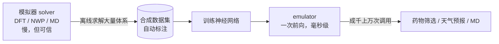

这一讲是 2026 版的首位客座讲者 Chris Bishop（Microsoft AI for Science 创始人）。主题不是"用 AI 读论文"，而是**用 AI 当模拟器的替身**：既然物理方程一定正确、只是解不动，那就先把方程反复解好、用这些解训练一个毫秒级网络，之后所有调用都走网络。核心矛盾是 **no free lunch（要有先验）** 与 **bitter lesson（数据最终赢）** 之间的调和。

## 方程已知，却解不动

Bishop 认为科学最惊人的发现是"世界由数学描述"，而且精度极高：电子的磁矩，理论计算与实验测量吻合到 **13 位有效数字**。

但 Dirac 在近百年前就点破了困境：描述日常世界的定律已经完全知道，**困难在于精确应用这些定律会导致方程复杂到不可解**。于是科学发现长期靠两条路：

- **实验**：真实世界的证据，最终裁判。
- **模拟**：1960 年代数字计算机出现后多出的"预言机"——方程可信，就不必做实验，直接算。

AI 现在同时介入假设生成、数据分析、自动化湿实验室和文献阅读；Microsoft 的 Discovery Platform 就是 agentic 的科研助手。但这讲聚焦另一条：**AI emulator（模拟器替身）**。

## no free lunch：数据与先验必须搭配

**no free lunch theorem** 的意思不是"没有免费午餐"这么玄，而是：**只靠数据学不出东西**，必须数据 + 假设（prior knowledge / inductive bias）。

| 领域 | 数据 | 先验 |
| --- | --- | --- |
| 大语言模型 | 互联网级、极多 | 很轻：attention 结构 |
| 科学 | 稀缺、昂贵（一个蛋白结构可能花一年） | 极丰富：方程、对称性、守恒律 |

科学的先验具体是什么：

- **方程**：Schrödinger 方程描述原子尺度物质。
- **不变性 invariance**：分子旋转后能量不变（空间各向同性），尽管输入的原子坐标全变了。
- **等变性 equivariance**：有磁矩的分子旋转时，磁矩跟着转。
- **守恒律**：能量、质量、动量、电荷。

利用方式有两种：把对称性**写进网络架构**（geometric deep learning），或者把方程写成"某式 $=0$"，把平方项加进 loss。

### bitter lesson 的两难

Sutton 2019 的 **bitter lesson**：历史上不断有人靠精巧先验提升效果，但最终都输给"数据更多、模型更大、算力更强"的对手。于是：

- 先验很漂亮，但数据最终会赢；
- 科学数据又贵又少，纯堆数据不现实。

**调和办法**：不要在人手写的架构里堆先验，而是**用方程生成海量数据**——先验通过"数据"这条通道进入模型。

## emulator：两阶段，摊销成本

1. **离线阶段**：用传统软件把方程解成千上万次，生成合成数据。
2. **训练阶段**：在这个数据集上训练网络；数据贵，所以数据集和模型都不大，成本远低于训练前沿 LLM。
3. **推理阶段**：训练好的 emulator 就是一个前向函数，输出应与模拟器一致，但快 **三个数量级以上**（常见几千倍）。

一次性成本只有在**反复调用**时才划算——用几千、几百万次推理把数据生成与训练的成本摊薄。

**相比真实数据的四个优势**：

- 标签自动、完全精确：解出波函数后，任何性质都能直接算。
- 没有隐私与同意问题。
- 数据量原则上无限：有算力就能继续生成。
- 生成过程天然并行，能吃掉大量闲置/低优先级算力；不需要前沿模型那种超算集群。

## 案例一：天气预报

手机上的预报来自 **numerical weather prediction（NWP）**：解一组大气动力学 PDE，空间网格要细、时间步要小，而且必须**比真实天气跑得快**才能叫预报。各国气象中心用超算每 6 小时跑一次。

几十年的模拟数据大量公开，天然适合训练 emulator。Bishop 团队的不同点：不只模仿某一个模拟器，而是用**多个模拟器、多种分辨率、多种时间尺度**的数据训练一个 **foundation model**，再微调。

- 污染物（氮氧化物）传感器远比气象站稀疏，直接学效果差；用天气 foundation model 微调后达到 SOTA。
- 英国 8 天预报：**单张 A100、1 分钟**。加速几千倍，改变的是工作方式，不只是"快一点"。

## 案例二：材料与分子

### MatGen：条件扩散生成晶体

晶体由晶胞轴、原子种类、原子位置描述。MatGen 把扩散模型搬到晶体上：对已知稳定结构加噪，学习逐步去噪，最终生成稳定的新晶体。它是**条件**扩散——输入目标电子/磁/机械性质，生成对应材料。

搜索空间有多大：类药小分子约 $10^{60}$ 个，和太阳系原子数同量级。所以生成模型的作用不是一次吐出完美材料，而是**把搜索聚焦到化学空间里更可能命中的区域**；再用性质 emulator（MatterSim）快速筛选。两级加速叠加。

### 三难：accuracy / speed / generality

任何方法只能轻松拿到其中两个，目标是**把 Pareto 前沿往外推**：

- **accuracy** 的门槛叫 **chemical accuracy**，约 1 kcal/mol——达到它，计算模型就与实验可比，可以少做湿实验。
- 为什么难：反应的能量变化只是体系总能量的极小一部分。类比称船长：先称"船 + 船长"，再称船，相减得到船长体重；数学上精确，但船太重，必须把两次称量做到极高精度。

## 量子化学：为什么波函数解不动

Schrödinger 方程的解叫**波函数** $\psi$，它是所有电子坐标的联合函数。咖啡因约 100 个电子，$\psi$ 就是 **300 维**空间里的函数。若每维取 1000 个格点，格点数按维数指数爆炸：$1000^{300}$。所以成本随电子数指数增长，**咖啡因至今没有被直接精确求解过**。

1965 年 Walter Kohn 的关键发现：**根本不需要波函数**，只需要 3 维的**电子密度** $n(\mathbf r)$；所有性质都能从密度算出。成本从指数降到**电子数的三次方**。这是精确变换，不是近似——1998 年因此获诺贝尔化学奖。DFT（density functional theory）至今是超算科学计算负载的大头，某些中心约占三分之一。

直观类比：复杂的三维塑料分子模型 → 它在二维平面上的影子。影子信息更少，但足以决定要问的性质。

### 交换关联泛函：DFT 里唯一的未知

Kohn-Sham 方程是迭代方程，其中绝大部分项都能直接算，只有一项很小却决定精度：**exchange-correlation functional（交换关联泛函）**。Kohn 证明它**universal**——存在一个泛函适用于整个分子/材料空间——但没给出解析形式。

六十年来人们手写了约 **800 个**近似泛函（绰号 the zoo / Jacob's ladder），各有适用域，成本与精度互相牵制：

- 三次方成本的很便宜，但精度远低于 chemical accuracy；
- 五次方成本的接近 chemical accuracy，但非常贵。

2002 年 *Science* 的 *In Pursuit of the Divine Functional* 就在呼吁：别再堆手搓泛函，回去找那个 universal functional。

### Skala：用机器学习学泛函

思路很直接：既然泛函未知，就**用数据学出来**。难点是要同时做到又准又快。

- 表示：电子密度是百万点级的点云，能量对它的依赖是**非局域**的，两两算 $10^6\times10^6$ 不可行。做法是先压到以原子为中心的低维表示，用 **message passing** 在点云与原子中心之间往返传递。
- 数据：团队用三年时间跑标准量子化学方法，生成了比此前全部公开数据多一个数量级的训练集。
- 结果：泛函取名 **Skala**（意大利语"梯子"）。在 atomization energy 上达到 chemical accuracy，在更广的化学性质上可与四次方成本的泛函相比。
- 局限：目前只覆盖分子、只覆盖主族元素，尚未包含过渡金属与材料。

泛化能力超出训练域，Bishop 猜测部分原因正是它在逼近那个 **universal** 泛函。

## 案例三：蛋白质动力学

中心法则：**sequence → structure → function**。测序与静态结构已有诺奖级成果，真正未解的是 **dynamics**——蛋白开合、对接、与小分子结合。

**分子动力学（MD）**：把原子当经典粒子，按牛顿第二定律逐步更新位置，力 = 能量的梯度，而能量来自量子力学。两个硬障碍：

- 每一步原则上都要解 Schrödinger 方程；
- **sequentiality 诅咒**：原子振动在飞秒尺度，蛋白折叠在毫秒尺度，需要 $10^6\sim10^{15}$ 个**串行**时间步。GPU 带来的是并行度，而时钟频率多年没有提升，串行步数无法靠算力硬堆。

解法是继续搭"emulator 阶梯"：

1. 把蛋白切成块（coarse-grain），用 DFT 计算块间力；
2. 训练块间力的 emulator；
3. MD 每一步只需调用 emulator，不再迭代求解。

这样能对约 **10,000 个原子**的蛋白做动力学。再往上一层：用 MD 数据 + X 射线等实验数据训练，直接**采样平衡分布**，绕开动力学（发在 *Science* 封面）。目标是回答"蛋白在各个能量井里待多久、比例多少"，避免为一次稀有跨越事件模拟极长时间。目前做到单个蛋白在真空中，下一步是蛋白—蛋白相互作用与水环境。

## 几层 emulator 的阶梯

| 层级 | 对象 | 成本 | 训练数据来自 |
| --- | --- | --- | --- |
| 第一性原理 | Schrödinger / 波函数 | 指数 | — |
| DFT | 电子密度 + 交换关联泛函 | 立方 | 量子化学基准 |
| Skala | 学习到的泛函 | 近立方 | 高精度量子化学数据 |
| 力场 emulator | 原子间力 | 极快 | DFT 计算 |
| 蛋白 emulator | 粗粒化动力学 / 平衡采样 | 极快 | MD + 实验 |

每一层都用上一层的"慢而可信"结果做监督，把成本逐层摊销。

## 问答里的几个要点

- **等变性 vs 数据增强**：把旋转等变性写进架构是**精确**的；把同一分子旋转 100 次当 100 条数据是近似的。bitter lesson 的立场是后者也够用，而且能配更通用的架构。
- **为什么还留着 DFT**：DFT 编码了大量物理（例如波函数的反对称性、Pauli 不相容原理）；丢掉这些先验去端到端学，代价太大。Skala 只是替换其中最难的泛函项，不是取代整个 DFT。
- **模拟数据是第二层 no free lunch**：合成数据本身已含先验；但实验仍是最终裁判，不一致就是理论错。实验数据还用于微调（如蛋白模型用 X 射线数据微调）。
- **离临床应用还有多远**：药物 off-target 相互作用的预测可能 2~3 年内有实际价值；用第一性原理模拟整个细胞在可预见未来不现实。

## 识别信号

- 数据稀缺、但方程/对称性已知 → **emulator**：离线模拟生成数据，训练快速代理。
- 问"为什么不直接用模拟" → 迭代求解太慢；问"为什么不直接用数据" → 科学数据太贵、太少。
- 问"先验和 bitter lesson 怎么共存" → 把先验放进**生成数据的过程**，而不是写死在网络结构里。
- 问加速比 → 一次性训练成本 ÷ 海量调用；前向一次 vs 迭代求解。
- 问 DFT → 波函数指数成本 → 电子密度立方成本；剩余未知是交换关联泛函。
- 问蛋白动力学难点 → 飞秒步长 vs 毫秒事件，**串行**步数，不是纯算力问题。
- 问三难 → accuracy / speed / generality 只能取二，目标是扩大可行域。

## 易错点

- emulator **不是**"AI 替代物理"：它的训练数据由物理模拟生成，物理先验通过数据进入模型。
- DFT 是精确变换到密度，但 Kohn-Sham 方程里的交换关联泛函仍是近似；Skala 学的正是这一项。
- 天气 emulator 的几千倍加速是**相对 NWP 模拟器**，不代表预报一定更准。
- chemical accuracy（1 kcal/mol）是"与实验可比"的高门槛，不是随便可达到的精度。
- MD 的瓶颈是时间步的**顺序依赖**，增加 GPU 并行度无法直接解决。
- sequence → structure 已大体解决，function / dynamics 才是当前前沿。

## 总结

科学的两难是：方程精确已知，精确求解却在指数成本上不可行。emulator 的思路是把"解方程"从在线变成离线：用模拟器批量生成合成数据，训练一个前向网络，把成本摊销到海量调用上，典型加速三个数量级。它同时回应了 no free lunch（先验通过方程生成的数据进入）与 bitter lesson（数据规模仍然是赢家）。天气、晶体生成、交换关联泛函 Skala、蛋白动力学是四个层次递进的例子；越往上，越是用上一层的慢结果监督下一层的快模型。
