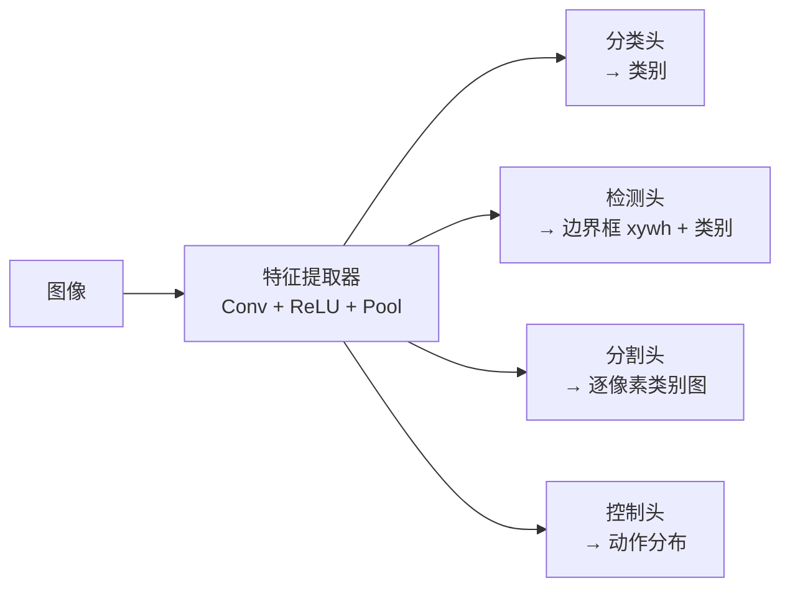

图像是二维（或三维 RGB）矩阵，空间结构本身就是信息。全连接网络必须先 flatten，把相邻像素的关系一刀切掉，参数量还爆炸。CNN 用**局部感受野 + 权重共享**的卷积在二维上直接扫，再用池化降采样、逐层组合出从边缘到物体的特征层级。

## 图像在计算机里是什么

- 灰度图 = 二维矩阵，每个格子 0~1 的亮度。
- RGB 图 = 三维矩阵 `H × W × 3`，三个通道各一张二维矩阵。

视觉任务通常接在两种输出上：**分类**（整张图 → 固定长度向量，如 Lincoln/Washington/Jefferson/Obama 四选一）或**回归**（输出连续值）。分类靠逐层检测低层特征再组合成高层结构：眼睛、鼻子、耳朵 → 脸；轮子、车牌、车灯 → 车。

## 为什么不能直接 flatten

把 `100 × 100` 的图压成 10,000 维向量：

- 相邻像素的空间关系全丢了（左右翻转、平移后像素完全不同）；
- 第一个全连接层就是 `10000 × hidden`，参数量巨大。

手工定义特征（边缘检测算子等）也曾是主流，但类内变化（视角、光照、尺度）太多，人写不全。所以要让网络**自己学该找什么特征**。

## 卷积：在 patch 上做加权和

不再让每个神经元连整张图，只连一个小 patch（**局部感受野 local receptive field**），再把 patch 滑遍全图。

```
输出像素 = Σ (patch 像素 × filter 权重) + bias
        → 再过非线性
```

filter（kernel）本身就是一个小矩阵，其权重就是这一层的参数，和全连接层的权重一样靠反向传播学出来。

### 判 X 的例子

黑 = `-1`，白 = `+1`。要判断一张图是不是 X，找三种特征：

| filter | 内容 |
| --- | --- |
| 绿色 | 45° 斜线 |
| 橙色 | 交叉点 |
| 蓝色 | 另一方向的斜线 |

两张像素级完全不同的 X，在特征空间里高度一致 —— 这就是卷积要的效果。

### 数值示例：3×3 filter 扫 5×5 图

filter 权重（一条竖边检测器）：

```
-1  0  1
-1  0  1
-1  0  1
```

输入 patch 全为 `1` 时，逐元素相乘再相加：`-3 + 0 + 3 = 0`。若 patch 左侧全黑 `-1`、右侧全白 `+1`：`3 + 0 + 3 = 6`，强响应 —— 说明这里有一条竖直边缘。

**结果的意义**：逐元素乘再求和 = 点积，值越大说明 patch 与 filter 越对齐；强负值说明方向相反（反色）。

### feature map

filter 滑完整张图（每次移动 stride 格，可重叠可不重叠），每个位置得到一个数，拼成下一层的**特征图 feature map**。图上亮的地方 = 原图中该特征出现的位置。

一张图可以配多个 filter，输出就从一个二维矩阵变成**三维 volume**：`H × W × 滤波器个数`。判 X 用 3 个 filter；实际网络第一层常用 32、64 个。

### 手工 filter 的直观

| filter 类型 | 权重形态 | 效果 |
| --- | --- | --- |
| 锐化 | 中心正、四边负 | 强化细节对比 |
| 边缘检测 | 中心负、四边正 | 突出轮廓 |

CNN 之前这些权重是人工写的；现在全交给梯度下降学。

## CNN 的三个基本操作

```
卷积 → ReLU → 池化 → 卷积 → ReLU → 池化 → ... → flatten → 全连接 → softmax
```

1. **卷积**：主力，负责提取局部特征。
2. **非线性 ReLU**：`max(0, x)`，负值归零、正值保留。数据是非线性的，卷积本身是线性的，必须夹非线性。
3. **池化 pooling**：降采样，降低特征图分辨率。

### 池化

最常用 **max pooling**：在每个 `2 × 2` 窗口取最大值。

```
4 x 4 feature map         2 x 2 输出
1  3 | 2  4
5  6 | 8  7      →        6  8
------+------
9  2 | 1  0               9  6
3  4 | 6  2
```

取最大值 = “把最强烈的响应保留下来”。

**关键**：池化只在 `H × W` 上降维，**不碰通道数**。32 个通道进来，池化后还是 32 个通道，只是每张图变小了。

**为什么降采样**：让特征图的尺寸相对 filter 越来越小，同样的 filter 就能“看到”更大范围的东西 —— 低层看线条，深层看物体。代价是不能把 patch 无脑放大，否则丢掉局部性。

## 完整结构与代码

CNN = **特征提取器 feature extractor**（卷积 + ReLU + 池化，可复用）+ **分类头 classifier head**（flatten + 全连接 + softmax）。

```python
# TensorFlow / Keras 风格
model = Sequential([
    Conv2D(32, (3, 3), activation='relu'),   # 32 个 3x3 filter
    MaxPool2D((2, 2)),                        # 分辨率减半
    Conv2D(64, (3, 3), activation='relu'),   # 在 32 个特征图上再找 64 种
    MaxPool2D((2, 2)),
    Flatten(),
    Dense(128, activation='relu'),
    Dense(num_classes, activation='softmax'),
])
```

```python
# PyTorch 风格
nn.Sequential(
    nn.Conv2d(3, 32, kernel_size=3),    # 输入 3 通道(RGB) → 32 通道
    nn.ReLU(),
    nn.MaxPool2d(2),
    nn.Conv2d(32, 64, kernel_size=3),
    nn.ReLU(),
    nn.MaxPool2d(2),
    nn.Flatten(),
    nn.Linear(64 * 6 * 6, 128),
    nn.ReLU(),
    nn.Linear(128, num_classes),
)
```

## 泛化到各种视觉任务

特征提取部分几乎不变，只换输出头：



- **分类**：图像 → 一个类别（医疗影像、血检等）。
- **目标检测**：输出任意数量边界框的 `(x, y, w, h)` + 类别。边框位置和数量都不固定。
  - 朴素做法：随机撒框逐个判 → 太慢。
  - 启发式：先找“有东西”的 blob 再框 → 快一点但脆弱，框不是学出来的。
  - 现代做法：卷积特征图上**proposal** 候选框，再对每个框提特征分类；关键是整条链**端到端可微**，框提得不好也能反传到输入端。
- **语义分割**：图像 → 图像，每个像素分类。需要把下采样换成**上采样 upsampling** 还原分辨率。
- **自动驾驶控制**：相机 + 稀疏地图（也是图像）各自过卷积 → 拼特征 → 输出转向角等控制量。动作常是多峰的（左转或右转都行），本质是分布学习而非单值回归。

## 扩展到 1D / 3D

卷积不限于 2D：

- **1D 卷积**：在序列上滑 patch，可做文本/音频模型。
- **3D 卷积**：体积数据（CT、视频），filter 也是三维。

## 附：Tiny VGG 逐层拆解

[CNN Explainer](https://poloclub.github.io/cnn-explainer/) 用可交互的 Tiny VGG 展示一个小 CNN 的完整流程，可拿它对照上面的概念。

### 第一层卷积的通道账

- 输入 RGB：3 个通道。
- 第一卷积层：10 个神经元（10 张 activation map）。
- Tiny VGG 的卷积层是**全连接**的：每个输出神经元都连到上一层的所有通道。
- 所以每个输出神经元需要 `3` 个 `3×3` kernel，先各自做逐元素点积，再**三个中间结果求和 + bias**，得到一张 activation map。
- 总 kernel 数：`3 × 10 = 30` 个 `3×3`。

这解释了“输入 3 通道、输出 32 通道”的 32 从哪来：每张输出特征图都由全部输入通道的 kernel 叠加而成。

### 三个超参数

| 超参数 | 作用 | 调大的后果 |
| --- | --- | --- |
| **padding** | 在边缘补零，保住边界信息与空间尺寸 | 输出尺寸变大，可堆更深 |
| **kernel size** | 滑动窗口大小 | 感受野变大、参数变多、分辨率下降快；分类任务通常偏爱小 kernel 堆深 |
| **stride** | 每次滑动几格 | 输出变小、提取更粗；调小则特征更细但计算量大 |

Tiny VGG 卷积用 stride 1；池化用 `2×2` kernel、stride 2，**丢掉 75% 的激活值**（4 个里只留 1 个最大），既省算力也抑制过拟合。

### ReLU 为什么必须有

没有非线性，多层卷积叠起来仍等价于**一个**卷积层（线性复合还是线性）。ReLU 提供非线性决策边界；相比 sigmoid，实测训练更快。

### Softmax 与普通归一化的区别

```
softmax(x_i) = exp(x_i) / Σ_j exp(x_j)
```

两者都能把 logits 压到 `[0,1]` 且和为 1，但 softmax 会把最大值**显著放大**，是“可微的 argmax”，让正确答案拿到更大的梯度信号。普通归一化不会。

### flatten 的尺寸

`5 × 5 × 2` 的 tensor flatten 成 `50` 维向量，才能接全连接分类头。

## 易错点

- 卷积核的权重是**学出来的**，不是人工设计；手工 filter 只是直观演示。
- 池化不改变通道数，只改变 `H`、`W`。
- flatten 之后才进全连接；卷积层本身不需要 flatten。
- 经典 CNN 是“特征提取通用、输出头专用”，迁移学习就是复用前者。

## 总结

卷积 = 在小 patch 上做“逐元素乘 + 求和 + bias + 非线性”，滑遍全图得到 feature map；多个 filter 得到通道 volume。CNN 由 **卷积 → ReLU → 池化** 堆叠成特征提取器，最后接全连接分类头。池化在空间上降采样、保留通道，让深层 filter 覆盖更大范围，从而学到从边缘到物体的层级特征。换掉输出头就能做检测、分割、控制。
