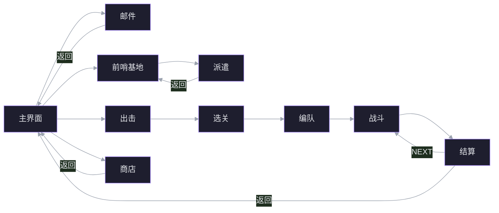

# NIKKE 自动化脚本 · 规划与架构

> 记录日期：2026-11-09。状态：立项讨论完成，尚未开工。
> 目标：自动过图 + 日常资源收集；作为第一个大型工程学习项目；后期融合深度学习。

## 1. 目标与边界

**目标**

- 日常资源收集：邮件/奖励、派遣、商店免费项、模拟室、拦截、竞技场、企业塔等。
- 自动过图：主线/活动关卡循环，含编队、战斗、结算、体力与失败处理。
- 通过项目学习：分层架构、状态机、CV/OCR、数据集与模型部署、长期运行维护。

**第一版不做**

- 全活动长期覆盖、多账号、WebUI 远程控制。
- 实时战斗 AI / 强化学习。
- 内存读写、封包修改、注入、反检测对抗。

**运行环境**

- 开发期：MuMu 模拟器 + ADB，锁定逻辑分辨率 720×1280（竖屏）。
- 后续可选：Windows 官方客户端。本机已装 `C:\Program Files\NIKKE\NIKKE\game\nikke.exe`，但带 AntiCheatExpert（ACE），输入/捕获都更麻烦，不建议作为起点。
- 本机 MuMu ADB：`C:\Program Files\Netease\MuMu\nx_device\12.0\shell\adb.exe`。
- 显示为 1707×1067 逻辑分辨率（有 DPI 缩放），必须固定窗口尺寸并做 DPI 感知。

## 2. 可行性结论

| 目标 | 可行性 | 真实难点 |
|---|---|---|
| 日常资源收集 | 高 | 菜单导航、弹窗兜底、每日刷新调度 |
| 自动过图 | 中高 | 战斗本身可自动；难点在关卡选择、编队、结算/失败判定、体力、断线 |
| 全活动长期覆盖 | 中低 | UI 改版导致模板失效，维护成本高 |
| 融合深度学习 | 中 | 传统 CV 已覆盖多数场景；DL 应作为可评测的感知模块 |

判断：项目整体可行，适合作为第一个大型工程。但要把「脚本」和「DL」分开：脚本主线是软件工程，DL 是后期增强模块。

## 3. 参考项目拆解

### 3.1 ALAS（LmeSzinc/AzurLaneAutoScript）——架构范本

- 碧蓝航线自动化，Python 3.7.6，约 1944 个 `.py`、估算 23 万行，ADB 控制模拟器/真机，固定 1280×720。
- 技术栈：OpenCV 模板匹配/颜色/二值化/透视；cnocr 1.2.2 + MXNet 做 OCR；PyWebIO + Starlette；无 PyTorch/PaddleOCR/TensorRT。
- 核心设计：
  - **页面对象 + 导航图**：`Page(check_button, links)`，所有页面自动注册；`Page.init_connection()` 以主界面为枢纽做反向 BFS（docstring 写 A*，实现是 BFS）；`ui_get_current_page()` 遍历 `check_button` 识别当前页，未知页返回 `page_unknown`。
  - **两级识别**：先 ROI 平均色预筛（阈值 10），再模板匹配确认（`TM_CCOEFF_NORMED`，相似度 0.85，搜索区外扩 30px）。
  - **状态循环**：每轮一张截图；先判退出条件再判动作；不写固定 `sleep`；不写否定条件；用 `interval` 限频；不嵌套循环。
  - **NextRun 调度**：`SCHEDULER_PRIORITY` 优先级字符串同时是白名单；`task_delay()` 排下次，`task_call()` 触发依赖；连续失败 3 次 → `RequestHumanTakeover`。
  - **卡死/连点检测**：画面 60 秒无变化 → `GameStuckError`；15 次点击窗口内同一按钮 ≥12 次或两按钮各 ≥6 次 → `GameTooManyClickError`。
  - **异常分级 + 现场保存**：`TaskEnd / GameStuckError / GamePageUnknownError / RequestHumanTakeover` 等；错误时保存最近截图和脱敏日志。
  - **配置生成**：YAML schema → `config_generated.py`、GUI 表单、i18n、模板索引。
- 学什么：页面图、状态循环、调度、异常分级、配置生成、资源提取工具。
- 不学什么：Python 3.7.6 老栈、cnocr/MXNet、几乎没有 CI 与测试、大量魔法坐标。
- 延伸：同作者下一代框架 **StarRailCopilot** 已换 pydantic 配置、现代 OCR、低耦合，更适合作为新代码的风格参考。

### 3.2 NIKKEAutoScript（megumiss/NIKKEAutoScript）——同游戏范本

- 903 stars，Python 3.9，294 个 `.py`、61,641 行，GPL-3.0；PC 客户端与 ADB 双端，强制 720×1280。
- 识别：`Button.match()` 模板匹配（默认 0.85），`appear(offset=0)` 颜色检测，多尺度/翻转/Otsu/多点匹配；PaddleOCR PP-OCRv5 处理文字与数字。
- 流程：页面图 + `ui_get_current_page/ui_goto/ui_ensure/ui_additional`；业务模块用 `while 1` + `appear_then_click`；调度器按优先级与 NextRun 串行。
- 过图：活动推图最完整（网格找未通关卡、自动编队、`FIGHT → SKIP → NEXT_STAGE → END_FIGHTING`、扫荡 MAX）；主线只有半自动 `module/daemon/semi_combat.py`，全自动仍未实现（issue #303）。
- 硬伤：720×1280 硬绑定、坐标硬编码、两套设备栈重复、约 200 处 `except Exception`、14 处 `exit(1)`、业务无测试、活动资产跑步机（仓库约 589MB）、GPL-3.0 中混入 AGPL 移植代码且上游无 License。
- 学什么：页面图、Button 抽象、活动推图流程、错误现场保存。
- 不学什么：720×1280 绑定、设备层实现、WebUI、直接复制代码（许可证不干净）。

### 3.3 MutantPilot——不是 NIKKE 脚本

- `snsididjdjsjsj/MutantPilot` 是《泰拉瑞亚》tModLoader 的 C# 模组，不是 NIKKE 脚本，也不基于 MaaFramework。
- 在进程内直接读 `Player/NPC/Projectile` 状态，用手写 MPC 打 Fargo's Mutant Boss；C# 约 8,144 行，18 个测试工程。
- 首版有 NumPy 模拟器 + PPO + ONNX + TCP 策略服务，但第二个提交整体移除，文档明确「实战控制器从未读取导出的 ONNX」。
- 只学四件事：决策核与设备 I/O 分离、录屏/fixture 回归测试、预算化决策与优雅降级、逐动作遥测。
- 白盒读内存、反射私有字段、帧级战斗 AI 全部不适用于 NIKKE。

### 3.4 MaaFramework 路线（MaaNikke / MDA）

- 声明式 pipeline：`pipeline/*.json` 定义 `recognition / action / next / on_error / timeout / max_hit`，`[JumpBack]` 回首页；Python Agent 处理动态逻辑；MaaDebugger 可视化调试。
- 优点：识别、点击、控制器、调试器、UI 全现成，几天可跑通一个任务；适合菜单/日常。
- 缺点：不是通用状态机，没有变量、循环、数值运算；复杂逻辑要写 Agent；调试分散在 JSON 与 Python；执行循环是秒/百毫秒级，不适合实时战斗。
- 许可证：MaaFramework LGPL-3.0、MaaNikke GPL-3.0、MDA AGPL-3.0，均只能参考思路。
- 结论：可作为「一天 spike」直观感受成品，但本项目以学习大型工程为目标，主线仍建议从零写小骨架。

### 3.5 对比

| 维度 | ALAS | NIKKEAutoScript | MutantPilot | MaaFramework |
|---|---|---|---|---|
| 游戏 | 碧蓝航线 | NIKKE | 泰拉瑞亚 | 通用 |
| 平台 | ADB/模拟器 | PC + ADB | 进程内 mod | Win/ADB |
| 语言 | Python 3.7.6 | Python 3.9 | C# | JSON + Agent |
| 规模 | 约 23 万行 | 6.16 万行 | 8 千行 | 框架 |
| 识别 | 模板/颜色/cnocr | 模板/颜色/PaddleOCR | 白盒状态 | 模板/OCR/颜色 |
| 调度 | NextRun + 优先级 | NextRun + 优先级 | 无 | 任务流水线 |
| 可学度 | 架构 9/10 | 同游戏流程 8/10 | 测试 7/10 | 快速产出 8/10 |
| 风险 | 老栈 | 许可证/绑定 | 不可迁移 | 表达力有限 |

## 4. 推荐架构

目标：1500–2500 行的最小骨架，分层与 ALAS 对齐，每层只保留必要能力。

```
nikke-auto/
├─ app/
│  ├─ main.py            # CLI 入口
│  ├─ scheduler.py       # NextRun + 优先级 + 每日 04:00 重置
│  └─ registry.py        # 显式任务表，不用全局装饰器
├─ device/
│  ├─ base.py            # 协议: screenshot/click/swipe/back
│  ├─ adb.py             # MuMu/真机: screencap + input tap / minitouch
│  └─ win32.py           # PC 客户端: mss/dxcam + SendInput（以后）
├─ perceive/
│  ├─ template.py        # TM_CCOEFF_NORMED + 多尺度 + 掩码
│  ├─ color.py           # ROI 均值 / HSV 阈值
│  ├─ ocr.py             # RapidOCR/PaddleOCR 封装 + 数字解析
│  └─ classifier.py      # 第二阶段: ONNX 页面分类器
├─ ui/
│  ├─ button.py          # area/color/template/threshold/offset
│  ├─ page.py            # Page(check_button, links)
│  ├─ graph.py           # BFS 到 main hub + 路径缓存
│  ├─ ensure.py          # ensure(page) / additional() 弹窗兜底
│  └─ assets/720x1280/   # 模板图，按语言/分辨率分目录
├─ tasks/
│  ├─ reward.py  daily.py  shop.py  outpost.py
│  ├─ simulation.py  interception.py  campaign.py
├─ config/
│  ├─ schema.py          # pydantic
│  └─ default.yaml
├─ tools/
│  ├─ record.py          # 录屏 + 输入日志
│  ├─ replay.py          # FakeDevice 离线回放
│  ├─ crop_template.py   # 框选生成模板并写 assets
│  └─ label.py           # 页面标注/数据集导出
├─ tests/
│  ├─ test_navigation.py
│  └─ fixtures/          # 录屏片段
└─ docs/
   ├─ architecture.md
   ├─ page-map.md        # Mermaid 页面图
   └─ devlog/
```

| 层 | 只做一件事 | 输入 → 输出 |
|---|---|---|
| device | I/O | 无 → 截图 / 点击 |
| perceive | 像素 → 事实 | 截图 → 模板分数、颜色、OCR 文本 |
| ui | 事实 → 页面与导航 | 截图 → 当前页 / 去目标页 |
| tasks | 业务策略 | 页面状态 → 点击序列 |
| app | 调度与生命周期 | 时间 → 跑哪个任务 |

### 4.1 六个必须做对的机制

1. **逻辑分辨率统一**：所有坐标只存在于 720×1280 逻辑空间；设备层把真实截图缩放到该尺寸；Windows 端做 DPI 感知与固定窗口。
2. **页面图导航**：`Page` 带 `check_button` 与 `links`；启动时从 `page_main` 做 BFS，建立回主界面路径；`ensure(page)` = 识别当前页 + 沿路径走；未知页统一回主界面。
3. **状态循环**：每轮一张截图；先判退出；只写「看到目标才行动」；用 `interval` 限频；禁止固定 `sleep`。
4. **调度器**：每任务 `enabled / next_run / cadence / priority`；每日 04:00 重置后按优先级跑；`task_delay()` 排下次，`task_call()` 触发依赖。
5. **错误分级**：`TaskEnd` 正常、`RetryableError` 退避重试、`PageUnknown` 回主界面、`HumanRequired` 停止并通知；加卡死（画面 60 秒不变）与连点（同按钮 15 次内 ≥12 次）检测。
6. **离线回放测试**：`FakeDevice` 按时间戳回放录屏，业务代码不改；这是后续 DL 数据集与回归测试的基础。

### 4.2 页面图示例



### 4.3 两个运行环境

- 运行时：WSL Python 3.11 调 Windows 版 `adb.exe`（已在 M0 验证可行，路径自动翻成 `/mnt/c/...`），项目放 `C:\X\Project\nikke-auto`；截图与输入全部走 ADB，不需要 Windows 侧 Python。
- 训练：WSL 的 `dl_env`（torch 2.11 + CUDA），读 `/mnt/c/X/Project/nikke-auto/data`，导出 ONNX 给运行时。
- 共享 `data/recordings`、`data/datasets`、`models`；不把一个环境装成万能环境。

## 5. 识别策略：OCR 优先，YOLO 后置

### 5.1 分工

| 要知道的事 | 合适工具 | 原因 |
|---|---|---|
| 按钮/图标在不在 | 模板匹配 / 颜色 | 外观固定，1–5ms，可解释 |
| 数字/文字是多少 | OCR / 数字小 CNN | 内容会变，YOLO 读不出任意字符串 |
| 同类物体几个、在哪 | YOLO | 位置不固定、多实例 |
| 整页是什么状态 | 小分类 CNN | 特效/弹窗遮挡时更鲁棒 |

NIKKE 日常中会变的信息几乎全是数字与文本：体力 `120/120`、金币、钻石、关卡号 `12-4`、拦截次数 `3/3`、派遣剩余时间、商店价格、任务进度。这些必须 OCR。图标（邮件、商店、出击、前哨基地）外观固定，模板匹配足够。

### 5.2 先训 YOLO 的弊端

1. 标注成本高且反复发生：每页面、每分辨率、每语言都要框；改版后要重标、重训、重导。
2. 类别爆炸：文字内容无界，只能检测「文字区域」，检测完仍要 OCR。
3. 容易学到背景：相邻帧高度相似，按帧随机划分会泄漏；换分辨率/布局后 mAP 易崩。
4. 调试闭环长：模板失败看分数热力图即可；YOLO 失败要查数据集、误检、NMS、重训。
5. 延迟/资源不划算：ROI 模板 1–5ms CPU；YOLO11n 约 5–15ms GPU、30–80ms CPU。
6. 小目标弱：体力数字、次数、小图标只有十几像素，数字用「裁剪 + 10 类 CNN」更简单。
7. 解决的不是瓶颈：项目 80% 工作量在导航、调度、弹窗、异常恢复、结算判定。
8. 许可：Ultralytics YOLO 为 AGPL-3.0，分发需注意。

### 5.3 OCR 的代价

- 游戏字体描边/渐变/动画可能误识别；需 ROI 约束、颜色掩码、多帧投票、数值范围校验。
- PaddleOCR 全量约 100–300ms，主循环偏重；数字建议 RapidOCR 或自训数字 CNN。
- OCR 只给文本 + 框，不给语义；需靠 ROI 或版面关系判断「这个 120 是体力还是金币」。
- OCR 本身是 DL 模型：不是不用 DL，而是先用训练好的模型，把精力留给工程。

### 5.4 YOLO 真正值得上的场景

1. 分辨率/布局不固定（720×1280、1080×1920、PC 不同 DPI）。
2. 同类多实例：编队卡片、背包物品、敌人/红圈、地图节点。
3. 遮挡/特效严重：战斗结算、弹窗叠加时，检测器/整页分类比模板鲁棒。

### 5.5 一天决策实验

1. 录 300 帧，覆盖 10 个页面/元素。
2. 模板方案：每元素 1 张模板，记录命中率、误报、耗时。
3. YOLO11n：标 200–300 张，训 50 epoch，记录 mAP50、误报、耗时、标注+训练工时。
4. 用不同日期、不同界面的 100 帧做测试集。

预期：固定分辨率下模板命中更高、工时少一个数量级；YOLO 在换分辨率/新页面时更稳。按场景分工，不二选一。

## 6. 深度学习路线

| 层级 | 做什么 | 为什么 | 验收 |
|---|---|---|---|
| L0 | OCR（现成模型） | 文字/数字必须靠它 | 数字准确率、延迟 |
| L1 | 页面状态分类器 | 特效/弹窗遮挡时模板分数下降 | 留出会话 top-1 ≥99%，单帧 <10ms |
| L2 | 图标/按钮检测器（YOLO11n） | 摆脱硬编码 ROI，适配分辨率 | mAP50 ≥0.9，速度不劣于模板 |
| L3 | 数字小 CNN | 体力/金币/等级，比 OCR 快 | 多位数准确率 ≥99.5% |
| L4 | 未知页面检测 | 低置信度 → 人工接管并收集难例 | 未知页召回、误报率 |
| L5 | 战斗决策 | 战斗本身可自动，ROI 低 | 不建议做 |

### 6.1 第一个 DL 项目：页面分类器

1. 录 2–3 小时日常，`tools/label.py` 用模板匹配自动打标，再人工修正。
2. 20–30 个页面类别；输入 224×224 或 160×288；MobileNetV3-Small / ResNet18。
3. **按录制会话划分 train/val**，不能按帧随机分。
4. 输出混淆矩阵、每类 recall、置信度校准；低置信度回退模板或 `additional()`。
5. 导出 ONNX，运行时 onnxruntime；仅在模板置信度低于阈值时调用。

闭环：自动打标 → 训练 → 低置信度回退 → 人工修正 → 再训练。

## 7. 路线图

| 阶段 | 时间（业余） | 交付物 | 验收 |
|---|---|---|---|
| M0 观测 | 3–5 天 | 截图、点击、录屏、离线回放 | 录 10 分钟，回放 100 帧一致；点击生效 |
| M1 页面 | 1–2 周 | Button/颜色/模板 + 15 个 Page + BFS + 弹窗兜底 | 随机 100 次跨页导航 ≥95% |
| M2 首个日常 | 1 周 | 邮件/奖励领取，幂等、重试、日志 | 连跑 20 次 0 卡死 |
| M3 日常套件 | 2 周 | 5–8 个日常 + 调度器 + 配置 + 统计 | 24h soak；3 种故障自恢复 |
| M4 自动过图 | 2–3 周 | 选关、预设队伍、自动战斗、结算/失败/体力 | 无人值守连过 20 关 |
| M5 DL 感知 | 2 周 | 页面分类器 + 数据集管线 + 回退 | 留出会话 ≥99%，延迟达标 |
| M6 运维 | 2 周 | WebUI/通知/多账号（可选） | 远程看状态、收异常通知 |

业余投入约 8–12 周到稳定个人版；全活动覆盖是长期维护，不写进第一版。

自动过图闭环：

```
选关 → 确认队伍（固定预设 1）→ 开始战斗 → 开 AUTO_SHOOT/AUTO_BURST
→ 等待结算（模板 + 超时）→ 胜利 NEXT_STAGE，失败停/降关
→ 体力不足记录并结束 → 下次调度继续
```

## 8. 第一周

| 天 | 任务 | 产出 |
|---|---|---|
| D1 | 建仓库、Windows Python 3.11、uv/venv、日志、pytest 骨架 | `python -m app.main --help` |
| D2 | MuMu 设 720×1280，ADB 截图循环，缩放逻辑分辨率 | `tools/record.py` 存帧与时间戳 |
| D3 | 点击/滑动封装，录屏回放 `FakeDevice` | 回放驱动一次点击 |
| D4 | `Button/Template` + 调试叠加图 | 截图标出 5 个按钮 |
| D5 | `Page` + 5 页面 + BFS，`ensure(page_main)` | 任意 5 页回主界面 |
| D6 | 邮件/奖励任务端到端 | 跑通一次领取 |
| D7 | 写 `docs/devlog/0001.md`，录 demo 复盘 | 明确下周修复项 |

第一周不碰：WebUI、DL、多账号、活动、PC 客户端迁移。

## 9. 学习清单

**必须（前 4 周）**

1. Python 工程化：包结构、类型标注、pydantic、logging、pytest、git。
2. OpenCV：读图/缩放/色彩空间/ROI、`matchTemplate`/NCC、阈值、轮廓、金字塔。
3. 软件架构：分层、依赖倒置、状态机、BFS、重试/退避、可观测性。
4. NIKKE 域知识：日常系统、菜单层级、体力/次数/刷新规则。

**第二阶段**

5. OCR：检测/识别两段式、数字后处理、置信度。
6. DL：CNN、迁移学习、数据划分、混淆矩阵、校准（接 CS229/6.S191）。
7. 部署：ONNX Runtime、TensorRT。

**以后**

8. Web 前端、多进程/多账号、MaaFramework、RL。

**源码阅读顺序**

- ALAS：wiki `1.-Start`、`4.1`、`4.2`、`4.4` → `module/base/base.py` → `button.py` → `ui/page.py` → `ui/ui.py` → `config/config.py` → `device/device.py`；挑 `module/reward/reward.py` 跟一遍。
- StarRailCopilot：看现代 pydantic 配置与低耦合写法。
- NIKKEAutoScript：`doc/tools.md` → `module/base/button.py` → `module/ui/page.py` → `module/daemon/semi_combat.py` → `module/event/story.py` → `main.py`；设备层与 WebUI 先跳过。
- MutantPilot：`docs/architecture.md` → `Combat/CombatPlanner.cs` → `tests/README.md`。

## 10. 风险

- **ToS/封号**：PC 客户端带 ACE；模拟器自动化同样违反 ToS。用小号、仅本地、不传播、不做内存读写/注入/反检测对抗。
- **ACE 不做对抗**：ACE 是常驻 Windows 内核驱动（`ACE-BASE.sys`），公开资料列出的检测面包括反调试/反注入、VM 环境、DMA 设备、以及「异常截屏/数据流 + 异常输入注入 + 异常瞄准行为」这类 AI 外挂特征——恰好覆盖「截图 + 合成点击」的 PC 机器人。模拟器不是绕过它，而是根本不经由它（跑的是 Android 客户端，ADB tap 是标准触摸事件）；客户端风险降低，但服务端行为检测和 ToS 风险仍在。
- **许可证**：NIKKEAutoScript GPL-3.0 + AGPL 移植 + 上游无 License；学架构可以，复制实现不行。
- **维护成本**：UI 改版导致模板失效；少用模板、多用 OCR/颜色/锚点，模板集中管理，做一键重截工具。
- **范围蔓延**：WebUI、DL、多账号在 M3 前做任何一个都会拖垮进度。
- **DPI/分辨率**：固定窗口、DPI 感知、逻辑分辨率归一化，一开始就做对。
- **数据泄漏**：DL 数据集按会话划分。

## 11. 待决问题

1. 从零写骨架，还是先用 MaaFramework 做一天 spike 再决定？
2. 开发目标锁定 MuMu + ADB，还是直接攻 PC 客户端？
3. 第一版日常范围：邮件/奖励 + 商店 + 派遣，够不够？
4. DL 做到 L1（页面分类器）就停，还是继续 L2（YOLO 检测）？
5. 是否需要 WebUI，还是先用 CLI + 日志文件？

## 12. 下一步

M0：在 `C:\X\Project\nikke-auto` 搭设备抽象 + ADB 截图/点击 + 录屏 + `FakeDevice` 回放 + 模板匹配调试器。需要 MuMu 以 720×1280 运行。

## 附录：ADR-0001 第一版设备平台

状态：accepted（2026-11-09）

### 上下文

- 单人、业余 8–12 周；目标是学习 + 可用，不是产品化。
- PC 官方客户端已安装，但带 AntiCheatExpert（ACE），输入注入/捕获更复杂。
- MuMu 已安装，ADB 可用，可锁定 720×1280；NIKKE 竖屏，逻辑分辨率统一。
- 自动化违反 ToS，存在封号风险；只在小号、本地运行。
- 第一版不需要多账号——这是范围约束，不是平台约束。

### 备选

- A. MuMu + ADB 720×1280
- B. PC 客户端 + SendInput/DXGI
- C. MaaFramework + Win32 控制器

### 决定

选 A。设备层抽象为 `Device` 协议，业务层只看见 720×1280 逻辑坐标；PC 后端保留为未来实现。

### 后果

- 好处：截图/点击确定，迭代快；分辨率固定，模板与 ROI 稳定；不经过 Windows 进程的 ACE，调试风险较低。
- 代价：模拟器性能/稳定性不如 PC，长时间挂机需监控；仍有 ToS/封号风险；需要维护 device 抽象层，PC 迁移不是零成本。

### 复审

- M0 结束：若截图帧率 <2fps、点击延迟 >300ms，或 ADB 连接不稳定，重开 ADR。
- M3 结束：若 24h soak 失败率 >5%，或封号风险不可接受，考虑 PC 或 MaaFramework。
- 若未来必须支持多账号，先写新 ADR，不直接改本条。

## 附录：ADR-0002 架构风格

状态：accepted（2026-11-09）

### 上下文

- 项目首要目标是学习大型工程，其次才是尽快可用；单人、业余 8–12 周。
- MaaFramework 生态已有 NIKKE 资源（MaaNikke/MDA），证明声明式 pipeline 可行；开发快、调试器现成。
- 但 MaaFramework 不是通用状态机：没有变量、循环、数值运算；复杂逻辑要写 Agent；执行循环是秒/百毫秒级；JSON + Agent 双调试面。
- 自写骨架前期慢，但完全可控，便于接入 DL、定制调度与统计。
- 许可证：MaaFramework LGPL-3.0、MaaNikke GPL-3.0、MDA AGPL-3.0。

### 备选

- A. 纯自写分层骨架（device / perceive / ui / tasks / app）
- B. 纯 MaaFramework + Python Agent
- C. 混合：MaaFramework 做菜单/日常，Python 做策略/调度

### 决定

选 A 作为第一版；用一天 spike 跑 MaaDebugger + MaaNikke 校准预期；M1 结束若导航成功率 <80% 或开发速度明显不可接受，切换到 C。不直接选 B，因为学习目标优先，且 B 的表达力上限会限制后续 DL/调度。

### 后果

- 好处：完全控制识别、调度、异常与 DL 接口；无框架许可证约束；架构能力是项目的主要学习产出。
- 代价：前 1–2 周产出慢；调度、卡死/连点检测、错误现场、回放测试都要自己写；容易重复造轮子；需要自律，避免过度设计。

### 复审

- M1 结束：随机 100 次导航成功率 <80%，或同一功能开发时间超过 MaaFramework spike 的 3 倍 → 重开 ADR，考虑 C。
- 若目标从「学习」转为「尽快可用」→ 重开 ADR，考虑 B。
- 若 MaaFramework 后续提供通用状态机/变量 → 重新评估 C。

## 附录：ADR-0003 识别策略

状态：accepted（2026-11-09）

### 上下文

- UI 固定 720×1280；图标/按钮外观稳定；动态信息多为数字/文本（体力、金币、关卡、次数、计时）。
- 模板匹配约 1–5ms CPU，可解释；OCR 是独立模型（文本检测 + 字符序列识别）。
- Ultralytics 8.4.183 的 task map 有 `detect / segment / semantic / depth / classify / pose / obb`，但没有 OCR task，不能直接输出字符串。
- 用户原始意图是训练 YOLO；本条记录为什么后置，而不是否定。
- 第一版 8–12 周，标注/训练预算有限。

### 备选

- A. 模板 + 颜色 + OCR（分层）
- B. 先训 YOLO 统一检测 UI 元素，再 OCR 文本区域
- C. 纯 OCR / 纯模板，不用 DL
- D. A + 后期 L2 YOLO（多实例/分辨率适配）

### 决定

M0–M4 选 A：图标/按钮用模板 + 颜色，数字/文本用 OCR，页面状态用少量锚点；M4 结束做一次对比实验（200–300 张标注、10 类），再决定是否上 D 的 L2 YOLO。B 不作为起点：标注/重训成本高、文字仍需 OCR、固定 ROI 下检测是浪费。

### 后果

- 好处：毫秒级、可解释、无标注冷启动；OCR 处理动态文本；模板失败时能看分数热力图定位。
- 代价：模板对 UI 改版脆弱；OCR 有误识别，需要 ROI/颜色掩码/多帧投票/数值范围校验；多分辨率适配要手工维护模板，直到 L2。

### 复审

- M4：模板失败率 >5%，或 UI 改版频率 >1 次/周 → 跑 YOLO 对比实验，重开 ADR。
- 若必须支持多分辨率/多语言 → L2 提前。
- 若 OCR 单帧延迟 >100ms → 换 RapidOCR 或数字 CNN。

## 附录：ADR-0004 DL 边界

状态：accepted（2026-11-09）

### 上下文

- DL 是学习目标的一部分，但项目主线是可用脚本；DL 不能成为瓶颈。
- 模板匹配在固定 UI 下已覆盖大部分页面识别；低置信度主要来自特效、弹窗遮挡、动画过渡、UI 改版。
- 录屏与回放管线在 M0 建立，M4 后可自动打标 + 人工修正。
- 训练准确率不是验收指标；必须按录制会话划分 train/val。
- 计算资源：WSL `dl_env`（RTX 5060 8GB）训练，Windows onnxruntime 推理。

### 备选

- A. 不上 DL：纯模板 + OCR
- B. L1 页面分类器作为低置信度回退
- C. L1 + L2 YOLO 一起上
- D. 端到端 DL / RL

### 决定

第一版做 B：

- 20–30 个页面类别；输入 224×224（或 160×288）；MobileNetV3-Small / ResNet18。
- 数据来自 M0 录屏，模板自动打标 + 人工修正；按录制会话划分 train/val。
- 只在模板置信度低于阈值时调用；输出页面 + 置信度；低置信度 → `additional()` / 人工接管。
- 导出 ONNX，onnxruntime 推理；记录模型版本、数据集哈希、混淆矩阵。
- L2 YOLO 不在第一版；M4 对比实验若证明多实例/分辨率适配值得，另开 ADR。
- D 不做：NIKKE 战斗可自动，RL 无模拟器、成本高、验证难。

### 后果

- 好处：用真实指标学习 DL 全流程；模板失效时有回退；难例可回流再训练。
- 代价：标注/训练/评估工作量；模型漂移；运行时多一个依赖；过度信任黑盒的风险；回退率太低时维护不划算。

### 复审

- M5：留出会话 top-1 <99%，或每类召回 <90%，或单帧延迟 >30ms → 回退纯模板。
- 回退率 <1%（一年触发不了几次）→ 停掉 L1，保留数据集。
- UI 改版频繁 → 先重训/重标；每季度检查模型漂移。
- 若 L2 实验 mAP50 ≥0.9 且速度不劣于模板 → 另开 ADR-0006。

## 附录：ADR-0005 范围

状态：accepted（2026-11-09）

### 上下文

- 用户的首要目标是自动过图，日常收集次之；这一优先级重排了风险，而不是缩小了范围。
- 维护成本随功能数线性增长，可用时间不增长；每多接一个系统就多一批模板和一处 UI 改版的破口。
- 两条技术线难度不对称：日常是「页面在不在 → 点按钮」；战役要判定战斗结算、胜负/星级、掉落、体力、关卡推进、失败重试。
- 第一个可用版本的价值高于覆盖度；没有闭环的框架无法被验证。

### 备选

- A. 日常优先（每日任务、模拟室、拦截、前哨收菜、商店免费）
- B. 过图优先（战役推进为主，日常后置）
- C. 双线并行
- D. 全量日常 + 过图

### 决定

采 B，但加一条约束：

- M0–M2 的 walking skeleton 必须先在**一个日常子任务**（模拟室或前哨收菜）上跑通，只用于验证截图、导航、重试、异常分级；不计入 MVP 功能清单。
- M3–M4 主攻自动过图：战斗结果识别、关卡推进、体力不足分支、失败重试。
- 日常完整套件推到 v2；竞技场、公会、活动、多账号不进第一版。
- C 不做：两条线共用一套未验证的框架，故障归因会混在一起。D 不做：范围蔓延。

### 后果

- 好处：主线对齐用户真实目标；骨架先在低风险任务上定型；过图的战斗判定问题不会和框架问题混在一起。
- 代价：第一版对「日常资源收集」几乎无覆盖；战役的不确定性会拉长 M4；若战斗判定卡住，框架能力无法及时兑现。

### 复审

- M2：骨架在日常子任务上 7 天成功率 <95% → 框架有问题，暂停过图。
- M4：过图 7 天成功率 <80%，或战斗判定连续两周无进展 → 降级为「固定关卡重刷」，不再追求全自动推进。
- 若用户优先级改变（更想要日常）→ 重开本 ADR，不悄悄改范围。
- v2 的功能补充顺序：维护成本最低、收益最高的系统优先。

## 附录：ADR-0006 智能体形态

状态：accepted（2026-11-09）

### 上下文

- 期望形态是「看一眼画面、理解意图、自己操作」的通用智能体；核实后，NIKKE 战斗为 5 人固定站位掩体射击，**不可移动**，官方自带自动射击与自动爆发，战斗内没有可干预的连续动作空间。
- 地图层（章节地图、Lost Sector、地上）有目标符号与移动，但动作空间是离散的「点一下目的地」，寻路由游戏完成。
- 实测：主流 VLM 单步决策 1.5–10 秒，约 $0.01/步；VideoGameBench 实时模式最好模型完成率 0.48%，暂停思考 1.6%。动作游戏要求 <100 ms。
- 用户明确愿意承担「告诉它什么是什么」的语义标注工作。
- 运行结果必须可回放、可测试、成本可控。

### 备选

- A. 纯脚本状态机，不引入 LLM
- B. 脚本主回路 + 语义知识库 + 低频 VLM 兜底 + 开发期 LLM 辅助
- C. LLM/VLM 作为主控制回路（端到端 agent）
- D. RL 端到端

### 决定

采 B：

- **主回路**：模板 / 颜色 / OCR / 状态机，毫秒级、确定性、可回放。
- **语义层**：页面与元素的知识库（名字、模板、动作、前置条件），人工维护——这就是「我告诉它什么是什么」。智力在页面图，不在模型。
- **导航**：页面图 BFS；地图层只做「识别目标图标 → 点选」，寻路交给游戏，不做空间 A*。
- **VLM 兜底**：仅在未知页面或连续失败时触发，间隔 ≥30 秒，单次预算 ≤$0.05；输出结构化动作或「请人工接管」。不进逐帧回路。
- **开发期 LLM**：生成页面配置、分析失败日志、批量裁剪模板；不进入运行时。
- C 不做：延迟差两个数量级，benchmark 完成率 <1%。D 不做：无模拟器，验证成本过高。

### 后果

- 好处：确定性与可回放；运行成本近零；异常有兜底；学习目标覆盖分层设计、CV、DL 和 LLM 工具链。
- 代价：不是通用智能体，新玩法仍需人工加配置；VLM 兜底的收益尚无量化证据；地图图标若复杂，仍需 L2 检测器与标注。

### 复审

- 出现需要连续帧决策（<200 ms）的玩法 → 只能专用 CV/RL，重开 ADR。
- VLM 兜底触发率 <1%/周 → 删除该模块。
- 兜底成功率 <50% → 降级为「截图 + 通知人工」。
- 新增探索型玩法（地上仍为 beta）→ 重新核实其动作空间与寻路责任。

关联：[[learning-plans]]、[[teaching-style]]、[[架构决策方法 · 以 NIKKE 项目为例]]
