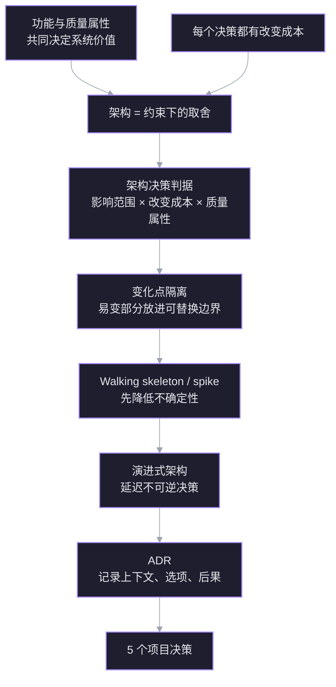

# 架构决策方法 · 以 NIKKE 项目为例

> 日期：2026-11-09。目标：学会像架构师一样识别约束、排序质量属性、做取舍、用 spike 降低不确定性，并把决策写成 ADR。
> 案例：NIKKE 自动化脚本（见 [[NIKKE 自动化脚本 · 规划与架构]]）。

## 探针

> [!question] 探针 1 · 架构是什么
> 在软件项目里，「架构」最接近下面哪个说法？
> A. 目录结构与分层方式　B. 约束下对质量属性的取舍　C. 技术栈与框架组合

> [!failure] ✗ 选了 A
> 正确是 B。架构的核心不是文件怎么摆，而是**在约束下对质量属性做取舍**；目录结构只是取舍之后的结果之一。A 是架构的可见产物，不是架构本身。

> [!question] 探针 2 · 什么算架构决策
> 在 NIKKE 项目里，哪个决定最应该被当作「架构决策」？
> A. 拆 main.py　B. 锁定 720×1280 并把分辨率代码集中到设备层　C. 升级 Python 版本

> [!question] 不知道
> 正常。判据是：**改变成本高、影响多个模块、直接决定某个质量属性**的决定，才是架构决策。B 把「分辨率」这个变化点隔离出来，影响设备层和所有任务；A 是局部重构，C 是低切换成本的工具选择。

> [!question] 探针 3 · 质量属性
> 下面哪一组词最像软件系统的「质量属性」？
> A. 登录、商店、战斗、邮件　B. 可维护性、鲁棒性、性能、可移植性　C. Python、OpenCV、ADB、YOLO

> [!success] ✓ 正确
> B 是质量属性；A 是业务功能（行为），C 是实现手段。质量属性描述「系统做得有多好」，不描述「系统做什么」。


## 依赖图



## 教学计划

探针定位到的边缘：知道架构与实现有关、能识别质量属性；但把架构等同于目录结构，且无法判断一个决定是否属于架构决策。因此不从「怎么分层」开始，而从「什么决定值得在早期做、为什么」开始。

1. 修正架构定义：约束 + 质量属性 + 取舍。
2. 架构决策判据：影响范围 × 改变成本 × 质量属性。
3. 变化点隔离：分辨率、设备、UI 版本、DL 模型。
4. Walking skeleton / spike：M0 就是 walking skeleton；MaaFramework 用一天 spike 验证。
5. 演进式架构：延迟不可逆决策，保留设备层可替换。
6. ADR：给 5 个待决问题各写一页「上下文—选项—取舍—后果」。

终点：你能自己为 5 个决策给出有理由的答案，而不是问我要答案。

## 节点

### 节点 1 · 架构不是目录结构

**动机**：第一题选「目录结构与分层」不是小错。如果架构等于目录，时间会花在「app 放哪、utils 叫什么」上，而真正昂贵的决定——平台、设备抽象、页面模型、调度、DL 边界——会被当成实现细节，等发现错了已经很难改。

**两条无条件真理**

1. 一个软件系统同时被两个维度评价：它做什么（功能/行为），以及它做得有多好（质量属性：可维护性、鲁棒性、性能、可移植性……）。
2. 每个技术决策都有改变成本；有的改起来几分钟，有的改起来要重写半个项目。

**推导**

架构要做的事，是在约束（单人、业余 8–12 周、MuMu/Windows、ToS、许可证）下，决定**哪些质量属性优先、哪些变化点现在隔离、哪些决定可以以后再说**。取舍的结果会体现为目录、接口、依赖方向，但目录只是影子。

反例：两个项目目录树一模一样，都用 `app/ device/ ui/ tasks/`。项目 A 把 `720×1280` 坐标写死在每个任务里；项目 B 把所有分辨率相关代码收进 `device/`。目录一样，架构完全不同：A 改分辨率要动几十个文件，B 只动一层。

反过来，目录树完全不同的两个项目——一个按技术分层，一个按功能分包——只要依赖方向清楚、变化点隔离，都可能是好架构。

**定义**

> 架构 = 在约束下对质量属性的取舍，以及这些取舍留下的结构（边界、依赖、接口）。目录是结构的可见部分，不是全部。

**连接**：这解释了探针 2 为什么答「不知道」——缺的不是目录知识，而是判据：什么样的决定值得在早期用架构手段处理。下一个节点给判据。

> [!question] 节点 1 确认
> 下面哪个事实最能说明「架构不等于目录结构」？
> A. 目录树一样，但分辨率代码的集中程度不同　B. 目录树一样，但 Python 版本不同　C. 目录树一样，但 README 写法不同

> [!success] ✓ 正确
> 分辨率代码的集中程度直接决定「改分辨率要动多少文件」，这是依赖关系与变化点隔离，不是目录名字。Python 版本、README 写法都不改变模块间的依赖结构。

### 节点 2 · 架构决策的判据

**动机**：不是所有决定都值得架构处理。过度设计会把 8 周项目拖成 8 个月；漏掉昂贵决定又会让后期重写。需要一个过滤器。

**三个轴**

1. **影响范围**：这个决定约束了多少模块/任务/人？改它要动多少地方？
2. **改变成本**：如果现在选错，多久能改回来？有没有数据迁移、协议兼容、UI 重写？
3. **质量属性**：它是否直接决定可维护性、鲁棒性、性能、可移植性或安全？

**判据**：三轴都高 → 架构决策，写 ADR；改变成本高但范围窄 → 技术债，至少记录；改变成本低 → 直接决定，不要开会。

**NIKKE 例子**

| 决定 | 影响范围 | 改变成本 | 质量属性 | 结论 |
|---|---|---|---|---|
| 目录怎么分 | 低 | 低 | 弱 | 不是架构决策 |
| 锁定 720×1280 + 设备层隔离 | 高 | 中高 | 可移植性、可维护性 | 架构决策 |
| Python vs C# | 高 | 高 | 性能、生态、可维护性 | 架构决策 |
| loguru vs logging | 低 | 低 | 弱 | 不是 |
| 页面图 vs 每个任务写死点击序列 | 高 | 高 | 可维护性、鲁棒性 | 架构决策 |
| 先训 YOLO vs 模板 + OCR | 高 | 中高 | 性能、可维护性、开发速度 | 架构决策 |

**可逆性**：架构师不是「什么都提前定」，而是「对难改的早定，对易改的晚定」。这就是延迟决策的本质。

**连接**：节点 1 的取舍，现在有了筛选器；节点 3 用它逐个数 NIKKE 的变化点。

> [!question] 节点 2 确认
> 下面哪个决定最需要写成 ADR（架构决策记录）？
> A. 换掉日志库　B. 锁定 MuMu + ADB 作为第一版设备平台　C. 拆分 reward.py 的一个函数

> [!success] ✓ 正确
> 设备平台影响所有任务、切换成本高、直接决定可移植性与可维护性；日志库和函数拆分都是局部、低成本的改动。

### 节点 3 · 变化点隔离

**动机**：节点 2 告诉你哪些决定重要；节点 3 回答「重要决定怎么落到结构上」。如果知道某个维度会变，最便宜的做法是把它关进一个边界，让变化不外溢。

**NIKKE 的变化点**

| 变化点 | 可能的变化 | 隔离边界 | 业务层看到什么 |
|---|---|---|---|
| 分辨率/宽高比 | 720×1280 → 1080×1920 / PC 窗口 | device 层 + 逻辑坐标 | 永远 720×1280 逻辑坐标 |
| 平台 | MuMu/真机/PC | device 后端 | screenshot/click/swipe |
| UI 版本/活动 | 按钮位置、模板失效 | ui/assets + Page | `ensure(page)`、`click(BUTTON)` |
| 识别技术 | 模板 → OCR → CNN/YOLO | perceive 接口 | `read_stamina()`、`page()` |
| DL 模型 | 换骨干/换版本 | classifier + model registry | 置信度 + 页面标签 |
| 调度策略 | 每日/活动/多账号 | app/scheduler | 任务只实现 `run()` |

**原则**：稳定部分依赖抽象，不依赖具体实现；易变部分集中在边界内。Parnas 的信息隐藏原则：模块应该隐藏「最可能变化的设计决策」。

**代价与边界**：每加一层间接就多一层代码、多一次调试。只对「真实存在的变化」做隔离，不为想象中的未来做抽象。判据：至少两个具体变体，或有强证据说它要来。

- 分辨率/平台：MuMu 与 PC 是两个真实变体 → 值得隔离。
- 多语言：目前只做中文 → 不先做 i18n。
- 多账号：第一版不做 → 不先抽象。

**连接**：节点 2 选出了架构决策，节点 3 把它们变成边界；节点 4 讲怎么用最小闭环验证这些边界是否合理。

> [!question] 节点 3 确认
> 第一版只做中文、720×1280。下面哪个做法最符合变化点隔离？
> A. 任务里直接写 `click(360, 640)`　B. 任务调用 `click(BUTTON_MAIL)`，坐标与模板放 assets　C. 先把所有 UI 文本做成 i18n 表

> [!success] ✓ 正确
> 任务只依赖语义按钮，坐标/模板的变化被关在 assets 与 ui 层；写死坐标让变化外溢，i18n 是为不存在的变体付保险费。

### 节点 4 · Walking skeleton 与 spike

**动机**：节点 3 给了边界，但怎么知道边界划对了？不要「先写完所有层，最后集成」——那是 big bang integration，问题会在最贵的时候暴露。要尽早用一条最薄的端到端切片验证接缝。

**两个工具**

| 工具 | 是什么 | 目的 | 代码命运 |
|---|---|---|---|
| Walking skeleton | 系统最薄的一条端到端实现，连接所有架构组件，不含业务功能 | 验证接缝、尽早可运行 | 保留，长成系统 |
| Spike | 限时实验，回答一个具体技术问题 | 降低不确定性 | 用完即弃 |

**NIKKE 的 walking skeleton（M0）**

```
ADB 截图 → 缩放到 720×1280 → 模板匹配一个按钮 → 点击 → 确认页面变化
```

它同时接通 device、perceive、ui 和一个最小 task，但不写任何日常逻辑。跑通它，就证明「设备层接口、逻辑坐标、识别原语、点击反馈」这条链是活的。

**值得先做的 spike**

1. MuMu 能否稳定截到 720×1280、帧率多少、延迟多少？
2. `adb shell input tap` 够不够快，还是必须上 minitouch？
3. 模板匹配在动画/弹窗下会不会抖？
4. 用一天跑 MaaDebugger + MaaNikke 资源，看声明式路线到底能走多快。

**反模式**：先花两周做「完美设备抽象」，却一次截图都没跑过；或者先写完全部日常，最后才接设备层。

**连接**：节点 3 给了边界，节点 4 用最薄切片验证边界；节点 5 讲怎么让这条骨架随信息增加而演进。

> [!question] 节点 4 确认
> 下面哪个是 walking skeleton，而不是 spike？
> A. 用一天写脚本验证 MuMu 能否稳定截图，代码用完就删　B. 打通「截图→识别邮件按钮→点击→确认进入邮件页」并保留为骨架　C. 先写完所有日常任务，再统一接设备层

> [!success] ✓ 正确
> 它连接了所有架构组件、端到端可运行、并且会保留下来长成系统；A 是 spike，C 是 big bang integration。

### 节点 5 · 演进式架构

**动机**：你不可能在第一天知道所有事。架构不是一次性设计，而是一串按信息到达顺序排列的决策。

**两类门**

| 类型 | 特征 | 策略 |
|---|---|---|
| 双向门（可逆） | 改回来便宜 | 快速决定，错了再改 |
| 单向门（难逆） | 改回来贵 | 慢一点，等信息足够 |

NIKKE 的例子：

- 双向门：日志库、目录结构、配置格式、新增一个任务。
- 单向门：设备平台、页面模型、统计数据 schema、DL 接口。

**最后责任时刻**：延迟到「再等下去的代价 > 现在决定错的代价」。

- 平台：M0 前决定。
- 页面模型：M1 前决定。
- 是否上 DL：M4 后决定（有足够录屏和基线）。
- 多账号/WebUI：M6 后决定。

**里程碑即架构检查点**：每个 M 结束时问三个问题——学到了什么？哪个边界错了？哪个决定该改？

**连接**：节点 4 的骨架是第一个检查点；节点 5 让它随信息演进，而不是一次定死。

> [!question] 节点 5 确认
> 下面哪个决定最应该延迟到后期？
> A. 是否支持多账号　B. 设备层是否隔离分辨率　C. 页面导航是否用图搜索

> [!success] ✓ 正确
> 多账号是范围问题，不影响骨架；分辨率隔离和页面图导航是 M0/M1 就必须定的地基。延迟的是「范围」，不是「接缝」。

### 节点 6 · ADR（架构决策记录）

**动机**：六周后你会忘记为什么选 MuMu，未来的你会想「为什么不直接上 PC」。没有记录，决策会被重新争论，或被无意推翻。

**是什么**：一个决策一页，放 `docs/adr/NNNN-title.md`；状态 `proposed / accepted / superseded`；不修改历史，用新 ADR 取代旧 ADR。

**模板**

```
# 0001 第一版设备平台
状态：accepted

## 上下文
单人、业余 8–12 周；PC 客户端有 ACE；MuMu 分辨率可控；自动化有 ToS 风险。

## 备选
A. MuMu + ADB 720×1280
B. PC 客户端 + SendInput
C. MaaFramework + Win32 控制器

## 决定
选 A。

## 后果
+ 截图/点击确定，迭代快
- 需要抽象设备层，PC 迁移待定
- 模拟器性能与稳定性风险

## 复审
M3 结束时复审；若 MuMu 帧率 <2fps 或封号风险不可接受，重开 ADR。
```

**五个待写 ADR**

1. `0001` 平台：MuMu + ADB 720×1280 起步。
2. `0002` 架构风格：分层 + 页面图 + 状态循环，而不是先上 MaaFramework。
3. `0003` 识别策略：模板 + OCR 优先，YOLO 后置。
4. `0004` DL 边界：L1 页面分类器作为第一个 DL 模块。
5. `0005` 第一版范围：日常 MVP，不做 WebUI/多账号。

**连接**：前五个节点给理由，ADR 让理由可复查；面试时也能讲清取舍，而不是只说「我用了 XX」。

> [!question] 节点 6 确认
> 下面哪个最像一条合格的 ADR 内容？
> A. 记录「我们选了 MuMu」　B. 记录「约束、备选、选择、后果」　C. 记录「以后要支持 PC」

> [!success] ✓ 正确
> ADR 的价值在「为什么」和「代价」，不在结论；只记结论等于没记，只记待办是任务清单，不是决策记录。

### 补充：L1 的验收陷阱

> [!question] 验收指标
> L1 的验收指标里，哪一项最容易被忽略但最重要？
> A. 留出会话的 top-1 与每类召回　B. 训练集准确率　C. 模型文件大小

> [!failure] ✗ 选了「训练准确率」
> 训练准确率是优化诊断，不是验收指标。模型可以记住训练帧；同一会话相邻帧几乎一样，按帧随机划分会让验证集泄漏。训练 99% 换一天可能只有 60%。验收要看留出会话的 top-1、每类召回、混淆矩阵、置信度校准。

> [!question] 泛化失败
> 同一段录屏按帧随机划分，训练集 99%，换一天录屏只有 60%。最可能的原因是什么？
> 用户答：过拟合了？

> [!success] ✓ 方向对，根因再挖一层
> 表象是过拟合，但根因是**按帧划分导致验证集泄漏**。模型记住的是同一会话的背景、光照、UI 状态，不是页面语义。修法不是先把模型变小，而是按录制会话划分 train/val，留出整天/整段录屏；再谈正则、增强、容量。

> [!question] 止损条件
> 什么情况下应该停掉 L1，回到纯模板？
> A. 指标不达标（留出会话 top-1 低、回退率过低）　B. 训练损失没降到 0　C. 没用上 YOLO

> [!success] ✓ 正确
> DL 模块必须有止损条件，否则会变成永远调参的黑洞。停的条件是**它没带来价值**：留出会话 top-1 低于阈值、每类召回太低、延迟超标，或者回退率太低（一年也触发不了几次，维护成本白付）。训练损失不趋 0 是正常现象；「没用上 YOLO」不是理由。

## 总结

| 节点 | 一句话 |
|---|---|
| 1 架构 | 约束下对质量属性的取舍；目录只是影子 |
| 2 判据 | 影响范围 × 改变成本 × 质量属性 |
| 3 隔离 | 只隔离真实变化点，抽象要付保险费 |
| 4 骨架 | walking skeleton 保留，spike 用完即弃 |
| 5 演进 | 双向门快定，单向门慢定，里程碑复审 |
| 6 ADR | 上下文—备选—决定—后果 |

### 补充：YOLO 的任务族与 OCR 的边界

本地 `ultralytics 8.4.183` 的 task map 包含：`detect / segment / semantic / depth / classify / pose / obb`。这些任务回答的是「在哪里、属于哪一类、每个像素是什么、关键点在哪」，**没有一个直接输出字符串**。

| 任务 | 输出 | 能不能读出「120/120」 |
|---|---|---|
| detect | 框 + 类别 | 不能，只能框出「数字区域」 |
| segment / semantic | 掩码 + 类别 | 不能，掩码不携带字符含义 |
| classify | 整图/裁剪图一个标签 | 不能，类别是固定的 |
| pose | 关键点坐标 | 不能，关键点不是字符 |
| OBB | 旋转框 + 类别 | 不能 |

OCR 是另一类模型：**文本检测 + 字符序列识别**（CRNN/CTC 或 attention），输出的是字符串。YOLO 可以负责「找到文字区域」，但「读出内容」必须接 OCR。

也可以用 YOLO 检测 10 个数字类别，再按 x 坐标排序拼接——这等于手写一个 OCR。它可行，但标注更贵、小目标更弱、变长数字要后处理；固定 ROI 下不如「裁剪 + 数字 CNN」，通用场景不如 CRNN/CTC。

所以「OCR 处理数值读取」这句话是对的——但 OCR 不是 YOLO 的一个 task，而是另一个模型。

> [!question] 识别边界确认
> 哪类信息需要的是「字符序列解码」，而不是 YOLO 的检测/分割/分类头？
> A. 体力数字　B. 邮件图标　C. 商店按钮

> [!success] ✓ 正确
> 体力是变长字符串，需要 OCR 的序列识别；图标/按钮只需要判断「在不在」，模板或分类头就够。

> [!question] YOLO 成本确认
> 先训 YOLO 统一识别 UI，最大的隐藏成本是什么？
> A. 标注与重训随 UI 改版反复发生　B. 完全不能检测小目标　C. 只能跑在 GPU 上

> [!success] ✓ 正确
> 标注/重训是持续成本；YOLO 能检测小目标（只是弱），也能在 CPU 上跑。

### 补充：范围最小 ≠ 风险最小

范围决策不是「砍到最少」，而是**选择先承担哪一个风险**。两条线难度不对称：

| | 日常 | 自动过图 |
|---|---|---|
| 核心识别 | 页面在不在 → 点按钮 | 战斗结算、胜负/星级、掉落、体力 |
| 状态推进 | 固定顺序，可重入 | 关卡索引 + 失败重试 + 体力不足分支 |
| 失败代价 | 漏做一项，明天补 | 卡关反复打，体力白烧 |
| 调试反馈 | 一帧截图就能验 | 要等整场战斗 |

> [!question] MVP 范围
> 日常 MVP 的范围应该怎么切？
> A. 日常链 + 高收益副本，不含 PVP 与活动　B. 所有日常，含 PVP、公会与活动　C. 只做自动过图，日常后置　D. 只做登录领奖与每日任务

> [!success] ✓ 选择成立，但风险被转移了
> 只做过图是**有效的最小 MVP**，也贴合你的首要目标；问题在于它把最难的技术线放在了 walking skeleton 的位置。战役要判定战斗结果、推进关卡、处理体力和失败重试，而这些不确定性会掩盖框架本身的问题——导航坏了还是战斗识别坏了，分不清。采用的折中：目标仍是过图优先，但骨架先在一个日常子任务（模拟室/前哨收菜）上验证，不计入功能清单。

## 应用到五个项目决策

| 决策 | 推荐 | 主要理由 | 复审点 |
|---|---|---|---|
| 0001 平台 | MuMu + ADB 720×1280 | 分辨率/输入可控、迭代快；设备层隔离 PC 迁移 | M0/M3 |
| 0002 架构风格 | 自写分层骨架 | 学习目标；MaaFramework 表达力有限 | M1 |
| 0003 识别 | 模板 + 颜色 + OCR | 固定 UI 下最快、最可解释 | M4 |
| 0004 DL | L1 页面分类器 | 模板失效时的回退，可评测 | M5 |
| 0005 范围 | 日常 MVP | 先跑通闭环，防范围蔓延 | M3 |

`0001`–`0005` 已按 ADR 模板写入项目文档附录（上下文、备选、决定、后果、复审条件）。五条决策全部成文，下一步是 M0 观测骨架。


