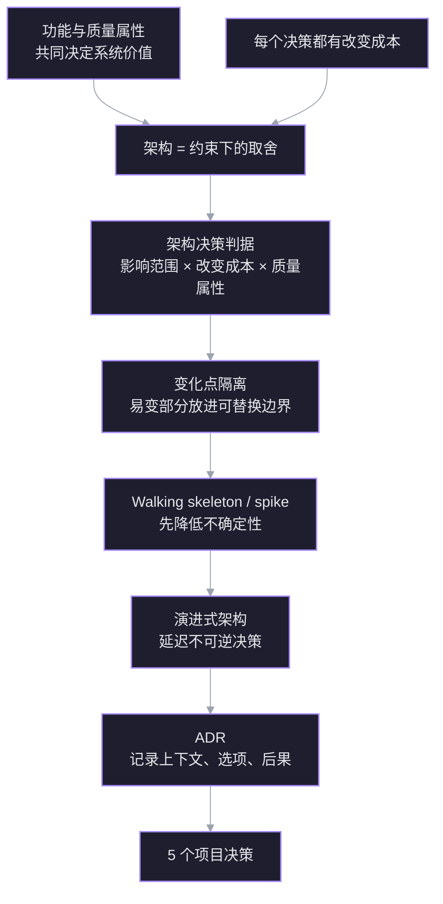

# 架构决策方法 · 以 NIKKE 项目为例

> 日期：2026-11-09。目标：学会像架构师一样识别约束、排序质量属性、做取舍、用 spike 降低不确定性，并把决策写成 ADR。
> 案例：NIKKE 自动化脚本（见 [[NIKKE 自动化脚本 · 规划与架构]]）。

## 探针

> [!question] 探针 1 · 架构是什么
> 在软件项目里，「架构」最接近下面哪个说法？
> A. 目录结构与分层方式　B. 约束下对质量属性的取舍　C. 技术栈与框架组合

> [!failure] ✗ 选了 A
> 正确是 B。架构的核心不是文件怎么摆，而是**在约束下对质量属性做取舍**；目录结构只是取舍之后的结果之一。A 是架构的可见产物，不是架构本身。

> [!question] 探针 2 · 什么算架构决策
> 在 NIKKE 项目里，哪个决定最应该被当作「架构决策」？
> A. 拆 main.py　B. 锁定 720×1280 并把分辨率代码集中到设备层　C. 升级 Python 版本

> [!question] 不知道
> 正常。判据是：**改变成本高、影响多个模块、直接决定某个质量属性**的决定，才是架构决策。B 把「分辨率」这个变化点隔离出来，影响设备层和所有任务；A 是局部重构，C 是低切换成本的工具选择。

> [!question] 探针 3 · 质量属性
> 下面哪一组词最像软件系统的「质量属性」？
> A. 登录、商店、战斗、邮件　B. 可维护性、鲁棒性、性能、可移植性　C. Python、OpenCV、ADB、YOLO

> [!success] ✓ 正确
> B 是质量属性；A 是业务功能（行为），C 是实现手段。质量属性描述「系统做得有多好」，不描述「系统做什么」。

## 依赖图

## 教学计划

探针定位到的边缘：知道架构与实现有关、能识别质量属性；但把架构等同于目录结构，且无法判断一个决定是否属于架构决策。因此不从「怎么分层」开始，而从「什么决定值得在早期做、为什么」开始。

1. 修正架构定义：约束 + 质量属性 + 取舍。
2. 架构决策判据：影响范围 × 改变成本 × 质量属性。
3. 变化点隔离：分辨率、设备、UI 版本、DL 模型。
4. Walking skeleton / spike：M0 就是 walking skeleton；MaaFramework 用一天 spike 验证。
5. 演进式架构：延迟不可逆决策，保留设备层可替换。
6. ADR：给 5 个待决问题各写一页「上下文—选项—取舍—后果」。

终点：你能自己为 5 个决策给出有理由的答案，而不是问我要答案。

## 节点

### 节点 1 · 架构不是目录结构

**动机**：第一题选「目录结构与分层」不是小错。如果架构等于目录，时间会花在「app 放哪、utils 叫什么」上，而真正昂贵的决定——平台、设备抽象、页面模型、调度、DL 边界——会被当成实现细节，等发现错了已经很难改。

**两条无条件真理**

1. 一个软件系统同时被两个维度评价：它做什么（功能/行为），以及它做得有多好（质量属性：可维护性、鲁棒性、性能、可移植性……）。
2. 每个技术决策都有改变成本；有的改起来几分钟，有的改起来要重写半个项目。

**推导**

架构要做的事，是在约束（单人、业余 8–12 周、MuMu/Windows、ToS、许可证）下，决定**哪些质量属性优先、哪些变化点现在隔离、哪些决定可以以后再说**。取舍的结果会体现为目录、接口、依赖方向，但目录只是影子。

反例：两个项目目录树一模一样，都用 `app/ device/ ui/ tasks/`。项目 A 把 `720×1280` 坐标写死在每个任务里；项目 B 把所有分辨率相关代码收进 `device/`。目录一样，架构完全不同：A 改分辨率要动几十个文件，B 只动一层。

反过来，目录树完全不同的两个项目——一个按技术分层，一个按功能分包——只要依赖方向清楚、变化点隔离，都可能是好架构。

**定义**

> 架构 = 在约束下对质量属性的取舍，以及这些取舍留下的结构（边界、依赖、接口）。目录是结构的可见部分，不是全部。

**连接**：这解释了探针 2 为什么答「不知道」——缺的不是目录知识，而是判据：什么样的决定值得在早期用架构手段处理。下一个节点给判据。

> [!question] 节点 1 确认
> 下面哪个事实最能说明「架构不等于目录结构」？
> A. 目录树一样，但分辨率代码的集中程度不同　B. 目录树一样，但 Python 版本不同　C. 目录树一样，但 README 写法不同

> [!success] ✓ 正确
> 分辨率代码的集中程度直接决定「改分辨率要动多少文件」，这是依赖关系与变化点隔离，不是目录名字。Python 版本、README 写法都不改变模块间的依赖结构。

### 节点 2 · 架构决策的判据

**动机**：不是所有决定都值得架构处理。过度设计会把 8 周项目拖成 8 个月；漏掉昂贵决定又会让后期重写。需要一个过滤器。

**三个轴**

1. **影响范围**：这个决定约束了多少模块/任务/人？改它要动多少地方？
2. **改变成本**：如果现在选错，多久能改回来？有没有数据迁移、协议兼容、UI 重写？
3. **质量属性**：它是否直接决定可维护性、鲁棒性、性能、可移植性或安全？

**判据**：三轴都高 → 架构决策，写 ADR；改变成本高但范围窄 → 技术债，至少记录；改变成本低 → 直接决定，不要开会。

**NIKKE 例子**

| 决定 | 影响范围 | 改变成本 | 质量属性 | 结论 |
|---|---|---|---|---|
| 目录怎么分 | 低 | 低 | 弱 | 不是架构决策 |
| 锁定 720×1280 + 设备层隔离 | 高 | 中高 | 可移植性、可维护性 | 架构决策 |
| Python vs C# | 高 | 高 | 性能、生态、可维护性 | 架构决策 |
| loguru vs logging | 低 | 低 | 弱 | 不是 |
| 页面图 vs 每个任务写死点击序列 | 高 | 高 | 可维护性、鲁棒性 | 架构决策 |
| 先训 YOLO vs 模板 + OCR | 高 | 中高 | 性能、可维护性、开发速度 | 架构决策 |

**可逆性**：架构师不是「什么都提前定」，而是「对难改的早定，对易改的晚定」。这就是延迟决策的本质。

**连接**：节点 1 的取舍，现在有了筛选器；节点 3 用它逐个数 NIKKE 的变化点。

> [!question] 节点 2 确认
> 下面哪个决定最需要写成 ADR（架构决策记录）？
> A. 换掉日志库　B. 锁定 MuMu + ADB 作为第一版设备平台　C. 拆分 reward.py 的一个函数

> [!success] ✓ 正确
> 设备平台影响所有任务、切换成本高、直接决定可移植性与可维护性；日志库和函数拆分都是局部、低成本的改动。

### 节点 3 · 变化点隔离

**动机**：节点 2 告诉你哪些决定重要；节点 3 回答「重要决定怎么落到结构上」。如果知道某个维度会变，最便宜的做法是把它关进一个边界，让变化不外溢。

**NIKKE 的变化点**

| 变化点 | 可能的变化 | 隔离边界 | 业务层看到什么 |
|---|---|---|---|
| 分辨率/宽高比 | 720×1280 → 1080×1920 / PC 窗口 | device 层 + 逻辑坐标 | 永远 720×1280 逻辑坐标 |
| 平台 | MuMu/真机/PC | device 后端 | screenshot/click/swipe |
| UI 版本/活动 | 按钮位置、模板失效 | ui/assets + Page | `ensure(page)`、`click(BUTTON)` |
| 识别技术 | 模板 → OCR → CNN/YOLO | perceive 接口 | `read_stamina()`、`page()` |
| DL 模型 | 换骨干/换版本 | classifier + model registry | 置信度 + 页面标签 |
| 调度策略 | 每日/活动/多账号 | app/scheduler | 任务只实现 `run()` |

**原则**：稳定部分依赖抽象，不依赖具体实现；易变部分集中在边界内。Parnas 的信息隐藏原则：模块应该隐藏「最可能变化的设计决策」。

**代价与边界**：每加一层间接就多一层代码、多一次调试。只对「真实存在的变化」做隔离，不为想象中的未来做抽象。判据：至少两个具体变体，或有强证据说它要来。

- 分辨率/平台：MuMu 与 PC 是两个真实变体 → 值得隔离。
- 多语言：目前只做中文 → 不先做 i18n。
- 多账号：第一版不做 → 不先抽象。

**连接**：节点 2 选出了架构决策，节点 3 把它们变成边界；节点 4 讲怎么用最小闭环验证这些边界是否合理。

> [!question] 节点 3 确认
> 第一版只做中文、720×1280。下面哪个做法最符合变化点隔离？
> A. 任务里直接写 `click(360, 640)`　B. 任务调用 `click(BUTTON_MAIL)`，坐标与模板放 assets　C. 先把所有 UI 文本做成 i18n 表

（答题后补反馈）

