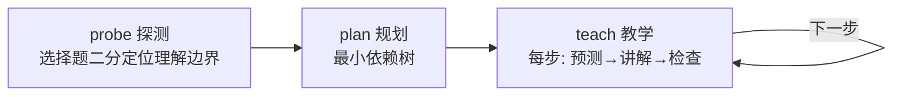

来源：视频 *Agent Harness for Learning Things*（repo: `learnharness`）。核心命题：用 AI 学东西时最大的风险不是模型出错，而是**跳过了“挣扎”这一步，制造出学会了的错觉**。系统要做的不是替你想，而是把你的脑力尽量花在直接与材料交互上。

## 学习 = 两个过程

| 过程 | 作用 |
| --- | --- |
| **教学 teaching** | 安装理解（install understanding） |
| **练习 practice** | 巩固并让理解变得可用（solidify & make usable） |

关键区分：**理解 ≠ 会用**。听课时全程跟得上，遇到问题却想不起来该用哪个结论 —— 不是理解是假的，而是“回忆 recall”没被训练。回忆靠**线索 cue** 触发：一个新概念刚学时只在被教的语境里才想得起来，线索又窄又弱；练习的任务就是**把线索集拓宽、加强**。

## 优化的前提：先有学习者的模型

没有抽象的“最优课程”或“最优练习题” —— 某一步是否冗余，只相对于你已懂的东西；是否够不着，只相对于你不懂的东西。所以系统必须先有**关于你理解状态的详细图像**。

光看对错不够：两个人可能给出同一个错误答案，原因完全不同。所以每次交互都有 **thinking 字段**，让你把未过滤的、混乱的思考过程直接写/说出来，给 agent 提供**过程数据**而不是只给最终答案。另有一个 **confidence 滑块**（自评答案正确的概率），是成本极低的额外信号。

## 教学：三阶段



1. **probe**：快速选择题，像二分搜索一样定位你理解的“边缘”，覆盖本课所有前置知识。
2. **plan**：agent 从“你已懂的”到“目标”推出**最小依赖树**。
3. **teach**：目标状态是“感觉显然为真”。既然已知什么是你当前认为显然为真的，就沿依赖树一次走一个推理步，每步都落到“显然为真”，直到目标本身也变成显然为真。

每一步的结构固定：

```
1. 你先预测下一步（不看讲解）
2. agent 讲解这一步
3. agent 出题检查你是否真的懂
```

先预测既给 agent 更多思考数据，本身也是学习机会。每步两问，形成苏格拉底式来回，错误在叠加下一层之前就被暴露和修正。

四个子 agent：researcher（事实核查）、PDF reader、SVG maker（画图）、demo builder（交互演示）。

## 练习：自适应的问题流

agent 的任务不是“出题”，而是**给定线索、要求你回忆出正确的东西**。目标状态是“需要努力才能成功的回忆”：够难，要挣扎；但不难到无法推进。

难度沿两个轴自适应：

1. 一个问题**组合多少个概念**；
2. **线索有多熟悉**。

thinking 分块提交，agent 能从思考过程推断你是否真的解出，不必手写最终答案。卡住时只给**最小提示**，把你引向自己发现答案，而不是直接给答案。

## 持久记录：命题 + 推理链

教学会话被抽取成 **propositions and reasoning chains**（命题与推理链），存成一张可增长的图：

- 节点 = 命题/想法；
- 有向边 = **推理方向**（谁推出了谁）；
- 可以把 Y 轴设为推理深度，论证一律向上生长；
- 跨会话也能自动连边（如“微分形式”会话连到“梯度下降”会话）。

这样既压缩（少 token 可放进上下文），又保留“想法之间如何连接”的精度。

## 什么是 agent harness

围绕 LLM、让它能在某个外部系统里探索和行动的一切：

| harness | 被作用的系统 |
| --- | --- |
| coding agent | 计算机 |
| research agent | 互联网 |
| **learning agent** | **你的大脑** |

别的 harness 里人是操作者；这里**你就是被作用的系统**，agent 的工作是在你的脑中建立理解。

## 现状与局限

- 桌面应用，开源免费，自带 API key；支持导入自己的笔记/PDF；可接 Deepgram 做语音输入。
- 图目前只表示“覆盖了什么”，**不表示掌握程度**；把练习评估结果写回图是下一步。
- 系统提示词全部可见可改，教学方法论可自行调。

## 可迁移的要点

- 让 AI 教东西时，**先让它探测你的边界**，再讲；否则讲的东西要么冗余要么接不上。
- **先预测再听讲解**，是最便宜的主动学习手段。
- 练习要练“从线索回忆”，而不是重读笔记。
- 记录“命题 + 推理链”比记录大段摘要更适合长期积累和跨主题连接。
