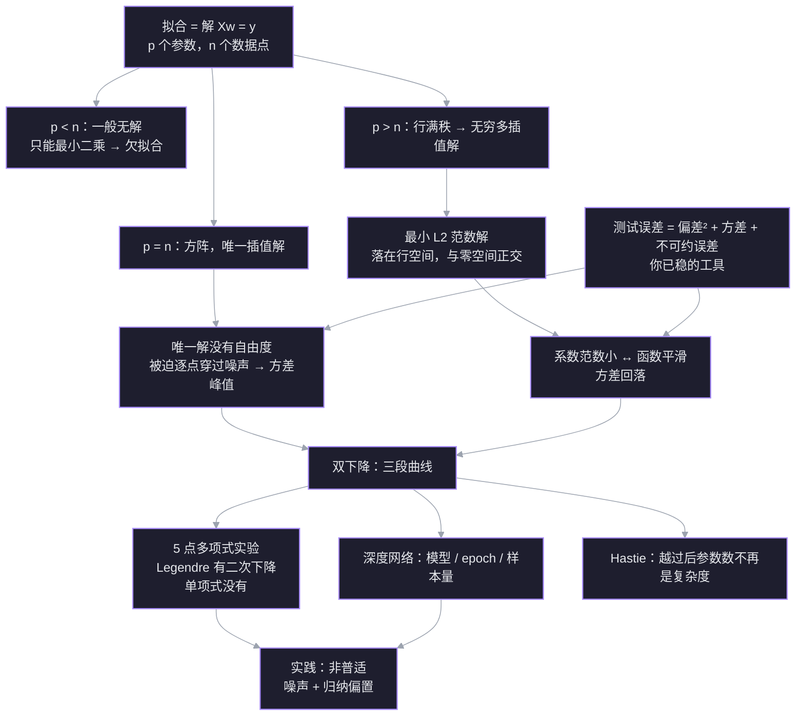

测试误差随模型增大先经历经典 U 形，在**插值阈值**（参数数刚好等于数据点数）处冲到最差，越过阈值后反而可能再次下降——这就是**双下降 double descent**。机制不是“更大模型学得更好”，而是：阈值处能完美拟合训练数据的解只有一个，模型被迫迁就噪声；越过后插值解变成无穷多个，算法挑中的最小范数解更平滑，方差回落。

> 原文：[[What the Books Get Wrong about AI Double Descent]]（Welch Labs）

## 探针：已经稳的和断掉的

| 线索 | 状态 | 具体表现 |
| --- | --- | --- |
| 经典 U 形 | ✅ 稳 | 知道低次欠拟合、高次过拟合，测试误差先降后升 |
| 训练误差 0 ⇒ 测试误差？ | ✅ 稳 | 能判断“单凭训练误差无法推断测试误差” |
| 插值阈值计数 | ✅ 稳 | 5 个点、4 次多项式（5 个系数）第一次穿过全部点 |
| 过参数化解的数量 | ✅ 稳 | 5 次多项式有 6 个系数，能穿过 5 个点的曲线有无穷多条 |
| 最小范数解 | ✅ 稳 | 知道伪逆/最小二乘会挑系数平方和最小的那条 |
| 偏差-方差左半段 | ✅ 稳 | 知道模型变复杂时偏差降、方差升 |
| 不可约误差 | ✅ 稳 | 知道它来自数据生成噪声，模型再强也消不掉 |
| 阈值处为什么最差 | ❌ 断点 | 答“idk” |
| 越过后为什么第二次下降 | ❌ 断点 | 误答成“不可约误差随参数增多而变小” |
| 双下降的普适性 | ✅ 稳 | 知道它取决于噪声与模型归纳偏置，不是越大越好 |

**这次教学的靶心**：把已经稳的几块（无穷多解、最小范数、偏差-方差）接成一条因果链，解释“阈值处最差 → 越过后方差回落”。

## 依赖图

## 关联笔记

- [[L8 求解Ax=b]] — 通解 = 特解 + 零空间；伪逆给最小范数解。本篇的 `Xw=y` 就是它的高维版本。
- [[L10 四个基本子空间]] — 最小范数解落在行空间、与零空间正交；这是“过参数化为什么能挑平滑解”的几何地基。
- [[L29 奇异值分解]] — 条件数衡量噪声放大；伪逆只对非零奇异值取倒数。阈值处的方差峰值可以在这里找到矩阵语言。
- [[曲线拟合的概率视角 最小二乘与正则化]] — 最小二乘来自高斯噪声，L2 正则来自高斯先验；双下降讨论的是“不加正则、只靠最小范数”时会发生什么。
- [[神经网络对称性 损失曲面的隐藏结构]] — 对称性解释“为什么有海量等价好解”；双下降解释“为什么这些多解里有的泛化更好”。
- [[L1 深度学习基础]] — 经典的过拟合/正则化讲法；本篇补上它在插值阈值之后的边界。

## 1. 拟合就是解方程

把每个数据点写成一个方程：

$$
w_0\phi_0(x_i)+\cdots+w_{p-1}\phi_{p-1}(x_i)=y_i,\qquad i=1,\dots,n
$$

堆成矩阵就是

$$
Xw=y,\qquad X\in\mathbb R^{n\times p}
$$

这就是 [[L8 求解Ax=b]] 里的 $Ax=b$，只是现在 $A$ 叫 $X$、$x$ 叫 $w$。三种情形由 $p$ 与 $n$ 的关系决定：

| 情形 | 形状 | 解集 | 训练误差 |
| --- | --- | --- | --- |
| $p<n$ | 高瘦 | 一般无解，只能最小二乘 | $>0$（欠拟合） |
| $p=n$ | 方阵 | 一般唯一解 | $0$（插值） |
| $p>n$ | 矮胖 | 行满秩时无穷多解 | $0$（插值） |

$p=n$ 就是**插值阈值**：第一次有足够的参数让曲线穿过全部 $n$ 个点。

> [!question] 5 个点、6 个系数，$X$ 是 $5\times6$ 且行满秩。$Xw=y$ 的解集是几维的？
>
> A. 0 维：只有一个解　B. 1 维：一条直线　C. 5 维：五个自由参数

> [!success] ✓ 正确
> 自由度 $=p-r=6-5=1$：解集是 $w_p+N(X)$，一条过特解、方向沿零空间的直线。

## 2. 阈值处为什么最差：唯一解没有自由度

阈值处最反直觉：模型不是“参数太多”，而是“参数刚好够”。$p=n$ 时 $X$ 是方阵，通常可逆，解唯一：

$$
w=X^{-1}y.
$$

把观测拆成真实值加噪声 $y=f+\varepsilon$：

$$
w=X^{-1}f+X^{-1}\varepsilon.
$$

第一项是“穿过真实值”的插值，第二项是噪声被 $X^{-1}$ 映射后的结果。[[L29 奇异值分解]] 给过条件数的含义：$\kappa=\sigma_1/\sigma_r$ 是解方程时相对误差的放大上界。阈值处没有别的解可选，噪声必须原封不动地进入 $w$；$X$ 越病态，噪声被放得越大。换一批训练噪声，曲线就换一副样子——这就是方差。

关键不是“参数多”，而是“刚好够、没有剩余自由度”。$p<n$ 时模型拟合不完全，但会被迫平均掉一部分噪声；$p=n$ 时它第一次能穿过所有点，却只有一条路可走，只能跟着噪声走。

> [!question] 5 个点、4 次多项式，唯一一条穿过全部点的曲线。重新采一批噪声、再拟合一次，曲线会怎样？
>
> A. 基本重合，变化很小　B. 可能明显变形，因为必须迁就每个噪声点　C. 一定变得更平滑

> [!success] ✓ 正确
> 阈值处解唯一，噪声没有别的方向可去；换一批噪声，曲线就被迫跟着变。这就是方差在 $p=n$ 处达到峰值的原因。

## 3. 越过后为什么降：多解 + 最小范数

$p>n$ 时 $X$ 是矮胖矩阵。若行满秩，对任意 $y$ 都有解，而且解集是

$$
w_p+N(X),
$$

一条 $p-n$ 维的仿射子空间。[[L8 求解Ax=b]] 已经给过选择规则：最小二乘/伪逆返回其中**范数最小**的那个，

$$
w^{+}=X^{+}y,
$$

它落在行空间 $C(X^{\mathsf T})$，与零空间 $N(X)$ 正交。

几何上，$w^{+}$ 是解集里离原点最近的点。零空间方向不改变训练预测 $Xw$，所以最小范数解把这些方向的系数取 0；它只用行空间里的方向来表示 $y$。随着 $p$ 增大，行空间越来越丰富，同一个 $y$ 可以用更多、更小的系数拼出来，而不是靠少数几个大系数硬凑。

在正交多项式基（如归一化 Legendre）下，系数平方和就是函数在区间上的 $L^2$ 范数：

$$
\|w\|_2^2=\sum_j w_j^2 \;\approx\; \int f(x)^2\,dx.
$$

所以“系数范数小”就是“函数整体振幅小、振荡少”。这就是过参数化时方差回落的原因：训练点上的噪声仍然被穿过，但点与点之间，最小范数解挑的是最平缓的那条曲线。[[L10 四个基本子空间]] 的行空间/零空间正交分解是这里的几何地基。

> [!warning] 边界
> 这里的“平滑”是相对于你选的范数/基而言的。换成单项式基，最小范数解不再对应函数 $L^2$ 范数，双下降可能消失——第 5 节会用数值实验看到这一点。这正是[[#5. 多项式实验：Legendre vs 单项式|归纳偏置]]在起作用。

> [!question] 6 个系数、5 个约束，解集是一条 1 维直线。最小范数解在直线上取哪个点？
>
> A. 离原点最近的点　B. 离原点最远的点　C. 任意一个特解

> [!success] ✓ 正确
> 伪逆给的是解集到原点的垂足：它落在行空间、与零空间正交，所以是范数最小的那个解。
