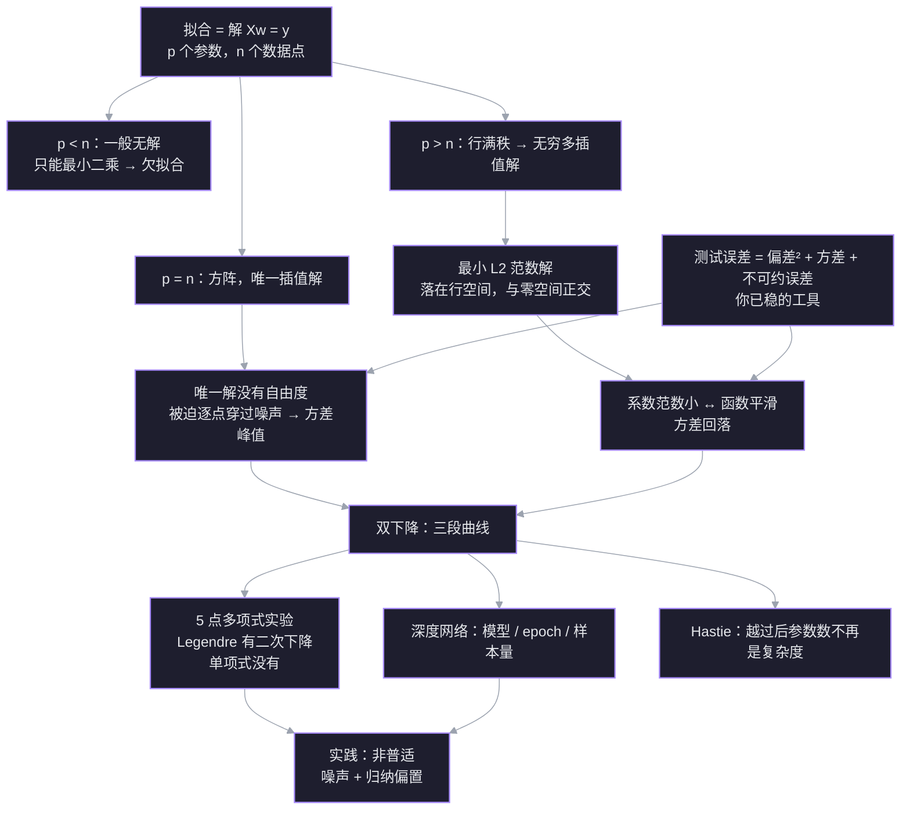

测试误差随模型增大先经历经典 U 形，在**插值阈值**（参数数刚好等于数据点数）处冲到最差，越过阈值后反而可能再次下降——这就是**双下降 double descent**。机制不是“更大模型学得更好”，而是：阈值处能完美拟合训练数据的解只有一个，模型被迫迁就噪声；越过后插值解变成无穷多个，算法挑中的最小范数解更平滑，方差回落。

> 原文：[[What the Books Get Wrong about AI Double Descent]]（Welch Labs）

## 探针：起点与补上的断点

| 线索 | 状态 | 具体表现 |
| --- | --- | --- |
| 经典 U 形 | ✅ 稳 | 知道低次欠拟合、高次过拟合，测试误差先降后升 |
| 训练误差 0 ⇒ 测试误差？ | ✅ 稳 | 能判断“单凭训练误差无法推断测试误差” |
| 插值阈值计数 | ✅ 稳 | 5 个点、4 次多项式（5 个系数）第一次穿过全部点 |
| 过参数化解的数量 | ✅ 稳 | 5 次多项式有 6 个系数，能穿过 5 个点的曲线有无穷多条 |
| 最小范数解 | ✅ 稳 | 知道伪逆/最小二乘会挑系数平方和最小的那条 |
| 偏差-方差左半段 | ✅ 稳 | 知道模型变复杂时偏差降、方差升 |
| 不可约误差 | ✅ 稳 | 知道它来自数据生成噪声，模型再强也消不掉 |
| 阈值处为什么最差 | ✅ 已补 | 唯一插值解没有自由度，方差项在 $\gamma=1$ 发散 |
| 越过后为什么第二次下降 | ✅ 已补 | 多解 + 最小范数解 → 系数范数下降 → 方差回落 |
| 双下降的普适性 | ✅ 稳 | 知道它取决于噪声与模型归纳偏置，不是越大越好 |

**这次教学补上的链**：阈值处唯一插值解 → 方差发散；越过后多解 → 最小范数解 → 系数范数下降 → 方差回落。探针时的两个断点现在都接上了。

## 依赖图

## 关联笔记

- [[L8 求解Ax=b]] — 通解 = 特解 + 零空间；伪逆给最小范数解。本篇的 `Xw=y` 就是它的高维版本。
- [[L10 四个基本子空间]] — 最小范数解落在行空间、与零空间正交；这是“过参数化为什么能挑平滑解”的几何地基。
- [[L29 奇异值分解]] — 条件数衡量噪声放大；伪逆只对非零奇异值取倒数。阈值处的方差峰值可以在这里找到矩阵语言。
- [[曲线拟合的概率视角 最小二乘与正则化]] — 最小二乘来自高斯噪声，L2 正则来自高斯先验；双下降讨论的是“不加正则、只靠最小范数”时会发生什么。
- [[神经网络对称性 损失曲面的隐藏结构]] — 对称性解释“为什么有海量等价好解”；双下降解释“为什么这些多解里有的泛化更好”。
- [[L1 深度学习基础]] — 经典的过拟合/正则化讲法；本篇补上它在插值阈值之后的边界。

## 1. 拟合就是解方程

把每个数据点写成一个方程：

$$
w_0\phi_0(x_i)+\cdots+w_{p-1}\phi_{p-1}(x_i)=y_i,\qquad i=1,\dots,n
$$

堆成矩阵就是

$$
Xw=y,\qquad X\in\mathbb R^{n\times p}
$$

这就是 [[L8 求解Ax=b]] 里的 $Ax=b$，只是现在 $A$ 叫 $X$、$x$ 叫 $w$。三种情形由 $p$ 与 $n$ 的关系决定：

| 情形 | 形状 | 解集 | 训练误差 |
| --- | --- | --- | --- |
| $p<n$ | 高瘦 | 一般无解，只能最小二乘 | $>0$（欠拟合） |
| $p=n$ | 方阵 | 一般唯一解 | $0$（插值） |
| $p>n$ | 矮胖 | 行满秩时无穷多解 | $0$（插值） |

$p=n$ 就是**插值阈值**：第一次有足够的参数让曲线穿过全部 $n$ 个点。

> [!question] 5 个点、6 个系数，$X$ 是 $5\times6$ 且行满秩。$Xw=y$ 的解集是几维的？
>
> A. 0 维：只有一个解　B. 1 维：一条直线　C. 5 维：五个自由参数

> [!success] ✓ 正确
> 自由度 $=p-r=6-5=1$：解集是 $w_p+N(X)$，一条过特解、方向沿零空间的直线。

## 2. 阈值处为什么最差：唯一解没有自由度

阈值处最反直觉：模型不是“参数太多”，而是“参数刚好够”。$p=n$ 时 $X$ 是方阵，通常可逆，解唯一：

$$
w=X^{-1}y.
$$

把观测拆成真实值加噪声 $y=f+\varepsilon$：

$$
w=X^{-1}f+X^{-1}\varepsilon.
$$

第一项是“穿过真实值”的插值，第二项是噪声被 $X^{-1}$ 映射后的结果。[[L29 奇异值分解]] 给过条件数的含义：$\kappa=\sigma_1/\sigma_r$ 是解方程时相对误差的放大上界。阈值处没有别的解可选，噪声必须原封不动地进入 $w$；$X$ 越病态，噪声被放得越大。换一批训练噪声，曲线就换一副样子——这就是方差。

这个峰值有解析版本。设 $\gamma=p/n$，Hastie 等在无岭线性回归里给出方差项：$\gamma<1$ 时约为 $\sigma^2\gamma/(1-\gamma)$，$\gamma>1$ 时约为 $\sigma^2/(\gamma-1)$——两边都在 $\gamma\to1$ 时发散。阈值处不是“稍微差一点”，而是方差项本身爆炸。([Hastie et al. 2022](https://arxiv.org/abs/1903.08560))

关键不是“参数多”，而是“刚好够、没有剩余自由度”。$p<n$ 时模型拟合不完全，但会被迫平均掉一部分噪声；$p=n$ 时它第一次能穿过所有点，却只有一条路可走，只能跟着噪声走。

> [!question] 5 个点、4 次多项式，唯一一条穿过全部点的曲线。重新采一批噪声、再拟合一次，曲线会怎样？
>
> A. 基本重合，变化很小　B. 可能明显变形，因为必须迁就每个噪声点　C. 一定变得更平滑

> [!success] ✓ 正确
> 阈值处解唯一，噪声没有别的方向可去；换一批噪声，曲线就被迫跟着变。这就是方差在 $p=n$ 处达到峰值的原因。

## 3. 越过后为什么降：多解 + 最小范数

$p>n$ 时 $X$ 是矮胖矩阵。若行满秩，对任意 $y$ 都有解，而且解集是

$$
w_p+N(X),
$$

一条 $p-n$ 维的仿射子空间。[[L8 求解Ax=b]] 已经给过选择规则：最小二乘/伪逆返回其中**范数最小**的那个，

$$
w^{+}=X^{+}y,
$$

它落在行空间 $C(X^{\mathsf T})$，与零空间 $N(X)$ 正交。

几何上，$w^{+}$ 是解集里离原点最近的点。零空间方向不改变训练预测 $Xw$，所以最小范数解把这些方向的系数取 0；它只用行空间里的方向来表示 $y$。随着 $p$ 增大，行空间越来越丰富，同一个 $y$ 可以用更多、更小的系数拼出来，而不是靠少数几个大系数硬凑。

![[viz-min-norm-solution-affine-projection-1794294278776.svg|1000]]

*图：三个自由度下的解集。0 自由度：唯一解，没有选择余地；1 自由度：仿射线，$w^{+}$ 是原点到直线的垂足；2 自由度：仿射平面，$w^{+}$ 仍是垂足。所有解都满足 $Xw=y$，区别只在 $\|w\|$。*

在正交多项式基（如归一化 Legendre）下，系数平方和就是函数在区间上的 $L^2$ 范数：

$$
\|w\|_2^2=\sum_j w_j^2 \;\approx\; \int f(x)^2\,dx.
$$

所以“系数范数小”就是“函数整体振幅小、振荡少”。这就是过参数化时方差回落的原因：训练点上的噪声仍然被穿过，但点与点之间，最小范数解挑的是最平缓的那条曲线。[[L10 四个基本子空间]] 的行空间/零空间正交分解是这里的几何地基。

> [!question] 6 个系数、5 个约束，解集是一条 1 维直线。最小范数解在直线上取哪个点？
>
> A. 离原点最近的点　B. 离原点最远的点　C. 任意一个特解

> [!success] ✓ 正确
> 伪逆给的是解集到原点的垂足：它落在行空间、与零空间正交，所以是范数最小的那个解。

> [!question] 在归一化 Legendre 基下，最小范数解让下面哪个量最小？
>
> A. 函数在区间上的 L2 范数　B. 函数在区间上的最大值　C. 训练集上的误差

> [!success] ✓ 正确
> 归一化后基函数满足 $\int P_iP_j=\delta_{ij}$，写 $f=\sum_j w_jP_j$ 就有 $\int f^2=\sum_j w_j^2$。最小系数范数就是最小函数 $L^2$ 范数，也就是压低整体能量/振荡。

> [!warning] 边界
> 这里的“平滑”是相对于你选的范数/基而言的。更准确地说：基依赖来自“惩罚系数坐标”；若把范数定义为函数空间/RKHS 范数，最小范数插值解与基无关。换成单项式基、仍惩罚系数 $L^2$，最小范数解不再对应函数 $L^2$ 范数，双下降可能消失——[[#5. 多项式实验：Legendre vs 单项式|多项式实验]]会看到这一点。

## 4. 三段拼起来：双下降

把三件事按 $p$ 与 $n$ 的关系排好，就得到双下降：

| 区间 | 谁主导 | 增加容量时 | 训练误差 |
| --- | --- | --- | --- |
| $p<n$ | 偏差 | 偏差降、方差升 → 测试误差先降 | $>0$ |
| $p=n$ | 方差 | 唯一插值解，方差发散 → 峰值 | $0$ |
| $p>n$ | 方差（被最小范数压住） | 多解 + 最小范数解 → 方差回落 | $0$ |

第一次下降来自**偏差**：模型从太简单变得够复杂。第二次下降来自**方差**：越过阈值后，解不再唯一，最小范数解把系数范数压小，曲线变平滑。不可约误差 $\sigma^2$ 始终是地板，不参与这两次下降。

> [!note] 两次下降不是同一件事
> 左段是“模型终于能表达真实函数”；右段是“模型有太多表达方式，算法挑了最平滑的那种”。把两者都叫“更大模型更好”会丢掉机制。

> [!question] 右段（$p>n$）测试误差回落，主要是哪一项在下降？
>
> A. 方差　B. 偏差　C. 不可约误差

> [!success] ✓ 正确
> 右段的多解 + 最小范数选择压低了拟合对训练噪声的敏感度，所以是方差回落；不可约误差是数据噪声地板，不随模型变。

## 5. 多项式实验：Legendre vs 单项式

用 5 个点、真实函数 $f(x)=x^2$、噪声 $\sigma=0.2$（seed 6），在 $[-1,1]$ 上取 1001 个测试点。对每个阶数 $d$，用伪逆求最小系数范数插值：

$$
w^{+}=X^{+}y.
$$

| $d$ | $p=d+1$ | 训练 MSE | 测试 MSE（Legendre） | 测试 MSE（单项式） | $\|w\|$（Legendre） |
| --- | --- | --- | --- | --- | --- |
| 1 | 2 | 0.416 | 0.1363 | 0.1363 | 0.552 |
| 2 | 3 | 0.0563 | 0.0196 | 0.0196 | 1.007 |
| 3 | 4 | 0.0448 | 0.0375 | 0.0375 | 1.045 |
| 4 | 5 | 0 | 0.1733 | 0.1733 | 1.603 |
| 5 | 6 | 0 | 0.1725 | 0.1756 | 1.603 |
| 6 | 7 | 0 | 0.1126 | 0.2283 | 1.077 |
| 7 | 8 | 0 | 0.1099 | 0.2307 | 1.075 |
| 8 | 9 | 0 | 0.1065 | 0.2842 | 1.074 |
| 9 | 10 | 0 | 0.1031 | 0.2864 | 1.067 |
| 10 | 11 | 0 | 0.0972 | 0.3369 | 1.029 |

读法：

- $d=4$（$p=5=n$）是插值阈值：训练误差第一次到 0，测试误差也在这里达到峰值 0.1733。
- $d>4$：Legendre 基的测试误差回落到 0.0972，系数范数从 1.603 降到 1.029；单项式基没有第二次下降，测试误差一路升到 0.3369。
- $d\le4$：两种基的曲线完全重合。因为此时最小二乘解在函数空间里唯一，换基只换坐标，不换函数；$d>4$ 解不唯一，最小系数范数的选择依赖基，函数才分叉。

同一组解在单项式坐标下的范数大得多：$d=4$ 时 5.172（Legendre 1.603），$d=10$ 时 3.976（Legendre 1.029）。

![[viz-polynomial-basis-double-descent-1794294554660.svg|900]]

*图：同一组 5 个点，Legendre 基（紫）在阈值后回落；单项式基（青）没有第二次下降。$d\le4$ 两线重合，因为解唯一。*

> [!warning] 不要把这个例子当成“Legendre 一定更好”
> 这是一次噪声实现（seed 6）的曲线；换噪声，峰的位置和回落幅度会变。稳健的部分是：阈值在 $p=n$、最小范数解在过参数化区系数范数下降、基/范数决定第二次下降是否出现。[[#3. 越过后为什么降：多解 + 最小范数|第 3 节]]的边界在这里兑现。

> [!question] 多项式实验里，为什么 $d\le4$ 时两种基的测试误差曲线完全重合？
>
> A. 解唯一，换基只换坐标不换函数　B. 两种基的系数完全相同　C. 单项式基无法插值

> [!success] ✓ 正确
> $d\le4$ 时最小二乘解在函数空间里唯一；两组系数只是同一个多项式的两种坐标表示，拟合出的函数相同，测试误差自然相同。$d>4$ 解不唯一，最小系数范数的选择依赖基，函数才分叉。

## 6. 深度网络：同一条机制，三种轴

深度网络没有“参数数刚好等于样本数”这么干净的阈值，但机制相同：在某个容量附近，模型第一次能完美拟合训练集；再往上，解不唯一，优化器的归纳偏置决定挑哪个解。

Nakkiran et al. (ICLR 2020) 把双下降拆成三条轴：

| 轴 | x 轴 | 峰值附近发生什么 |
| --- | --- | --- |
| 模型规模 | 参数量 / 宽度 | 第一次能拟合训练集，测试误差峰 |
| 训练时长 | epoch | 训练到某个时刻第一次拟合完，测试误差峰 |
| 样本量 | 训练样本数 | 样本数增加反而变差（sample-wise non-monotonicity） |

他们用**有效模型复杂度 EMC** 统一这三条轴：EMC 是“训练过程能以接近零训练误差拟合的最大样本数”。双下降的峰在 EMC ≈ n 附近，而不是原始参数数。

SGD 在这里扮演“选择器”：对线性回归，从零初始化做梯度下降，精确收敛到最小 $L^2$ 范数解；对深度网络，只有部分情形有定理（深度线性网络、齐次网络、宽两层网络等），一般非线性网络没有普适的“SGD 一定找最小范数”定理。经验上它偏向平滑/低范数解，但不能把线性结论直接外推。([Nakkiran et al. 2020](https://arxiv.org/abs/1912.02292)；[Vardi & Shamir 2021](https://arxiv.org/abs/2012.05156))

> [!question] 深度网络里，双下降的阈值更接近哪个量？
>
> A. 有效模型复杂度 EMC ≈ n　B. 原始参数数　C. 学习率

> [!success] ✓ 正确
> 峰的位置跟“训练过程能以近零训练误差拟合多少样本”走，也就是 EMC ≈ n；原始参数数只是一个粗糙代理，深度网络里并不直接等于阈值。

## 7. 边界与理论脉络

双下降是“沿某条复杂度轴观察到的稳健现象”，不是“所有模型都必须双下降”的定律。

**什么时候会出现**：标签噪声/信噪比、数据-参数比、模型/范数的归纳偏置、优化器与学习率日程、架构、正则化、损失函数，都会改变峰的形状，甚至把峰抹平。岭回归可以消除 $\gamma=1$ 的发散；高噪声下还可能在大宽度处出现“最后再升一次”。

**它和偏差-方差的关系**：Hastie et al. (Annals of Statistics 2022) 在无岭线性回归里把风险分解成偏差项和方差项，并称之为“second bias-variance tradeoff”；方差项在 $\gamma=1$ 发散。ISLR2 §10.8 的措辞是“双下降不违反偏差-方差权衡”，问题在于**用参数数衡量复杂度**：越过阈值后，参数数增加不一定更复杂；结点数/参数数不是灵活性的好度量，有效自由度才更接近。([Hastie et al. 2022](https://arxiv.org/abs/1903.08560)；[ISLR2](https://www.statlearning.com/))

**理论脉络（按时间）**：

| 时间        | 工作                                  | 一句话                                     |     |
| --------- | ----------------------------------- | --------------------------------------- | --- |
| 1989/1995 | Vallet et al.; Opper et al.         | 早期观察到“peaking phenomenon”，未连成一般原理       |     |
| 2017      | Zhang et al., ICLR                  | 随机标签也能 100% 拟合；正则化既不必要也不充分              |     |
| 2019      | Belkin et al., PNAS                 | 命名/普及 double descent；RFF/MNIST，阈值 $N=n$ |     |
| 2020      | Nakkiran et al., ICLR               | 模型/epoch/样本量三轴；EMC；更多数据可能更差             |     |
| 2022      | Hastie et al., Annals of Statistics | 无岭线性回归的风险分解；$\gamma=1$ 方差发散             |     |
| 2021      | ISLR2 §10.8                         | 教学化表述：不违反偏差-方差；结点数不是灵活性                 |     |
| 2024      | Patil et al.; Curth et al.          | 有效自由度在 $p=n$ 达峰后下降；原始参数数不够              |     |

**实践含义**：

- 看到测试误差回升，不要立刻断定“过拟合，必须减模型”；先确认是不是在插值阈值附近。
- 正则化仍然有用，但它的角色从“把模型拉回 U 形中间”变成“改变过参数化时挑哪个插值解”。
- “更大模型”不是无条件更好；高噪声、错误的归纳偏置、不合适的优化器都可能让第二次下降不出现，甚至最后再升。
- 对深度网络，不要假设 SGD 一定给最小范数解；这是线性模型的定理，不是深度学习的普适定律。

> [!question] ISLR2 / Hastie 认为双下降推翻了偏差-方差权衡吗？
>
> A. 没有，问题是用参数数衡量复杂度　B. 推翻了　C. 只在神经网络成立

> [!success] ✓ 正确
> Hastie et al. 把它称为“second bias-variance tradeoff”；ISLR2 §10.8 明确说它不违反偏差-方差权衡。真正的修正在于复杂度度量：越过阈值后，参数数/结点数不再是灵活性的好代理，有效自由度才更接近。

## 一页总结

| 问题 | 答案 |
| --- | --- |
| 双下降是什么 | 经典 U 形，在插值阈值处冲高，越过后再次下降 |
| 阈值在哪 | 通用线性回归是 $p=n$；深度网络是 EMC ≈ 样本数 |
| 阈值为什么最差 | 唯一插值解，没有自由度，方差项在 $\gamma=1$ 发散 |
| 越过后为什么降 | 解不唯一，最小范数解系数更小、函数更平滑，方差回落 |
| 第二次下降一定更好吗 | 不一定；可能仍差于经典最优，甚至最后再升 |
| 普适吗 | 不；噪声、归纳偏置、优化器、架构、正则化、损失都影响 |
| 正则化还有用吗 | 有；它改变插值解的选择，也能抹平峰值 |
| SGD 一定找最小范数吗 | 线性模型严格；深度网络部分成立，一般情形开放 |

## 术语表

| 术语                           | 含义                                    |
| ---------------------------- | ------------------------------------- |
| 插值 interpolation             | 训练误差恰好为 0，曲线穿过每个训练点                   |
| 插值阈值 interpolation threshold | 第一次有足够容量拟合全部 $n$ 个点的位置；通用线性回归为 $p=n$  |
| 过参数化 overparameterized       | 参数数多于数据点数，$p>n$                       |
| 最小范数解 minimum-norm solution  | 所有插值解中 $\|w\|_2$ 最小的那个，$w^{+}=X^{+}y$ |
| 双下降 double descent           | 测试误差随容量先降、阈值处升、过参数化区再降                |
| 有效模型复杂度 EMC                  | 训练过程能以近零训练误差拟合的最大样本数                  |
| 归纳偏置 inductive bias          | 模型/算法在众多拟合解中偏好哪一类解的倾向                 |
| 隐式正则 implicit regularization | 优化算法本身（如 SGD）带来的解选择偏好，而非显式惩罚项         |
| 不可约误差 irreducible error      | 数据生成噪声 $\sigma^2$，任何模型都消不掉            |
