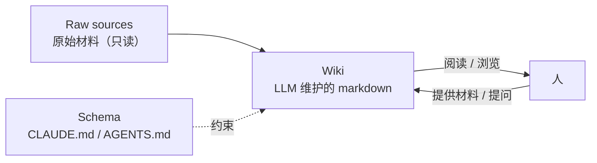

来源：Karpathy 的 gist *llm-wiki*。一句话：与其每次提问都从原始文档里 RAG 检索，不如让 LLM **增量维护一个持久的 markdown wiki**，知识编译一次、持续更新，而不是每次重新推导。

## RAG 的问题

- 上传一堆文件，查询时检索相关片段 → 生成答案。
- 每次都从零“重新发现”知识，**没有积累**。
- 问一个需要综合五份文档的问题，每次都要重新找、重新拼。

## 核心区别

| | RAG | 持久 wiki |
| --- | --- | --- |
| 产物 | 每次的答案 | 交错链接的 markdown 页面 |
| 积累 | 无 | 每加一份材料都更丰富 |
| 交叉引用 | 查询时临时建立 | 已经写好 |
| 矛盾 | 可能被忽略 | 已被标记 |

**wiki 是复利资产**：交叉引用、矛盾标记、综合结论都已存在，新问题直接站在已有综合之上。

角色分工：人负责选材料、探索、提问；LLM 负责总结、交叉引用、归档、记账。典型工作流是一边开 LLM agent、一边开 Obsidian —— “Obsidian 是 IDE，LLM 是程序员，wiki 是代码库”。

## 三层架构

1. **Raw sources**：精选的原始文档，**不可变**，是事实来源。
2. **Wiki**：LLM 生成的页面（摘要、实体页、概念页、对比、总览、综合），LLM 全权维护。
3. **Schema**：告诉 LLM wiki 如何组织、遵循什么约定、按什么流程摄取/回答/维护。关键配置文件，让 LLM 成为“守纪律的维护者”而非普通聊天机器人。

## 三个操作

### Ingest

新材料丢进 raw → LLM 读取 → 讨论要点 → 写摘要页 → 更新索引 → 更新相关实体/概念页 → 追加日志。**一份材料可能触及 10~15 个页面**。

### Query

针对 wiki 提问，LLM 检索页面、阅读、带引用地综合回答。输出形式可以多样：markdown、对比表、Marp 幻灯片、matplotlib 图。

关键：**好的回答要归档回 wiki**。临时做的对比、发现的联系，不该消失在聊天记录里。

### Lint

定期健康检查：

- 页面间矛盾；
- 被新来源推翻的过时结论；
- 没有入链的孤儿页；
- 反复提到却没有独立页面的概念；
- 缺失的交叉引用；
- 可以用搜索补上的数据空白。

## 两个特殊文件

| 文件 | 性质 | 作用 |
| --- | --- | --- |
| `index.md` | 内容导向 | 全站目录：链接 + 一句话摘要 + 元数据，按类别组织；每次 ingest 更新 |
| `log.md` | 时间导向 | 只追加的操作日志；固定前缀（如 `## [2026-04-02] ingest \| 标题`）可用 grep/tail 解析 |

查询时先读 index 找相关页，再深入。中等规模（约 100 份来源、数百页）用索引就够，不需要向量 RAG 基础设施。

## 工具

- **Obsidian Web Clipper**：网页 → markdown，快速进 raw。
- **附件本地化**：固定 attachment 目录 + 下载附件快捷键，避免外链失效；LLM 先读文本、再单独看图片。
- **Graph view**：看整体形状、找 hub 和孤儿页。
- **Marp**：markdown 做幻灯片。
- **Dataview**：查 frontmatter 生成动态表。
- **git**：wiki 就是 markdown 仓库，天然有版本历史。
- **qmd**：本地 markdown 搜索（BM25 + 向量 + LLM 重排），规模大了再上。

## 为什么可行

维护知识库最烦的不是读和想，而是**记账**：更新交叉引用、保持摘要最新、标记矛盾、维持几十页的一致性。人放弃 wiki 是因为维护成本增长快于价值。LLM 不会厌倦、不会漏更新，一次能改 15 个文件 —— **维护成本接近零**。

思想源头是 Vannevar Bush 1945 年的 Memex：私人、主动策展、文档间的关联和文档本身一样有价值。Bush 没解决“谁来维护”，LLM 补上了这一环。

## 与本 vault 的关系

这套结构与当前 Obsidian 库几乎同构：`Raw/`、`Captures/`、`Ref/`、`OfficialDocuments/` 是不可变来源层；各栏目笔记是 wiki 层；记忆里的笔记规范就是 schema。差别是本库还多了「主页/索引/进度」和人工确定的目录结构。
