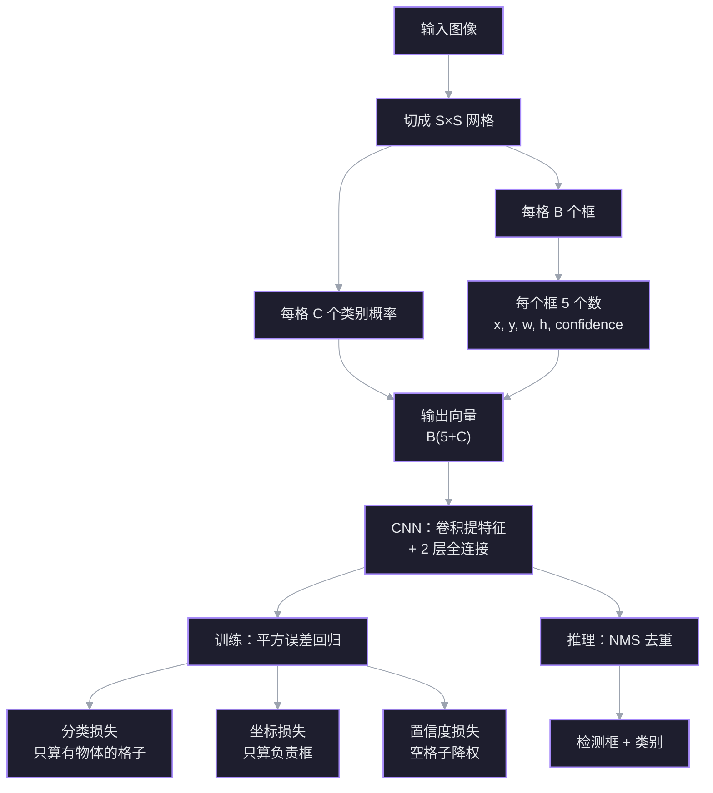

# YOLO 目标检测：一次前向的回归

一句话：把图像切成 $S\times S$ 网格，每个格子直接回归 $B$ 个框的坐标、置信度和 $C$ 个类别概率；整张图只过一次 CNN，检测问题被压成回归问题。

> 原文：[[How YOLO Object Detection Works]]（视频转录）

## 为什么是「只看一次」

| 方法 | 做法 | 代价 |
| --- | --- | --- |
| DPM | 用整物体和部件滤波器做滑动窗口，拼出置信度图 | 要扫很多窗口；物体部件齐全才判存在 |
| R-CNN | region proposal → CNN 提特征 → 每类一个 SVM | 三个模型通常分开训练；每张图要看很多区域 |
| YOLO | 整图一次前向，网格直接回归框和类别 | 精度不如最慢的模型，但实时性最好 |

YOLO 的定位不是「最准」，而是**实时检测里速度和精度的平衡点**。它快，不是因为网络更小，而是因为**每张图只过一遍网络**。

## 网格与输出向量

把输入图划成 $S\times S$ 个格子。物体中心落在哪个格子，就由哪个格子负责它。

每个格子输出两类东西：

1. $B$ 个边界框，每个框 5 个数：$x,y,w,h,\text{confidence}$；
2. $C$ 个类别概率，表示「如果这里有物体，它最可能是哪一类」。

所以每个格子的输出向量长度是：

$$
B(5+C)
$$

原论文取 $S=7$、$B=2$、$C=20$，每个格子输出 $2\times(5+20)=30$ 个数，整张图的输出是 $7\times7\times30$。

架构本身很朴素：一层层卷积把图像压成抽象特征，再接两层全连接，输出每个格子的向量。没有 region proposal，也没有单独的 SVM。

## 坐标怎么归一化

$x,y$ 是框中心**相对于所在格子左上角**的偏移，再除以格子的宽高；$w,h$ 除以**整张图**的宽高。这样四个数都落在 $[0,1]$。

例子：图 $70\times70$，网格 $7\times7$，所以每个格子 $10\times10$。框中心在整图坐标 $(16,44)$：

- 所在格子：$\lfloor16/10\rfloor=1$，$\lfloor44/10\rfloor=4$；
- 格子内偏移：$16\bmod10=6$，$44\bmod10=4$；
- 归一化中心：$x=6/10=0.6$，$y=4/10=0.4$；
- 若框宽 $20$ px、高 $30$ px：$w=20/70\approx0.286$，$h=30/70\approx0.429$。

## 训练目标

### 类别

正确类别的目标概率为 $1$，其余为 $0$。YOLO v1 假设类别互斥，所以每个格子只给一个类别；v3 之后才支持多标签。

### 置信度

置信度回答两个问题：「这里有没有物体？」以及「框得准不准？」。

- 有物体的格子：目标置信度 = 预测框与真实框的 IoU；
- 没有物体的格子：目标置信度 = $0$。

一个格子有 $B$ 个预测框，训练时只让**与真实框 IoU 最高**的那个框负责这个物体。这样不同的框会 specialization，分别擅长不同类别或长宽比。

### 推理时的 NMS

同一物体常被多个格子、多个框重复检出。非极大值抑制（NMS）：

1. 按置信度从高到低排序；
2. 取最高的框，删掉与它 IoU 超过阈值的其他框；
3. 重复，直到没有框可删。

## 损失函数：检测就是回归

YOLO 不用交叉熵，整份损失就是**平方误差**的和，分成四块：

$$
L=
\lambda_{\text{coord}}\sum_i\sum_j \mathbb{1}_{ij}^{\text{obj}}
\left[(x_i-\hat x_i)^2+(y_i-\hat y_i)^2+
(\sqrt{w_i}-\sqrt{\hat w_i})^2+
(\sqrt{h_i}-\sqrt{\hat h_i})^2\right]
$$
$$
+\sum_i\sum_j \mathbb{1}_{ij}^{\text{obj}}(C_{ij}-\hat C_{ij})^2
+\lambda_{\text{noobj}}\sum_i\sum_j \mathbb{1}_{ij}^{\text{noobj}}(C_{ij}-\hat C_{ij})^2
+\sum_i \mathbb{1}_i^{\text{obj}}\sum_c (p_i(c)-\hat p_i(c))^2
$$

| 项 | 算在哪些格子上 | 作用 |
| --- | --- | --- |
| 坐标损失 | 只有负责框 $\mathbb{1}_{ij}^{\text{obj}}$ | 学 $x,y,w,h$ |
| 物体置信度损失 | 只有负责框 | 学会说「这里有东西」 |
| 空格子置信度损失 | 没有物体的格子，乘 $\lambda_{\text{noobj}}$ | 学会说「这里没东西」 |
| 分类损失 | 只有有物体的格子 | 学类别 |

原论文取 $\lambda_{\text{coord}}=5$、$\lambda_{\text{noobj}}=0.5$。

**为什么用 $\sqrt{w},\sqrt{h}$？** 同样的绝对误差，在小框上更严重。直接用 $w,h$ 会让大框的误差主导损失；开方后大框的差异被压成次线性，小框的相对误差被放大，尺寸不同的框更平衡。

**为什么两个 $\lambda$？** 一张图里大多数格子是空的。如果一视同仁，置信度会被大量「0」拉向零，而坐标损失只在大少数有物体的格子上出现，会被淹没。所以空格子的置信度损失降权（$0.5$），坐标损失升权（$5$）。

## 局限（v1）

| 局限 | 原因 |
| --- | --- |
| 一个格子只能给一个类别 | 类别概率是每格一组，狗和自行车挤在同一格就冲突 |
| 一个格子只能出固定 $B$ 个框 | 拥挤场景里人数超过 $B$ 就漏 |
| 不擅长没见过的长宽比和奇怪配置 | 框的回归依赖训练分布 |
| 绝对坐标误差不随框大小缩放 | $\sqrt{w},\sqrt{h}$ 只是缓解，不是真正的尺度归一化 |
| 空格子远多于有物体的格子 | 用 $\lambda_{\text{noobj}}$ 和 $\lambda_{\text{coord}}$ 做重加权 |

## 一句话收尾

YOLO 的简洁性来自一个选择：**不把检测拆成「找候选区域 + 分类」，而是让网络在网格上直接回归框和类别**。代价是每格容量有限、尺度处理粗糙；收益是一次前向就能实时出结果。

## 关联笔记

- [[IoU 交并比 检测与分割的评价指标]] — 置信度目标和 NMS 都在用 IoU。
- [[N020 NDJSON数据集与YOLO姿态估计pose训练]] — Ultralytics YOLO 的实际训练流程。
- [[YOLO 导出 格式与量化]] — 训练完之后怎么导出 ONNX/TensorRT、怎么做 PTQ/QAT。
- [[曲线拟合的概率视角 最小二乘与正则化]] — 平方误差损失的另一条来路：高斯噪声下的最大似然。
