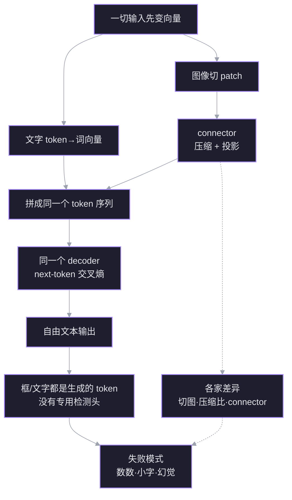

# 多模态模型如何看图像

一个没有 OCR、也没有检测头的模型，怎样“看见”图像、读出文字、输出框？答案不在某个隐藏模块里，而在一条统一管线：**图像变成向量，和文字向量拼进同一个序列，由同一个 Transformer 做下一 token 预测**。OCR 和检测是这条管线的产物，不是前置步骤。

## 管线



## 1 统一序列：视觉和文字凭什么同处一个 Transformer

**动机。** 你已经知道 ViT 把图切成 patch、每块投成一个向量；也知道 LLM 把词变成向量。剩下一个看似过不去的问题：图像向量和词向量是两种东西，LLM 凭什么能在同一个 Transformer 里处理它们？

**地基。** 两条无条件为真的事实：

1. 神经网络的每一层只做矩阵乘法、加权和、非线性。它不检查一个向量“来自词还是来自像素”；只要维度对得上，就能进同一个矩阵。
2. Transformer 的输入是一个向量序列 $X\in\mathbb{R}^{n\times d}$。self-attention 对序列里任意两个位置做同一套 $QK^\top$ 打分，不区分位置的来源。

**推导。** 设词向量维度是 $d$，ViT 输出 $m$ 个维度为 $d_v$ 的向量。若 $d_v=d$ 可直接拼；若不等，先用一个映射 $P:\mathbb{R}^{d_v}\to\mathbb{R}^d$ 把它们搬进同一空间。然后把视觉向量插在文本里的 `<image>` 占位处：

```text
文字:  [BOS] [IMG]  这  是  什  么  ？
向量:   e0   v1 … vm  e1  e2  e3  e4  e5
              ↑ 视觉 token 占据序列中的位置
       同一个序列 X ∈ R^{n×d}
```

$$
X=\big[e_{\text{BOS}},\;P(v_1),\ldots,P(v_m),\;e_{\text{这}},\ldots\big]
$$

此后 attention 的公式没有任何变化：

$$
\operatorname{Attn}(Q,K,V)=\operatorname{softmax}\!\left(\frac{QK^\top}{\sqrt d}\right)V
$$

“看见”因此有了精确含义：**后面的文字 token 在算 attention 时，能把前面的视觉 token 加权读进来**。不需要额外的“融合层”，也不需要把图像翻译成文字。图像只是序列里多出来的 $m$ 个位置。

**连接。** 这个节点是后面一切的地基：connector 节点解释 $P$ 怎么选、为什么要压缩；decoder 节点解释为什么同一个 next-token 目标能同时产出句子和框；OCR 节点解释“读字”为什么只是文字 token 在读视觉 token。反过来，如果图像没有进入同一序列，后面三条都无从谈起。

> [!question] 节点 1
> 一个纯文本 LLM 要接受图像输入，最小必要的改动是什么？
> A. 在 Transformer 里新增一个专门处理图像的注意力层
> B. 把图像变成与词向量同维度的向量序列，拼进输入序列
> C. 先用 OCR 或检测把图像转成文字，再送进 LLM
> D. 不知道

> [!success] ✓ 正确
> 最小改动就是 B：把视觉向量映射到词向量维度，插进同一个序列。A 会多出一个模块；C 是 OCR/检测流水线的思路，不是 LLM 内部发生的事。

## 2 connector：维度对齐只是下限，真正的工作是压缩

**动机。** 节点 1 说“用一个映射 $P$ 把视觉向量搬进词向量空间”。如果只是维度不匹配，一个线性层就够了。但真实系统里 connector 还要干第二件事：**减少 token 数**。为什么非压不可？

**地基。**

1. attention 的计算随序列长度增长，上下文窗口有限。视觉 token 多了，既吃显存，又挤占文字预算。
2. 逐 token 的线性层或 MLP 只改变每个向量的维度，**不改变向量的个数**。要减少个数，必须跨 token 合并或聚合。

**推导。** 设 ViT 输出 $m$ 个 $d_v$ 维向量。connector 有两个独立旋钮：

- **维度旋钮**：把 $d_v$ 投到 $d$。任何线性层都能做，和压缩无关。
- **数量旋钮**：把 $m$ 降到 $m'$。必须让多个视觉 token 的信息汇到一个 token 里。

主流做法：

| 做法 | 代表 | token 数 | 代价 |
|---|---|---|---|
| 逐 token MLP | LLaVA | 不变 | 不压缩，长图很贵 |
| pixel shuffle / space-to-depth | Qwen2.5-VL、InternVL、DeepSeek-VL2 | 降到 1/4 或 1/16 | 相邻 patch 被合并，细笔画受损 |
| resampler（可学习 query 做 cross-attention） | MiniCPM-V 4.5 | 固定 64/切片 | 信息瓶颈，小字容易丢 |
| 卷积下采样 | DeepSeek-OCR | 4096→256（Base） | 为文档单任务定制 |

**连接。** connector 是“视觉带宽旋钮”：给多少 token，决定模型能看清多少细节。节点 3 会看到，这些 token 进入同一个 decoder 后，输出形式由 next-token 目标决定；节点 5 的失败模式，很多可以在这里提前预测。

> [!question] 节点 2
> 为什么几乎所有 VLM 都要在视觉编码器后做 token 压缩？
> A. 视觉 token 太多会挤占上下文并推高 attention 成本
> B. 不压缩的话图像向量无法与词向量对齐维度
> C. 压缩是为了把图像转成文字
> D. 不知道
