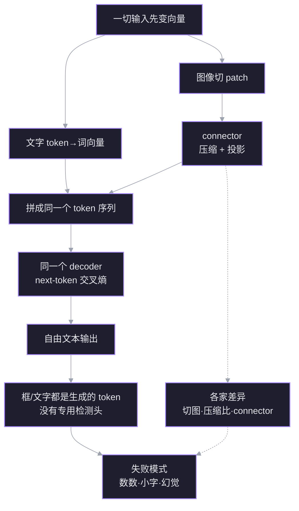

# 多模态模型如何看图像

一个没有 OCR、也没有检测头的模型，怎样“看见”图像、读出文字、输出框？答案不在某个隐藏模块里，而在一条统一管线：**图像变成向量，和文字向量拼进同一个序列，由同一个 Transformer 做下一 token 预测**。OCR 和检测是这条管线的产物，不是前置步骤。

## 管线



## 1 统一序列：视觉和文字凭什么同处一个 Transformer

**动机。** 你已经知道 ViT 把图切成 patch、每块投成一个向量；也知道 LLM 把词变成向量。剩下一个看似过不去的问题：图像向量和词向量是两种东西，LLM 凭什么能在同一个 Transformer 里处理它们？

**地基。** 两条无条件为真的事实：

1. 神经网络的每一层只做矩阵乘法、加权和、非线性。它不检查一个向量“来自词还是来自像素”；只要维度对得上，就能进同一个矩阵。
2. Transformer 的输入是一个向量序列 $X\in\mathbb{R}^{n\times d}$。self-attention 对序列里任意两个位置做同一套 $QK^\top$ 打分，不区分位置的来源。

**推导。** 设词向量维度是 $d$，ViT 输出 $m$ 个维度为 $d_v$ 的向量。若 $d_v=d$ 可直接拼；若不等，先用一个映射 $P:\mathbb{R}^{d_v}\to\mathbb{R}^d$ 把它们搬进同一空间。然后把视觉向量插在文本里的 `<image>` 占位处：

```text
文字:  [BOS] [IMG]  这  是  什  么  ？
向量:   e0   v1 … vm  e1  e2  e3  e4  e5
              ↑ 视觉 token 占据序列中的位置
       同一个序列 X ∈ R^{n×d}
```

$$
X=\big[e_{\text{BOS}},\;P(v_1),\ldots,P(v_m),\;e_{\text{这}},\ldots\big]
$$

此后 attention 的公式没有任何变化：

$$
\operatorname{Attn}(Q,K,V)=\operatorname{softmax}\!\left(\frac{QK^\top}{\sqrt d}\right)V
$$

“看见”因此有了精确含义：**后面的文字 token 在算 attention 时，能把前面的视觉 token 加权读进来**。不需要额外的“融合层”，也不需要把图像翻译成文字。图像只是序列里多出来的 $m$ 个位置。

**连接。** 这个节点是后面一切的地基：connector 节点解释 $P$ 怎么选、为什么要压缩；decoder 节点解释为什么同一个 next-token 目标能同时产出句子和框；OCR 节点解释“读字”为什么只是文字 token 在读视觉 token。反过来，如果图像没有进入同一序列，后面三条都无从谈起。

> [!question] 节点 1
> 一个纯文本 LLM 要接受图像输入，最小必要的改动是什么？
> A. 在 Transformer 里新增一个专门处理图像的注意力层
> B. 把图像变成与词向量同维度的向量序列，拼进输入序列
> C. 先用 OCR 或检测把图像转成文字，再送进 LLM
> D. 不知道

> [!success] ✓ 正确
> 最小改动就是 B：把视觉向量映射到词向量维度，插进同一个序列。A 会多出一个模块；C 是 OCR/检测流水线的思路，不是 LLM 内部发生的事。

## 2 connector：维度对齐只是下限，真正的工作是压缩

**动机。** 节点 1 说“用一个映射 $P$ 把视觉向量搬进词向量空间”。如果只是维度不匹配，一个线性层就够了。但真实系统里 connector 还要干第二件事：**减少 token 数**。为什么非压不可？

**地基。**

1. attention 的计算随序列长度增长，上下文窗口有限。视觉 token 多了，既吃显存，又挤占文字预算。
2. 逐 token 的线性层或 MLP 只改变每个向量的维度，**不改变向量的个数**。要减少个数，必须跨 token 合并或聚合。

**推导。** 设 ViT 输出 $m$ 个 $d_v$ 维向量。connector 有两个独立旋钮：

- **维度旋钮**：把 $d_v$ 投到 $d$。任何线性层都能做，和压缩无关。
- **数量旋钮**：把 $m$ 降到 $m'$。必须让多个视觉 token 的信息汇到一个 token 里。

主流做法：

| 做法 | 代表 | token 数 | 代价 |
|---|---|---|---|
| 逐 token MLP | LLaVA | 不变 | 不压缩，长图很贵 |
| pixel shuffle / space-to-depth | Qwen2.5-VL、InternVL、DeepSeek-VL2 | 降到 1/4 或 1/16 | 相邻 patch 被合并，细笔画受损 |
| resampler（可学习 query 做 cross-attention） | MiniCPM-V 4.5 | 固定 64/切片 | 信息瓶颈，小字容易丢 |
| 卷积下采样 | DeepSeek-OCR | 4096→256（Base） | 为文档单任务定制 |

**连接。** connector 是“视觉带宽旋钮”：给多少 token，决定模型能看清多少细节。节点 3 会看到，这些 token 进入同一个 decoder 后，输出形式由 next-token 目标决定；节点 5 的失败模式，很多可以在这里提前预测。

> [!question] 节点 2
> 为什么几乎所有 VLM 都要在视觉编码器后做 token 压缩？
> A. 视觉 token 太多会挤占上下文并推高 attention 成本
> B. 不压缩的话图像向量无法与词向量对齐维度
> C. 压缩是为了把图像转成文字
> D. 不知道

> [!success] ✓ 正确
> 压缩首先是带宽问题：token 多了挤上下文、推高 attention 成本。维度对齐是另一件事，线性层就能做。

## 3 同一个 decoder：句子、框、文字都是 next-token

**动机。** 视觉 token 已经进了序列。下一个问题：模型怎么知道什么时候该输出一句话、什么时候该输出框坐标？内部是不是切到了“检测模式”？

**地基。**

1. decoder-only Transformer 的输出永远是一个词表上的概率分布 $p(x_{t+1}\mid x_{\le t})$。
2. 交叉熵只要求“提高训练数据里那个下一个 token 的概率”，**不关心这个 token 是词、数字、坐标还是 `<box>` 标签**。

**推导。** 三类训练样本：

```text
VQA : 图 + “这是什么？”      → “一只猫”
OCR : 图 + “读出文字”        → “禁止停车”
检测: 图 + “框出猫”          → {"bbox_2d":[112,240,480,610]}
```

在模型看来，三者没有结构差别，都是 token 序列。损失是同一个：

$$
\mathcal{L}(\theta)=-\sum_t \log p_\theta\big(x_t \mid x_{<t}, V\big)
$$

$V$ 是视觉 token。没有单独的框回归头，坐标就是词表里的 token；模型从 grounding 数据里学坐标的分布。推理时采样或取 argmax，再把输出字符串解析成框。

| | YOLO | VLM |
|---|---|---|
| 输出 | 张量：框 + 类别 + 检测分数 | token 序列 |
| 损失 | 框回归 + 分类 + objectness | next-token 交叉熵 |
| 类别 | 固定集合 | 开放词表 |
| 置信度 | 检测分数（由检测损失训练） | token 概率，不是检测置信度 |
| 加新能力 | 改检测头/重训 | 换数据与提示，同一个头 |

关键结论：**“检测”在 VLM 里是一种输出格式，不是一种架构能力。** 也正因为没有任何几何约束，模型才会输出不存在的框——这直接通向节点 5 的幻觉。

> [!question] 节点 3
> Qwen2.5-VL 输出一个检测框时，训练损失是什么？
> A. 框坐标回归 + 类别分类（检测损失）
> B. 图文对比学习（CLIP 式）
> C. 下一个文本 token 的交叉熵
> D. 不知道

> [!success] ✓ 正确
> 损失就是 next-token 交叉熵。框坐标是词表里的数字 token，没有单独的框回归头；YOLO 式的检测损失在这里不存在。

## 4 证据：框、文字、版面到底长什么样

**动机。** 节点 3 说“框是 token”。这一节把三家开源模型的实际输出摊开，看这句话具体怎么落地。

**推导。** 同一件事（定位/读数）在不同模型里只是不同的 token 语法：

| 模型 | 输出格式 | 坐标口径 | 备注 |
|---|---|---|---|
| Qwen2.5-VL | `{"bbox_2d":[x1,y1,x2,y2]}` 或 `<\|box_start\|>(x1,y1),(x2,y2)<\|box_end\|>` | 重设尺寸后的绝对像素 | 格式随 checkpoint/工具链漂移 |
| InternVL 2.5/3 | `<ref>猫</ref><box>[[x1,y1,x2,y2]]</box>` | 归一化 0–1000 | 标签与框分开 |
| DeepSeek-OCR | Markdown / HTML / JSON / 纯文本 | 不输出框 | 版面结构由标签序列表达 |

三个推论：

1. **格式是学出来的，不是架构规定的。** 同一套 decoder，换一套训练数据就换一种语法；提示词格式对不上，解析就会失败。
2. **坐标是数字 token，不是连续回归量。** 模型逐位生成 “112”，再学它和图像位置的关系——比 YOLO 的连续回归更容易出现坐标偏差，而且没有检测分数可以衡量。
3. **DeepSeek-OCR 把“OCR”反过来用。** 它不检测文字框，而是把整页压成 256 个视觉 token，再生成文档文本。表格用 HTML 标签、阅读顺序靠序列位置——结构信息活在 token 序列里，不在框里。

**连接。** 到这里，“没有专用头”已经从原理落到证据。节点 5 用这套结构解释失败模式：为什么数数会错、小字会丢、框会幻觉。

> [!question] 节点 4
> DeepSeek-OCR 输出一张表格时，实际生成的是什么？
> A. 一个检测框加单元格坐标的 JSON
> B. 一段 Markdown/HTML 文本，表格结构由标签序列表达
> C. 一张重建的表格图片
> D. 不知道

> [!success] ✓ 正确
> DeepSeek-OCR 生成的是 Markdown/HTML 文本，表格结构由标签序列表达。它不输出框；版面信息活在生成的 token 序列里。

## 5 失败模式：从结构推出来，而不是背清单

**动机。** 如果前面四步真的理解了，失败模式应该能被**预测**，而不是记住一张“VLM 缺点”清单。

**推导。** 三个结构约束各自产生一类失败：

| 结构约束 | 预测的失败 | 证据 |
|---|---|---|
| 固定 token 预算 + 压缩 | 小字、密集表格、细笔画丢失 | 2×2 合并 / 16× 卷积；DeepSeek-OCR 10× 约 97%，20× 约 60% |
| 没有符号化中间表示 | 数数超过 4 个左右开始崩；精确空间关系接近随机 | BlindTest、Winoground |
| next-token 目标 + 无几何约束 | 物体幻觉；框可以凭空生成；token 概率不是检测置信度 | POPE |

**为什么 OCR 反而显得强。** 文字对比度高、重复性强，而且有语言先验兜底：视觉 token 给出字形线索，语言模型补全常用词。两路证据叠加，所以即使没有 OCR 模块也能读得不错；但密集小字仍然受 token 预算限制。

**连接。** 到这里整条链闭合：统一序列（节点 1）→ 压缩（节点 2）→ 同一目标（节点 3）→ 证据（节点 4）→ 可预测的失败（节点 5）。节点 6 把这条链压成一张对比图。

> [!question] 节点 5
> VLM 输出一个图中不存在的物体的框，最根本的原因是？
> A. 检测头发生故障
> B. 图像分辨率太高
> C. 框只是生成的 token，没有几何约束阻止它
> D. 不知道

> [!success] ✓ 正确
> 根因是 C：框只是生成的 token，没有任何几何约束阻止它。不是检测头“坏了”，而是根本没有检测头。

## 6 综合：一句话与一张图

**一句话。** 图像被编码成一串向量，和文字向量放进同一个序列，由同一个 Transformer 做 next-token 预测；OCR、检测、描述都只是这个过程的**输出格式**。

| 问题 | OCR 流水线 | YOLO | VLM |
|---|---|---|---|
| 输入表示 | 图像 → 文本区域 | 图像 → 特征图 | 图像 → patch 向量 → 视觉 token |
| 中间表示 | 检测框 + 字符序列 | 特征图 + 框 | 无符号中间表示，只有向量序列 |
| 输出头 | 检测头 + 识别头 | 检测头 | 语言模型头 |
| 训练目标 | 检测/识别损失 | 框回归 + 分类 | next-token 交叉熵 |
| 词表 | 固定字符集 | 固定类别集 | 开放词表 |

**“我”这一侧。** Anthropic 没有公开 Claude 的视觉编码器结构。能确认的是 API 行为：按官方文档的计费口径，大约每 28×28 像素折算 1 个 token，并有分辨率上限。所以准确说法是：我看到的不是“文字”或“框”，而是一串视觉 token；读字、定位、描述都由同一套 attention + next-token 机制产生。具体 encoder 是不是 ViT、patch 多大，未公开，不能假装知道。

**最终回答。** 视觉既不是 OCR，也不是 YOLO。OCR 和 YOLO 是两条专用的、带显式中间表示和专用输出头的流水线；VLM 把图像降维成 token，塞进语言模型的序列里，让“看图”变成“在包含视觉 token 的序列上做下一 token 预测”。读字和框是训练数据在这套通用机制上长出来的能力，不是预先装好的模块。

> [!question] 节点 6
> DeepSeek-OCR 和 Qwen2.5-VL 最本质的共同点是什么？
> A. 都有专门的 OCR 检测头
> B. 都用 resampler 压缩视觉 token
> C. 视觉 token 进入同一个 decoder，用 next-token 目标生成文本
> D. 不知道
