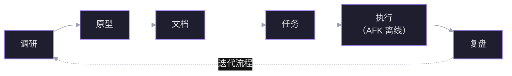

课程让你自建一套七阶段流程，实现阶段离线；环境只有五条命令，卡住先查网络。

## 立场

不要直接套 GSD、Spec Kit、BMAD 这类现成框架。流程要自己掌控、自己迭代，地基是真实工程技能。

## 七阶段

调研 → 原型 → 文档 → 任务 → 执行 → 复盘。只点名了六个，第七个后面补。



## AFK

实现阶段离开键盘，别盯着代理干活。前提是代码库足够健康——代理在好代码库里才稳定。

## 环境

2 万行 TypeScript + Node + React playground，不需要精通这些技术。

```bash
corepack enable
pnpm install
pnpm db:migrate
pnpm db:seed     # 只写 SQLite，不起网页
pnpm dev         # 5173
```

- `db:seed` 用固定 ID 插入、没有清空逻辑；重跑前先 `rm data.db`。
- 不要用肉眼看代码库，让代理去读。

## 排障

- 任何"没反应"先查网络：npm、git、扩展安装都栽在同一件事上。
- GitHub 不通时换镜像：`https://ghfast.top/https://github.com/...`；脚本写死原地址的，用 `pnpm exec ai-hero-cli ... --upstream=<镜像>` 绕开。
- 判断方法：`timeout 15 git ls-remote <url> HEAD` 无输出就是网络。
