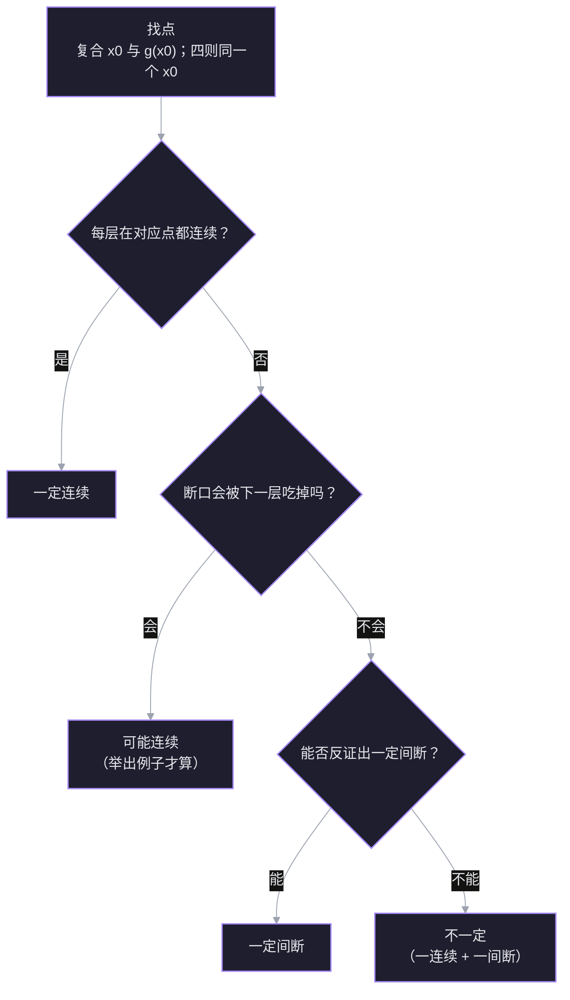

> 材料：[[【高数】看完起飞！连续与间断概念题，结论大盘点！]]（视频转录）

> [!info] 学习目标
> 不背结论表，而是能回答「为什么这条一定、那条不一定」，会造反例，做题时能准确找到该盯的点。

## 1. 起点：连续的定义

$f$ 在 $x_0$ 连续，意思是

$$
\lim_{x\to x_0}f(x)=f(x_0).
$$

这个等式同时要求三件事：$f(x_0)$ 有定义、极限存在、两者相等。等价地，左右极限都存在且都等于 $f(x_0)$：

$$
f(x_0^-)=f(x_0^+)=f(x_0).
$$

「间断」就是这三件事里有任何一件不成立。判断间断点时，左右极限是否相等、是否等于函数值，决定了它是可去、跳跃、无穷还是振荡。

> [!question] 函数 $f$ 在点 $x_0$ 处连续的定义是什么？
> - $\lim_{x\to x_0}f(x)$ 存在
> - $\lim_{x\to x_0}f(x)=f(x_0)$
> - $f(x_0)$ 有定义
> - 我不知道

> [!success] ✓ 正确
> 对。只有极限存在不够（可能极限值不等于函数值，这就是可去间断），只有函数值有定义更不够。连续要求两者相等，等价于左右极限都等于 $f(x_0)$。

## 2. 复合函数的盯点规则

设 $h(x)=f(g(x))$，要判断 $h$ 在 $x_0$ 处是否连续。输入是这样流动的：

$$
x\ \xrightarrow{\ g\ }\ u=g(x)\ \xrightarrow{\ f\ }\ y=f(u).
$$

所以两层在不同的坐标轴上检查：

- **内层 $g$ 的输入是 $x$**，连续性在 $x_0$ 处检查；
- **外层 $f$ 的输入是 $u$**，连续性在 $u_0=g(x_0)$ 处检查——不是 $x_0$。

这两个点通常不同。复合题最常见的错误就是把外层也拿到 $x_0$ 去看：$x_0$ 是 $x$ 轴上的坐标，$f$ 根本不认识它，$f$ 只认识 $u$ 轴上的 $u_0$。

例：$g(x)=x+1$，$f(u)=\dfrac{1}{u-1}$，则 $h(x)=\dfrac{1}{x}$。判断 $x_0=0$：

- $g$ 在 $0$ 连续，$u_0=g(0)=1$；
- 外层要看 $f$ 在 $u=1$ 处——那里是无穷间断，所以 $h$ 在 $x=0$ 间断。

若错误地去看 $f$ 在 $u=0$，会得到「外层连续」的假结论。

材料里的例子：$y=f(e^{x^4})$，$x_0=0$ 时 $u_0=e^0=1$，外层要看的是 $f$ 在 $1$ 处，而不是在 $0$ 处。

> [!question] $g(x)=x+1$，$f(u)=\dfrac{1}{u-1}$。判断 $h(x)=f(g(x))$ 在 $x=0$ 处连续，应该检查外层 $f$ 在哪个点？
> - $u=0$
> - $u=1$
> - 还是 $x=0$，和 $x_0$ 是同一个点
> - 我不知道

> [!success] ✓ 正确
> 对。$u_0=g(0)=1$，外层看 $f$ 在 $u=1$ 处；那里是无穷间断，所以 $h(x)=1/x$ 在 $x=0$ 间断。选 $u=0$ 就是踩了「把外层拿到 $x_0$ 去看」的坑。

![[viz-composite-continuity-two-points-1794667511792.svg|800]]

## 3. 两层都连续 ⇒ 复合连续

定理：若 $g$ 在 $x_0$ 连续，且 $f$ 在 $u_0=g(x_0)$ 连续，则 $h=f\circ g$ 在 $x_0$ 连续。

证明就是把两个定义接起来：

- 内层连续：$x\to x_0$ 时 $u=g(x)\to g(x_0)=u_0$；
- 外层连续：$u\to u_0$ 时 $f(u)\to f(u_0)$。

第一条说「$u$ 会被送到 $u_0$」，第二条说「到了 $u_0$，$f$ 的值就落到 $f(u_0)$」。把第一条的输出喂给第二条：

$$
x\to x_0\ \Longrightarrow\ g(x)\to u_0\ \Longrightarrow\ f(g(x))\to f(u_0)=f(g(x_0))=h(x_0).
$$

这正是 $h$ 在 $x_0$ 连续的定义。两条连续性各负责链条的一节，缺一节就接不上——这就是下一节「不一定」的来源。

> [!question] 已知 $h(x)=f(g(x))$ 在 $x_0$ 连续。能推出 $g$ 在 $x_0$ 连续吗？
> - 能，内层必须连续，否则复合不可能连续
> - 不能，例如外层是常数函数，$g$ 怎么断都会被压平
> - 不能，因为 $h$ 连续与 $g$ 是否连续无关
> - 我不知道

> [!success] ✓ 正确
> 对。外层若是常数函数，复合恒为常数，无论内层怎么断都连续——所以定理的逆命题不成立。注意第三个选项的理由不对：$h$ 连续与 $g$ 是否连续并非「无关」，在 $f$ 可逆且连续的局部，$g$ 的连续性反而能被 $h$ 逼出来；只是不能无条件推。

## 4. 有一层间断：为什么结论变成「不一定」

链条断了一节，不等于输出一定断——断口可能被下一层「吃掉」。所以每种情况都要造两个例子：一个连续、一个间断。

### 4.1 内层断、外层连续

- **外层还「活着」**：内层从两侧输出 $1$ 与 $-1$，外层分别给出 $1.5$ 与 $-0.5$，复合在 $x_0$ 两侧取不同的值 → 间断。
- **外层「躺平」**：外层对 $1$ 与 $-1$ 都给 $1.5$（例如常数函数 $f\equiv1.5$），内层跳得再厉害，输出恒定 → 连续。

所以内层的跳变能不能传出去，取决于外层在「内层两侧的输出值」上是否给出同一个结果。

### 4.2 外层断、内层连续

- **内层「跨过」断点**：$g(x)=x-1$ 在 $x=1$ 两侧取到 $u=0$ 的两边，外层 $f(u)=\operatorname{sign}(u)$ 把正负变成 $\pm1$，复合在 $x=1$ 处跳跃 → 间断。
- **内层「不跨」**：$g(x)=x^2\ge0$ 始终落在 $u=0$ 的同一侧。若外层在这侧取常值（$f(u)=1$ 当 $u\ge0$，$-1$ 当 $u<0$），复合恒为 $1$ → 连续。若外层是标准 $\operatorname{sign}$（$f(0)=0$），复合在 $0$ 处极限为 $1$、函数值为 $0$，是可去间断——把 $f(0)$ 改成 $1$ 就补上了。

所以外层的断点能不能被「看见」，取决于内层有没有把 $u$ 送到断点的两边。

### 4.3 两层都断

- 若内层的两个输出值恰好落在外层「取同一个值」的两个点上，复合也能连续。例：$g$ 在 $0$ 两侧取 $0$ 与 $1$，$f$ 在 $u=0,1$ 都取 $0$、其余取 $1$，则复合恒为 $0$。
- 若落在外层不同的值上，就继续间断。

### 4.4 第二类间断：振荡

内层是无穷间断（如 $g(x)=1/x$，在 $0$ 处补定义），外层连续（如 $\sin$）：$u\to\infty$ 时 $\sin u$ 在 $-1$ 与 $1$ 之间反复震荡，复合通常是振荡型间断。这里的直觉是：内层的输出跑向无穷，外层永远等不到一个稳定的 $u_0$。

**方法**：否定「一定」只需两个例子（一个连续、一个间断）；肯定「一定」用反证。

> [!question] 内层 $g$ 在 $x_0$ 间断、外层 $f$ 在 $u_0=g(x_0)$ 连续。下面哪种情况复合仍可能连续？
> - $g$ 的左右极限都存在（第一类间断）
> - $g$ 从两侧输出的值，经 $f$ 之后落在同一个数
> - $f$ 在 $u_0$ 处可导
> - 我不知道

> [!success] ✓ 正确
> 对。连续的外层会把「两个不同的输入」映成「同一个输出」——跳变在到达 $y$ 轴之前就被抹平了。左右极限都存在不够：跳跃间断照样能传出去（4.2 的 $\operatorname{sign}(x-1)$ 就是）；外层可导也帮不上忙，它只影响 $u_0$ 附近的光滑程度，不影响内层是否跨过断点。

## 5. 四则运算：哪些「一定」

这里不再有内外层，$f$ 与 $g$ 平等地在同一点 $x_0$ 上运算。结论分三类。

### 5.1 一定连续

由极限的四则运算法则直接得到：

- 连续 $\pm$ 连续 $=$ 连续；
- 连续 $\times$ 连续 $=$ 连续；
- 连续 $\div$ 连续 $=$ 连续，前提是分母在 $x_0$ 处不为 $0$。

### 5.2 一定间断

这几条都用**反证**：假设结果连续，把间断的那一项解出来，得到矛盾。

- **连续 $\pm$ 间断 $=$ 一定间断。** 若 $f+g$ 连续，则 $g=(f+g)-f$ 是两个连续函数之差，必连续，与 $g$ 间断矛盾。
- **连续（非零）$\times$ 间断 $=$ 一定间断。** 若 $f(x_0)\ne0$，则 $1/f$ 在 $x_0$ 附近连续；若 $fg$ 连续，则 $g=(fg)\cdot(1/f)$ 连续，矛盾。非零这个条件是关键。
- **间断 $\div$ 连续（分母非零）$=$ 一定间断。** 若 $g/f$ 连续，则 $g=f\cdot(g/f)$ 连续，矛盾。
- **连续（分子非零）$\div$ 间断 $=$ 一定间断。** 若 $f(x_0)\ne0$、$g(x_0)\ne0$，且 $f/g$ 连续，则 $g=f/(f/g)$ 连续，矛盾。

### 5.3 不一定

- **间断 $\pm$ 间断**：$\operatorname{sign}(x)+(-\operatorname{sign}(x))\equiv0$，连续；两个跳跃方向相同的间断相加，仍然间断。
- **间断 $\times$ 间断**：$f(x)=1\ (x>0),\ 0\ (x<0)$ 与 $g(x)=0\ (x>0),\ 1\ (x<0)$ 都在 $0$ 处间断，但 $fg\equiv0$ 连续。
- **连续 $\times$ 间断，但连续项在该点取 $0$**：$f(x)=x$，$g(x)=\operatorname{sign}(x)$，则 $fg=|x|$ 连续。
- **连续（分子取 $0$）$\div$ 间断**：同样 $f(x)=x$ 除以 $g(x)=\operatorname{sign}(x)$（$g(0)=1$），得到 $|x|$，连续。
- **取绝对值或平方**：$g=\operatorname{sign}$ 间断，但 $|g|\equiv1$、$g^2\equiv1$ 都连续；若断点两侧的值不是相反数（如 $2$ 与 $-1$），取绝对值后变成 $2$ 与 $1$，仍然间断。

一句话记法：**「一定间断」都靠反证，而且都要一个非零条件；「不一定」都靠零因子、相消或翻折把差距抹平。**

> [!question] $f$ 在 $x_0$ 连续且 $f(x_0)\ne0$，$g$ 在 $x_0$ 间断。为什么 $f\cdot g$ 一定间断？
> - 若 $fg$ 连续，则 $g=(fg)\cdot(1/f)$ 连续，与 $g$ 间断矛盾
> - 因为非零的连续函数会把间断放大
> - 因为 $f(x_0)\ne0$ 说明 $f$ 在 $x_0$ 附近没有零点
> - 我不知道

> [!success] ✓ 正确
> 对。这条「一定」的本质是：非零连续因子可以**除掉**，于是 $g$ 被还原成连续函数的乘积，矛盾。第三个选项只说明了 $1/f$ 能定义，没有把它和矛盾接上。

## 6. 做题流程

遇到这类题，按四步走：

1. **找点。** 复合：内层看 $x_0$，外层看 $u_0=g(x_0)$；四则：两个函数都看同一个 $x_0$。
2. **判每层。** 各自在该点是连续，还是哪一类间断（可去 / 跳跃 / 无穷 / 振荡）。
3. **追链条。** 复合看内层两侧的输出经外层是否同值、内层是否跨过断点；四则看有没有非零条件、能不能相消或零因子。
4. **落结论。** 三种：一定连续、一定间断（用反证）、不一定（举一个连续、一个间断的例子）。

## 7. 术语

| 英文 | 中文 | 含义 |
| --- | --- | --- |
| continuity at a point | 点连续 | $\lim_{x\to x_0}f(x)=f(x_0)$ |
| one-sided limit | 单侧极限 | $x\to x_0^+$ 或 $x\to x_0^-$ |
| removable discontinuity | 可去间断 | 极限存在但不等于函数值 |
| jump discontinuity | 跳跃间断 | 左右极限存在但不相等 |
| infinite discontinuity | 无穷间断 | 至少一侧极限为无穷 |
| oscillatory discontinuity | 振荡间断 | 极限不存在且不趋于无穷，如 $\sin(1/x)$ |
| composition | 复合 | $h(x)=f(g(x))$ |
| counterexample | 反例 | 证明「不一定」时各举一个 |

## 8. 总结

- 复合先找两个点：内层看 $x_0$，外层看 $g(x_0)$；两层都连续才保证复合连续。
- 有一层断，结论是「不一定」：内层的跳变能否传出去，看外层是否把两侧输出映成同一个值；外层的断点能否被看见，看内层是否跨过它。
- 四则里「一定间断」都要一个非零条件，证明一律反证；「不一定」靠零因子、相消、取绝对值或平方抹平差距。
- 做题流程：找点 → 判层 → 追链条 → 落结论；「不一定」必须给出两个方向的具体例子。

> [!question] $h(x)=\operatorname{sign}(x)\cdot x^2$ 在 $x=0$ 处连续吗？
> - 一定间断，因为 $\operatorname{sign}$ 在 $0$ 处间断
> - 连续，因为连续因子 $x^2$ 在 $0$ 处取 $0$
> - 不一定，要看 $x$ 从哪边趋近
> - 我不知道

> [!question] 不知道：$\operatorname{sign}$ 是什么
> $\operatorname{sign}(x)$ 是符号函数：$x>0$ 取 $1$，$x<0$ 取 $-1$，$x=0$ 取 $0$。它在 $0$ 处跳跃间断。
>
> 本题 $x^2\ge0$，于是 $h(x)=x^2$（$x>0$）、$h(0)=0$、$h(x)=-x^2$（$x<0$），即 $h(x)=x|x|$。因为 $|h(x)|=x^2\to0=h(0)$，所以 $h$ 在 $0$ 处连续——连续因子取 $0$，把跳跃压平了。

> [!success] ✓ 正确
> 对。$|h(x)|=x^2\to0$，两侧都被压到 $0$；又 $h(0)=0$，极限值等于函数值，所以连续。
