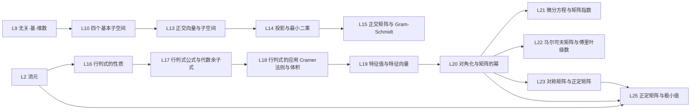

课程：MIT 18.06 Linear Algebra（Gilbert Strang, OCW）。

## 课程材料

- [[Linear Algebra/STDY/STDY|STDY]] — L1~L23、L25 知识点（L24 待补）+ 专题笔记 [[马尔可夫链]]、[[线性规划与单纯形法]]
- [[Linear Algebra/Ref/Ref|Ref · 原始材料索引]] — 18.06 字幕（lecture 1~27）、18.06SC 习题课、3b1b 系列、数学不难、专题视频，按类目列出
- 当前主线材料：lecture 23 [[23. Differential Equations and exp(At)]] 与习题课 [[Differential Equations and exp (At)]]；lecture 24 [[24. Markov Matrices; Fourier Series]] 与习题课 [[Markov Matrices]]；lecture 25 [[25. Symmetric Matrices and Positive Definiteness]] 与习题课 [[Symmetric Matrices and Positive Definiteness]]；lecture 27 [[27. Positive Definite Matrices and Minima]] 与习题课 [[Positive Definite Matrices and Minima]]
- [[Linear Algebra/Assignments/Assignments|Assignments]] — 题目类内容
- [[Linear Algebra/Exam|Exam]] — PDF 讲义知识点清单与未覆盖项；[[Linear Algebra/Concentrated|Concentrated]] — 已学定理与性质分类汇编

## 待整理原始材料

- [[13. Quiz 1 Review]] · [[Exam 1 Problem Solving]] — 复习与习题课材料，暂不单独成笔记
- 数学不难 11 特征值分解、12 PCA — 已用于 [[L20 对角化与矩阵的幂]] 的数据图景；13.1 二次型 — 已用于 [[L25 正定矩阵与极小值]] 的几何部分
- [[Eigenvectors Are Hiding Something Nobody Talks About!]] — 特征值/对角化/PCA/PageRank 专题视频；已用于 L20 的耦合振子、PCA、PageRank 三个图景
- [[Matrix trace isn't just summing the diagonal  Lie groups, algebras, brackets 5]] — 迹的几何直观与李代数；已用于 [[L19 特征值与特征向量]] 的「迹的几何意义：散度」
- [[The Single Most Undervalued Fact of Linear Algebra]] — 矩阵即图、强连通分量与 Frobenius 标准形；已用于 [[L12 图·网络·关联矩阵]] 的补充一节
- [[Differential Equations and exp (At)]] — 18.06SC 习题课，三阶方程与矩阵指数第一列；已用于 [[L21 微分方程与矩阵指数]]
- [[24. Markov Matrices; Fourier Series]] — lecture 24 字幕；已整理为 [[L22 马尔可夫矩阵与傅里叶级数]]
- [[Markov Matrices]] — 18.06SC 习题课，两状态粒子、$A^n$ 与平稳分布；已并入 [[L22 马尔可夫矩阵与傅里叶级数]]
- [[How Markov Chain Monte Carlo Finds the Impossible]] — Metropolis–Hastings 与细致平衡；已作为 L22 的延伸一节

## 笔记链接

- [[L1 线性方程的几何]] — 行图像 vs 列图像；线性组合能否到达 $b$，奇异判定。
- [[L2 消元]] — 消元、主元与回代；消元矩阵 $E$、置换 $P$、RREF。
- [[L3 矩阵乘法与逆]] — 矩阵乘法五种视角；逆、奇异判据、Gauss-Jordan。
- [[L4 A=LU 分解]] — $A=LU$、乘数账本、$n^3/3$、$PA=LU$。
- [[L5 转置·置换·向量空间]] — 置换、转置、对称；向量空间与列空间。
- [[L6 列空间与零空间]] — 可解性与子空间的两种描述。
- [[L7 求解Ax=0主变量与特解]] — 零空间算法；主元/自由变量、特解、$[-F;I]$。
- [[L8 求解Ax=b]] — 增广消元；通解 = 特解 + 零空间；秩的四种情形。
- [[L9 线性无关·基·维数]] — 无关、张成、基、维数。
- [[L10 四个基本子空间]] — 维数 $r,r,n-r,m-r$；正交补；矩阵空间；$B=LU$ 习题课。
- [[L11 矩阵空间·秩1·小世界图]] — 矩阵与函数当向量；秩 1 积木；图与小世界；矩阵空间判定习题课。
- [[L12 图·网络·关联矩阵]] — 等电位、KCL、树、回路、欧拉公式、拉普拉斯矩阵；补充邻接矩阵、强连通分量与 Frobenius 标准形；读图习题课。
- [[L13 正交向量与子空间]] — 点积判正交、勾股定理、子空间正交、四个基本子空间的正交补、$A^{\mathsf T}A$ 的秩与可逆性。
- [[L14 投影与最小二乘]] — 投影到直线/子空间、投影矩阵、正规方程、拟合直线、误差正交与最小性。
- [[L15 正交矩阵与 Gram-Schmidt]] — $Q^{\mathsf T}Q=I$、$Q^{\mathsf T}=Q^{-1}$、$P=QQ^{\mathsf T}$、$\hat x=Q^{\mathsf T}b$、Gram-Schmidt、$A=QR$。
- [[L16 行列式的性质]] — 三条定义性质推出十条、消元求行列式、四道习题、斜对称矩阵补充。
- [[L17 行列式公式与代数余子式]] — 大公式与 $n!$ 个置换项、余子式展开与棋盘符号、行差列和数例、三对角递推、三种公式对照。
- [[L18 行列式的应用 Cramer法则与体积]] — 伴随矩阵求逆、Cramer 法则的体积比解释与灵敏度、行列式=体积、四面体数例。
- [[L19 特征值与特征向量]] — $Ax=\lambda x$、特征方程与零空间、迹/行列式不变量、迹=散度、运算规则、复特征值、代数/几何重数。
- [[L20 对角化与矩阵的幂]] — $A=S\Lambda S^{-1}$、$A^k=S\Lambda^kS^{-1}$、差分方程与 Fibonacci、特征基换坐标的解耦视角、耦合振子/PCA/PageRank 三个图景、Jordan 形。
- [[L21 微分方程与矩阵指数]] — $u'=Au$、纯指数解、$e^{At}=Se^{\Lambda t}S^{-1}$、稳定性与左半平面、迹/行列式判据、高阶方程转 companion 矩阵、三阶数例。
- [[L22 马尔可夫矩阵与傅里叶级数]] — 列和为 $1$ → $\lambda=1$；$A-I$ 奇异给出平稳分布；其余特征值 $|\lambda_i|\le1$ 决定收敛；加州/马萨诸塞与两状态粒子两例；正交基展开 $x_i=q_i^{\mathsf T}v$；Fourier 级数的积分公式；MCMC 延伸（细致平衡、burn-in、多峰陷阱）。
- [[L23 对称矩阵与正定矩阵]] — 实特征值与正交特征基、谱定理 $A=Q\Lambda Q^{\mathsf T}$、投影叠加/主轴定理、主元符号=特征值符号、正定四判据、$A^{\mathsf T}A$ 与列满秩、习题课四证。
- [[L24 复矩阵与快速傅里叶变换]] — 暂跳待补（lecture 26）；Hermitian/酉矩阵、傅里叶矩阵、FFT。
- [[L25 正定矩阵与极小值]] — 四种判别法（能量/特征值/主元/顺序主子式）、配方=消元、碗与马鞍、椭圆主轴、Hessian 与极小值、三对角与参数 $c$ 数例。
- [[马尔可夫链]] — 链的随机过程视角：无记忆性、转移矩阵=马尔可夫矩阵、平稳分布、MCMC/PageRank/LLM 三个应用；与 L22 互补。
- [[线性规划与单纯形法]] — LP 三要素、可行域与顶点、单纯形法角到角、凸性保证全局最优、影子价格与对偶。

## 命题速查

一条命题一行，`→` 是推理方向，末尾是落点；复习时先扫这一节，卡住再点进笔记。

- 行图像 vs 列图像 → 解方程就是问「$b$ 是不是列的线性组合」。[[L1 线性方程的几何]]
- 消元 = 主元 + 回代；矩阵语言 $A=LU$，换行用 $P$ 记账。[[L2 消元]] [[L4 A=LU 分解]]
- 可逆 ⟺ 消元不出现零行 ⟺ $\det A\ne0$。[[L3 矩阵乘法与逆]] [[L16 行列式的性质]]
- 向量空间 = 对加法与数乘封闭；$A$ 的四空间维数 $r,r,n-r,m-r$。[[L5 转置·置换·向量空间]] [[L10 四个基本子空间]]
- $Ax=b$ 可解 ⟺ $b\in C(A)$；通解 = 特解 + $N(A)$。[[L6 列空间与零空间]] [[L8 求解Ax=b]]
- 无关 + 张成 = 基；维数 = 基的大小。[[L9 线性无关·基·维数]]
- 行空间 ⟂ 零空间、列空间 ⟂ 左零空间，且互为正交补。[[L13 正交向量与子空间]]
- 列线性无关 ⟺ $A^{\mathsf T}A$ 可逆（$N(A^{\mathsf T}A)=N(A)$）。[[L13 正交向量与子空间]]
- 无解时投到列空间，误差 ⟂ $C(A)$ → 正规方程 $A^{\mathsf T}A\hat x=A^{\mathsf T}b$。[[L14 投影与最小二乘]]
- $P=A(A^{\mathsf T}A)^{-1}A^{\mathsf T}$ 对称、幂等；$I-P$ 投到左零空间。[[L14 投影与最小二乘]]
- 列标准正交 $Q^{\mathsf T}Q=I$ → $P=QQ^{\mathsf T}$，$\hat x=Q^{\mathsf T}b$，免求逆。[[L15 正交矩阵与 Gram-Schmidt]]
- Gram-Schmidt = 逐个减掉已有方向上的投影，最后归一化。[[L15 正交矩阵与 Gram-Schmidt]]
- $A=QR$ 且 $R$ 上三角（第 $j$ 列只由前 $j$ 个 $q$ 组成）→ 最小二乘改回代 $R\hat x=Q^{\mathsf T}b$。[[L15 正交矩阵与 Gram-Schmidt]]
- 行列式 = 有向体积；三条定义性质推出其余七条。[[L16 行列式的性质]]
- $\det=0\iff$ 奇异；消元后主元连乘，再乘 $(-1)^{换行次数}$。[[L16 行列式的性质]]
- $\det(AB)=\det A\det B$、$\det A^{\mathsf T}=\det A$、$\det(cA)=c^n\det A$；斜对称矩阵奇数阶行列式为零。[[L16 行列式的性质]]
- 大公式 = $n!$ 个置换项；余子式展开 = 沿一行/列降阶；一般计算用消元主元连乘。[[L17 行列式公式与代数余子式]]
- $A^{-1}=\operatorname{adj}A/\det A$；Cramer $x_j=\det A_j/\det A$，几何上是体积比。[[L18 行列式的应用 Cramer法则与体积]]
- $|\det A|$ = 平行体体积；线性变换把体积放大 $|\det A|$ 倍（Jacobian 的来源）。[[L18 行列式的应用 Cramer法则与体积]]
- $Ax=\lambda x$：先解 $\det(A-\lambda I)=0$ 得 $\lambda$，再解零空间得 $x$。[[L19 特征值与特征向量]]
- $\sum\lambda_i=\operatorname{tr}A$，$\prod\lambda_i=\det A$；三角矩阵特征值在对角线上。[[L19 特征值与特征向量]]
- $\operatorname{tr}A$ = 向量场 $x\mapsto Ax$ 的散度 = 单位体积的瞬时相对膨胀率；$\det(e^{At})=e^{t\operatorname{tr}A}$。[[L19 特征值与特征向量]]
- $A=S\Lambda S^{-1}$ 当且仅当有 $n$ 个线性无关特征向量；重根看几何重数。[[L20 对角化与矩阵的幂]]
- $A^k=S\Lambda^kS^{-1}$；差分方程 $u_{k+1}=Au_k$ 的解 $u_k=\sum_i c_i\lambda_i^kx_i$，长期由主导特征值决定。[[L20 对角化与矩阵的幂]]
- 耦合振子、PCA、PageRank 在特征基下分别变成独立振型、主方向、平稳分布：同一个对角化结构换了三套衣服。[[L20 对角化与矩阵的幂]]
- $u'=Au$ 的解 $u(t)=e^{At}u_0=Se^{\Lambda t}S^{-1}u_0$；每个模式按 $e^{\lambda_i t}$ 独立演化。[[L21 微分方程与矩阵指数]]
- $e^{At}\to0$ ⟺ 所有 $\operatorname{Re}\lambda_i<0$；$2\times2$ 时等价于 $\operatorname{tr}A<0$ 且 $\det A>0$。[[L21 微分方程与矩阵指数]]
- 高阶常系数方程用 companion 矩阵化成一阶系统，特征多项式不变；解方程 = 求特征值。[[L21 微分方程与矩阵指数]]
- 马尔可夫矩阵：元素非负、列和为 $1$ → $A^{\mathsf T}\mathbf 1=\mathbf 1$ → $A-I$ 奇异 → $\lambda=1$；对应特征向量就是平稳分布。[[L22 马尔可夫矩阵与傅里叶级数]]
- $u_k=\sum_i c_i\lambda_i^kx_i$；$|\lambda_i|\le1$，本原时其余严格小于 $1$，所以 $u_k\to c_1x_1$，$c_1$ 由总量守恒定出。[[L22 马尔可夫矩阵与傅里叶级数]]
- 标准正交基展开 $v=\sum x_iq_i$ → $x_i=q_i^{\mathsf T}v$；矩阵形式 $x=Q^{\mathsf T}v$。[[L22 马尔可夫矩阵与傅里叶级数]] [[L15 正交矩阵与 Gram-Schmidt]]
- Fourier 级数 = 函数空间的正交基展开；内积换成积分，系数 $a_n=\frac1\pi\int_0^{2\pi}f\cos nx\,dx$。[[L22 马尔可夫矩阵与傅里叶级数]]
- MCMC：构造平稳分布为目标分布的链，接受率 $\min(1,w'/w)$ 让归一化常数 $Z$ 在比值中消掉；细致平衡保证收敛。[[L22 马尔可夫矩阵与傅里叶级数]]
- 实对称矩阵：特征值全实、特征向量可选为标准正交；$A=Q\Lambda Q^{\mathsf T}$，$Q^{\mathsf T}=Q^{-1}$。[[L23 对称矩阵与正定矩阵]]
- 谱分解 $A=\sum_i\lambda_iq_iq_i^{\mathsf T}$：对称矩阵 = 沿正交轴的投影叠加，也就是主轴定理。[[L23 对称矩阵与正定矩阵]]
- 对称矩阵的正主元个数 = 正特征值个数；主元符号给出惯性，乘积都等于 $\det A$。[[L23 对称矩阵与正定矩阵]]
- 正定四判据：$x^{\mathsf T}Ax>0$（$x\ne0$）$\iff$ 特征值全正 $\iff$ 主元全正 $\iff$ 顺序主子式全正。[[L23 对称矩阵与正定矩阵]] [[L25 正定矩阵与极小值]]
- 正定 ⇒ 可逆；$A^{\mathsf T}A$ 正定 $\iff$ $A$ 列满秩。[[L23 对称矩阵与正定矩阵]]
- $\det A>0$ 不足以判定正定，必须检查所有顺序主子式；对角元为负即可一票否决。[[L23 对称矩阵与正定矩阵]]
- 邻接矩阵把有向图装进线性代数；节点重编号 = $P^{\mathsf T}AP$，按 SCC 排序后得到块上三角与 Frobenius 标准形。[[L12 图·网络·关联矩阵]]
- $A$ 正定 ⟺ $x^{\mathsf T}Ax>0\ (x\ne0)$ ⟺ 特征值全正 ⟺ 主元全正 ⟺ 顺序主子式全正；四个测试是同一件事的四种视角。[[L25 正定矩阵与极小值]]
- 配方就是消元：$x^{\mathsf T}Ax=(L^{\mathsf T}x)^{\mathsf T}D(L^{\mathsf T}x)=\sum p_i(\text{线性式}_i)^2$，主元在平方外、乘数在平方内；$D_k=p_1\cdots p_k$ 让行列式测试与主元测试必然一致。[[L25 正定矩阵与极小值]]
- 正定的几何：曲面是开口向上的碗、原点为严格极小、等高线是椭圆/椭球；主轴方向 = 特征向量，半轴长 $1/\sqrt{\lambda_i}$（$A=Q\Lambda Q^{\mathsf T}$）。[[L25 正定矩阵与极小值]]
- 多元极小：$\nabla f=0$ 只是驻点，Hessian 正定才是严格极小；二变量判据 $f_{xx}>0,\ f_{xx}f_{yy}>f_{xy}^2$ 就是顺序主子式。[[L25 正定矩阵与极小值]]
- $A^{\mathsf T}A$ 正定 ⟺ $A$ 列满秩 → 正规方程唯一解；正定 ⇒ Cholesky $A=LL^{\mathsf T}$。[[L25 正定矩阵与极小值]]
- 马尔可夫链：$P(X_{n+1}\mid X_n,\dots,X_0)=P(X_{n+1}\mid X_n)$，无记忆；转移矩阵列和为 $1$ = 马尔可夫矩阵；平稳分布 = $\lambda=1$ 特征向量。[[马尔可夫链]] [[L22 马尔可夫矩阵与傅里叶级数]]
- 同一个马尔可夫骨架三种穿法：过程（链）、代数（矩阵）、应用（MCMC/PageRank/LLM）。[[马尔可夫链]]
- LP = 线性目标 + 线性约束；最优解在可行域顶点上。[[线性规划与单纯形法]]
- 单纯形法沿边从角到角，靠 reduced cost 判方向；凸可行域 + 线性目标 ⇒ 无改善边 = 全局最优。[[线性规划与单纯形法]]
- 约束影子价格 = 对偶变量：多一单位资源目标能改善多少。[[线性规划与单纯形法]]

## 依赖图

## 当前进度

- 2026-11-04：新建专题笔记 [[马尔可夫链]]（链的随机过程视角 + MCMC/PageRank/LLM）与 [[线性规划与单纯形法]]（Simplex 视频转写），同步 STDY、Ref、Inbox、Concentrated。
- 2026-11-03：L23 对称矩阵与正定矩阵补写完成（lecture 25 + 18.06SC 习题课）：实特征值与正交特征基、谱定理 $A=Q\Lambda Q^{\mathsf T}$、投影叠加/主轴定理、主元符号=特征值符号、正定四判据与两个 $2\times2$ 例子、$A^{\mathsf T}A$ 与列满秩。
- 2026-11-03：L22 马尔可夫矩阵与傅里叶级数补写完成（lecture 24 + 18.06SC 习题课；延伸整理 MCMC 视频）：$\lambda=1$ 与平稳分布、收敛速度、两个两状态例子、正交基展开、Fourier 系数积分公式、Metropolis–Hastings。
- 2026-11-02：L21 微分方程与矩阵指数补写完成（lecture 23 + 18.06SC 习题课）；新增相图/稳定区图和邻接矩阵/SCC 块结构图，L12 增补「矩阵即图」一节（强连通分量、置换相似、Frobenius 标准形）。
- 当前：L25 正定矩阵与极小值笔记完成（2026-11-01），lecture 27 与习题课已整理；配三张英文标注彩色图（碗/马鞍、椭圆与主轴、临界方向能量）。同期给 L1、L10、L12、L13、L14、L15、L18、L19、L20 各补一张彩色示意图，另补 L14 最小二乘拟合、L14 概率/正则化、L16 行列式性质三联图、L20 PCA 主方向；绘图脚本归档在 `STDY/assets/make_la_figs.py`。
- 2026-11-01：整理 [[Linear Algebra/Exam|Exam]]（15 份中文讲义的逐讲知识点、✅/◐/○ 覆盖标记、未学清单、Threshold test I 备考建议）与 [[Linear Algebra/Concentrated|Concentrated]]（已学定理与性质按主题汇编）；建立 [[Linear Algebra/Ref/Ref|Ref 索引]]；Overview 命题并入主页「命题速查」后改为跳转。
- 讲次安排：L22（马尔可夫与傅里叶，lecture 24）、L23（对称矩阵与正定，lecture 25）已于 2026-11-03 补写；L24（复矩阵与 FFT，lecture 26）暂跳，保留空位，之后补写；主线按实际进度走到 L25。

## 掌握度

状态词：待自测 / 能复述 / 能做对 / 易错。

| 讲次 | 笔记 | 掌握 | 错题 |
| --- | --- | --- | --- |
| L1~L12 | 完成 | 待自测 | 0 |
| L13 正交向量与子空间 | 完成 | 待自测 | 0 |
| L14 投影与最小二乘 | 完成 | 待自测 | 0 |
| L15 正交矩阵与 Gram-Schmidt | 完成 | 待自测 | 0 |
| L16 行列式的性质 | 完成 | 待自测 | 0 |
| L17 行列式公式与代数余子式 | 完成 | 待自测 | 0 |
| L18 行列式的应用 Cramer法则与体积 | 完成 | 待自测 | 0 |
| L19 特征值与特征向量 | 完成 | 待自测 | 0 |
| L20 对角化与矩阵的幂 | 完成 | 待自测 | 0 |
| L21 微分方程与矩阵指数 | 完成 | 待自测 | 0 |
| L22 马尔可夫矩阵与傅里叶级数 | 完成 | 待自测 | 0 |
| L23 对称矩阵与正定矩阵 | 完成 | 待自测 | 0 |
| L24 复矩阵与快速傅里叶变换 | 待补 | — | 0 |
| L25 正定矩阵与极小值 | 完成 | 待自测 | 0 |
| 马尔可夫链（专题） | 完成 | 待自测 | 0 |
| 线性规划与单纯形法（专题） | 完成 | 待自测 | 0 |

错题记在 [[Linear Algebra/Errors|Errors]]，每条指到具体小节；每日题目见 [[Linear Algebra/Problems/Problems|Problems]]。

## 下一步

- L22、L23、L25 按 [[Review]] 到期自测；L24 留空位待补；主线下一讲从 lecture 28 起（等 Ref 材料）。
