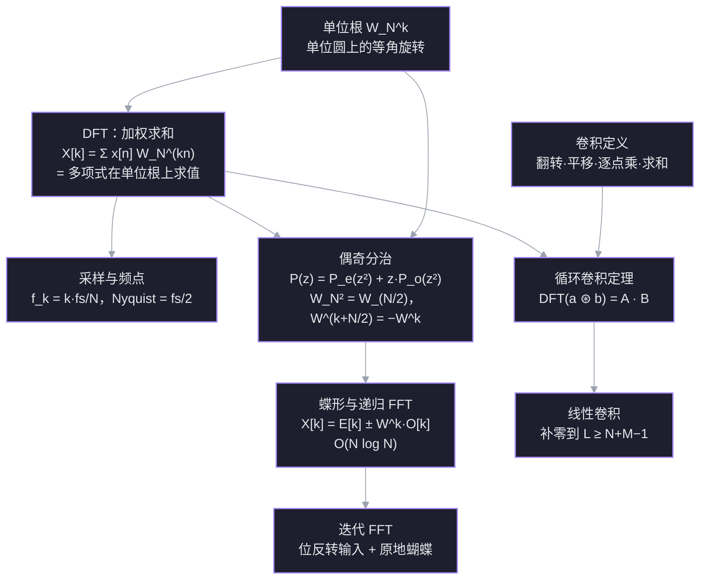

实信号里有哪些频率？怎么在 $O(N\log N)$ 内算出来？卷积为什么能用 FFT 加速？这篇笔记从 DFT 的加权求和出发，经过单位根、偶奇分治、蝶形与位反转，最后落到频点含义和卷积定理。线代背景见 [[L24 复矩阵与快速傅里叶变换]]。

## 约定

本笔记统一用工程 / NumPy 约定：

$$
W_N=e^{-2\pi i/N},\qquad
X[k]=\sum_{n=0}^{N-1}x[n]\,W_N^{kn},
\qquad \text{逆变换带 } \frac1N .
$$

L24 用的是 Strang 的共轭约定 $W=e^{+2\pi i/N}$；两边公式结构相同，所有虚部符号相反。跨笔记抄公式时先看指数符号。

## 探针结果

| 依赖线 | 结果 |
| --- | --- |
| 单位根、复数旋转、根求和 | ✅ 稳：$W_8^2=i$、$1+W^2+W^4+W^6=0$ 都答对 |
| FFT 递归复杂度 | ✅ 稳：$T(n)=2T(n/2)+O(n)\Rightarrow O(n\log n)$ |
| DFT 逐项公式 / 下标权重 | ❌ 缺口：把输出当成「全部相加」，$j=1$ 与 $j=2$ 混淆 |
| 频点 $\leftrightarrow$ Hz、采样率 | ❌ 未接触 |
| 卷积（连 2 点线性卷积） | ❌ 未接触 |
| 迭代 FFT / 位反转 | ❌ 未接触 |

## 依赖图

## 节点 1 · DFT：用单位根做加权求和

### 动机

手上有 $N$ 个采样点 $x[0],\ldots,x[N-1]$，想知道「其中频率 $k$ 的成分有多强」。最直接的办法：造一个同频率的测试信号，和 $x$ 逐点相乘再求和。同相时相加变大，不同相时正负抵消。DFT 就是把这件事做到极致：测试信号取单位圆上的 $N$ 个等角点。

### 建立

取 $W_N=e^{-2\pi i/N}$。第 $k$ 个测试信号是

$$
\tau_k[n]=W_N^{kn}=e^{-2\pi ikn/N},\qquad n=0,\ldots,N-1 .
$$

$n$ 每走一步，相位前进 $2\pi k/N$；$k$ 就是「一圈里转几圈」。定义

$$
X[k]=\sum_{n=0}^{N-1}x[n]\,W_N^{kn}.
$$

- $k=0$：权重全是 $1$，$X[0]$ 就是所有样本之和（直流分量）。
- $k=1$：权重是 $1,W_N,W_N^2,\ldots$，每步转 $2\pi/N$。
- $k=2$：每步转 $4\pi/N$，一圈转两圈。

关键：第 $k$ 个输出用的是 $W_N$ 的 $0,k,2k,\ldots$ 次幂，**步长是 $k$**，不是 $1$。

### 数字例子

$N=4$，$W_4=e^{-2\pi i/4}=-i$，$x=(1,2,3,4)$。

$$
\begin{aligned}
X[0]&=1+2+3+4=10,\\
X[1]&=1+2(-i)+3(-i)^2+4(-i)^3\\
&=1-2i-3+4i=-2+2i.
\end{aligned}
$$

继续：

$$
\begin{aligned}
X[2]&=1+2(-i)^2+3(-i)^4+4(-i)^6\\
&=1-2+3-4=-2,\\
X[3]&=1+2(-i)^3+3(-i)^6+4(-i)^9\\
&=1+2i-3-4i=-2-2i.
\end{aligned}
$$

于是

$$
F_4x=(10,\,-2+2i,\,-2,\,-2-2i).
$$

> [!question] 接上面的例子：$x=(1,2,3,4)$，$N=4$，$W_4=-i$。$X[2]$ 等于多少？
> - $-2-2i$
> - $-2$
> - $2$
> - 不知道

> [!success]- ✓ 正确 —— $X[2]=-2$
> $X[2]=1+2(-i)^2+3(-i)^4+4(-i)^6=1-2+3-4=-2$。中途误选了一次 $2$，复核后确认是 $-2$；公式、复数幂和最后求和都已落地，不是概念缺口。

## 节点 2 · 采样与频点：$X[k]$ 到底是多少 Hz

### 动机

节点 1 给出的 $X[k]$ 只是编号为 $k$ 的复数。要知道它在说哪个频率，必须把「离散下标」翻译成「每秒多少次」。

### 建立

以采样率 $f_s$ 采样，采样间隔 $T_s=1/f_s$。第 $n$ 个样本对应时间 $t_n=nT_s$，记录长度

$$
T=N T_s=\frac{N}{f_s}.
$$

测试信号 $\tau_k[n]=e^{-2\pi ikn/N}$。把它看成连续时间复指数 $e^{-2\pi i f t}$ 在 $t=nT_s$ 处的采样：

$$
e^{-2\pi i f_k nT_s}=e^{-2\pi ikn/N}
\quad\Longrightarrow\quad
2\pi f_kT_s=\frac{2\pi k}{N}
\quad\Longrightarrow\quad
f_k=\frac{k}{NT_s}=\frac{k f_s}{N}.
$$

所以第 $k$ 个 bin 的频率是

$$
f_k=\frac{k f_s}{N},
\qquad
\Delta f=\frac{f_s}{N}=\frac1T .
$$

- $k=0$：$0$ Hz，直流分量。
- $k=N/2$（$N$ 为偶数）：$f_s/2$，**Nyquist 频率**，是可表示的最高频率。
- $k>N/2$：应解释为负频率 $f_k=(k-N)f_s/N$。因为 $e^{-2\pi ikn/N}$ 对 $k$ 以 $N$ 为周期，$k$ 与 $k+N$ 是同一个测试信号。
- 实信号 $x[n]\in\mathbb R$：$X[N-k]=\overline{X[k]}$。$k$ 与 $N-k$ 是共轭对，所以只需看 $k=0,\ldots,N/2$；幅度谱偶对称、相位谱奇对称。

### 数字例子

$f_s=1000$ Hz，$N=1000$：

$$
\Delta f=1\ \text{Hz},\qquad
k=50\Rightarrow 50\ \text{Hz},\qquad
k=500\Rightarrow 500\ \text{Hz（Nyquist）}.
$$

若 $k=600$，则

$$
f_{600}=(600-1000)\cdot\frac{1000}{1000}=-400\ \text{Hz}.
$$

换一组：$f_s=8000$ Hz，$N=1024$，

$$
\Delta f=\frac{8000}{1024}=7.8125\ \text{Hz},\qquad
k=64\Rightarrow 64\times7.8125=500\ \text{Hz}.
$$

### 两个易混点

- **「频率分辨率」**：bin 间距是 $f_s/N$；补零会让 bin 更密，但真正能分辨两个邻近频率的能力由记录时长 $T$ 决定（约 $1/T$），补零不提高真实分辨率。
- **Nyquist 频率** $f_s/2$ 是能表示的最高频率；采样定理要求 $f_s>2f_{\max}$，否则高频会折叠（混叠）。

### 幅度（读谱时用）

实正弦若频率正好落在 bin 上，单边幅度

$$
A_k=\frac{2|X[k]|}{N}\quad(0<k<N/2),
$$

DC 与 Nyquist 不乘 $2$。

> 连接：$f_k=k f_s/N$ 只用到「采样间隔」和「测试信号每步转多少相位」，没有引入新假设；它把节点 1 的编号 $k$ 接上了物理频率轴。

### 多项式视角

把 $x$ 当成系数：

$$
P(z)=x_0+x_1z+\cdots+x_{N-1}z^{N-1}.
$$

那么

$$
X[k]=P(W_N^k).
$$

也就是说，**做一次 DFT = 把多项式在 $N$ 个单位根上同时求值**。这个视角下一步会把「求值」拆成两半，这就是 FFT 的入口。

> 连接：这一步只用到你已经稳的单位根 $W_N^{kn}$；「为什么是加权求和」来自相关性/投影，而「步长是 $k$」正是你之前混淆的地方。下一节点把它翻译成频率。
