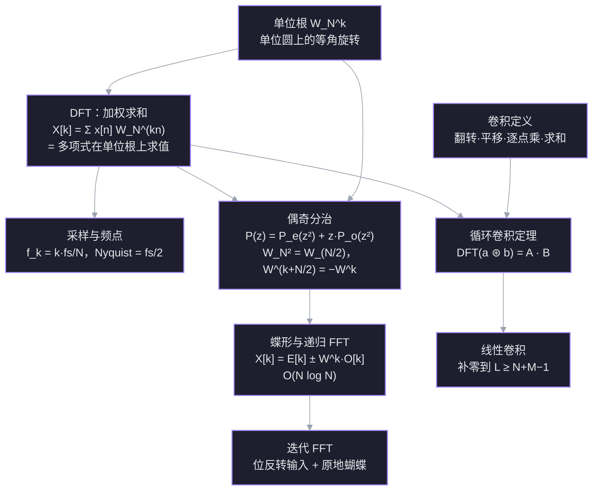
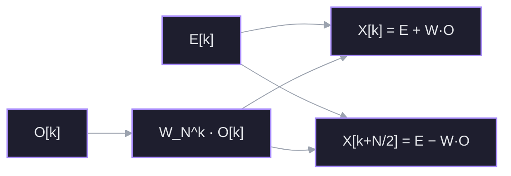

实信号里有哪些频率？怎么在 $O(N\log N)$ 内算出来？卷积为什么能用 FFT 加速？这篇笔记从 DFT 的加权求和出发，经过单位根、偶奇分治、蝶形与位反转，最后落到频点含义、卷积定理、零填充，以及一份可运行的实现。线代背景见 [[L24 复矩阵与快速傅里叶变换]]。

## 约定

本笔记统一用工程 / NumPy 约定：

$$
W_N=e^{-2\pi i/N},\qquad
X[k]=\sum_{n=0}^{N-1}x[n]\,W_N^{kn},
\qquad \text{逆变换带 } \frac1N .
$$

L24 用的是 Strang 的共轭约定 $W=e^{+2\pi i/N}$；两边公式结构相同，所有虚部符号相反。跨笔记抄公式时先看指数符号。

## 另一条入口：从多项式乘法发现 FFT

> 参考：Reducible《The Fast Fourier Transform (FFT) — Most Ingenious Algorithm Ever》（YouTube `h7apO7q16V0`），转录见 [[The Fast Fourier Transform (FFT) Most Ingenious Algorithm Ever 1]]。

这条线和本笔记的信号视角是同一件事：$x=(x_0,\ldots,x_{N-1})$ 既是采样，也是多项式

$$
P(z)=x_0+x_1z+\cdots+x_{N-1}z^{N-1}
$$

的系数；DFT 的 $X[k]$ 就是 $P(W_N^k)$。

发现顺序：

1. **系数表示**做多项式乘法是 $O(d^2)$：$c_k=\sum_{i+j=k}a_ib_j$（线性卷积）。
2. **值表示**：$d$ 次多项式由 $d+1$ 个点唯一确定。乘法变成逐点相乘，$O(d)$。
3. 计划：系数 → 在 $2d+1$ 个点上求值 → 逐点乘 → 插值回系数。缺的两个「魔法盒」就是 FFT 和 IFFT。
4. 求值朴素做是 $O(n^2)$。偶奇拆分 + $\pm$ 配对可以减半；但递归下去，平方后的点全为正，$\pm$ 配对失效。
5. 把求值点扩到复数，取 $n$ 次单位根：平方后变成 $n/2$ 次单位根，每一层都保持 $\pm$ 配对。这就是节点 3 的递归。
6. 插值 = 乘 DFT 矩阵的逆；逆矩阵只是 $\omega\to\omega^{-1}$ 再乘 $1/n$，所以 IFFT 是同一个 FFT 改一行。迭代版见节点 4。

**符号约定**：视频用 $\omega=e^{+2\pi i/N}$；本笔记用 $W_N=e^{-2\pi i/N}$，两者互为共轭。用本笔记约定时，IFFT 用 $W_N^{-1}=e^{+2\pi i/N}$ 再乘 $1/n$。跨来源抄公式先看指数符号。

这条路径也直接给出卷积定理：值表示里 $C(z_k)=A(z_k)B(z_k)$，翻译回 DFT 就是 $C[k]=A[k]B[k]$，而系数域的乘法正是卷积。

## 探针结果

| 依赖线 | 结果 |
| --- | --- |
| 单位根、复数旋转、根求和 | ✅ 稳：$W_8^2=i$、$1+W^2+W^4+W^6=0$ 都答对 |
| FFT 递归复杂度 | ✅ 稳：$T(n)=2T(n/2)+O(n)\Rightarrow O(n\log n)$ |
| DFT 逐项公式 / 下标权重 | ❌ 缺口：把输出当成「全部相加」，$j=1$ 与 $j=2$ 混淆 |
| 频点 $\leftrightarrow$ Hz、采样率 | ❌ 未接触 |
| 卷积（连 2 点线性卷积） | ❌ 未接触 |
| 迭代 FFT / 位反转 | ❌ 未接触 |

## 依赖图



## 节点 1 · DFT：用单位根做加权求和

### 动机

手上有 $N$ 个采样点 $x[0],\ldots,x[N-1]$，想知道「其中频率 $k$ 的成分有多强」。最直接的办法：造一个同频率的测试信号，和 $x$ 逐点相乘再求和。同相时相加变大，不同相时正负抵消。DFT 就是把这件事做到极致：测试信号取单位圆上的 $N$ 个等角点。

### 建立

取 $W_N=e^{-2\pi i/N}$。第 $k$ 个测试信号是

$$
\tau_k[n]=W_N^{kn}=e^{-2\pi ikn/N},\qquad n=0,\ldots,N-1 .
$$

$n$ 每走一步，相位前进 $2\pi k/N$；$k$ 就是「一圈里转几圈」。定义

$$
X[k]=\sum_{n=0}^{N-1}x[n]\,W_N^{kn}.
$$

- $k=0$：权重全是 $1$，$X[0]$ 就是所有样本之和（直流分量）。
- $k=1$：权重是 $1,W_N,W_N^2,\ldots$，每步转 $2\pi/N$。
- $k=2$：每步转 $4\pi/N$，一圈转两圈。

关键：第 $k$ 个输出用的是 $W_N$ 的 $0,k,2k,\ldots$ 次幂，**步长是 $k$**，不是 $1$。

### 数字例子

$N=4$，$W_4=e^{-2\pi i/4}=-i$，$x=(1,2,3,4)$。

$$
\begin{aligned}
X[0]&=1+2+3+4=10,\\
X[1]&=1+2(-i)+3(-i)^2+4(-i)^3\\
&=1-2i-3+4i=-2+2i.
\end{aligned}
$$

继续：

$$
\begin{aligned}
X[2]&=1+2(-i)^2+3(-i)^4+4(-i)^6\\
&=1-2+3-4=-2,\\
X[3]&=1+2(-i)^3+3(-i)^6+4(-i)^9\\
&=1+2i-3-4i=-2-2i.
\end{aligned}
$$

于是

$$
F_4x=(10,\,-2+2i,\,-2,\,-2-2i).
$$

> [!question] 接上面的例子：$x=(1,2,3,4)$，$N=4$，$W_4=-i$。$X[2]$ 等于多少？
> - $-2-2i$
> - $-2$
> - $2$
> - 不知道

> [!success]- ✓ 正确 —— $X[2]=-2$
> $X[2]=1+2(-i)^2+3(-i)^4+4(-i)^6=1-2+3-4=-2$。中途误选了一次 $2$，复核后确认是 $-2$；公式、复数幂和最后求和都已落地，不是概念缺口。

### $X[k]$ 到底在测什么（2026-11-07 重讲）

公式容易让人迷失，先把它放一边。$X[k]$ 回答的是一个具体问题：

> **这 $N$ 个采样里，有多少「每 $N$ 个点重复 $k$ 圈」的成分？**

测法只有一步：**逐点相乘，再全部加起来**。

1. 数据是 $x[0],\ldots,x[N-1]$，波形在时间上的样子。
2. 对每个 $k$，造一个测试波形：在 $N$ 个点上正好重复 $k$ 圈的波。
3. 把数据和测试波形逐点相乘。
4. 求和。

波形里有这个成分，乘积同号，和很大；没有，乘积正负交替，抵消到 $0$。这个和就是 $X[k]$。

$N=4$ 的四个测试波形：

| $k$ | 测试波形 | 含义 |
|---|---|---|
| 0 | $1,\ 1,\ 1,\ 1$ | 常数，不变 |
| 1 | $1,\ -i,\ -1,\ i$ | 转一圈（每步 $90^\circ$） |
| 2 | $1,\ -1,\ 1,\ -1$ | 转两圈（每步 $180^\circ$） |
| 3 | $1,\ i,\ -1,\ -i$ | 反着转一圈 |

两个一眼能看出的例子：

$$
x=(1,1,1,1):\quad
X[0]=1+1+1+1=4,\qquad
X[1]=1-i-1+i=0.
$$

常数信号只有 $0$ 号成分。

$$
x=(1,-1,1,-1):\quad
X[2]=1+1+1+1=4,\qquad
X[1]=1+i-1-i=0.
$$

每点翻转的信号匹配 $k=2$（Nyquist），不匹配 $k=1$。

复数值的含义：$|X[k]|$ 是这个频率成分的强度；$\arg X[k]$ 是它的相位。$k$ 换成 Hz 是节点 2 的事：$f_k=k f_s/N$。

公式 $\sum x[n]W_N^{kn}$ 只是把上面四步写成一行：$x[n]$ 是数据，$W_N^{kn}$ 是第 $k$ 个测试波形在第 $n$ 个点的值。

**锚点：$k$ 数的是整段 $N$ 个点里重复几圈，不是翻转次数的编号。** 每点翻转一次 = 每 $2$ 个点一个周期 = 整段 $N/2$ 圈 = $k=N/2$。

> [!question] $x=(1,-1,1,-1)$，$N=4$。按「逐点相乘再求和」，哪个 $X[k]$ 明显非零？
> - $X[0]$
> - $X[1]$
> - $X[2]$
> - 不知道

> [!failure] ✗ 选了 $X[1]$ —— 正确答案是 $X[2]$
> 把「每点翻转」误当成了 $k=1$。但 $k$ 数的是整段重复几圈：$k=1$ 的测试波形是 $1,-i,-1,i$，每步只转 $90^\circ$，跟不上数据；逐点乘得 $1+i-1-i=0$。每步翻 $180^\circ$ 对应整段 $2$ 圈，即 $k=2$，逐点乘得 $1+1+1+1=4$。识别信号：看到「最快振荡 / 每点翻转」就想到 $k=N/2$，不要按第一个频率去数。

> [!question] $N=8$，$x=(1,-1,1,-1,1,-1,1,-1)$。哪个 $k$ 的测试波形与它完全匹配？
> - $k=1$
> - $k=4$
> - $k=2$
> - 不知道

> [!success] ✓ 正确 —— $k=4$
> 每点翻转仍是整段 $N/2$ 圈，$N=8$ 时 $k=4$；测试波形 $W_8^{4n}=(-1)^n$，逐点相乘全为 $1$，$X[4]=8$。

## 节点 2 · 采样与频点：$X[k]$ 到底是多少 Hz

### 从零重建：频率、采样率、记录时长（2026-11-06）

前面直接从复指数推到 $f_k=k f_s/N$，跳过了「频率」本身。补一条地面：

- **频率 = 每秒重复几次。** $2$ Hz 的声音一秒完整振动 $2$ 次，周期 $0.5$ s。
- **采样率 = 每秒取几个点。** $f_s=8000$ Hz 表示点间隔 $1/8000$ s。
- $N$ 个点覆盖的时长 $T=N/f_s$。$N=1024,\ f_s=8000$ 时 $T=0.128$ s。
- DFT 的第 $k$ 个测试信号，在这段记录里正好转 $k$ 圈。所以它的频率是「圈数 ÷ 时长」：

$$
f_k=\frac{k}{T}=\frac{k f_s}{N}.
$$

数字：$\Delta f=8000/1024=7.8125$ Hz，$k=64$ 即 $64\times7.8125=500$ Hz。$k$ 是格子编号，不是 Hz。

- 一个周期至少要两个采样点才看得出来，所以最高频率是 $f_s/2$，对应 $k=N/2$。

### 动机

节点 1 给出的 $X[k]$ 只是编号为 $k$ 的复数。要知道它在说哪个频率，必须把「离散下标」翻译成「每秒多少次」。

### 建立

以采样率 $f_s$ 采样，采样间隔 $T_s=1/f_s$。第 $n$ 个样本对应时间 $t_n=nT_s$，记录长度

$$
T=N T_s=\frac{N}{f_s}.
$$

测试信号 $\tau_k[n]=e^{-2\pi ikn/N}$。把它看成连续时间复指数 $e^{-2\pi i f t}$ 在 $t=nT_s$ 处的采样：

$$
e^{-2\pi i f_k nT_s}=e^{-2\pi ikn/N}
\quad\Longrightarrow\quad
2\pi f_kT_s=\frac{2\pi k}{N}
\quad\Longrightarrow\quad
f_k=\frac{k}{NT_s}=\frac{k f_s}{N}.
$$

所以第 $k$ 个 bin 的频率是

$$
f_k=\frac{k f_s}{N},
\qquad
\Delta f=\frac{f_s}{N}=\frac1T .
$$

- $k=0$：$0$ Hz，直流分量。
- $k=N/2$（$N$ 为偶数）：$f_s/2$，**Nyquist 频率**，是可表示的最高频率。
- $k>N/2$：应解释为负频率 $f_k=(k-N)f_s/N$。因为 $e^{-2\pi ikn/N}$ 对 $k$ 以 $N$ 为周期，$k$ 与 $k+N$ 是同一个测试信号。
- 实信号 $x[n]\in\mathbb R$：$X[N-k]=\overline{X[k]}$。$k$ 与 $N-k$ 是共轭对，所以只需看 $k=0,\ldots,N/2$；幅度谱偶对称、相位谱奇对称。

### 数字例子

$f_s=1000$ Hz，$N=1000$：

$$
\Delta f=1\ \text{Hz},\qquad
k=50\Rightarrow 50\ \text{Hz},\qquad
k=500\Rightarrow 500\ \text{Hz（Nyquist）}.
$$

若 $k=600$，则

$$
f_{600}=(600-1000)\cdot\frac{1000}{1000}=-400\ \text{Hz}.
$$

换一组：$f_s=8000$ Hz，$N=1024$，

$$
\Delta f=\frac{8000}{1024}=7.8125\ \text{Hz},\qquad
k=64\Rightarrow 64\times7.8125=500\ \text{Hz}.
$$

### 两个易混点

- **「频率分辨率」**：bin 间距是 $f_s/N$；补零会让 bin 更密，但真正能分辨两个邻近频率的能力由记录时长 $T$ 决定（约 $1/T$），补零不提高真实分辨率。
- **Nyquist 频率** $f_s/2$ 是能表示的最高频率；采样定理要求 $f_s>2f_{\max}$，否则高频会折叠（混叠）。

### 幅度（读谱时用）

实正弦若频率正好落在 bin 上，单边幅度

$$
A_k=\frac{2|X[k]|}{N}\quad(0<k<N/2),
$$

DC 与 Nyquist 不乘 $2$。

> 连接：$f_k=k f_s/N$ 只用到「采样间隔」和「测试信号每步转多少相位」，没有引入新假设；它把节点 1 的编号 $k$ 接上了物理频率轴。

### 概念澄清：bin、DC、Nyquist

- **bin**：DFT 输出有 $N$ 个复数，每个编号 $k$ 是一个频点 / 频率槽。把 $0$ 到 $f_s$ 的频率轴切成 $N$ 格，第 $k$ 格的中心频率是 $k f_s/N$。
- **直流分量**：$k=0$，频率为 $0$，不振荡。$X[0]=\sum_n x[n]$，所以 $X[0]/N$ 是记录内平均值 / 恒定偏置。
- **为什么 $N/2$ 是最高**：采样后 $f$ 与 $f+f_s$ 给出同一串样本，唯一频带是 $[-f_s/2,\ f_s/2)$；$k=N/2$ 对应 $f_s/2$，是边界。$k>N/2$ 应读作负频率。实信号还有 $X[N-k]=\overline{X[k]}$，$0,\ldots,N/2$ 已含全部信息。

### 确认题（2026-11-06）

> [!question] $f_s=8000$ Hz，$N=1024$ 点 DFT，峰值在 $k=32$。对应多少 Hz？
> - $250$ Hz
> - $32$ Hz
> - $500$ Hz
> - 不知道

> [!failure] ✗ 选了 500 Hz —— 正确答案是 250 Hz
> 500 Hz 是上一个例子 $k=64$ 的答案。$k$ 减半（$64\to32$），频率也减半：$500/2=250$ Hz，或直接算 $32\times7.8125=250$ Hz。先把「$k$ 与 Hz 成正比」钉住，再用乘法核对。

> [!success] ✓ 正确 —— $1000$ Hz
> $128\times7.8125=1000$ Hz，也等于 $2\times500$：$k$ 翻倍，Hz 翻倍。比例关系落地。

### 多项式视角

把 $x$ 当成系数：

$$
P(z)=x_0+x_1z+\cdots+x_{N-1}z^{N-1}.
$$

那么

$$
X[k]=P(W_N^k).
$$

也就是说，**做一次 DFT = 把多项式在 $N$ 个单位根上同时求值**。这个视角下一步会把「求值」拆成两半，这就是 FFT 的入口。

> 连接：这一步只用到你已经稳的单位根 $W_N^{kn}$；「为什么是加权求和」来自相关性/投影，而「步长是 $k$」正是你之前混淆的地方。下一节点把它翻译成频率。

## 节点 3 · 偶奇分治：把求值拆成两半

### 动机

直接算 DFT 要 $N^2$ 次乘法：$N=1024$ 约 $105$ 万次，$N=2048$ 就到 $419$ 万次。翻倍的数据量让计算量翻四倍，但数据本身没变复杂——问题是同一批数被反复相乘。能不能复用？

节点 1 的多项式视角给了入口：DFT 是在 $N$ 个单位根上同时求 $P(z)$ 的值。求值可以按系数拆开。

### 建立

把系数按奇偶分开：

$$
\begin{aligned}
P(z)&=(x_0+x_2z^2+x_4z^4+\cdots)+z\,(x_1+x_3z^2+x_5z^4+\cdots)\\
&=P_e(z^2)+z\,P_o(z^2).
\end{aligned}
$$

$P_e$ 和 $P_o$ 都只有 $N/2$ 个系数。现在代入 $z=W_N^k$，用探针里已经稳的两条事实：

$$
W_N^2=W_{N/2},\qquad (W_N^k)^2=W_{N/2}^k ;
$$

$$
W_N^{k+N/2}=-W_N^k .
$$

于是

$$
E[k]=P_e(W_{N/2}^k),\qquad O[k]=P_o(W_{N/2}^k)
$$

正好是两组 $N/2$ 点 DFT 的第 $k$ 项，而 $k+N/2$ 只用把同一个 $E[k],O[k]$ 取负：

$$
\boxed{
\begin{aligned}
X[k]&=E[k]+W_N^k\,O[k],\\
X[k+N/2]&=E[k]-W_N^k\,O[k],
\end{aligned}}
\qquad k=0,\ldots,\tfrac N2-1 .
$$

一个 $N$ 点 DFT 变成两个 $N/2$ 点 DFT，外加 $N/2$ 次乘法和 $N$ 次加减。递推

$$
T(N)=2T(N/2)+O(N)\;\Longrightarrow\;T(N)=O(N\log N).
$$

这一对「相加 / 相减」就是蝶形（butterfly）。 



### 数字例子

用节点 1 的同一组数据：$N=4$，$x=(1,2,3,4)$，当时暴力算出

$$
X=(10,\,-2+2i,\,-2,\,-2-2i).
$$

现在分治。偶数样本 $(1,3)$，奇数样本 $(2,4)$：

$$
E=\mathrm{DFT}_2(1,3)=(4,-2),\qquad
O=\mathrm{DFT}_2(2,4)=(6,-2).
$$

**$E$ 与 $O$ 是怎么来的（2026-11-07 补）**

$\mathrm{DFT}_2$ 不是新东西，就是节点 1 的公式取 $N=2$。$W_2=e^{-2\pi i/2}=e^{-i\pi}=-1$，两个单位根只有 $1$ 和 $-1$，所以

$$
\mathrm{DFT}_2(a,b)=\bigl(a+b,\;a-b\bigr),
$$

也就是「和与差」：

$$
E=\mathrm{DFT}_2(1,3)=(1+3,\;1-3)=(4,-2),\qquad
O=\mathrm{DFT}_2(2,4)=(6,-2).
$$

从多项式视角看是同一件事：$P_e(z)=1+3z$，$E[0]=P_e(1)=4$，$E[1]=P_e(-1)=-2$。递归到 $N=2$ 就停，因为一个 2 点蝶形只要一次加法和一次减法。

> [!question] $\mathrm{DFT}_2(5,1)$ 等于多少？
> - $(6,4)$
> - $(6,-4)$
> - $(4,6)$
> - 不知道

> [!success] ✓ 正确 —— $(6,4)$
> $5+1=6$，$5-1=4$。$k=0$ 时两个样本同号相加；$k=1$ 时第二个样本乘 $W_2=-1$ 后相加。

$W_4^0=1$，$W_4^1=-i$。逐项：

$$
\begin{aligned}
k=0:&\quad X[0]=4+1\cdot6=10, &&X[2]=4-6=-2,\\
k=1:&\quad X[1]=-2+(-i)(-2)=-2+2i, &&X[3]=-2-(-i)(-2)=-2-2i.
\end{aligned}
$$

四个数与暴力计算逐个吻合，但只做了两次 2 点 DFT。

### 连接

用到的三样东西都已就位：DFT 定义（节点 1）、$W_N^2=W_{N/2}$（探针稳）、$W^{k+N/2}=-W^k$（探针稳）。分治没有引入新事实，只是把「在 $N$ 个根上求值」重新分组。

## 节点 3 确认题（2026-11-07）

> [!question] $N=4$，$x=(1,2,3,4)$，$E=(4,-2)$，$O=(6,-2)$，$W_4^1=-i$。按蝶形公式，$X[3]$ 等于多少？
> - $-2+2i$
> - $-2-2i$
> - $10$
> - 不知道

> [!failure] ✗ 答 $4+6i$ —— 正确答案是 $-2-2i$
> 两处错。**索引配对**：$N=4$ 时 $X[0],X[2]$ 由 $E[0],O[0]$ 算出，$X[1],X[3]$ 由 $E[1],O[1]$ 算出；$X[3]$ 在第二半，$k=3-N/2=1$，要用第二组 $(-2,-2)$，不是第一组的 $(4,6)$。**符号**：第二半是 $E[k]-W^kO[k]$，不是加。识别信号：先由输出下标定 $k$（后半减 $N/2$），再取同一 $k$ 的 $E,O$，最后按前后半选 $\pm$。验算：实数列满足 $X[N-k]=\overline{X[k]}$，$X[3]=\overline{X[1]}=-2-2i$。

> [!question] 同一组 $E=(4,-2)$、$O=(6,-2)$、$W_4^1=-i$。按 $X[k]=E[k]+W^kO[k]$，求 $X[1]$。
> - $-2-2i$
> - $-2+2i$
> - $10$
> - 不知道

> [!success] ✓ 正确 —— $-2+2i$
> $k=1$，取 $E[1]=-2$、$O[1]=-2$；第一半用加号：$-2+(-i)(-2)=-2+2i$。与 $X[3]=-2-2i$ 互为共轭，符合实数列的对称性。

**下一步**：节点 4（迭代 FFT 与位反转）。E/O 的 2 点 DFT 已在上面补讲并确认；节点 2 的 $k\leftrightarrow$ Hz 比例也已确认。

## 节点 4 · 迭代 FFT 与位反转

### 动机

节点 3 的递归版本清楚，但每次递归都要拆数组、开新空间，函数调用开销大。实际实现（NumPy、FFTW、嵌入式 DSP）用的是同一套蝶形，改成**自底向上、原地计算**：先把输入按「位反转」顺序摆好，再做 $\log_2 N$ 轮蝶形。

### 建立

$N=8$ 的拆分树：

```
第一层：x0 x2 x4 x6 | x1 x3 x5 x7      （偶 | 奇）
第二层：x0 x4 | x2 x6 || x1 x5 | x3 x7
叶子：  x0 x4 x2 x6  x1 x5 x3 x7
```

叶子下标写成 3 位二进制再反转，正好就是它们的位置：

| 原下标 | 二进制 | 反转 | 新位置 |
|---|---|---|---|
| 0 | 000 | 000 | 0 |
| 1 | 001 | 100 | 4 |
| 2 | 010 | 010 | 2 |
| 3 | 011 | 110 | 6 |
| 4 | 100 | 001 | 1 |
| 5 | 101 | 101 | 5 |
| 6 | 110 | 011 | 3 |
| 7 | 111 | 111 | 7 |

所以先把 $a$ 重排成 $a[\mathrm{rev}(i)]$，然后自底向上合并，每一轮把相邻两块用蝶形接起来：

```c
for (int len = 2; len <= N; len <<= 1) {
    for (int start = 0; start < N; start += len) {
        for (int j = 0; j < len / 2; ++j) {
            complex u = a[start + j];
            complex v = a[start + j + len/2] * W_len(j);  // W_len(j) = e^(-2πij/len)
            a[start + j]          = u + v;
            a[start + j + len/2]  = u - v;
        }
    }
}
```

### 数字例子

$N=4$，$x=(1,2,3,4)$。位反转（2 位）把下标排成 $0,2,1,3$：

$$
a=(1,3,2,4).
$$

第一轮 `len=2`：$(1,3)\to(4,-2)$，$(2,4)\to(6,-2)$，得 $a=(4,-2,6,-2)$。

第二轮 `len=4`：

- $j=0,\ W_4^0=1$：$u=4,\ v=6$ → $X[0]=10,\ X[2]=-2$。
- $j=1,\ W_4^1=-i$：$u=-2,\ v=(-2)(-i)=2i$ → $X[1]=-2+2i,\ X[3]=-2-2i$。

结果 $(10,-2+2i,-2,-2-2i)$ 与节点 3 完全一致。

### 连接

内层每一次 $(u,v)\mapsto(u+v,\ u-v)$ 就是节点 3 的蝶形；位反转只是把递归拆分的叶子顺序提前摆好，让每一轮的配对在内存里相邻。没有新的数学，只是把同一套蝶形排成了能原地跑的循环。

> [!question] $N=16$ 的迭代 FFT，原下标 $5$（二进制 $0101$）在重排后落到哪个位置？
> - $5$
> - $10$
> - $12$
> - 不知道

> [!failure] ✗ 答 $12$ —— 正确答案是 $10$
> $12=1100_2$ 其实是原下标 $0011=3$ 的反转，说明二进制位写错了一格。正确流程：把下标补成 $\log_2 N$ 位，从右往左逐位读。$5=0101_2\to1010_2=8+2=10$。

> [!question] $N=16$，原下标 $11$（二进制 $1011$）重排后落到哪个位置？
> - $7$
> - $13$
> - $11$
> - 不知道

> [!success] ✓ 正确 —— $13$
> $1011_2$ 从右往左读得 $1101_2=8+4+1=13$。位反转不看数值大小，只看二进制位序；$N=16$ 一律补足 4 位再翻转。

## 节点 5 · 卷积定理：值表示里的逐点乘

### 动机

多项式乘法 / 线性卷积直接算是 $O(N^2)$：每个系数都要和对方所有系数相乘。节点 4 的 FFT 能在 $O(N\log N)$ 内求值；值表示又把乘法变成逐点乘 $O(N)$。两者接起来，卷积就能用 FFT 加速——这是 FFT 在信号处理、图像滤波里最重要的用途。

### 建立

设 $a=(a_0,\ldots,a_{N-1})$、$b=(b_0,\ldots,b_{M-1})$，对应多项式 $A(z),B(z)$。乘积 $C(z)=A(z)B(z)$ 的系数是

$$
c_k=\sum_{i+j=k}a_i b_j \qquad\text{（线性卷积）}.
$$

在 $N$ 个点 $z_k=W_N^k$ 上求值：

$$
C(z_k)=A(z_k)\,B(z_k).
$$

而 $A(z_k)=A[k]$、$B(z_k)=B[k]$ 正是 DFT，所以

$$
\boxed{\,C[k]=A[k]\,B[k]\,}
$$

逆 DFT 就回到系数：

$$
c=\mathrm{IDFT}\bigl(A\odot B\bigr),
$$

其中 $\odot$ 是逐点乘。

### 数字例子

$A(z)=1+2z$，$B(z)=1+z$，乘积 $C(z)=1+3z+2z^2$，线性卷积为 $(1,3,2)$。

在 $4$ 次单位根（$1,-i,-1,i$，本笔记约定）上求值：

| 点 | $A$ | $B$ | $C=A\cdot B$ |
|---|---|---|---|
| $1$ | $3$ | $2$ | $6$ |
| $-i$ | $1-2i$ | $1-i$ | $-1-3i$ |
| $-1$ | $-1$ | $0$ | $0$ |
| $i$ | $1+2i$ | $1+i$ | $-1+3i$ |

对最后一列做逆 DFT，得 $(1,3,2,0)$，与直接乘多项式一致；末尾的 $0$ 来自补零。

### 循环卷积与线性卷积

长度 $N$ 的 DFT 只认得 $N$ 个点，卷积超出 $N$ 的部分会绕回开头，得到**循环卷积**。$a=(1,2)$、$b=(1,1)$ 直接用 $N=2$：

$$
c_0=a_0b_0+a_1b_1=1+2=3,\qquad
c_1=a_0b_1+a_1b_0=1+2=3,
$$

即 $(3,3)$，而线性卷积是 $(1,3,2)$。要恢复线性卷积，必须补零到

$$
L\ge N+M-1,
$$

通常取 $2$ 的幂，方便 radix-2 FFT。

### 连接

节点 1 把 DFT 解释为「在单位根上求值」；多项式视角说明求值把乘法变成逐点乘；所以卷积定理只是「乘法在值表示下的样子」。节点 4 提供 $O(N\log N)$ 的求值与插值。没有新数学。

> [!question] $a=(1,2)$，$b=(1,1)$，直接用 $N=2$ 的 DFT 做循环卷积，结果是？
> - $(1,3)$
> - $(3,3)$
> - $(1,3,2)$
> - 不知道

> [!success] ✓ 正确 —— $(3,3)$
> 循环卷积把下标按 $N=2$ 取模：$c_0=a_0b_0+a_1b_1=3$，$c_1=a_0b_1+a_1b_0=3$。线性卷积的第三项 $2$ 绕回到 $c_0$，所以看不到 $(1,3,2)$；补零到 $L\ge3$ 才能得到它。

## 节点 6 · 零填充：避免混叠 vs 频谱插值

### 动机

节点 5 留下两个容易混的问题：

1. 卷积时为什么必须补零？——防止循环卷积绕回。
2. 补零后频点变密了，是不是频率分辨率提高了？——不是，只是插值。

两个「补零」名字相同，目的完全不同。

### 建立

**卷积里的补零：代数要求。**

$a,b$ 长度分别为 $N,M$，乘积多项式次数不超过 $N+M-2$。补零到 $L\ge N+M-1$ 后，所有项都装得进 $L$ 个位置，没有项需要绕回开头，于是

$$
\text{循环卷积}=\text{线性卷积}.
$$

**频谱里的补零：只是采样更密。**

把 $N$ 点数据补零到 $L$ 点，DFT 的频点间隔从 $f_s/N$ 变成 $f_s/L$，谱线看起来更密；但这是在**同一个连续频谱**上采更多点（插值），并没有增加新信息。两个靠得很近的频率能不能分开，由观测时长决定：

$$
T=\frac{N}{f_s},\qquad \Delta f=\frac{1}{T}=\frac{f_s}{N}.
$$

补零不改变 $T$，所以不改变分辨能力。

### 数字例子

**卷积**：$a=(1,2)$、$b=(1,1)$，补零到 $L=4$：

$$
a=(1,2,0,0),\quad b=(1,1,0,0),
$$

$$
c_0=1,\quad c_1=1+2=3,\quad c_2=2,\quad c_3=0
\;\Rightarrow\;(1,3,2,0),
$$

与线性卷积一致；不补零时是节点 5 的 $(3,3)$。

**频谱**：$f_s=8000$ Hz、$N=1024$，分辨率

$$
\Delta f=\frac{8000}{1024}=7.8125\ \text{Hz}.
$$

补零到 $L=4096$ 后，频点间隔变成 $8000/4096=1.953125$ Hz，但主瓣宽度仍约为 $7.8$ Hz——只是在这个主瓣上画了更多点。

### 连接

卷积里的补零是代数要求：让多项式次数装进 $L$，消除绕回。频谱里的补零只是采样更密：不增加观测时长，所以不提高分辨率。两者都叫补零，但一个改的是「位置够不够」，另一个改的是「采样密不密」。

> [!question] $f_s=8000$ Hz、$N=1024$ 点，补零到 $L=4096$ 后，两个频率相距多近还能被分开？
> - $1.953$ Hz
> - $7.8125$ Hz
> - $31.25$ Hz
> - 不知道

> [!failure] ✗ 选了 $1.953$ Hz —— 正确答案是 $7.8125$ Hz
> $1.953$ Hz 是补零后的**频点间隔** $f_s/L$，不是分辨能力。补零没有增加新的时间采样，观测时长仍是 $T=N/f_s=0.128$ s，所以 $\Delta f=1/T=7.8125$ Hz。两个相距 $2$ Hz 的频率仍会落进同一个约 $7.8$ Hz 宽的主瓣；补零只是在这个主瓣上画了更多点。识别信号：问「能不能分开」看 $N$ 和 $T$，问「谱线多密」才看补零后的 $L$。

> [!question] $f_s=8000$ Hz 不变，想把频率分辨率从 $7.8125$ Hz 提高到约 $1.953$ Hz，应该怎么做？
> - 补零到 $4096$ 点
> - 同样 $f_s$ 下采 $4096$ 个点
> - 把 $f_s$ 提高到 $32000$ Hz
> - 不知道

> [!success] ✓ 正确 —— 同样 $f_s$ 下采 $4096$ 个点
> 分辨率 $\Delta f=f_s/N$。$f_s$ 不变时把 $N$ 从 $1024$ 增到 $4096$，$T$ 从 $0.128$ s 增到 $0.512$ s，$\Delta f=8000/4096=1.953$ Hz。补零不增加 $T$；只提高 $f_s$ 而不延长观测时间也不改变分辨能力。

## 节点 7 · 代码落地：迭代 radix-2 FFT

### 动机

节点 4 给了结构，节点 5–6 给了用途；这一节把结构写成能跑的代码，并用 `numpy.fft` 和 `numpy.convolve` 做交叉验证。

### 建立

两处关键：

1. **位反转重排**：用 `j` 逐位翻转，原地交换 `i < j` 的元素。
2. **自底向上合并**：`length = 2, 4, ..., N`；每段内 `v = x[start+k+half] * w`，然后 `(u+v, u-v)`；`w` 每步乘 `W_length = e^{-2πi/length}`。

逆变换利用 DFT 矩阵的性质：

$$
F^{-1}=\frac1n\,\overline{F},
$$

所以 `ifft(X) = conj(fft(conj(X))) / n`，与节点 4 的“同一个 FFT 改一行”一致。

```python
import numpy as np


def fft(x):
    """迭代 radix-2 FFT，工程约定 W_N = exp(-2πi/N)。"""
    x = np.asarray(x, dtype=complex)
    n = len(x)
    assert n & (n - 1) == 0, "n 必须是 2 的幂"

    # 位反转重排
    j = 0
    for i in range(1, n):
        bit = n >> 1
        while j & bit:
            j ^= bit
            bit >>= 1
        j |= bit
        if i < j:
            x[i], x[j] = x[j], x[i]

    # 自底向上合并
    length = 2
    while length <= n:
        w_len = np.exp(-2j * np.pi / length)
        half = length // 2
        for start in range(0, n, length):
            w = 1 + 0j
            for k in range(half):
                u = x[start + k]
                v = x[start + k + half] * w
                x[start + k] = u + v
                x[start + k + half] = u - v
                w *= w_len
        length <<= 1
    return x


def ifft(X):
    """DFT 矩阵的逆 = 共轭 → fft → 共轭 → 除以 n。"""
    return np.conj(fft(np.conj(X))) / len(X)


if __name__ == "__main__":
    rng = np.random.default_rng(0)

    for n in (8, 1024):
        x = rng.standard_normal(n)
        e_f = np.max(np.abs(fft(x) - np.fft.fft(x)))
        e_i = np.max(np.abs(ifft(x) - np.fft.ifft(x)))
        print(f"N={n:4d}  max|fft-numpy|={e_f:.2e}  max|ifft-numpy|={e_i:.2e}")

    a = np.array([1, 2])
    b = np.array([1, 1])

    # 线性卷积：补零到 L >= N+M-1
    L = 4
    c = ifft(fft(np.pad(a, (0, L - len(a)))) *
             fft(np.pad(b, (0, L - len(b))))).real
    print("线性卷积 numpy.convolve:", np.convolve(a, b))
    print("线性卷积 FFT 补零到 4 :", np.round(c).astype(int))

    # 不补零：循环卷积
    c2 = ifft(fft(a) * fft(b)).real
    print("循环卷积 N=2          :", np.round(c2).astype(int))

    fs, N = 8000, 1024
    print(f"分辨率 fs/N = {fs / N} Hz")
    print(f"补零到 4096 的频点间隔 = {fs / 4096} Hz")
```

### 运行结果

```
N=   8  max|fft-numpy|=5.55e-16  max|ifft-numpy|=6.94e-17
N=1024  max|fft-numpy|=9.43e-13  max|ifft-numpy|=9.21e-16
线性卷积 numpy.convolve: [1 3 2]
线性卷积 FFT 补零到 4 : [1 3 2 0]
循环卷积 N=2          : [3 3]
分辨率 fs/N = 7.8125 Hz
补零到 4096 的频点间隔 = 1.953125 Hz
```

### 连接

- 误差在 $10^{-13}$ 量级，是浮点舍入，不是算法错误；N=1024 的误差比 N=8 大，因为累加次数更多。
- 补零到 4 后线性卷积 `(1,3,2)` 与 `numpy.convolve` 一致；不补零的 `(3,3)` 是节点 5 的循环卷积。
- 最后两行把节点 6 的两个量并排：$7.8125$ Hz 是分辨率，$1.953$ Hz 是补零后的频点间隔。
- 这份实现用 Python 循环，复杂度是 $O(N\log N)$ 但常数很大；生产代码会把内层用 NumPy 向量化或直接用 `np.fft`。

> [!question] `ifft(X) = conj(fft(conj(X))) / n` 中的 `/ n` 从哪来？
> - DFT 矩阵的逆带 $1/n$ 归一化
> - 防止数值溢出
> - 补偿两次共轭
> - 不知道

> [!success] ✓ 正确 —— DFT 矩阵的逆带 $1/n$ 归一化
> DFT 矩阵 $F$ 的元素是 $W_N^{kn}$，共轭矩阵 $\overline F$ 的元素是 $W_N^{-kn}$。两者相乘 $F\overline F=nI$，所以 $F^{-1}=\frac1n\overline F$。`conj(fft(conj(X)))` 算的正是 $\overline F X$，再除以 $n$ 才得到 $F^{-1}X$。这个 $1/n$ 是线性代数的归一化，不是数值技巧。
