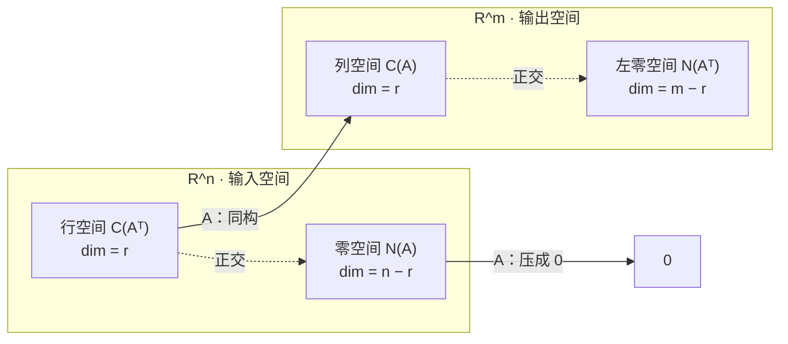
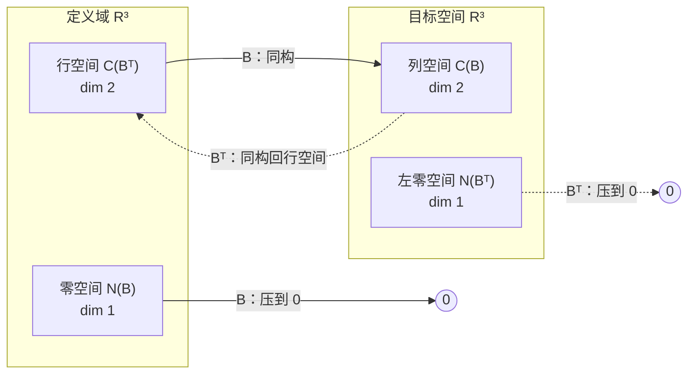

一个 $m\times n$ 矩阵天然带四个子空间，维数只由秩 $r$ 决定，基可以用一次消元全部读出；两对空间互为正交补，合起来铺满输入空间和输出空间。这就是线性代数基本定理。

## 四个空间的定义

| 空间 | 记号 | 定义 | 住在哪 |
| ---- | ---- | ---- | ---- |
| 列空间 | $C(A)$ | $A$ 各列的全部线性组合 | $\mathbb R^m$ |
| 零空间 | $N(A)$ | $\{x:Ax=0\}$ | $\mathbb R^n$ |
| 行空间 | $C(A^{\mathsf T})$ | $A$ 各行的全部组合 | $\mathbb R^n$ |
| 左零空间 | $N(A^{\mathsf T})$ | $\{y:A^{\mathsf T}y=0\}$ | $\mathbb R^m$ |

行空间就是「行的组合」，转置只是让行向量竖起来。左零空间的名字来自

$$
A^{\mathsf T}y=0\iff y^{\mathsf T}A=0^{\mathsf T},
$$

$y$ 从左边乘 $A$，它收集的是「哪些行组合给出零行」，即行与行之间的线性关系。

## 维数

设 $\operatorname{rank}A=r$：

$$
\boxed{\dim C(A)=r,\quad \dim C(A^{\mathsf T})=r,\quad
\dim N(A)=n-r,\quad \dim N(A^{\mathsf T})=m-r.}
$$

- $\dim C(A)=r$：$r$ 个主元列构成基。
- **行秩 = 列秩**：消元后 $R$ 有 $r$ 个非零行，无关且张成行空间；行变换不改变行空间。
- $\dim N(A)=n-r$：自由变量个数。
- $\dim N(A^{\mathsf T})=m-r$：把规则用在 $A^{\mathsf T}$ 上。

两两相加补满：

$$
r+(n-r)=n,\qquad r+(m-r)=m.
$$

## 四组基的算法

用同一个 $3\times4$ 矩阵：

$$
A=\begin{bmatrix}1&2&3&1\\1&1&2&1\\1&2&3&1\end{bmatrix},
\qquad
R=\begin{bmatrix}1&0&1&1\\0&1&1&0\\0&0&0&0\end{bmatrix},
$$

$m=3,n=4,r=2$。

| 空间 | 基 | 怎么来 | 本例 |
| ---- | ---- | ---- | ---- |
| $C(A)$ | $A$ 的主元列 | 消元定主元位置，回原矩阵取列 | 第 1、2 列 |
| $C(A^{\mathsf T})$ | $R$ 的前 $r$ 个非零行 | 行变换保持行空间 | $(1,0,1,1),(0,1,1,0)$ |
| $N(A)$ | 特解 | $Rx=0$ 回代 | $(-1,-1,1,0),(-1,0,0,1)$ |
| $N(A^{\mathsf T})$ | $E$ 的后 $m-r$ 行 | 解 $EA=R$ | $(-1,0,1)$ |

**列空间必须用原矩阵的主元列**。消元后的 $R$ 与 $A$ 列空间不同，但消元保持列与列之间的线性关系（「第 3 列 = 第 1 列 + 第 2 列」在两边都成立），所以原矩阵的主元列也无关并张成同样的列空间。

**行空间用 $R$ 的行**。行变换是行与行的组合，不会跑出行空间，所以 $C(A^{\mathsf T})=C(R^{\mathsf T})$。

> 对比记忆：**列空间用原矩阵的列，行空间用 $R$ 的行**。消元动的是行：行空间不变，列空间变了。

**左零空间借 Gauss-Jordan 的 $E$**。对 $[A\mid I]$ 消元：

$$
[A\mid I]\longrightarrow[R\mid E],\qquad EA=R.
$$

$E$ 记录全部行操作。它的最后 $m-r$ 行乘 $A$ 得到 $R$ 的零行，所以这些行就是左零空间的基。本例

$$
E=\begin{bmatrix}-1&2&0\\1&-1&0\\-1&0&1\end{bmatrix},
\qquad
N(A^{\mathsf T})=\operatorname{span}\{(-1,0,1)\}.
$$

验证：$-\text{row}_1+\text{row}_3=0$。也可以直接从 $A$ 看出第 3 行 = 第 1 行。

## 正交关系

$$
C(A^{\mathsf T})\perp N(A)\quad(\text{都在 }\mathbb R^n),
\qquad
C(A)\perp N(A^{\mathsf T})\quad(\text{都在 }\mathbb R^m).
$$

证明一行：若 $x\in N(A)$，则对每一行 $a_i^{\mathsf T}$ 有 $a_i^{\mathsf T}x=0$；行空间的任意向量是行的组合，也与 $x$ 正交。

更强的是互为**正交补**：

$$
\mathbb R^n=C(A^{\mathsf T})\oplus N(A),
\qquad
\mathbb R^m=C(A)\oplus N(A^{\mathsf T}).
$$



$A$ 只「看见」行空间，把它一一对应到列空间；零空间被压成原点。左零空间是输出端到不了的方向。

## 例子：全部信息

| 空间 | 维数 | 基 |
| ---- | ---- | ---- |
| $C(A)\subseteq\mathbb R^3$ | 2 | $(1,1,1),(2,1,2)$ |
| $N(A^{\mathsf T})\subseteq\mathbb R^3$ | 1 | $(-1,0,1)$ |
| $C(A^{\mathsf T})\subseteq\mathbb R^4$ | 2 | $(1,0,1,1),(0,1,1,0)$ |
| $N(A)\subseteq\mathbb R^4$ | 2 | $(-1,-1,1,0),(-1,0,0,1)$ |

正交性验收：$(1,1,1)\cdot(-1,0,1)=0$、$(2,1,2)\cdot(-1,0,1)=0$；行空间向量与两个零空间特解的内积也为 0。维度验收：$2+1=3=m$，$2+2=4=n$。

## 矩阵空间

$3\times3$ 矩阵全体 $M$ 也构成向量空间：矩阵能加、能乘数（此语境不关心矩阵乘法）。

**摊平**：按行排成 9 个数，$\operatorname{vec}(A)\in\mathbb R^9$，所以 $\dim M=9$。别和「矩阵的列空间维数」混淆：列空间维数是秩（$\le3$），矩阵空间维数是 9。**只有空间有维数。**

**基**：$E_{ij}$（只有 $(i,j)$ 位置为 1）。它们张成且无关，9 个基矩阵 ⇒ $\dim M=9$。**维数 = 基的个数 = 自由参数个数。**

**有约束就数自由位置**：

| 子空间 | 维数 | 一组基 | 约束 |
| ---- | ---- | ---- | ---- |
| 全体 $3\times3$ | 9 | $E_{ij}$ | 无 |
| 上三角 | 6 | $E_{ij},i\le j$ | 下三角 3 个位置为 0 |
| 严格上三角 | 3 | $E_{ij},i<j$ | 对角也全 0 |
| 对角 | 3 | $E_{11},E_{22},E_{33}$ | 非对角 6 个位置为 0 |
| 对称 $S$ | 6 | $E_{ii}$、$E_{ij}+E_{ji}$ | 3 对位置相等 |
| 反对称 $K$ | 3 | $E_{ij}-E_{ji}$ | 对角必为 0 |
| 迹为零 | 8 | — | $a_{11}+a_{22}+a_{33}=0$ |
| 对称且迹零 | 5 | — | 对称 6 维再减 1 |

两条公式：

$$
\dim(U+V)+\dim(U\cap V)=\dim U+\dim V,
\qquad
\dim\ker T+\dim\operatorname{im}T=\dim V.
$$

上三角 + 下三角 = 全体（9），交集 = 对角（3）：$6+6=9+3$。$\operatorname{tr}:M\to\mathbb R$ 的像 1 维，故迹零矩阵维数 $=9-1=8$。

```
M（dim 9）
├── 对称 S (6) ⊕ 反对称 K (3)                6 + 3 = 9
├── 上三角 U (6) + 下三角 L (6) = M           6 + 6 = 9 + 3
├── 迹为零 (8) = M 减去 1 个线性约束
└── 对称 ∩ 上三角 = 对角 (3)
```

**价值**：

- **矩阵方程摊平成普通线性系统**。Sylvester 方程 $AX+XB=C$ 变为 $(I\otimes A+B^{\mathsf T}\otimes I)\operatorname{vec}(X)=\operatorname{vec}(C)$，LU、最小二乘直接可用；Lyapunov、Riccati 同理。
- **参数计数就是数维数**。卷积的权重共享把参数限制在 Toeplitz / 块结构子空间；每加一条对称或共享约束，自由度就少几维。
- **几何自由度**：旋转矩阵有 9 个数，$R^{\mathsf T}R=I$ 给 6 个独立约束，故 $\dim SO(3)=9-6=3$，$\dim SE(3)=6$。
- **低秩结构**：秩恰为 $r$ 的矩阵集合对加法不封闭，不是子空间，但自由度是 $r(m+n-r)$；LoRA 用 $r(m+n)$ 个参数近似 $mn$。
- **Frobenius 内积** $\langle A,B\rangle=\operatorname{tr}(A^{\mathsf T}B)$ 把正交、投影、最小二乘搬到矩阵空间。
- **结构决定计算成本**：对称、带状、Toeplitz 消元时只处理非零结构，这是数值库单独提供 `symmetric` / `banded` / `sparse` 求解器的原因。
- **空间 → 代数**：一旦关心乘法，上三角矩阵乘上三角仍是上三角（子代数）；反对称矩阵的对易子仍反对称（李代数 $\mathfrak{so}(3)$）；正交矩阵乘正交仍是正交（群 $O(3)$）。

## 直观理解（3b1b）

- $A$ 在行空间上是可逆的：核只有 0，像正好是列空间，维数都是 $r$，所以是同构——「$A$ 有 $r$ 维有效信息通道」。
- 零空间是被压扁的方向：任意 $x$ 唯一拆成 $x=x_r+x_n$，$Ax=Ax_r$。只保留行空间分量，输出不变。
- 四个维数像收支表：输入端 $n$ 拆成「有效 $r$」+「被压掉 $n-r$」；输出端 $m$ 拆成「能到达 $r$」+「到不了 $m-r$」。
- 左零空间 = 输出端盲区：$y\in N(A^{\mathsf T})$ 与所有列正交，所以 $Ax=b$ 可解的必要条件是 $y^{\mathsf T}b=0$。

## 拓展延伸

- 伪逆 $A^{+}:C(A)\to C(A^{\mathsf T})$ 给出最小范数解；投影 $P=A(A^{\mathsf T}A)^{-1}A^{\mathsf T}$ 把 $b$ 投到 $C(A)$。
- SVD $A=U\Sigma V^{\mathsf T}$ 一次给出四个空间的正交基。
- 线性层 $W$ 的零空间是剪枝/压缩的切入口；LoRA 把增量限制在低秩子空间；有效秩持续下降是表示坍缩信号。
- 零空间方向改变输入但不改变输出，可用于构造对抗样本或做不变性分析。

## 习题课：B=LU 的四个基本子空间

**题目**：

$$
B=LU,\qquad
L=\begin{bmatrix}1&0&0\\2&1&0\\-1&0&1\end{bmatrix},\qquad
U=\begin{bmatrix}5&0&3\\0&1&1\\0&0&0\end{bmatrix},
$$

求 $C(B)$、$N(B)$、$C(B^{\mathsf T})$、$N(B^{\mathsf T})$ 的维数与一组基。**不要先把 $B$ 乘开。**

**三句话钥匙**：

- $L$ 单位下三角 ⇒ 可逆 ⇒ 左乘 $L$ 不改变零空间和行空间：$Bx=0\iff Ux=0$，$C(B^{\mathsf T})=C(U^{\mathsf T})$。
- $U$ 上三角 ⇒ 主元、秩、自由列一眼可见：主元 5、1，$\operatorname{rank}B=2$，第 3 列自由，$\dim N(B)=1$。
- $E=L^{-1}$ 仍是单位下三角，$EB=U$。$U$ 的零行对应的 $E$ 的行就是左零空间的基。

**为什么是 $E$ 而不是 $L$**：$L$ 是乘数账本（怎么从 $U$ 拼出 $B$），$E=L^{-1}$ 是操作记录（怎么把 $B$ 消成 $U$）；左零空间问「哪些行加起来为零」，是拆解动作，所以答案在 $E$。若只需要某一行，解 $L^{\mathsf T}y=e_i$ 即可，不必求整个 $L^{-1}$。

**逐项结果**：

- 列空间：$C(B)$ 的基是 $L$ 乘以 $U$ 的主元列。本题 $U$ 的主元列是 $5e_1,e_2$，故基为

$$
(1,2,-1)^{\mathsf T},\quad(0,1,0)^{\mathsf T}.
$$

严格说是「$L\cdot U$ 的主元列」；本题恰好看起来像 $L$ 的前两列。

- 零空间：解 $Ux=0$，$5x_1+3x_3=0,\ x_2+x_3=0$，取 $x_3=1$：

$$
N(B)=\operatorname{span}\{(-3/5,-1,1)^{\mathsf T}\}.
$$

- 行空间：$U$ 的主元行，

$$
C(B^{\mathsf T})=\operatorname{span}\{(5,0,3)^{\mathsf T},(0,1,1)^{\mathsf T}\}.
$$

- 左零空间：

$$
E=L^{-1}=\begin{bmatrix}1&0&0\\-2&1&0\\1&0&1\end{bmatrix},
\qquad
N(B^{\mathsf T})=\operatorname{span}\{(1,0,1)^{\mathsf T}\}.
$$

验证：$(1,0,1)B=(5,0,3)+(-5,0,-3)=0$。

**结果表**：

| 子空间 | 维数 | 一组基 | 从哪个因子读 |
| ---- | :--: | ---- | ---- |
| $C(B)$ | 2 | $(1,2,-1),(0,1,0)$ | $L\cdot U$ 的主元列 |
| $N(B)$ | 1 | $(-3/5,-1,1)$ | $U$：自由变量取 1 回代 |
| $C(B^{\mathsf T})$ | 2 | $(5,0,3),(0,1,1)$ | $U$ 的主元行 |
| $N(B^{\mathsf T})$ | 1 | $(1,0,1)$ | $L^{-1}$ 对应 $U$ 零行的那一行 |

两条守恒律：$2+1=3=n$，$2+1=3=m$。



**结论**：看到 $B=LU$，不要急着乘开。$L$ 可逆 ⇒ 零空间、行空间搬到 $U$ 上处理；$U$ 上三角 ⇒ 主元给秩、自由列给 $\dim N$、主元行给行空间；$L^{-1}$ 对应 $U$ 零行的那一行给左零空间；列空间是例外，只能取 $L$ 作用下 $U$ 主元列的像。**LU 分解把「算」变成了「读」。**

$C(B)\ne C(U)$：左乘可逆矩阵保持秩，但会把列空间整体扭一下；只有维数相同，空间本身不同。行空间则相反，行变换不改变行空间。

**三角矩阵为什么重要**：它是「已经解完」的形状——$\det T=\prod t_{ii}$，特征值就是对角元，前代/回代 $O(n^2)$；严格上三角幂零，上三角矩阵给出不变子空间链。LU、QR、Cholesky、Schur、Jordan 都在生产三角因子。

## 术语

| 英文 | 中文 | 含义 |
| ---- | ---- | ---- |
| four fundamental subspaces | 四个基本子空间 | $C(A),N(A),C(A^{\mathsf T}),N(A^{\mathsf T})$ |
| row space / left null space | 行空间 / 左零空间 | 行的组合 / $A^{\mathsf T}y=0$ 的解 |
| row rank = column rank | 行秩 = 列秩 | 两者都等于 $r$ |
| orthogonal complement | 正交补 | 与子空间所有向量正交的最大子空间 |
| direct sum $\oplus$ | 直和 | 每个向量唯一分解为两个分量之和 |
| matrix space | 矩阵空间 | 把矩阵当向量，$\dim M_{n\times n}=n^2$ |
| vectorization | 向量化 / 摊平 | 把矩阵排成长向量 |
| Frobenius inner product | Frobenius 内积 | $\langle A,B\rangle=\operatorname{tr}(A^{\mathsf T}B)$ |
| degrees of freedom | 自由度 | 子空间的维数 |

## 总结

每个 $m\times n$ 矩阵带四个子空间：列空间与左零空间在 $\mathbb R^m$，行空间与零空间在 $\mathbb R^n$；维数由秩完全决定——$r,r,n-r,m-r$。基的算法：列空间取原矩阵主元列，行空间取 $R$ 的非零行，零空间取特解，左零空间取 $E$ 的零行。两对空间互为正交补，$A$ 在行空间与列空间之间是同构、把零空间压成 0。**秩是唯一的关键数字。**